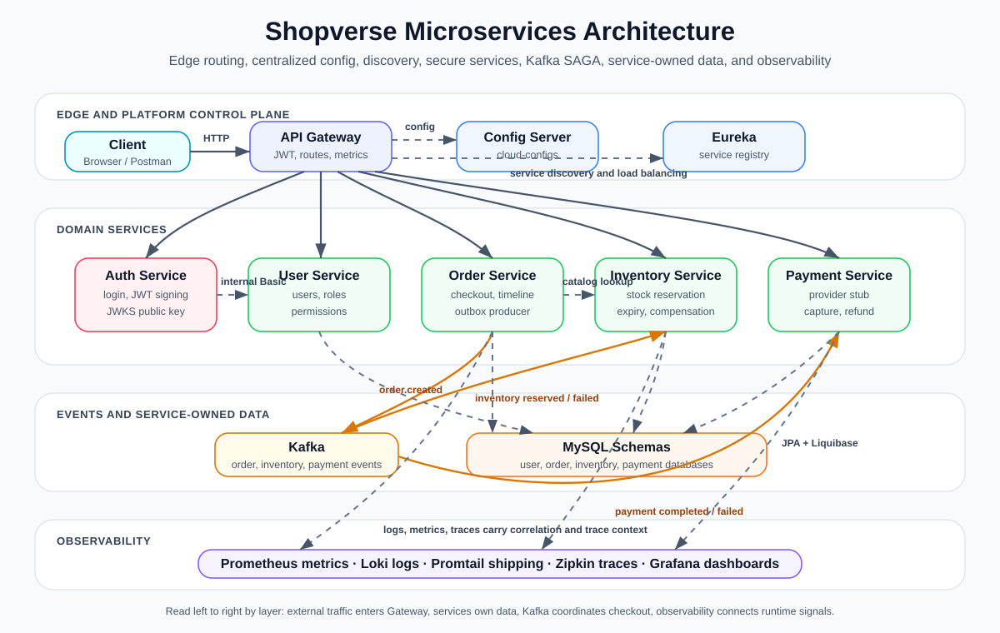
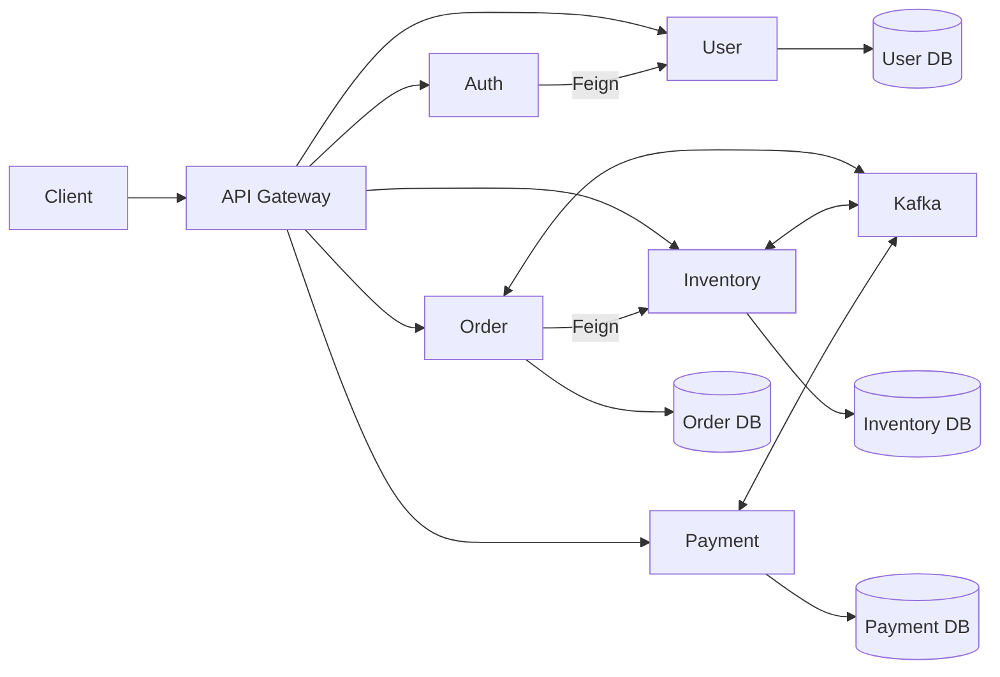

# Shopverse

[](https://github.com/taukhir/shopverse/actions/workflows/ci-backend.yml)
[](https://github.com/taukhir/shopverse/actions/workflows/ci-security.yml)
[](LICENSE)
[](https://github.com/taukhir/shopverse-docs/actions/workflows/docs-verify-publish.yml)
[](https://taukhir.github.io/shopverse-docs/)
[](https://taukhir.github.io/portfolio/shopverse-demo.html)


**Built by [Tauqeer Ahmed | taukhir](https://github.com/taukhir)**
[Portfolio](https://taukhir.github.io/portfolio/) · [Live Documentation](https://taukhir.github.io/shopverse-docs/) · [Static ShopVerse Demo](https://taukhir.github.io/portfolio/shopverse-demo.html) · [GitHub Profile](https://github.com/taukhir) · [LinkedIn](https://www.linkedin.com/in/tauqeer-ahmed-java) · [Resume](https://taukhir.github.io/portfolio/assets/Tauqeer-Ahmed-Resume.pdf)

Shopverse is an observable, failure-aware commerce microservices POC. It demonstrates secure, idempotent checkout across independently persisted Order, Inventory, and Payment services using Kafka choreography, transactional outbox, compensation, and end-to-end observability.

Runtime claims in this README describe the current local POC unless a section
explicitly says otherwise. The exact status of each capability is maintained in
the [Features and demonstrations](docs/reference/FEATURES-AND-DEMOS.md)
matrix using `Implemented`, `Implemented baseline`, `Partial`, and `Planned`
labels. Production hardening notes are roadmap or design guidance, not claims
that the current Compose stack is production-ready.



## Why This Repository Matters

Shopverse is the main proof artifact behind my portfolio. It is built to show
how I reason about backend architecture, not only how I write service code.

| Signal | What to inspect |
| --- | --- |
| **System design** | Gateway, discovery, config, service boundaries, database ownership, and event flow |
| **Reliability** | Idempotent checkout, outbox, Kafka retries, DLT persistence, replay audit, and compensation |
| **Security** | RSA-signed JWTs, JWKS validation, role/permission checks, and ownership authorization |
| **Operations** | Docker Compose, CI gates, structured logs, metrics, traces, dashboards, and runbooks |
| **Engineering maturity** | Service READMEs, [docs/](docs/README.md), ADRs, bounded tests, and failure-mode demos |

## Status Model

| Label | Meaning |
|---|---|
| `Implemented` | Code and configuration exist and are demonstrable in the local POC. |
| `Implemented baseline` | A working baseline exists, with known scale, automation, or hardening gaps. |
| `Partial` | The core behavior exists, but important correctness, automation, or production-readiness work remains. |
| `Planned` | Roadmap, study material, or target design; not current runtime behavior. |

When this README summarizes a broad capability, treat the implementation
matrix as the source of truth for the precise status and evidence.

## Fast Reviewer Path

If you only have a few minutes, review these in order:

1. [Live documentation site](https://taukhir.github.io/shopverse-docs/)
2. [Static ShopVerse demo](https://taukhir.github.io/portfolio/shopverse-demo.html)
3. [Architecture diagram](docs/img/diagrams/shopverse-architecture-flow.svg)
4. [Checkout example](#checkout-example)
5. [Architecture decisions](#architecture-decisions)
6. [Features and demonstrations](docs/reference/FEATURES-AND-DEMOS.md)
7. [End-to-end demo runbook](docs/case-study/COMPLETE-DEMO.md)
8. [GitHub Actions workflow guide](.github/workflows/README.md)

## What This Demonstrates

- Designing service boundaries around ownership and failure isolation
- Handling distributed checkout without a single shared transaction
- Making asynchronous work queryable through order timelines and audit tables
- Using security and observability as part of the architecture, not as add-ons
- Keeping local development repeatable through Compose, seeded data, and runbooks
- Validating behavior through unit, integration, container, and smoke-test layers

## Architecture



The Config Server centralizes runtime configuration, Eureka provides service discovery, and the observability stack combines Prometheus, Grafana, Loki, Promtail, Micrometer Tracing, and Zipkin.

## Architecture Decisions

| Decision | Why it matters | ADR |
| --- | --- | --- |
| API Gateway, Eureka, and Config Server | Keeps edge routing, discovery, and runtime configuration explicit and reviewable | [ADR 001](docs/architecture/adr/001-gateway-discovery-config.md) |
| Kafka choreography SAGA | Avoids distributed transactions while keeping checkout failure paths observable | [ADR 002](docs/architecture/adr/002-kafka-choreography-saga.md) |
| JWT and JWKS security model | Lets services validate tokens without sharing signing secrets | [ADR 003](docs/architecture/adr/003-jwt-jwks-security.md) |
| Observability by default | Makes local POC and production-shaped behavior diagnosable across services | [ADR 004](docs/architecture/adr/004-observability-stack.md) |
| Multi-item checkout event contract | Scopes the single-item checkout limitation and the planned event-schema redesign | [ADR 005](docs/architecture/adr/005-multi-item-checkout-event-contract.md) |

## Core Capabilities

The list below is intentionally high level. Some items are complete in the POC,
some are implemented baselines, and some have hardening work documented in the
implementation matrix.

- RSA-signed JWT access tokens, JWKS, expiry validation, roles, permissions, and ownership authorization
- API Gateway routing, service discovery, Spring Cloud LoadBalancer, and Feign clients
- independent MySQL schemas managed by Liquibase and Spring Data JPA
- idempotent checkout with immutable shipping-address snapshots and persistent order timeline
- optimistic inventory locking, reservation expiry, cancellation release, and payment compensation
- customer account address book and persisted customer cart
- customer/admin order cancellation, payment retry/refund APIs, return request, and fulfillment transitions
- public inventory catalog, product detail, category, related-product, and MinIO image metadata APIs
- Kafka choreography with retries, DLT persistence, replay audit, and transactional outbox
- annotation-based Resilience4j RateLimiter, Bulkhead, Retry, CircuitBreaker, and fallback
- structured JSON logs, correlation propagation, Prometheus metrics, Grafana dashboards, and Zipkin traces
- JUnit, Mockito, Spring test slices, Testcontainers, and bounded verification modes
- Docker Compose, GitHub Actions, and Jenkins pipelines

Run the POC with the [complete Shopverse demo](docs/case-study/COMPLETE-DEMO.md).
The exact implementation matrix is in [Features and demonstrations](docs/reference/FEATURES-AND-DEMOS.md).

## Services

| Service | Port | Responsibility |
|---|---:|---|
| API Gateway | 8080 | routing, edge security, correlation, metrics |
| Auth Service | 8081 | login, JWT signing, JWKS |
| User Service | 8082 | users, roles, permissions, account addresses, persisted carts, internal authentication |
| Order Service | 8083 | checkout, ownership, SAGA timeline, cancellation, fulfillment, returns |
| Payment Service | 8084 | payment state, intent, retry, reconciliation, refund, webhook baseline |
| Inventory Service | 8086 | public catalog, product detail, stock, reservations, expiry, cancellation compensation |
| Discovery Server | 8761 | Eureka registry |
| Config Server | 8888 | centralized configuration |
| Angular Storefront | 4200 | customer/admin web UI served by nginx in Docker |

## Quick Start

Prerequisites:

- Docker Desktop with Docker Compose v2
- Git
- Java 21 and Node.js 20+ only when running services or the web frontend outside Docker
- at least 8 GB memory available to Docker for the complete local stack

Create a local `.env` from the repository template, validate the Compose model,
then start:

```powershell
Copy-Item .env.example .env
docker compose --profile apps --profile assets config --quiet
docker compose --profile apps --profile assets up --build -d
docker compose ps
```

Replace placeholder values in `.env` before exposing the stack beyond a local
POC. Wait until Config Server, Discovery Server, MySQL, and application
containers report healthy before testing checkout.

Use the API Gateway for application requests:

```text
http://localhost:8080
```

Key interfaces:

| Tool | URL |
|---|---|
| Eureka | `http://localhost:8761` |
| Config Server | `http://localhost:8888` |
| Grafana | `http://localhost:3000` |
| Prometheus | `http://localhost:9090` |
| Zipkin | `http://localhost:9411` |

Docker configuration and command explanations are in [infra/docker/README.md](infra/docker/README.md).

## Docker Compose Modes

The root [docker-compose.yml](docker-compose.yml) remains the backend platform
compose file. The optional [docker-compose.full-stack.yml](docker-compose.full-stack.yml)
overlay adds the Angular storefront container.

Backend platform only:

```powershell
Copy-Item .env.example .env
docker compose --profile apps --profile assets config --quiet
docker compose --profile apps --profile assets up --build
```

Full stack with Angular, backend services, and MinIO product assets:

```powershell
Copy-Item .env.example .env
docker compose --profile apps --profile assets -f docker-compose.yml -f docker-compose.full-stack.yml config --quiet
docker compose --profile apps --profile assets -f docker-compose.yml -f docker-compose.full-stack.yml up --build
```

Full stack plus observability:

```powershell
docker compose --profile apps --profile assets --profile observability -f docker-compose.yml -f docker-compose.full-stack.yml config --quiet
docker compose --profile apps --profile assets --profile observability -f docker-compose.yml -f docker-compose.full-stack.yml up --build
```

Useful URLs:

| Interface | URL | Notes |
|---|---|---|
| Angular storefront/admin | `http://localhost:4200` | nginx serves Angular and proxies `/api` and `/auth` to `api-gateway:8080` |
| API Gateway | `http://localhost:8080` | backend entry point |
| MinIO Console | `http://localhost:9001` | enabled by the `assets` profile |
| Eureka | `http://localhost:8761` | service registry |
| Grafana | `http://localhost:3000` | enabled by the `observability` profile |
| Prometheus | `http://localhost:9090` | enabled by the `observability` profile |
| Zipkin | `http://localhost:9411` | traces |

Optional frontend port override in `.env`:

```dotenv
SHOPVERSE_WEB_PORT=4200
```

Compose profiles:

| Profile | Adds |
|---|---|
| `apps` | Spring Boot application services and API Gateway |
| `assets` | MinIO and product-image seeding |
| `observability` | Prometheus, Grafana, Loki, and Promtail |

Troubleshooting:

- If `http://localhost:4200` loads but catalog/auth calls fail, check that
  `api-gateway` is healthy: `docker compose ps api-gateway`.
- If product images are missing, start with `--profile assets` and verify
  `minio-init` completed successfully.
- If Angular route refreshes return `404`, confirm the container is using
  [shopverse-web/nginx.conf](shopverse-web/nginx.conf); it falls back to
  `index.html` for client-side routes.
- If starting only `shopverse-web` after the backend is already running fails
  with `service "shopverse-web" depends on undefined service "api-gateway"`,
  the `--profile apps --profile assets` flags were omitted. `shopverse-web`
  has no profile itself but depends on `api-gateway`, which is gated behind
  `apps`; without that profile active, Compose excludes `api-gateway` from the
  project model entirely. Always include both profile flags, even when
  targeting `shopverse-web` on its own:
  `docker compose --profile apps --profile assets -f docker-compose.yml -f docker-compose.full-stack.yml up --build -d shopverse-web`.

## Five-Minute Local Evaluation

Use this path when you want to verify the architecture without reading every
service first:

```powershell
Copy-Item .env.example .env
docker compose --profile apps --profile assets config --quiet
docker compose --profile apps --profile assets up -d mysql mysql-bootstrap kafka minio minio-init config-server discovery-server user-service auth-service order-service payment-service inventory-service api-gateway
docker compose ps
```

Then:

1. Open Eureka at `http://localhost:8761` and confirm services are registered.
2. Log in through `POST /auth/login`.
3. Submit the [checkout request](#checkout-example) through the gateway.
4. Query the order timeline to observe SAGA state changes.
5. Open Zipkin/Grafana/Prometheus to inspect traces, metrics, and service health.

## MySQL Local Data

Compose exposes MySQL on host port `3307`; containers use `mysql:3306`.
Shopverse maintains separate schemas:

| Schema | Owner |
|---|---|
| `user_service` | users, roles, permissions, authentication support |
| `order_service` | orders, line items, timeline, outbox, DLT recovery |
| `inventory_service` | catalog, stock, reservations, outbox, DLT recovery |
| `payment_service` | payments, outbox, DLT recovery |

Liquibase and the local API seeder create a realistic baseline data set:

- `admin`, `customer1`, and `customer2` from Liquibase;
- realistic catalog products `101` through `120` with brand, model, category,
  descriptions, stock, pricing, and MinIO-backed image references;
- optional API-seeded customer accounts and orders for dashboard/order-history
  testing.

Reset the local stack to clean volumes and seed the current baseline through
the APIs:

```powershell
powershell -NoProfile -ExecutionPolicy Bypass -File .\scripts\Reset-ShopverseLocalData.ps1 `
  -CustomerCount 20 -ProductCount 20 -OrderCount 50
```

The reset removes local Compose volumes, starts a fresh stack, waits for
`/actuator/shopverse-readiness`, then creates 20 customer accounts, upserts 20
catalog products, and creates 50 idempotent checkout orders.

Local account passwords are in the Git-ignored
`shopverse-local-credentials.md`. Customer passwords are stored as delegated BCrypt
hashes. Production credentials still belong in managed secret and identity
systems rather than repository documentation.

Order Service uses a bounded Caffeine cache for the browse catalog. The default
TTL is 60 seconds and can be overridden with
`ORDER_SERVICE_CACHE_TTL_SECONDS`. After admin product upserts, refresh the
Order catalog view with `POST /api/v1/orders/admin/catalog-cache/evict`; the
API seed script does this automatically. Checkout validates requested products
through a direct Inventory lookup rather than relying on the cached browse
catalog. Checkout also stores a shipping address snapshot on the order so
later account-address edits do not mutate historical order records.

Inspect all schemas:

```powershell
docker compose exec mysql sh -lc '
  MYSQL_PWD="$MYSQL_ROOT_PASSWORD" mysql -uroot -e "
    SHOW DATABASES LIKE \"%_service\";
  "
'
```

The [complete Shopverse demo](docs/case-study/COMPLETE-DEMO.md)
contains SAGA, timeline, outbox, inventory, payment, and correlation queries.

## Checkout Example

First obtain a token from `POST /auth/login`, then create a checkout and
place the order from it:

```http
POST /api/v1/checkouts
Authorization: Bearer <token>
Content-Type: application/json

{
  "shippingAddress": {
    "recipientName": "Ahmed Khan",
    "phoneNumber": "+919876543210",
    "line1": "42 Market Road",
    "line2": "Apt 5",
    "city": "Bangalore",
    "state": "Karnataka",
    "postalCode": "560001",
    "country": "India"
  },
  "items": [
    {
      "productId": 101,
      "quantity": 1
    }
  ]
}
```

```http
POST /api/v1/checkouts/{checkoutId}/place-order
Authorization: Bearer <token>
Idempotency-Key: checkout-user-42-cart-9001
X-Correlation-Id: demo-checkout-9001
Content-Type: application/json

{ "checkoutVersion": 1 }
```

See [services/order-service/README.md](services/order-service/README.md) for
the full checkout flow and conflict semantics.

The request persists Order state, the shipping snapshot, and an outbox event in
one transaction. Kafka then drives Inventory and Payment asynchronously. Query
`/api/v1/orders/{id}/timeline` to inspect the business journey.

## Current Customer and Operations APIs

Recently implemented runtime surfaces include:

| Area | Endpoints |
|---|---|
| Customer account | `GET/PUT/PATCH /api/v1/users/me`, `GET/POST/PUT/DELETE /api/v1/users/me/addresses` |
| Persisted cart | `GET /api/v1/cart`, `PUT /api/v1/cart`, `POST /api/v1/cart/merge`, `POST /api/v1/cart/validate`, `DELETE /api/v1/cart/items/{productId}` |
| Public catalog | `GET /api/v1/inventory/public/items`, `GET /api/v1/inventory/public/items/{productId}`, `GET /api/v1/inventory/public/categories`, `GET /api/v1/inventory/public/items/{productId}/related`; admin image upload through `POST /api/v1/inventory/admin/items/{productId}/image` |
| Order actions | `POST /api/v1/orders/{id}/cancel`, `POST /api/v1/orders/{id}/return-request` |
| Admin fulfillment | `POST /api/v1/orders/admin/{id}/pack`, `POST /api/v1/orders/admin/{id}/ship`, `POST /api/v1/orders/admin/{id}/deliver`, `POST /api/v1/orders/admin/{id}/cancel`, `POST /api/v1/orders/admin/catalog-cache/evict` |
| Payments | `POST /api/v1/payments/intent`, `POST /api/v1/payments/orders/{orderNumber}/retry`, `POST /api/v1/payments/orders/{orderNumber}/refund`, `GET /api/v1/payments/orders/{orderNumber}`, `POST /api/v1/payments/webhooks/provider` |
| Admin audit | `GET /api/v1/admin/audit-events`, `GET /api/v1/admin/audit-events/{id}` |

Cross-service audit event publishing, payment provider webhook signature
verification, refund audit depth, and inventory-aware cart validation remain
hardening items.

## AI-Assisted Engineering

Shopverse includes repository-owned guidance for using Codex, Claude Code, or
another approved coding assistant. These are developer productivity capabilities;
they are not runtime AI features exposed to Shopverse customers.

| Capability | Source |
|---|---|
| durable architecture, safety, and verification rules | [`AGENTS.md`](AGENTS.md) |
| Claude Code project entry point | [`CLAUDE.md`](CLAUDE.md) |
| service-specific rules | nested `AGENTS.md` and `CLAUDE.md` where available |
| reusable implementation, debugging, security, performance, UX, docs, and incident prompts | [`dev-tools/ai-workflows/`](dev-tools/ai-workflows/README.md) |
| deterministic evaluation scenarios and scoring | [`dev-tools/ai-workflows/evals/`](dev-tools/ai-workflows/evals/README.md) |
| complete learning track and practical workbook | [AI-assisted development docs](https://taukhir.github.io/shopverse-docs/ai/AI-ASSISTED-SDLC-DEVELOPER-PRODUCTIVITY) |

Start a task by choosing the smallest relevant prompt, completing the
[task-context template](dev-tools/ai-workflows/templates/task-context.md), and giving the
assistant explicit read/write authority. Generated code is not completion:
review the diff, run focused and broader checks, and record evidence and residual
risk. Never provide secrets, payment data, customer-sensitive information, or
unapproved production content to an AI tool.

Service-level AI capabilities, coverage gaps, and site-native README mirrors are
tracked in the [service README and AI capability matrix](docs/services/SERVICE-README-AI-CAPABILITY-GAP-MATRIX.md).

## Documentation

Shopverse-specific documentation (case study, architecture decisions, system
design, the implementation status matrix) lives in this repository under
[docs/](docs/README.md) as plain Markdown, reviewable directly on GitHub.

The generic backend-engineering knowledge base this case study sits inside
(Java, Spring, Kafka, databases, security, AI, interview prep, and more) is a
separate Docusaurus site in its own repository,
[taukhir/shopverse-docs](https://github.com/taukhir/shopverse-docs),
published at [taukhir.github.io/shopverse-docs](https://taukhir.github.io/shopverse-docs/). Generic
engineering guides there explain reusable production practices; the
[case study](docs/README.md) here states which of those practices are
actually implemented in this repository and which remain planned.

## Frontend Automation

Run the Angular storefront gate from the repository root:

```powershell
.\infra\scripts\Test-ShopverseSites.ps1 -Target Web -Mode Full -TimeoutMinutes 30
```

`-Target Docs` and `-Target All` still exist for compatibility but no longer
run anything: the Docusaurus documentation site moved to its own repository,
[taukhir/shopverse-docs](https://github.com/taukhir/shopverse-docs), which has
its own CI. Verify documentation changes there instead.

Run real Docker-backed integration only when you need release confidence:

```powershell
.\scripts\Test-ShopverseFullStack.ps1 -Mode Smoke -TimeoutMinutes 35
.\scripts\Test-ShopverseFullStack.ps1 -Mode Full -TimeoutMinutes 45 -KeepStack
```

API Gateway also exposes a stronger production readiness contract:

```powershell
curl.exe http://localhost:8080/actuator/shopverse-readiness
```

It returns HTTP `200` only when required discovery registrations, gateway
routes, downstream service health, baseline catalog data, and configured MiniIO
product image objects are ready. The full-stack smoke gate validates this
endpoint automatically.

Run the structured go-live checklist when you want one release report:

```powershell
.\scripts\Test-ShopverseRelease.ps1 -Mode Full -TimeoutMinutes 60
```

For a faster orchestration check without Docker:

```powershell
.\scripts\Test-ShopverseRelease.ps1 -Mode Quick -SkipFullStack -SkipBrowsers
```

If PowerShell script execution is locked down locally, use:

```powershell
powershell -NoProfile -ExecutionPolicy Bypass -File .\infra\scripts\Test-ShopverseSites.ps1 -Target Web -Mode Quick -SkipBrowsers
```

The web gate runs Angular development and production builds, Angular
unit/component tests, mocked Playwright E2E flows, axe accessibility checks, and
a Lighthouse budget against the production build.
The release checklist combines the web gate and the Docker-backed full-stack
gate, then writes a JSON report to `testing/reports/shopverse-release-report.json`.
The GitHub Actions workflow
[ci-web.yml](.github/workflows/ci-web.yml) runs the web checks on frontend
changes. Documentation has its own verification and publication workflow in
the shopverse-docs repository.
The full-stack gate starts an isolated Compose project, publishes API Gateway
on `http://127.0.0.1:18080` and Angular on `http://127.0.0.1:14200`, then runs
API SAGA smoke plus a real browser smoke through the nginx-served Angular app.

| Area | Guide |
|---|---|
| Complete demo | [End-to-end Shopverse runbook](docs/case-study/COMPLETE-DEMO.md) |
| Architecture | [System design](docs/architecture/SYSTEM-DESIGN.md) |
| Distributed systems | [Fundamentals](https://taukhir.github.io/shopverse-docs/architecture/DISTRIBUTED-SYSTEMS-GENERIC), [CAP and consistency](https://taukhir.github.io/shopverse-docs/architecture/DISTRIBUTED-CONSISTENCY-CAP), and [interview questions](https://taukhir.github.io/shopverse-docs/reference/DISTRIBUTED-SYSTEMS-INTERVIEW) |
| Features | [Features and demos](docs/reference/FEATURES-AND-DEMOS.md) |
| APIs | [Shopverse API guide](docs/development/API-GUIDE.md) and [REST design](https://taukhir.github.io/shopverse-docs/development/REST-API-GENERIC) |
| Security | [JWT, OAuth2, and Spring Security](https://taukhir.github.io/shopverse-docs/security/JWT-OAUTH2-SPRING-SECURITY) |
| Messaging | [Apache Kafka](https://taukhir.github.io/shopverse-docs/integration/APACHE-KAFKA), [Spring Kafka](https://taukhir.github.io/shopverse-docs/spring/SPRING-KAFKA), and [SAGA walkthrough](docs/case-study/DEMO-SEED-CHECKOUT-SAGA.md) |
| Observability | [Observability architecture](https://taukhir.github.io/shopverse-docs/observability/OBSERVABILITY) and [Shopverse operations](docs/observability/SHOPVERSE-OBSERVABILITY-OPERATIONS.md) |
| Data | [Database engineering](https://taukhir.github.io/shopverse-docs/data/DATABASE-ENGINEERING), [Hibernate](https://taukhir.github.io/shopverse-docs/data/HIBERNATE), [Liquibase](https://taukhir.github.io/shopverse-docs/data/LIQUIBASE-GENERIC), [Spring transactions](https://taukhir.github.io/shopverse-docs/spring/SPRING-TRANSACTIONS), and [caching principles](https://taukhir.github.io/shopverse-docs/architecture/CACHING-GENERIC) |
| Testing | [Shopverse testing](https://taukhir.github.io/shopverse-docs/development/TESTING) and [Spring Boot testing](https://taukhir.github.io/shopverse-docs/spring/SPRING-BOOT-TESTING) |
| Troubleshooting | [Debugging guide](https://taukhir.github.io/shopverse-docs/development/DEBUGGING) |

Service-specific APIs and configuration remain in each service README. Operational guides remain beside their deployment files:

- [Centralized configuration](services/config-server/README.md)
- [Observability deployment](infra/observability/README.md)
- [Docker](infra/docker/README.md)
- [Jenkins](dev-tools/jenkins/README.md)
- [GitHub Actions](.github/workflows/README.md)
