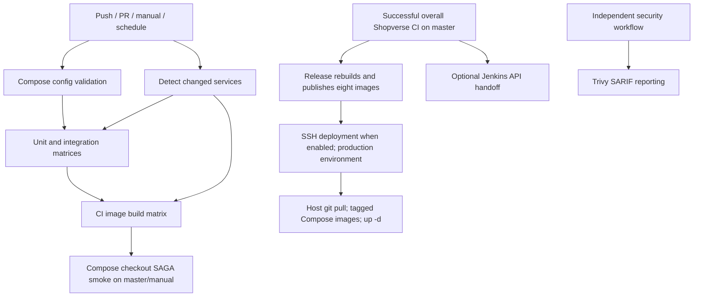

# CI pipeline change impact analysis

Date: 2026-11-05, Asia/Calcutta. Scope: proposed changes in
[ci-pipeline-review.md](ci-pipeline-review.md), rechecked against revision
`defaefc912435b53e749a45c72706be4f9c16c1d` and the current working tree.
Implementation remains user-led. Only this analysis and continuity records changed.

## Outcome

Selection fixes have broad verification coverage but low application impact.
Security gates and artifact promotion have high operational impact because they
change release eligibility and deployment of all eight services. Naming changes
are manageable only when their consumers migrate together. Application downtime
is not expected from a workflow-only rename or selection fix (inference), but
deployment behavior changes require a separate rollout and recovery rehearsal.

The earlier review is historical evidence: action versions, Docker Java images
and build toolchains have advanced since its recorded revision. Findings below
were checked against current source rather than assuming that baseline persists.

## Current connected flow

The CI-completion trigger represents the overall workflow result, not only the
smoke job. Security has no gating edge into release. Manual dispatch is also a
separate entry to release and Jenkins. CI smoke uses a disposable Compose test
stack; it is not a post-deployment production verification.

Evidence: `ci.yml:70-152,154-283,297-329`, `deploy.yml:4-16,32-34,91-144`,
`jenkins-trigger.yml:4-16,29,47-71`, `security.yml:63-90`, all under
`.github/workflows/`. Jenkins returns after submitting a build request; the
trigger script does not wait for Jenkins completion or establish deployment success.

## Change impact matrix

| Proposed change | Direct scope and downstream effect | Risk and acceptance |
|---|---|---|
| Explicit full-run selection and root `gradle/` detection | `ci.yml` change detector and all matrix consumers. Full verification selects 8 unit, 3 integration and 8 image jobs. Existing service-only selection can remain selective. | Low runtime impact; increased CI workload compared with current skipped work. Accept only with event/path fixtures, failed-diff fallback and unchanged matrix output schema. |
| Include Docker context control files in detection | Root `.dockerignore` affects root-context image builds, but is absent from the shared-path expression. Root catalog and Checkstyle inputs similarly affect builds/checks. | Audit actual inputs; `.dockerignore` should trigger image validation. A conservative all-service run is simpler initially; refine only with evidence. |
| Explicit shared-module tests and enforced static analysis | `shopverse-common`, build conventions and their service consumers; current `test` commands and `ignoreFailures` policy. Seven services include common; all eight include build-logic. API Gateway does not currently include common. | Medium delivery risk: newly enforced checks may reveal existing failures. Establish the baseline and separate common verification from service compilation; no arbitrary coverage target. |
| Stable CI gate and security release policy | CI prerequisites, independent security workflow, release publication and Jenkins trigger; remote branch rules also need inspection. | High delivery impact: previously releasable commits may block. Match results to source SHA; failed/cancelled/missing required checks reject; intentional no-change skips require proven selection. |
| Build once, promote service digests | CI/security/release image transport, registry permissions, release metadata and eight entries in `docker-compose.deploy.yml`. | High deployment impact. Each service has its own digest: one shared `IMAGE_TAG` cannot represent eight digest identities. Create a complete manifest with source SHA and per-service references; define handling of unchanged services. |
| Source-bound deployment and readiness/rollback | SSH script, host checkout, Compose configuration, protected environment and smoke checks. Current host runs `git pull`, then `pull`, `up -d`, `ps`. | High operational impact. Validate candidate readiness and rehearsed recovery on a disposable environment first; image rollback does not reverse database migrations. No migration is proposed by this CI task. |
| Repair Jenkins paths/source binding | Shared Jenkinsfile and User/Order/Discovery pipelines, root build context, API parameter contract and local runbook. | Medium if optional/unconfigured; high for active Jenkins users. Pass source identity independently of image tag. A successful HTTP trigger is not a successful Jenkins build. |
| SHA pins, job-specific permissions, explicit timeouts | All action call sites and jobs with broader permissions or missing bounds. | Medium delivery risk: insufficient rights or unsupported action runtime can break publication/upload. Verify reviewed pins and each job's real permission needs; do not change secret values. |
| Workflow/file/job naming and concurrency | Two name-based consumers, seven exact self-path filters, README badges, operations/testing documentation and potentially remote required checks. | Low application impact, medium automation risk. Update references atomically; validate remote checks before relying on new names. Keep deployment serialization distinct from cancellable PR verification. |

Evidence for build scope: `services/*/settings.gradle`;
`build-logic/src/main/groovy/io.shopverse.java-service-conventions.gradle:15-17,40-47`;
`shopverse-common/build.gradle:21`;
`services/order-service/Dockerfile:6-14`; `.dockerignore`;
`docker-compose.deploy.yml:1-25`. The impact of changes to shared build-logic is
broader than the dependency impact of any particular common submodule.

## Naming migration dependencies

1. Changing the display name `Shopverse CI` requires updating BOTH
   `deploy.yml:6` and `jenkins-trigger.yml:6`. Filename changes alone do not
   update these display-name subscriptions.
2. Filename-based self-filters occur seven times across `docs-site.yml`,
   `docs-visual-regression.yml`, `frontend-sites.yml` and `java-senior-labs.yml`.
3. Root `README.md:3-6` has CI, security and documentation badge/action URLs;
   `README.md:496` links the frontend workflow. Update the workflow guide,
   `dev-tools/testing/README.md:291`,
   `documentation/docs/operations/GITHUB-ACTIONS.md:149-152`,
   `documentation/docs/development/TESTING-MODES-CI-TRIAGE.md:155`, and the
   Docusaurus deployment/authoring pages found by the reference search.
4. Renaming job IDs requires updating `needs` and `needs.<id>` expressions.
   Renaming output step `detect` requires updating `steps.detect.outputs`.
   Avoid changing these IDs simply to obtain better display names.
5. Remote branch/ruleset checks, callers outside the repository and scripted
   workflow dispatchers may depend on names or paths. These dependencies are
   unverified, not confirmed absent. Keep old required checks until replacement
   checks have been observed and a coordinated ruleset change is ready.
6. Renaming `frontend-sites.yml` to `ci-web.yml` does not split execution: it
   currently verifies both Web and Docs via `Test-ShopverseSites.ps1 -Target All`.
   Prefer `ci-sites.yml` / `ShopVerse / CI / Sites` for a naming-only change;
   splitting into independent jobs is a separate behavioral change.
7. Keep image repository names, Compose service names, SARIF categories and
   service cache scopes stable during naming work. They are not workflow labels.

## Additional observations and boundaries

- CI still sets `JAVA_VERSION: "21"` (`ci.yml:22`), while service conventions
  and common request Java 25. Current settings configure Foojay toolchain
  resolution and the Order Dockerfile uses Java 25. This may build successfully
  through toolchain provisioning; it adds download/cache/network dependencies.
  Confirm the intended CI launch JDK and compiler JDK rather than declaring a
  failure from the differing numbers. No JDK migration is performed here.
- The pipeline currently treats every workflow-file change as shared. A naming
  migration therefore selects all services, in addition to whichever docs/web
  workflows their path filters activate. Exact runner minutes are unmeasured.
- `.github/workflows/deploy.yml` publishes all eight images even after a
  service-only CI run. A new release gate must explicitly define validation of
  rebuilt unchanged services, or promotion from a previously verified manifest.
- A release gate should not accidentally make GitHub Pages publication or
  unrelated documentation labs prerequisites for backend production release.
- The proposed CI fixes do not require REST DTO, Kafka schema, business state,
  database ownership or Liquibase changes. Digest promotion must preserve the
  existing application/configuration compatibility constraints.
- Reusing `Smoke-Test.ps1` against production would be a material behavior
  change: the script authenticates and creates checkout business state
  (`infra/scripts/Smoke-Test.ps1:18-28,55,79-104`). Design a safe dedicated
  environment/account/data policy before using it as a deployment probe.
- BACKLOG BUG-009 records the diff-crash fallback as Fixed. Current source
  catches the error but still does not select the intended services. Preserve
  this distinction when reconciling status; the backlog was not edited here.

## Safe rollout and recovery sequence

1. Implement detector/input fixes independently of names. Preserve output
   contracts; verify manual, scheduled, first-push, failed-diff, root Gradle,
   Docker context, shared, service-only and docs-only fixtures.
2. Add shared checks and stable gate; validate policy using controlled failing,
   cancelled and missing results. Establish baseline evidence before enforcing
   existing static findings. Coordinate remote required checks separately.
3. Design and rehearse manifest/digest promotion in a disposable environment.
   Verify per-service digest identity, source/config identity, readiness and
   previous-release recovery. Do not rerun application transactions on production
   merely to validate the pipeline.
4. Repair active Jenkins consumers, then migrate naming/reference changes as a
   separate coherent change. Confirm both downstream subscriptions and badge URLs.
5. Revert selection/naming changes through source control if needed; coordinate
   any required-check rollback so merging remains possible. Do not recover a
   failed gate by silently disabling security. Retain the previous verified
   release manifest; database compatibility still constrains application rollback.

## Validation performed and remaining evidence

- Read current workflow graph, Compose image references, Docker context,
  Gradle settings, Jenkins and smoke handoffs; searched tracked source/docs
  references with `rg`. Ten workflows parsed with installed `js-yaml` via Node.
- Checked all 14 local `needs` edges resolve. Static rename simulation showed
  two stale upstream subscriptions if the CI display name changes alone; counted
  seven exact self-path filters and eight tag-based deployment entries.
- Confirmed current detector still has the unmatched full-run marker. The
  previous review's five failing selection fixtures were not re-executed in
  this analysis; this pass verified their relevant source remains unchanged.
- No Gradle, browser, Docker, integration, workflow or Jenkins execution; no
  live GitHub settings, security baseline, runner cost or downtime measurement.
  YAML/dependency checks do not establish Actions expression/schema validity.
- Existing package manifest/lockfile, wrapper and Order-analysis changes were
  preserved. Only CI analysis and append-only continuity entries were added.

Decisions still needed: release security exception policy, required checks,
Jenkins's long-term role, artifact retention/access, JDK provisioning policy and
protected environment rollout. Tauqeer owns implementation; no external changes
or deployments are authorized by this impact-analysis request.
