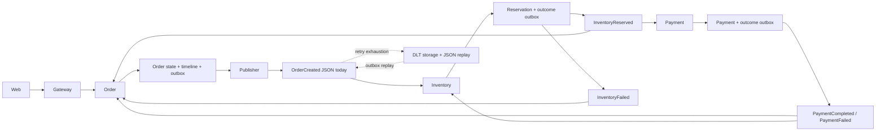

# Order contracts: impact analysis before implementation

2026-11-05 (Asia/Calcutta). Static source inspection at `defaefc9` with existing working-tree changes. Requested by Tauqeer. Proposed implementation plan; no application changes or operational cutover authorized by this analysis. Read alongside [order-contract-review.md](order-contract-review.md). Repository references below are relative to this file.

## Outcome and scope

Adopting the REST models is already wired into OrderController. Completing contract enforcement needs HTTP/mapping regression tests and drift checks. Adopting Avro affects Order, Inventory, shared publishing/recovery, configuration, local infrastructure and CI. Payment is indirectly affected by the pilot, and directly affected if shared defaults or downstream event contracts change.

Recommended first increment: preserve the present single-item HTTP behavior and migrate only OrderCreated transport. Inventory can adapt a validated one-element Avro items array to its existing reservation flow and continue producing existing JSON outcome events. Reject unsupported cardinality explicitly. Enabling multiple items is a separate business/persistence change; the schema's array must not silently enable it.

## Verified current execution trace

1. `OrdersApiService.checkout` sends `{items, shippingAddress}` with `Idempotency-Key` ([web client](../../../shopverse-web/src/app/features/orders/orders-api.service.ts:109)). Gateway routes `/api/v1/orders/**` to `ORDER-SERVICE` ([route](../../../infra/cloud-configs/API-GATEWAY.yml:27)).
2. `OrderController.checkout` validates the generated request and header, maps through `OrderContractMapper.toApplication`, then returns HTTP 201 with the generated response ([controller](../../../services/order-service/src/main/java/io/shopverse/order/controller/OrderController.java:91), [mapper](../../../services/order-service/src/main/java/io/shopverse/order/controller/OrderContractMapper.java:8)). HTTP acceptance precedes saga completion.
3. `OrderServiceImpl.checkout` checks an existing idempotency key/customer, obtains catalog prices through `CatalogService.getProduct` -> `InventoryClient.getCatalogItem`, creates immutable item/address snapshots, saves Order and timeline, and enqueues the local scalar OrderCreatedEvent within its transaction ([checkout](../../../services/order-service/src/main/java/io/shopverse/order/service/OrderServiceImpl.java:55), [catalog](../../../services/order-service/src/main/java/io/shopverse/order/service/CatalogService.java:35)). Catalog lookup is synchronous today; stock reservation and payment remain event driven.
4. `OutboxService.enqueue` serializes JSON. Shared `ShopverseOutboxPublishWorker` claims the row, sends its String payload using the persisted message key (orderNumber), then records publication; failures remain retryable ([enqueue](../../../services/order-service/src/main/java/io/shopverse/order/outbox/OutboxService.java:19), [publisher](../../../shopverse-common/shopverse-outbox-starter/src/main/java/io/shopverse/platform/outbox/ShopverseOutboxPublishWorker.java:30)). A successful send followed by failure to mark published can cause another delivery; producer idempotence does not eliminate this application-level duplicate.
5. `InventorySagaListener.onOrderCreated` parses JSON and calls transactional `InventorySagaTransactionService.handleOrderCreated`. That method reserves one product and enqueues JSON InventoryReserved or InventoryFailed, keyed by orderNumber ([listener](../../../services/inventory-service/src/main/java/io/shopverse/inventory_service/saga/InventorySagaListener.java:25), [transaction](../../../services/inventory-service/src/main/java/io/shopverse/inventory_service/saga/InventorySagaTransactionService.java:18)).
6. InventoryReserved is consumed independently by Order (advance timeline/state) and Payment (process payment and enqueue its outcome). PaymentCompleted goes to Order (confirm) and Inventory (confirm reservation); PaymentFailed goes to Order (failure) and Inventory (release). InventoryFailed rejects the pending Order. OrderCancelled releases inventory. Payment timeout waits for reconciliation; it does not immediately produce a terminal failure ([Order listeners](../../../services/order-service/src/main/java/io/shopverse/order/saga/OrderSagaListener.java), [Payment listeners](../../../services/payment-service/src/main/java/io/shopverse/payment_service/saga/PaymentSagaListener.java), [Payment transaction](../../../services/payment-service/src/main/java/io/shopverse/payment_service/saga/PaymentSagaTransactionService.java), [Inventory listeners](../../../services/inventory-service/src/main/java/io/shopverse/inventory_service/saga/InventorySagaListener.java)).
7. Listeners use retry topics and DLT handlers. Failed records store topic and String payload; shared `KafkaRecoveryService.replay` parses JSON, reconstructs orderNumber/correlationId and enqueues replay through the service outbox. Original key, headers and binary schema framing are not represented in that shared failed-record contract ([recovery](../../../shopverse-common/shopverse-kafka-recovery-starter/src/main/java/io/shopverse/platform/kafka/recovery/KafkaRecoveryService.java), [failed record](../../../shopverse-common/shopverse-kafka-recovery-starter/src/main/java/io/shopverse/platform/kafka/recovery/FailedKafkaEventRecord.java)).

Diagram shows the main flow and OrderCreated recovery; the outcome listeners also have retry/DLT paths. It does not imply cross-service transactions or ordering between different topics.

## Impact matrix

| Area | Verified coupling / impact | Required work for the pilot |
|---|---|---|
| REST spec and generated models | `shopverse-contracts/build.gradle` generates models only; route/status behavior is handwritten | Retain existing wire behavior; add route/status/error and nested validation checks against the checked-in spec; exercise the real mapper |
| Browser and gateway | Browser types are handwritten; checkout limits to one item; gateway route is unchanged | Prove current request/response compatibility. No UI feature expansion required for transport-only migration |
| Order event creation | Local event has productId, quantity and amount; Avro has items, totalAmount, eventId, occurredAt, currency | Explicit mapping, persisted stable event identity/time, validated one-item array, money/currency decision |
| Order outbox | TEXT JSON payload, no explicit encoding/schema discriminator; worker uses KafkaTemplate<String,String> | Add a version-aware publishing boundary while retaining old JSON rows; choose stored representation and encoding metadata before schema changes |
| Inventory input | String listener and scalar reserve API | Dedicated Avro route/container configuration and adapter; validate payload before mutation; preserve transaction + outcome outbox |
| Payment | Does not directly consume OrderCreated; consumes InventoryReserved JSON | Keep pilot output event contract unchanged; run downstream success/failure tests. Do not change shared serializer defaults globally |
| Shared platform adopters | Order, Inventory and Payment depend on both outbox and recovery starters | Preserve existing APIs/default JSON path or introduce an explicit versioned extension; compile and test all three adopters |
| Retry / DLT / replay | Stored String payload is parsed as JSON; source key/headers absent | Binary-safe failure capture, schema reference/encoding and original key/headers; safe display in admin responses; replay old JSON and new Avro |
| Data migrations | Existing outbox and failed-event rows remain readable only as their present representation | If adding metadata/raw payload storage, use forward-only Liquibase changes in each affected service; define legacy defaults and mixed-reader deployment |
| Configuration / infrastructure | Shared config uses String serializers/deserializers; inspected compose has Kafka but no schema registry service | Decide framing/registry and compatible pinned stack; provision isolated producer/consumer configuration, registry health/auth where needed, schema registration and topic settings |
| CI and operations | Shared paths trigger service selection in ci.yml; no dedicated schema compatibility gate identified | Generation/compilation, REST breaking/drift checks, approved schema baseline compatibility checks, real Kafka/registry tests; verify actual CI selection rather than assuming it |

## Decisions required before coding the Avro boundary

These are proposals for Tauqeer/architecture review, not approved changes.

1. **Pilot scope:** OrderCreated only, one item, unchanged downstream JSON outcomes. Alternatives: migrate the full choreography or enable BUG-001 concurrently; both materially expand the acceptance scope.
2. **Transport/cutover:** propose a separate Avro topic for the pilot, with the orderNumber key retained. Specify partitions, consumer groups, retry/DLT naming, retention and schema subject strategy. Avoid concurrent JSON and Avro business processing for the same order. Record the decision before changing topology.
3. **Encoding and durable representation:** decide registry/framing, schema identity/version metadata and whether outbox stores schema-aware JSON to encode later or encoded bytes in a safe representation. Either choice must preserve old rows and stable IDs on retries. A global serializer switch is unsafe for the remaining JSON events.
4. **Money:** the Avro draft uses decimal(12,2), while OrderEntity.totalAmount and OrderItemEntity.unitPrice use precision 19, scale 2 ([Order](../../../services/order-service/src/main/java/io/shopverse/order/entity/OrderEntity.java:34), [item](../../../services/order-service/src/main/java/io/shopverse/order/entity/OrderItemEntity.java:33), [schema](../../../shopverse-common/shopverse-avro-schemas/src/main/avro/order/order-created-event.avsc:45)). Inference: some persistence-representable values cannot be encoded by this draft. Align the accepted range or validate a deliberately smaller range before committing an unpublishable order; test boundary/overflow and rounding. Currency defaults to INR in Avro but Order/payment flow has no explicit persisted currency here. Agree supported currency semantics rather than silently assigning a default to historical data.
5. **Identity and duplicate policy:** eventId must be generated once, saved with event intent and reused across publish/replay. Existing business guards are order-based, not an implemented eventId inbox. Inventory reserve can return an existing result while its caller still enqueues another outcome. Decide whether to retain proven business idempotency or add an inbox with uniqueness and effects in one local transaction; test concurrency either way.
6. **Schema evolution:** choose compatibility mode and subject naming, null/default semantics, immutable baseline, and registration ownership. JSON-to-Avro is a wire-format migration; a schema compatibility check alone cannot prove it safe. No serializer/registry version has been selected or compatibility-tested by this analysis.
7. **Repository ownership guidance:** shared AGENTS.md says event records remain service-owned; the recorded module direction puts generated service-owned schemas in a common artifact. Reconcile/document that exception, retaining service namespaces and excluding domain logic/entities.

## Ordered implementation steps and completion gates

| Step | Work / affected files | Exit evidence |
|---|---|---|
| 1. Freeze baseline | Order OpenAPI, current examples, consumer inventory and the decisions above | Current vs target contracts labeled; pilot scope and migration decision recorded; all producers and consumers listed |
| 2. Close REST evidence gaps | Order HTTP/mapping tests; contract build/CI checks | Valid checkout, missing/blank/oversize key, invalid nested address/item, zero/multiple items, ownership, replay/conflict, timestamps/money and error bodies verified through HTTP and real mapper; route/status drift detected |
| 3. Finalize pilot schema/mapping | Avro schema, generated artifact, Order event mapper | Explicit mapping of amount -> totalAmount and scalar -> one-item array; stable eventId/occurredAt, correlation, currency and decimal bounds; round-trip tests |
| 4. Extend durable publication | Shared publisher contracts + Order outbox/store; additive changelogs if needed | Legacy pending JSON rows still publish correctly; new rows dispatch through intended encoder/template; transaction rollback, broker/registry outage and publish-then-mark failure tested |
| 5. Extend failure recovery | Shared failed-record/replay contracts; affected service entities/stores/adapters and migrations | Raw undecodable bytes captured; topic/key/headers/schema identity retained; malformed/schema-unavailable input reaches durable recovery; authorized replay preserves identity and old JSON replay still works |
| 6. Add Inventory reader | Inventory dependency/config/listener/adapter/transaction tests | New reader deployed/configured before producer activation; one-item Avro produces existing JSON outcome; unsupported cardinality rejected before stock changes; duplicate/concurrent processing verified |
| 7. Prove the whole flow | Order, Inventory, Payment integration tests with real Kafka and chosen registry | Checkout success, unavailable inventory, payment decline/timeout/reconcile, cancellation, expiry, duplicate/reordered events, retry exhaustion, DLT and replay all have correct domain state, stock/payment effects and timeline |
| 8. Prepare controlled cutover | Topic/config/deployment runbook and operational evidence | Distinct routing for new orders, drain policy for old topic/outbox/retry/DLT work, consumer readiness, rollback limits and metrics agreed; no business dual-processing |
| 9. Extend only after pilot | Other saga schemas and producers/consumers | Each event gets a separate producer/consumer compatibility inventory and integration evidence; remove legacy paths only after retained/replayable data no longer needs them |

Steps 4-6 may be implemented behind inactive routing, but the producer must not emit new records until its consumer and recovery path are ready. Step 2 can proceed independently of Avro design approval. No deployment or replay is performed as part of these steps without authorization.

## Separate BUG-001 impact

InventoryReservation has one unique orderNumber and one productId/quantity ([entity](../../../services/inventory-service/src/main/java/io/shopverse/inventory_service/entity/InventoryReservation.java:28)); reserve, release, confirmation and expiry address a single reservation ([service](../../../services/inventory-service/src/main/java/io/shopverse/inventory_service/service/InventoryServiceImpl.java:120)). Merely looping `reserve` for multiple lines under the same order number would find the first reservation on subsequent calls rather than reserve each distinct product.

Before enabling multiple items, design order-level reservation with line ownership/uniqueness, all-or-nothing versus partial policy, deterministic concurrent stock updates, duplicate products, release/expiry of all lines, outcome shape and one payment for the agreed order amount. Update forward-only migrations, repository/API views, admin reservation screens and the browser single-item guard. Current Payment's InventoryReserved contract also carries scalar product fields; it cannot be assumed compatible with a redesigned multi-line event.

## Cutover, rollback and monitoring

- Keep JSON readers and legacy data interpretation until pending outbox, retries, DLT retention and replay requirements are resolved. Do not reset offsets or replay automatically.
- Once Avro messages/orders exist, rolling back to JSON-only binaries cannot process them. Retain a compatible reader or stop new production and drain/recover under the agreed routing policy. Decide how cancellation/payment events crossing the cutover are handled for in-flight orders.
- Retain orderNumber as Kafka key; verify partition count and routing. Retry topics and different saga topics do not establish global order. Existing Order state guards make stale-event scenarios important acceptance cases; this review does not establish that every such ordering is safe.
- Observe outbox backlog/age and failures, consumer lag/retries/DLT, decode/registry errors, replay outcomes, reservation expiry and stuck saga age. Preserve order/event/correlation identifiers in logs/traces; keep metric labels bounded and payloads/customer data out of telemetry. Confirm trace propagation through the selected serializer and retry path.

## Validation and remaining uncertainty

This impact analysis used read-only source/configuration searches and file inspection. No tests, registry calls, live Kafka operations, deployments, database mutations or replays were run in this turn. The preceding review ran Order `test --no-daemon --max-workers=2`: 11 passed, including OpenAPI/Avro generation and compilation; that is earlier baseline evidence, not validation of this proposed migration or this later revision.

The existing Order infrastructure test disables listeners and tests broker acceptance of a JSON String, so it does not establish Avro choreography correctness. Runtime overrides, deployed consumers outside this repository, registry product/version, live schemas/topics/ACLs, actual backlog and operational rollback timing remain unverified. No application implementation changed; only architect analysis and continuity files were written.
