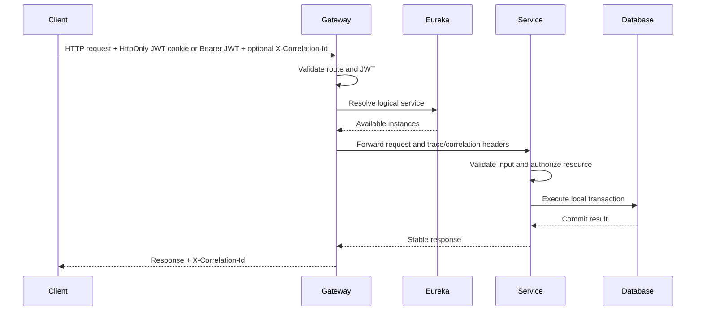
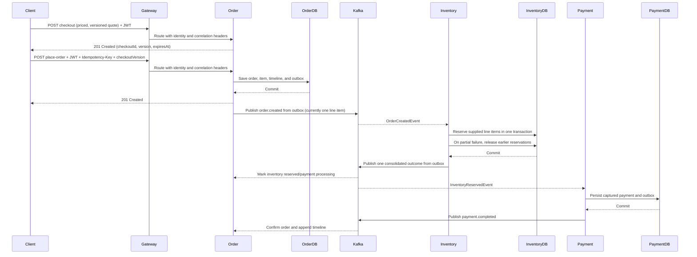
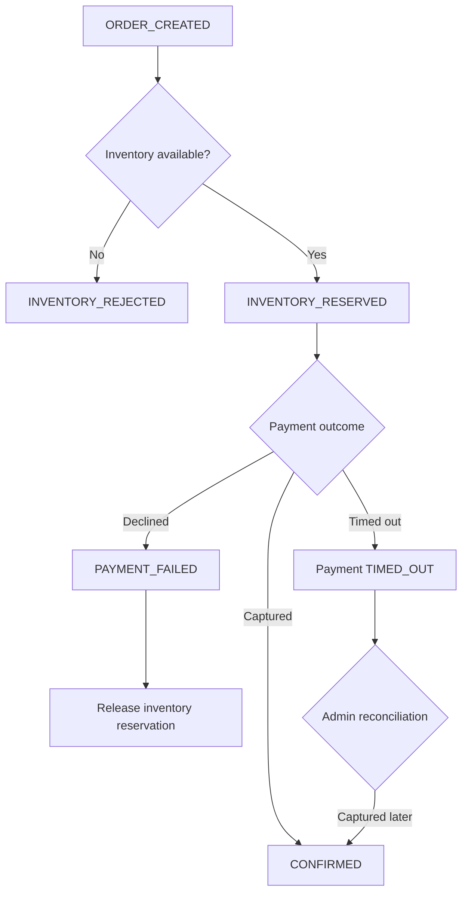
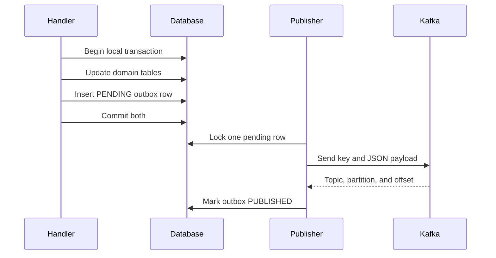
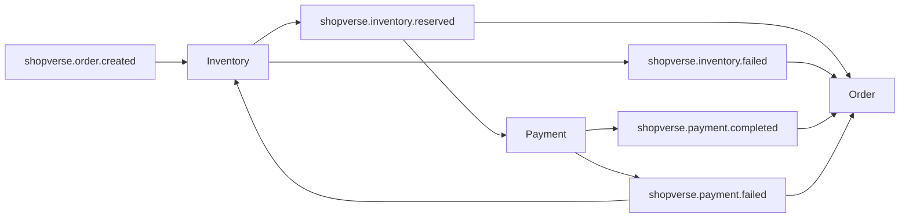

# Checkout, Security, And Event Flows

## Synchronous Request Flow



The downstream service repeats JWT validation and resource authorization.
Gateway security is not the sole protection for a service.

## Authentication Flow

```mermaid
sequenceDiagram
    participant Client
    participant Gateway
    participant Auth
    participant User
    participant UserDB
    participant Redis

    Client->>Gateway: GET /auth/csrf
    Gateway->>Auth: issue XSRF-TOKEN cookie
    Client->>Gateway: POST /auth/login + credentials + XSRF cookie/header
    Gateway->>Auth: Route public login request
    Auth->>User: Feign GET internal authenticated user + Basic credentials
    User->>UserDB: Load user, roles, permissions, password hash
    User->>User: Verify credentials through Spring Security
    User-->>Auth: Authenticated user authorities
    Auth->>Auth: Create claims and sign JWT with RSA private key
    Auth-->>Client: SHOPVERSE_ACCESS HttpOnly cookie; authenticated=true JSON
    Client->>Gateway: GET /auth/session + access cookie
    Gateway->>Auth: validate JWT and return UI identity/roles
    Auth-->>Client: authenticated identity; Cache-Control: no-store
    Client->>Gateway: Protected API + HttpOnly cookie (CSRF header on writes)
    Gateway->>Gateway: Convert cookie to bearer JWT and validate
    Gateway->>Gateway: Check jti revocation in Redis
    Gateway->>User: Forward Authorization: Bearer; strip access cookie
    Client->>Gateway: POST /auth/logout + cookie + CSRF header
    Gateway->>Redis: Check jti revocation marker
    Gateway->>Auth: Forward authenticated logout
    Auth->>Redis: Store revoked jti until exp
    Auth-->>Client: 204 No Content
```

`GET /auth/csrf` is a pre-login step. On every unsafe browser request, Gateway
requires a trusted `Origin` (or `Referer` fallback) and equal `XSRF-TOKEN`
cookie / `X-XSRF-TOKEN` header. A page reload does not refresh the JWT: Angular
calls `/auth/session` to rebuild only its in-memory identity. Shopverse does not
currently implement `/auth/refresh`; once the access JWT expires, the user must
log in again. See the detailed flow, endpoint examples, Angular code, and cookie
attributes in [Auth Service README](../../services/auth-service/README.md#browser-cookie-and-csrf-flow).

Resource services use the Auth Service JWKS endpoint to verify tokens. They do
not receive or share the RSA private signing key. Gateway and resource services
also fail closed when the JWT's `jti` is present in Redis or revocation state
cannot be checked. Logout revokes one access token; refresh-token rotation and
user-wide session revocation are not implemented.

## Successful Checkout SAGA



The HTTP response confirms creation of the Order resource. It does not imply
that asynchronous inventory and payment processing has completed.

Inventory can consume list-shaped order events and reserve multiple products
atomically, but the current Order API/producer still sends one line item. The
coordinated multi-item checkout rollout remains tracked as BUG-001.

## Failure And Compensation



Compensation is a later business transaction. It is not a rollback of the
already committed Inventory transaction.

## Transactional Outbox Flow



If Kafka is unavailable, the committed outbox row remains recoverable. A crash
after Kafka accepts a record but before the row is marked published can cause
duplicate delivery, so consumers must be idempotent.

## Event Topology



| Event | Producer | Consumers | Purpose |
|---|---|---|---|
| `shopverse.order.created` | Order | Inventory | Begin stock reservation |
| `shopverse.inventory.reserved` | Inventory | Order, Payment | Advance order and begin payment |
| `shopverse.inventory.failed` | Inventory | Order | Reject checkout |
| `shopverse.payment.completed` | Payment | Order | Confirm the order |
| `shopverse.payment.failed` | Payment | Order, Inventory | Fail order and release stock |

Event contracts currently carry order ID, order number, correlation ID, and
the fields needed by the consumer. Order number is the Kafka key to preserve
per-order partition ordering. A universal immutable event ID and schema version
are production hardening items.

## Recommended Next

Return to [Shopverse System Design](./SYSTEM-DESIGN.md) to select the next focused guide.

## Official References

- [AWS Well-Architected Framework](https://docs.aws.amazon.com/wellarchitected/latest/framework/welcome.html)
- [RFC 9110: HTTP Semantics](https://www.rfc-editor.org/rfc/rfc9110)
