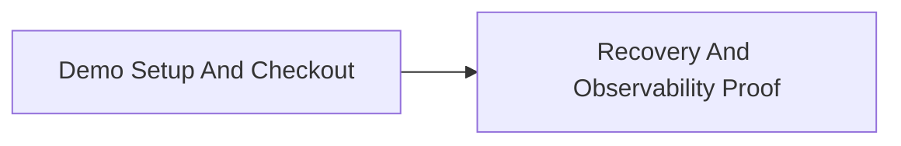

# Complete Shopverse Demo

<!-- split-guide-index -->
# Complete Shopverse Demo

A focused route through the complete Shopverse demonstration. The original long-form material is preserved without duplication across the focused pages below.

- [Demo Setup And Checkout](./COMPLETE-DEMO-SETUP-CHECKOUT.md) — Part 1 of the focused Complete Shopverse Demo learning route.
- [Recovery And Observability Proof](./COMPLETE-DEMO-RECOVERY-OBSERVABILITY.md) — Part 2 of the focused Complete Shopverse Demo learning route.

> **Use the index as the stable entry point**
>
> Each focused page owns one concern. Cross-links point to the canonical explanation instead of repeating the same material.

## Recommended Learning Order

1. [Demo Setup And Checkout](./COMPLETE-DEMO-SETUP-CHECKOUT.md)
2. [Recovery And Observability Proof](./COMPLETE-DEMO-RECOVERY-OBSERVABILITY.md)

## Reading Strategy

Use **Complete Shopverse Demo** as a decision and verification guide inside **Complete Shopverse Demo**. Start by naming the invariant or operational outcome, then follow the runtime flow and identify the owning component. For every example, record the expected success evidence, the most important failure mode, and the metric or test that proves recovery. This keeps the material useful for implementation reviews, production incidents, and architect interviews instead of treating it as isolated syntax.

Within **Complete Shopverse Demo**, apply the Shopverse guidance incrementally: verify the current behavior, introduce one bounded change, test the unhappy path, and preserve a rollback or reconciliation route. Follow links to canonical pages when a concept belongs to another track; do not copy that explanation into this page. This ownership rule keeps the focused guides short while retaining technical depth and traceability.

## Official References

- [Spring Boot reference](https://docs.spring.io/spring-boot/reference/)
- [Apache Kafka documentation](https://kafka.apache.org/documentation/)

## Recommended Next Page

Continue with [Demo Setup And Checkout](./COMPLETE-DEMO-SETUP-CHECKOUT.md).
