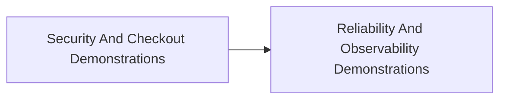

# Shopverse Features And Demos

<!-- split-guide-index -->
# Shopverse Features And Demos

Trace implemented capabilities to reproducible demonstrations and honest roadmap status. The original long-form material is preserved without duplication across the focused pages below.

- [Security And Checkout Demonstrations](https://taukhir.github.io/shopverse-docs/reference/FEATURES-SECURITY-CHECKOUT) — Part 1 of the focused Shopverse Features And Demos learning route.
- [Reliability And Observability Demonstrations](https://taukhir.github.io/shopverse-docs/reference/FEATURES-RELIABILITY-OBSERVABILITY) — Part 2 of the focused Shopverse Features And Demos learning route.

> **Use the index as the stable entry point**
>
> Each focused page owns one concern. Cross-links point to the canonical explanation instead of repeating the same material.

## Recommended Learning Order

1. [Security And Checkout Demonstrations](https://taukhir.github.io/shopverse-docs/reference/FEATURES-SECURITY-CHECKOUT)
2. [Reliability And Observability Demonstrations](https://taukhir.github.io/shopverse-docs/reference/FEATURES-RELIABILITY-OBSERVABILITY)

## Reading Strategy

Use **Shopverse Features And Demos** as a decision and verification guide inside **Shopverse Features And Demos**. Start by naming the invariant or operational outcome, then follow the runtime flow and identify the owning component. For every example, record the expected success evidence, the most important failure mode, and the metric or test that proves recovery. This keeps the material useful for implementation reviews, production incidents, and architect interviews instead of treating it as isolated syntax.

Within **Shopverse Features And Demos**, apply the Shopverse guidance incrementally: verify the current behavior, introduce one bounded change, test the unhappy path, and preserve a rollback or reconciliation route. Follow links to canonical pages when a concept belongs to another track; do not copy that explanation into this page. This ownership rule keeps the focused guides short while retaining technical depth and traceability.

## Official References

- [Spring Boot reference](https://docs.spring.io/spring-boot/reference/)
- [Apache Kafka documentation](https://kafka.apache.org/documentation/)

## Recommended Next Page

Continue with [Complete Demo](../case-study/COMPLETE-DEMO.md).
