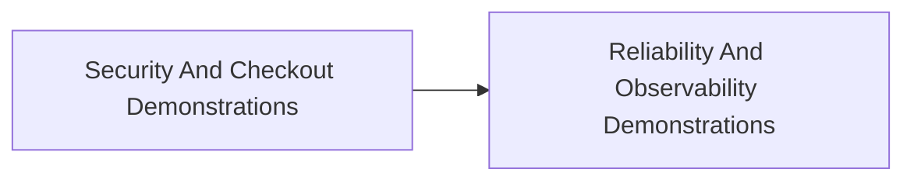

# Shopverse Features And Demos

## Current checkout, back-office, and frontend implementation note (2026-11-26)

The web checkout submits all cart lines, holds a stable idempotency key for
retries of one checkout, and renders multi-line review/receipt details. The
Order Service request DTO still caps checkout requests at one line, so
multi-item checkout is not end-to-end available until BUG-055 is implemented.
Back-office reconciliation currently uses existing Payment APIs; return
requests are visible in a read-only queue until FEAT-AU supplies approval
operations. Current dashboard counters reflect records loaded by the web app;
authoritative time-window analytics and cross-service reconciliation depend on
ENH-060/061. See the [selected frontend implementation report](../../dev-tools/teams/docs/frontend-selected-backlog-implementation-2026-11-25.md)
and [`BACKLOG-BY-AREA.md`](../../dev-tools/teams/BACKLOG-BY-AREA.md).

The customer notification route currently shows recent order states from the
authenticated order-history API, with loading, retry, empty, and populated
states. It does not represent a persisted notification inbox: unread/read
tracking and delivery preferences remain part of FEAT-AO and require backend
contracts. See ENH-062 in the backlog for the implemented frontend scope.

The back-office shares a responsive operations sidebar across admin routes.
Its navigation includes orders, inventory, payments, reconciliation,
returns/refunds, recovery, activity, users, groups, roles/permissions, and
settings. Desktop admin pages now use a common content width and sidebar offset.
Reconciliation remains Payment-API-backed and returns remain read-only until
the backend workflows land; ENH-063 tracks browser visual verification.

The admin customer directory uses the User Service's pageable/search API and
displays server totals. Durable activity uses the audit API's server-side page
and filters; its derived-data fallback remains client-side. Dashboard source
failures now remain distinguishable from successful empty responses. Admin
primary routes share reusable page-header/action framing. The interactive order
list now uses a bounded Order Service page endpoint with status/search filters,
allow-listed sorting, stable tie-break ordering, and summary records. Orders,
users, activity, inventory, and payments use a shared accessible pager. The
backend test run and browser verification still need to pass before ENH-065,
ENH-063, ENH-048, and ENH-067 can close. Effective session permissions remain
under ENH-066; saved views, scoped exports, and audited bulk actions remain
under FEAT-AZ.

<!-- split-guide-index -->
# Shopverse Features And Demos

Trace implemented capabilities to reproducible demonstrations and honest roadmap status. The original long-form material is preserved without duplication across the focused pages below.

- [Security And Checkout Demonstrations](https://taukhir.github.io/shopverse-docs/reference/FEATURES-SECURITY-CHECKOUT) — Part 1 of the focused Shopverse Features And Demos learning route.
- [Reliability And Observability Demonstrations](https://taukhir.github.io/shopverse-docs/reference/FEATURES-RELIABILITY-OBSERVABILITY) — Part 2 of the focused Shopverse Features And Demos learning route.

> **Use the index as the stable entry point**
>
> Each focused page owns one concern. Cross-links point to the canonical explanation instead of repeating the same material.

## Recommended Learning Order

1. [Security And Checkout Demonstrations](https://taukhir.github.io/shopverse-docs/reference/FEATURES-SECURITY-CHECKOUT)
2. [Reliability And Observability Demonstrations](https://taukhir.github.io/shopverse-docs/reference/FEATURES-RELIABILITY-OBSERVABILITY)

## Reading Strategy

Use **Shopverse Features And Demos** as a decision and verification guide inside **Shopverse Features And Demos**. Start by naming the invariant or operational outcome, then follow the runtime flow and identify the owning component. For every example, record the expected success evidence, the most important failure mode, and the metric or test that proves recovery. This keeps the material useful for implementation reviews, production incidents, and architect interviews instead of treating it as isolated syntax.

Within **Shopverse Features And Demos**, apply the Shopverse guidance incrementally: verify the current behavior, introduce one bounded change, test the unhappy path, and preserve a rollback or reconciliation route. Follow links to canonical pages when a concept belongs to another track; do not copy that explanation into this page. This ownership rule keeps the focused guides short while retaining technical depth and traceability.

## Official References

- [Spring Boot reference](https://docs.spring.io/spring-boot/reference/)
- [Apache Kafka documentation](https://kafka.apache.org/documentation/)

## Recommended Next Page

Continue with [Complete Demo](../case-study/COMPLETE-DEMO.md).
