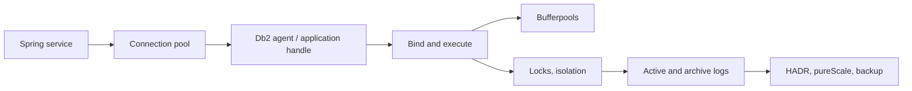

# IBM Db2 Architect Learning Path

Db2 is IBM's relational database family (Db2 for Linux, UNIX, and Windows, and
the separately engineered Db2 for z/OS). A lead engineer must connect a
business transaction to bufferpools, logging, locking, SQL PL, HADR, and the
application connection pool, not just portable ANSI SQL.

## At-A-Glance Topics

| Area | Why it matters |
|---|---|
| bufferpools and tablespaces | explains cache pressure, I/O, and page-level storage |
| active/archive logging | explains durability, crash recovery, and rollback |
| isolation levels (UR/CS/RS/RR) | Db2 names and semantics differ from ANSI terms used elsewhere |
| lock escalation and deadlocks | turns "query hangs" into evidence-based diagnosis |
| SQL PL and utilities | separates set-based database logic from maintenance operations |
| HADR and pureScale | separates disaster recovery from clustered scale-out |
| Spring/JDBC boundary | exposes driver, pool, and transaction-timeout behavior specific to Db2 |

## Complete Route

1. [Architecture, Storage, And Logging Internals](./db2/DB2-ARCHITECTURE-STORAGE-INTERNALS.md)
2. [SQL PL, Isolation Levels, And Concurrency](./db2/DB2-SQL-ISOLATION-CONCURRENCY.md)
3. [HADR, pureScale, And Operations](./db2/DB2-HA-OPERATIONS.md)
4. [Spring Integration, Production Scenarios, And Revision](./db2/DB2-SPRING-INTERVIEW-REVISION.md)

## Completion Standard

You are ready when you can explain why a page read waits on a bufferpool miss,
name the isolation level that matches a given consistency requirement without
guessing, read a lock-wait chain and resolve it without an unplanned outage,
distinguish HADR from pureScale, and configure a Spring datasource against Db2
with timeouts that match the database's own limits.

## Official References

- [Db2 for LUW Knowledge Center](https://www.ibm.com/docs/en/db2/11.5)
- [Db2 SQL reference](https://www.ibm.com/docs/en/db2/11.5?topic=db2-sql)
- [Db2 HADR overview](https://www.ibm.com/docs/en/db2/11.5?topic=hadr-high-availability-disaster-recovery)

## Recommended Next

Begin with [Architecture, Storage, And Logging Internals](./db2/DB2-ARCHITECTURE-STORAGE-INTERNALS.md).
