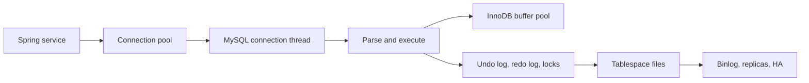

# MySQL Architect Learning Path

MySQL mastery for a lead engineer means more than portable SQL: it means
connecting a business transaction to InnoDB's clustered index, buffer pool,
redo/undo logs, replication stream, and the application connection pool.

## At-A-Glance Topics

| Area | Why it matters |
|---|---|
| clustered primary key | every secondary index carries the primary key, shaping row size and write cost |
| buffer pool and redo/undo | explains caching, durability, and MVCC read consistency |
| `REPEATABLE READ` + gap locks | MySQL's default isolation differs materially from Oracle/Postgres defaults |
| replication (binlog, GTID) | explains read-replica lag, failover, and HA topology choices |
| index design | turns "query is slow" into evidence rather than guesswork |
| Spring/JDBC/JPA boundary | exposes pool, batching, and transaction behavior specific to MySQL |

## Complete Route

1. [Architecture, Storage, And InnoDB Internals](./mysql/MYSQL-ARCHITECTURE-STORAGE-INTERNALS.md)
2. [SQL, Isolation Levels, And Concurrency](./mysql/MYSQL-SQL-ISOLATION-CONCURRENCY.md)
3. [Replication, Availability, And Operations](./mysql/MYSQL-HA-OPERATIONS.md)
4. [Spring Integration, Production Scenarios, And Revision](./mysql/MYSQL-SPRING-INTERVIEW-REVISION.md)

## Completion Standard

You are ready when you can explain why a wide secondary index costs more on
InnoDB than on a heap-organized engine, reason correctly about what
`REPEATABLE READ` and gap locks actually prevent, diagnose replica lag and
choose a failover strategy, and configure a Spring datasource and dialect
correctly for MySQL instead of assuming Postgres/Oracle defaults transfer.

## Official References

- [MySQL 8.0 Reference Manual](https://dev.mysql.com/doc/refman/8.0/en/)
- [InnoDB Storage Engine documentation](https://dev.mysql.com/doc/refman/8.0/en/innodb-storage-engine.html)
- [MySQL replication documentation](https://dev.mysql.com/doc/refman/8.0/en/replication.html)

## Recommended Next

Begin with [Architecture, Storage, And InnoDB Internals](./mysql/MYSQL-ARCHITECTURE-STORAGE-INTERNALS.md).
