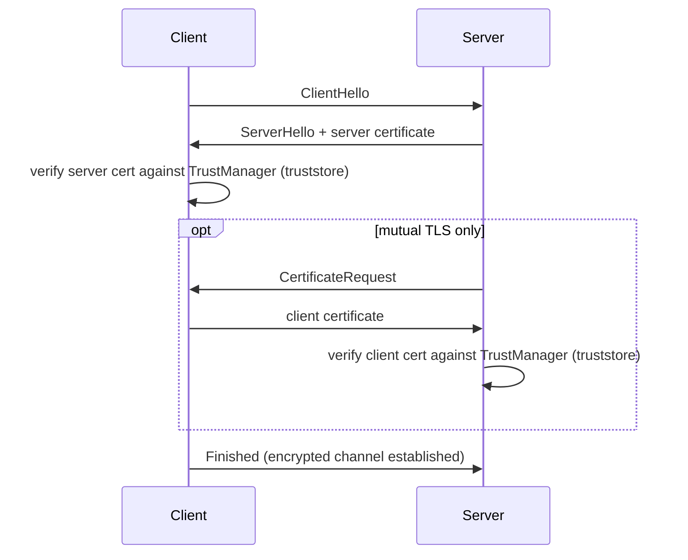

# Java TLS And Mutual TLS

TLS authenticates a server (and, with mutual TLS, the client too) and
encrypts the connection between them. At the JVM level this is built from
four cooperating pieces — `SSLContext`, a `KeyManager`, a `TrustManager`,
and a keystore/truststore backing each — that every higher-level API
(`HttpClient`, Spring's `server.ssl.*`, a gRPC channel) ultimately
configures on your behalf.

## Page Overview

This page covers: the TLS/mTLS handshake from the JVM's point of view;
`SSLContext`/`KeyManager`/`TrustManager` and the keystore/truststore each
one reads; JKS vs. PKCS12; a minimal one-way-TLS example followed by mutual
TLS for service-to-service calls; hostname verification; cipher
suite/protocol negotiation and pinning; how this relates to Spring Boot's
`server.ssl.*`/`spring.ssl.bundle.*` properties; `SSLHandshakeException`
failure modes; and keystore/truststore rotation without downtime. It does
not cover Spring Security's OAuth2/JWT authentication layer, which is a
separate, higher-level concern covered under
[Spring Security](/security/spring-security/JWT-JWKS-RESOURCE-SERVER) —
mTLS authenticates the TCP connection itself, before any application-layer
token is ever read.

## Prerequisites

- Basic familiarity with public-key certificates (a certificate binds a
  public key to an identity, signed by a certificate authority).
- Java networking fundamentals (sockets, `HttpClient`).

## Core Terminology

- **Keystore**: holds an entity's own private key and certificate (what you
  present to prove your identity).
- **Truststore**: holds the certificates (or CA certificates) an entity is
  willing to trust when verifying the other side's certificate.
- **One-way TLS**: only the server presents a certificate; the client
  verifies it against its truststore.
- **Mutual TLS (mTLS)**: the server also requests and verifies a client
  certificate, so both sides authenticate each other at the TLS layer.
- **`SSLContext`**: the JVM's assembled TLS configuration, built from a
  `KeyManager` (identity to present) and a `TrustManager` (whom to trust).

## Mental Model



One-way TLS only runs the first verification (client trusts server);
mutual TLS adds the `CertificateRequest` step, requiring the server to also
verify the client's certificate before the handshake completes. A keystore
and a truststore can physically be the same file format (JKS or PKCS12) —
the distinction is which role the entries play, not the file type. A
service's `KeyManager` reads its keystore, holding *its own* key pair; its
`TrustManager` reads its truststore, holding *other parties'* certificates
(or the CA that signed them).

## First Working Example: One-Way TLS Client

```java
KeyStore trustStore = KeyStore.getInstance("PKCS12");
try (InputStream in = Files.newInputStream(Path.of("truststore.p12"))) {
    trustStore.load(in, trustStorePassword);
}

TrustManagerFactory tmf = TrustManagerFactory.getInstance(
    TrustManagerFactory.getDefaultAlgorithm());
tmf.init(trustStore);

SSLContext sslContext = SSLContext.getInstance("TLSv1.3");
sslContext.init(null, tmf.getTrustManagers(), null);

HttpClient client = HttpClient.newBuilder()
    .sslContext(sslContext)
    .build();
```

With no `KeyManager` configured, this client presents no certificate of its
own — correct for one-way TLS, where only the server authenticates.

## Example Progression: Mutual TLS

```java
KeyStore keyStore = KeyStore.getInstance("PKCS12");
try (InputStream in = Files.newInputStream(Path.of("client-identity.p12"))) {
    keyStore.load(in, keyStorePassword);
}

KeyManagerFactory kmf = KeyManagerFactory.getInstance(
    KeyManagerFactory.getDefaultAlgorithm());
kmf.init(keyStore, keyStorePassword);

SSLContext sslContext = SSLContext.getInstance("TLSv1.3");
sslContext.init(kmf.getKeyManagers(), tmf.getTrustManagers(), null);

HttpClient mtlsClient = HttpClient.newBuilder()
    .sslContext(sslContext)
    .build();
```

Adding the `KeyManager` is the entire difference between one-way and mutual
TLS on the client side; the server side must independently be configured
to *request* (and verify) a client certificate — a client presenting one
accomplishes nothing if the server does not ask for it.

## How It Works: The Handshake

1. The client opens a TCP connection and sends a `ClientHello` (supported
   protocol versions and cipher suites).
2. The server replies with `ServerHello`, its certificate chain, and (for
   mutual TLS) a `CertificateRequest`.
3. The client's `TrustManager` validates the server's certificate chain
   against its truststore, checks validity dates, and verifies the
   hostname matches a Subject Alternative Name on the certificate.
4. For mutual TLS, the client sends its own certificate chain; the
   server's `TrustManager` performs the equivalent validation on it.
5. Both sides derive session keys and switch to encrypted application data.

Hostname verification (step 3) is a separate check from "is the
certificate signed by a CA I trust" — a certificate can be validly signed
and still fail the connection if its Subject Alternative Name does not
match the hostname actually being connected to, which is precisely the
defense against a correctly-signed certificate for the wrong host.

## Boundaries And Trade-Offs

- mTLS authenticates the TLS *connection*; it says nothing about the
  application-layer identity or permissions a request carries — a service
  can hold a valid client certificate and still need a separate
  authorization check (an OAuth2 token, a role claim) for the specific
  operation it is calling, the same layering Spring Security's resource
  server support provides on top of, not instead of, mTLS.
- Pinning a specific certificate (rather than trusting any certificate
  signed by a CA) is more resistant to a compromised CA but makes every
  certificate rotation a coordinated deployment, not an invisible
  background renewal — a deliberate availability/security trade-off.
- Disabling hostname verification to "fix" a handshake failure removes the
  exact check that defends against a validly-signed certificate presented
  by the wrong host; it is a security regression, not a configuration fix.

## Failure Modes, Edge Cases, And Common Mistakes

- **`SSLHandshakeException: PKIX path building failed`**: the peer's
  certificate chain does not resolve to anything in the truststore — the
  CA certificate is missing from the truststore, or an intermediate
  certificate in the chain was never included.
- **`SSLHandshakeException` from a hostname mismatch**: the certificate is
  valid and trusted, but its Subject Alternative Name does not match the
  hostname being connected to — common after a service is reached via a
  new DNS name or load-balancer alias the certificate was never issued for.
- **Expired certificate**: validity-date checking is part of the handshake,
  not a separate monitoring step the JVM performs for you — an expiring
  certificate causes a hard failure at the exact moment it crosses its
  `notAfter` date, with no grace period, which is why rotation (below)
  must complete before expiry, not after a failure is observed.
- **Missing client certificate on an mTLS server**: a server that requires
  client authentication rejects the handshake outright if the client sends
  none; a client configured only with a `TrustManager` (one-way TLS setup)
  against a server expecting mTLS fails here, not at the application layer.
- **Cipher suite / protocol mismatch**: an `SSLHandshakeException` with no
  certificate-related cause can mean the two sides share no common
  protocol version or cipher suite — common when one side has been
  hardened to TLS 1.3-only and the other has not been upgraded.

## Production And Diagnostic Guidance

- Spring Boot's `server.ssl.*` (and the newer `spring.ssl.bundle.*`)
  properties configure exactly this `SSLContext`/`KeyManager`/
  `TrustManager` machinery for the embedded server, and Spring's
  `RestClient`/`WebClient` SSL bundles do the same for outbound mTLS calls
  — they are a declarative wrapper over the APIs on this page, not a
  different mechanism, so a handshake failure diagnosed here applies
  identically when it surfaces through Spring configuration.
- Log (at least) the handshake failure's cause chain, the peer hostname,
  and the certificate's Subject/SAN/validity dates on an `SSLHandshakeException`
  — "handshake failed" alone does not distinguish an untrusted CA from an
  expired certificate from a hostname mismatch, and each has a different
  fix.
- Rotate a keystore/truststore by adding the new certificate alongside the
  old one (both trusted, or both presentable) before removing the old
  entry — the same expand/contract discipline this site requires for
  schema and API changes — so in-flight connections and not-yet-restarted
  peers do not fail during the rotation window.
- Favor a short-lived certificate issued by an internal CA (automatically
  renewed well before expiry) over a long-lived certificate for
  service-to-service mTLS; it bounds the blast radius of a leaked private
  key and removes the manual-rotation failure mode entirely.

## Tricky Interview Questions

**A client's `HttpClient` is configured with a `TrustManager` but no
`KeyManager`, calling a server that requires mutual TLS. What happens, and
why?** The handshake fails — the server requested a client certificate and
received none, because a `TrustManager` only governs which certificates
the client accepts from the server; presenting the client's own identity
requires a `KeyManager` backed by a keystore holding its private key and
certificate, which this configuration never built.

**A certificate is signed by a CA already in the truststore, has not
expired, and the handshake still fails with a hostname error. What check is
failing, and why is disabling it not an acceptable fix?** Hostname
verification is a separate check from chain-of-trust validation: the
certificate's Subject Alternative Name does not match the hostname being
connected to. Disabling hostname verification would let the connection
succeed against any correctly-signed certificate regardless of which host
presents it — exactly the attack (a validly-signed certificate for the
wrong host) this check exists to catch.

**A lead engineer wants to rotate a service's TLS certificate with zero
downtime across a fleet of instances that cannot all restart
simultaneously. What is the actual constraint, and how do you satisfy it?**
Every peer still holding the old truststore state must be able to validate
whichever certificate (old or new) is currently presented, and every peer
presenting a certificate must be accepted by whichever truststore state a
not-yet-updated peer holds — satisfied by trusting both the old and new
certificate (or CA) simultaneously during the rollout window, then removing
the old one only once every instance has rotated, the same overlap
discipline used for any other backward/forward-compatible rolling change.

## Summary / Review Checklist

- Keystore = your own identity (private key + certificate); truststore =
  whom you accept from the peer. Same file formats, different roles.
- One-way TLS authenticates the server only; mutual TLS additionally
  requires the server to request, and the client to present, a client
  certificate.
- Hostname verification and chain-of-trust validation are separate checks
  — a validly-signed certificate can still fail on hostname mismatch.
- `SSLHandshakeException` causes split into a small, diagnosable set:
  untrusted chain, hostname mismatch, expired certificate, cipher/protocol
  mismatch, or a missing client certificate.
- Rotate certificates by trusting old and new simultaneously during the
  rollout window — never a hard cutover across a fleet that cannot restart
  atomically.
- mTLS authenticates the connection, not the request's authorization —
  layer an application-level authorization check (OAuth2/JWT) on top, not
  instead of it.

## Recommended Next

For the application-layer identity/authorization layer that typically sits
on top of a TLS/mTLS connection, continue with
[JWT/JWKS Resource Server](/security/spring-security/JWT-JWKS-RESOURCE-SERVER).

## Official References

- [`javax.net.ssl` package](https://docs.oracle.com/en/java/javase/25/docs/api/java.base/javax/net/ssl/package-summary.html)
- [JSSE Reference Guide](https://docs.oracle.com/en/java/javase/25/security/java-secure-socket-extension-jsse-reference-guide.html)
- [Spring Boot SSL bundles](https://docs.spring.io/spring-boot/reference/features/ssl.html)
