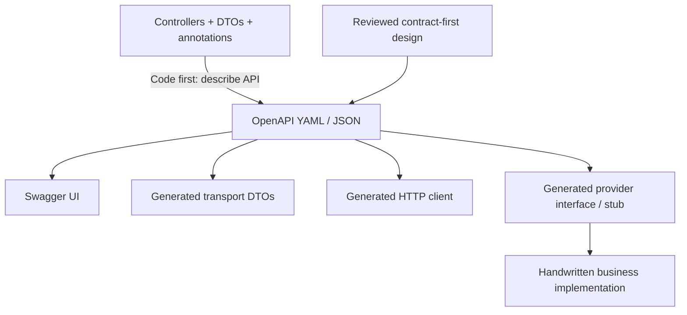
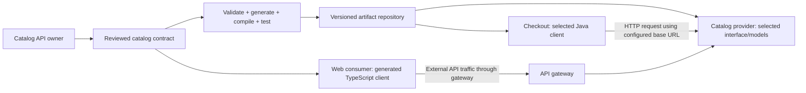

# OpenAPI And Swagger: Contracts Across Services

An API contract describes the HTTP boundary between a provider and its consumers.
Automation can produce that description from application code, or produce code
from a reviewed description. These are different directions of generation.

This page connects the concepts before the detailed
[contract artifact tutorial](./AMWAY-OPENAPI-CONTRACT-ARTIFACTS.md). Examples use
fictional Catalog and Checkout services; they do not describe proprietary Amway
endpoints or replace ShopVerse's Kafka checkout choreography.

## 1. The Names Mean Different Things

| Name | Responsibility | Typical output |
|---|---|---|
| OpenAPI Specification | Standard for describing HTTP APIs | Rules for a YAML or JSON document |
| OpenAPI document | A particular API's contract | Paths, methods, schemas, responses, security requirements |
| Swagger UI | Renders an OpenAPI document | Interactive API documentation |
| springdoc-openapi | Derives a description from Spring applications | OpenAPI JSON/YAML and optional UI integration |
| SmallRye OpenAPI | OpenAPI implementation used in Quarkus | API description from supported metadata and configuration |
| OpenAPI Generator | Generates selected code from a description | Models, clients, or server interfaces/stubs |
| MapStruct | Converts between Java representations | Mapper implementation |

Swagger is a tooling family; Swagger UI is one tool. Installing a UI does not
automatically publish a Java client library. A document rendered by the UI can
also feed generators and validation tools.
See [OpenAPI](https://www.openapis.org/what-is-openapi) and
[Swagger UI](https://swagger.io/open-source/swagger-ui/).

## 2. Ask What Is Being Generated



**Code first:** the implementation is the starting point. Framework tooling
examines routes, types, and supported annotations to assemble the description.
This reduces duplication, but undocumented error paths and business semantics
still require deliberate review.

**Contract first:** teams design a document, then generate selected provider or
consumer code. Developers implement the business operation behind a generated
interface or adapter. Regeneration should reproduce the transport code.

Some projects combine both. Establish which artifact is authoritative and compare
the runtime description with the approved contract. Otherwise changes can flow
in both directions without a clear owner.

## 3. Read A Small Contract

This illustrative OpenAPI 3.0.3 document describes a read operation. It can be an
input to generation; it is not a deployed API or a complete production contract.

```yaml title="catalog-api.yaml"
openapi: 3.0.3
info:
  title: Example Catalog API
  version: 1.2.0
paths:
  /products/{productId}:
    get:
      operationId: getProduct
      tags: [Products]
      parameters:
        - name: productId
          in: path
          required: true
          schema:
            type: string
      responses:
        '200':
          description: Product found
          content:
            application/json:
              schema:
                $ref: '#/components/schemas/ProductResponse'
        '404':
          description: Product not found
components:
  schemas:
    ProductResponse:
      type: object
      required: [id, displayName]
      properties:
        id:
          type: string
        displayName:
          type: string
```

Read the important pieces separately:

- `openapi` identifies the specification dialect, not your application's release.
- `info.version` identifies the described API document's version.
- `operationId` identifies an operation and commonly influences generated names.
- `$ref` points to a reusable definition within this document.
- `required` under the schema identifies mandatory properties.
- The path parameter's `required: true` identifies mandatory parameter presence.

Presence and nullability are separate. In OpenAPI 3.0, nullability uses
`nullable`; newer dialects have different schema rules. Pin a dialect that your
chosen tools support. See the
[3.0.3 specification](https://spec.openapis.org/oas/v3.0.3).

## 4. What A Generator Produces

Generation depends on the selected generator, library, templates, version, and
options. For this example, possible outputs include:

| Output | Possible generated name | What remains handwritten |
|---|---|---|
| Model | `ProductResponse` | Domain model and mapping policy |
| Client operation | `ProductsApi.getProduct(...)` | Integration policy, configuration, and failure handling |
| Provider interface | `ProductsApi` | Controller/resource implementation and business logic |
| Supporting code | `ApiClient`, serializers, exceptions | Runtime wiring and operational policy |

Names are illustrative. Inspect the actual generated files instead of assuming
every generator emits the same classes. A models-only JAR contains no HTTP call
implementation. A generated interface might require a framework proxy to execute
requests; another generator emits a concrete client.

The Gradle integration exposes tasks such as `openApiValidate` and
`openApiGenerate`. The build must also wire generation before compilation and
include the generated source directory and runtime dependencies where needed.
Generation by itself is not proof that generated sources compile.
See [generator tasks](https://openapi-generator.tech/docs/plugins/) and
[Java client options](https://openapi-generator.tech/docs/generators/java/).

Use the existing [Gradle artifact walkthrough](./AMWAY-OPENAPI-CONTRACT-ARTIFACTS.md)
for concrete build configuration rather than maintaining a second competing setup.

## 5. How Different Services Consume The Contract



The contract has an owning provider team. Consumers choose an approved released
version; they do not automatically change when the provider edits its source.
A Java service may depend on a published JAR, while another language generates
its own client from the released specification.

Distinguish the deliverables:

| Artifact | Example coordinate or file | Consumer action |
|---|---|---|
| Specification | `catalog-api.yaml` | Generate language-specific code or validate messages |
| Models JAR | `com.example.contracts:catalog-models:1.2.0` | Import transport types; supply HTTP integration separately |
| Client JAR | `com.example.contracts:catalog-client:1.2.0` | Configure supported HTTP client and call operations |
| Provider API JAR | `com.example.contracts:catalog-provider-api:1.2.0` | Implement supported server interfaces |

Coordinates are fictional. Artifact versioning and `info.version` need an explicit
release policy; changing one does not necessarily update the other. A shared
contract describes communication, not shared database ownership.

## 6. What Happens During A Runtime Call

For a conventional generated client, the consumer already compiled the generated
code into its application. It does not download the provider's Swagger page for
each call.

```text
Checkout application
  -> map internal request to generated client DTO
  -> generated operation serializes parameters/body
  -> configured HTTP transport sends request
  -> provider authorizes, validates, and executes business logic
  -> provider serializes response
  -> client deserializes generated response DTO
  -> consumer maps DTO into its own application model
```

Base URLs, credentials, timeouts, error interpretation, and tracing need explicit
integration. Verify each generated library's behavior. A generated client does
not establish safe retries: retrying a state-changing operation requires an
appropriate idempotency contract and provider implementation.

Swagger UI's interactive execution also sends real HTTP requests to its configured
server. Documentation access and endpoint authorization remain separate concerns.

## 7. Where MapStruct Fits

```text
generated ProductResponse
        -> handwritten mapping rules + generated MapStruct implementation
        -> consumer's ProductSnapshot
```

OpenAPI Generator derives transport code from YAML/JSON. MapStruct derives Java
conversion code from mapper declarations. One does not replace the other.

Keep generated transport models at integration boundaries. Let each service own
its domain types, persistence entities, authorization, and business decisions.
MapStruct can rename or transform fields; it should not silently decide current
price, stock availability, or valid order transitions.

Do not hand-edit generated DTOs or clients to fix a contract mismatch. Change the
source contract, generator configuration, template, or an appropriate handwritten
adapter, then regenerate. Read the
[MapStruct deep dive](../java/MAPSTRUCT-DEEP-DIVE.md) for custom helper selection.

## 8. Current ShopVerse Evidence

The repository provides a concrete code-first example:

- `order-service/build.gradle`, `inventory-service/build.gradle`, and
  `payment-service/build.gradle` declare
  `springdoc-openapi-starter-webmvc-ui`.
- `OrderController` in
  `order-service/src/main/java/io/shopverse/order/controller/OrderController.java`
  declares Spring request mappings plus `@Tag`, `@Operation`, and `@Parameter`.
- `OrderController.checkout` documents checkout and its `Idempotency-Key` header;
  that annotation is descriptive metadata, not the implementation of idempotency.

These files support describing ShopVerse's annotation-based documentation setup.
They do not establish that ShopVerse publishes generated client JARs through the
illustrative artifact pipeline above. No services were started to inspect their
live descriptions as part of authoring this page.

Springdoc's default JSON description route is `/v3/api-docs`; its documented UI
entry is `/swagger-ui.html`. Service context paths, security, and gateway routing
can change accessibility. Inspect active configuration before assuming a public
gateway exposes either route. See [springdoc](https://springdoc.org/).

## 9. Compatibility And Release Checks

Treat specification validity, generated-code compilation, and runtime behavior as
different checks. A syntactically valid document can still be incompatible with
existing consumers.

| Change | Question to resolve before release |
|---|---|
| Add an optional response field | Do old consumers tolerate unknown properties? |
| Add an enum value | Can deployed clients deserialize an unfamiliar value? |
| Make an optional request field required | Can every existing caller supply it? |
| Rename `operationId` | Does regeneration change consumer method names? |
| Change status or error shape | Do adapters and error handling still work? |
| Change generator or library | Do generated signatures, serializers, and dependencies change? |

A useful pipeline validates the document, compares it with the released baseline,
regenerates with pinned tooling, compiles outputs, runs provider and consumer
tests, and publishes an immutable release. Consumers upgrade deliberately.
When evolving additively, deploy a provider that accepts existing callers before
rolling out consumers that depend on new behavior.

Do not put real credentials or customer data in specifications, examples, generated
fixtures, or HTTP logs. Test authentication and resource ownership at runtime;
OpenAPI security metadata alone does not enforce them. HTTP contracts also do not
replace Kafka event-schema compatibility review.

## 10. Trace This In A Workplace Project

1. Locate the authoritative YAML/JSON or the provider's description generator.
2. Find the generation task and its selected generator, library, and version.
3. Identify generated models, client code, provider interfaces, and handwritten adapters.
4. Locate published coordinates and the exact version each consumer resolves.
5. Trace one operation from generated signature to actual HTTP request and response.
6. Find base URL, authentication, timeout, error mapping, and retry configuration.
7. Check compatibility tests against a deployed provider or representative contract.

If the client compiles but calls fail, compare the resolved contract version,
actual URL/method, serialized payload, provider version, and error response.
Compilation validates Java compatibility; it cannot prove the deployed provider
honors the expected wire contract.

## Continue Learning

- [Contract generation and artifact publishing tutorial](./AMWAY-OPENAPI-CONTRACT-ARTIFACTS.md)
- [OpenAPI fundamentals in Quarkus](../quarkus/QUARKUS-OPENAPI-FUNDAMENTALS.md)
- [Quarkus clients and artifacts](../quarkus/QUARKUS-OPENAPI-CLIENT-ARTIFACTS.md)
- [REST contract governance](../development/spring-rest/REST-OPENAPI-CONTRACT-GOVERNANCE.md)
- [MapStruct generated and custom mapping](../java/MAPSTRUCT-DEEP-DIVE.md)
