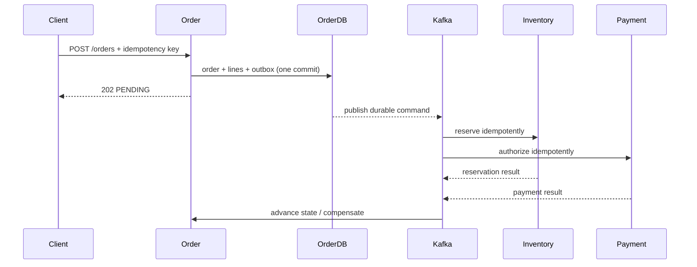

# Checkout And Order System Design

<DocLabels items={[
  {label: 'System-design capstone', tone: 'advanced'},
  {label: 'Distributed checkout', tone: 'production'},
  {label: 'Shopverse', tone: 'shopverse'},
]} />

## Requirements And Capacity

Assume 2 million monthly buyers, 250 orders/s peak, 3× flash-sale burst, 5 order
lines average, p95 acceptance under 500 ms, and no duplicate accepted order per
idempotency key. At 750 orders/s, the order write path produces roughly 3,750 line
rows/s plus one order and outbox record per request; size database and Kafka from
measured bytes, indexes, replication and retention rather than request count alone.

## Decisions

| Concern | Decision | Reason |
|---|---|---|
| acknowledgement | `202 PENDING` after local durable commit | remote calls cannot be atomic with order DB |
| duplicate request | unique customer/idempotency key + stored response | retry returns same logical order |
| publication | transactional outbox | no DB-commit/event-loss window |
| progress | explicit order state machine | visible convergence and terminal failure |
| recovery | idempotent consumers + compensation + reconciliation | handles duplicate and ambiguous outcomes |

Security requires authenticated subject, server-derived customer ownership, price
revalidation, bounded request body, rate limits and audit events without payment
or token leakage. Observe acceptance latency separately from completion latency,
plus outbox age, consumer lag, state age, compensation and reconciliation counts.

## Where Shopverse's Real Implementation Stands

The "explicit order state machine" row above is not hypothetical — it's
exactly what `services/order-service`'s `OrderStatus` enum and
`OrderServiceImpl`'s saga-event guards implement, and it's exactly where a
confirmed, currently-unfixed defect lives.

`OrderStatus` declares 14 values for the lifecycle this design describes
(`ORDER_CREATED` → `PENDING_INVENTORY` → `INVENTORY_RESERVED`/
`INVENTORY_REJECTED` → `PAYMENT_PROCESSING` → `PAYMENT_FAILED`/`CONFIRMED`
→ fulfillment states). The saga listeners that are supposed to advance
that state machine each guard on the order currently being in
`PENDING_INVENTORY` before they'll act — the right defensive instinct for
an at-least-once, choreographed SAGA (see
[ADR 002](../adr/002-kafka-choreography-saga.md)). The defect: nothing in
`checkout()` ever assigns `PENDING_INVENTORY` — the constructor only sets
`ORDER_CREATED`, and no other code path moves it forward. Every inventory
and payment event this design's own sequence diagram shows arriving still
arrives; the guard that's supposed to react to them silently no-ops
instead, because its precondition was never produced. One missing
assignment makes 9 of the 14 states unreachable — the entire post-checkout
lifecycle this page is designing never actually completes in the real
system today.

This is worth sitting with, not skipping past: the design above is
correct, and the bug is not a flaw in the choreography pattern or the
state-machine approach — it's a wiring gap between "the transition method
exists and is correct" and "something actually calls it at the point the
design says it should." That gap doesn't show up by reading the state
machine forward from its transition methods, which all look individually
sound; it shows up by walking every guarded value backward and confirming
something reachable assigns it. Full root cause, evidence, and the
designed (not yet implemented) fix:
[Order Status Dead-Transition Problem](../../reliability/problems/ORDER-STATUS-DEAD-TRANSITION-PROBLEM.md)
— tracked as `BUG-013` in `dev-tools/teams/BACKLOG.md`.

A second, related gap against this design: the "unique customer/
idempotency key + stored response" row holds for retries of the *same*
cart, but `CheckoutRequest.items` is constrained to exactly one line item
today (`@Size(max = 1)`), not the "5 order lines average" this capacity
model assumes. That's a separate, already-decided change —
[ADR 005](../adr/005-multi-item-checkout-event-contract.md) — not part of
this page's state-machine defect, but worth knowing before sizing this
design against the real system's current request shape.

## Evolution

Start as one modular transaction for order creation. Introduce ports, outbox and
state machine before extracting services. Move Inventory and Payment behind stable
commands only when ownership/scaling/isolation benefits justify distributed failure.

**Why not keep the HTTP request open until payment and inventory finish?**

<ExpandableAnswer title="Expand architect answer">

It couples user latency and Order capacity to two remote tail latencies and failure
budgets. Async acceptance provides durable progress and recovery. A synchronous
design can work at small scale, but needs one deadline, idempotent downstream calls,
clear ambiguous-outcome handling and no claim of cross-service atomicity.

</ExpandableAnswer>

## Canonical Detail

- [Shopverse whole-system design](../SYSTEM-DESIGN.md)
- [Distributed checkout problem](../../reliability/problems/runtime/DISTRIBUTED-CHECKOUT.md)
- [Idempotent checkout](../../reliability/problems/runtime/IDEMPOTENT-CHECKOUT.md)
- [Order Status Dead-Transition Problem](../../reliability/problems/ORDER-STATUS-DEAD-TRANSITION-PROBLEM.md)
- [ADR 002: Kafka Choreography SAGA For Checkout](../adr/002-kafka-choreography-saga.md)
- [ADR 005: Multi-Item Checkout Event Contract](../adr/005-multi-item-checkout-event-contract.md)

## Official References

- [Kafka design](https://kafka.apache.org/documentation/#design)

## Recommended Next

Continue with [Inventory Reservation Design](./INVENTORY-RESERVATION-DESIGN.md).
