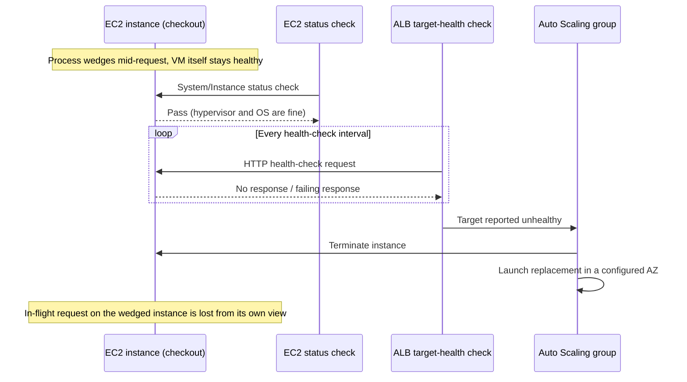

# AWS Compute, EBS, Scaling And Entry Points

## EC2 And Availability Zones

EC2 provides virtual machines. Select an instance family for CPU, memory,
network, storage, or accelerator needs; build immutable images where practical;
and use instance roles instead of embedded credentials. An EC2 instance runs in
one AZ, so resilience requires replacement capacity in other AZs.

## EBS Block Storage

Elastic Block Store (EBS) volumes are AZ-scoped block devices commonly attached
to EC2. They persist independently when configured to survive instance
termination. EBS is **storage**, not an application deployment platform.
[Elastic Beanstalk](./AWS-ELASTIC-BEANSTALK.md) is the AWS PaaS-like
deployment service sometimes confused with it by name alone.

Important EBS decisions include:

- Choose general-purpose SSD, provisioned-IOPS SSD, or throughput-oriented HDD based on latency, IOPS, throughput, and access pattern.
- Size and provision performance together; monitor whether the workload reaches volume or instance limits.
- Encrypt volumes and snapshots, control KMS permissions, and test snapshot restore.
- Create application-consistent snapshots when write ordering matters.
- A snapshot is a backup primitive, not proof that recovery works.
- Use EFS or S3 when multiple hosts need shared file or object access; do not assume a normal EBS volume is a multi-host filesystem.

## Auto Scaling

An Auto Scaling group maintains desired EC2 capacity across configured AZs and
replaces unhealthy instances. Target tracking can scale on signals such as CPU,
load-balancer request count per target, or a custom backlog metric.

Good scaling requires stateless instances, health checks that represent ability
to serve, graceful connection draining, startup time accounted for in policies,
and tested minimum/maximum capacity. CPU is often a poor signal for queue
workers; queue depth divided by processing capacity is usually more meaningful.

## Auto Healing

**Auto Healing** and **Auto Scaling** solve different problems and are easy
to conflate: Auto Scaling changes *capacity* (how many instances exist) in
response to load; Auto Healing replaces an instance that is still running
but no longer able to serve traffic correctly, regardless of load. An Auto
Scaling group implements auto healing through three layered health checks:

| Check | Detects | Owner |
|---|---|---|
| EC2 status check | hardware/hypervisor/network/OS-level instance failure | EC2 (`System status` and `Instance status`) |
| ELB target-health check | the application process itself is not responding correctly on its listener | the load balancer's target group |
| ASG health-check grace period | gives a newly launched instance time to finish booting/warming up before being judged | the Auto Scaling group |

A concrete failure scenario: a checkout-service EC2 instance mid-way
through processing an order starts failing its ALB target-group health
check (its process is wedged but the EC2 status check still passes, since
the VM itself is healthy). The ASG marks the instance unhealthy based on
the ELB check, terminates it, and launches a replacement in the same AZ or
another configured AZ. The in-flight request on the wedged instance is
lost from that instance's point of view — this is exactly why idempotent,
retry-safe request handling (not auto healing) is what protects the
in-flight order, and why connection draining (below) matters for requests
that were still healthy when termination started.

Setting the health-check grace period too short causes a second, worse
failure mode: the ASG judges a slow-starting instance unhealthy before it
has finished warming up (loading caches, JIT warm-up, connecting to
dependencies) and kills it repeatedly, a self-inflicted crash loop that
looks like an application bug but is actually a health-check configuration
error.

## Load Balancer Versus API Gateway

| Capability | Elastic Load Balancing | API Gateway |
|---|---|---|
| Main role | Distribute network or HTTP traffic across healthy targets | Publish, secure, throttle, transform, and observe APIs |
| Common targets | EC2, containers, IPs, and in some modes Lambda | Lambda or HTTP/AWS service integrations |
| Best fit | Application ingress and service traffic | Managed public/private API front door |
| Key controls | Listener rules, target groups, health checks, TLS | Routes, stages, authorization, quotas, usage plans, request validation |

They can be combined. Avoid duplicating authorization, routing, and throttling
without a clear ownership boundary.

## Monitoring And Alerts

Monitor EC2 CPU, status checks, network, memory/disk through the CloudWatch
agent, and application golden signals. For EBS monitor read/write latency and
operations, throughput, queueing, burst balance where applicable, and impaired
volume status. For Auto Scaling alarm on failed launches, unhealthy capacity,
capacity near maximum, and sustained scaling churn. For load balancers monitor
healthy hosts, target response time, rejected connections, and load-balancer and
target 4xx/5xx errors.

## Interview Questions

**An instance passes its EC2 status check but an ASG still terminates it.
Why, and which health check actually triggered it?** The ASG can be
configured to use ELB target-health checks instead of (or in addition to)
EC2 status checks. EC2 status checks only see host/hypervisor/network-level
failure; a wedged application process that still responds to the
hypervisor but not to the load balancer's health endpoint fails only the
ELB check, which the ASG then acts on.

**Why is "set the health-check grace period as short as possible" bad
advice for a service with a slow startup?** A grace period shorter than
real startup time causes the ASG to judge a still-warming-up instance as
unhealthy and terminate it before it ever serves traffic, producing a
launch-terminate crash loop that looks like an application defect but is
actually a health-check misconfiguration.

**What does Auto Scaling guarantee during a scale-in event that Auto
Healing does not need to guarantee?** Auto Scaling's deliberate scale-in
should drain existing connections before terminating a healthy,
intentionally-removed instance, preserving in-flight requests. Auto
Healing reacts to an instance that has already failed its health check, so
by definition there is no guarantee the instance can finish in-flight work
gracefully before replacement.
