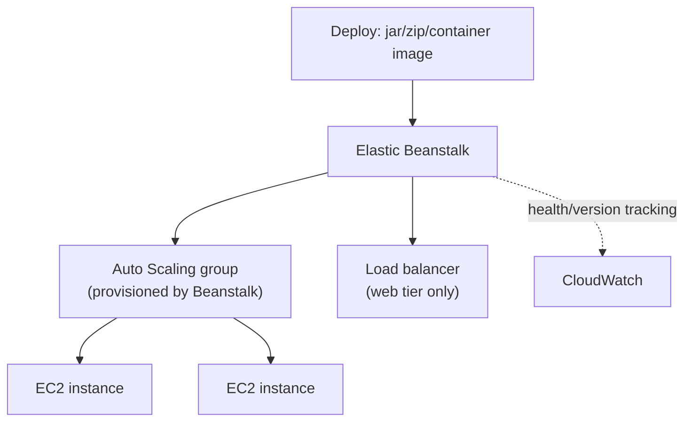

# AWS Elastic Beanstalk

Elastic Beanstalk is a **platform-as-a-service** layer over EC2: you supply
an application bundle (a jar, a container image, a zip of source), and
Beanstalk provisions and wires together the EC2 instances, Auto Scaling
group, load balancer, and security groups needed to run it, then keeps
managing that infrastructure on your behalf.

## Page Overview

This page covers: what Beanstalk automates versus a hand-built EC2/ASG/ALB
stack; deploying a Spring Boot application to a web-tier environment;
environment types; `.ebextensions` configuration; deployment policies and
their trade-offs; failure modes; and production guidance. It assumes the
reader already knows EC2, Auto Scaling, and load balancing from
[Compute, EBS, Scaling And Entry Points](./AWS-COMPUTE-EBS-SCALING.md).

## Prerequisites

- [AWS Compute, EBS, Scaling And Entry Points](./AWS-COMPUTE-EBS-SCALING.md)
  (EC2, Auto Scaling, Auto Healing, load balancers)
- [AWS VPC And Networking](./AWS-VPC-NETWORKING.md)

## Core Terminology

- **Application**: the logical container for one or more environments
  (e.g., separate `staging` and `production` environments of the same app).
- **Environment**: one running instantiation of the application, with its
  own EC2/ASG/ALB resources, configuration, and URL.
- **Platform**: the managed runtime image (Corretto/Java, Node.js, Python,
  Docker, etc.) Beanstalk provisions onto each instance.
- **Environment tier**: **web server tier** (fronted by a load balancer, for
  HTTP services) or **worker tier** (consumes an SQS queue, for background
  processing — no public load balancer).

## Mental Model



Beanstalk does not run your code on a Beanstalk-owned server — it owns the
EC2/ASG/ALB resources in *your* account and VPC, visible in the EC2/ASG/ALB
consoles like any other resource, and billed as those underlying resources.
This is the key difference from Lambda or a fully-managed container
platform: you can still SSH to the instances and inspect them, which is
also why Beanstalk does not remove host-level patching/capacity-planning
responsibility the way a serverless platform does.

## First Working Example

Deploying a Spring Boot jar to a new web-tier environment, via the EB CLI:

```bash
eb init shopverse-checkout --platform "Corretto 21" --region us-east-1
eb create checkout-staging --envvars SPRING_PROFILES_ACTIVE=staging
eb deploy
```

`eb create` provisions the environment's EC2/ASG/ALB stack from scratch
(this takes several minutes); `eb deploy` ships a new application version
to an *existing* environment using whichever deployment policy the
environment is configured with (see below). A Spring Boot jar run this way
must bind to the port Beanstalk's web-tier proxy expects (`PORT`
environment variable, default `5000` on recent Corretto platforms, or
`8080` behind the platform's embedded reverse proxy depending on platform
version) — mismatching this port is the most common "environment shows
Severe health, instance looks fine when I SSH in" symptom for a first
deployment.

## Environment Types

| Tier | Front door | Fits |
|---|---|---|
| Web server | Application Load Balancer | synchronous HTTP services, the normal case for a REST API |
| Worker | None — polls an SQS queue Beanstalk creates/manages | background/async processing (report generation, email sending, order-event fan-out work), decoupled from request/response latency |

A worker-tier environment still runs on EC2/ASG underneath, but has no
public load balancer; Beanstalk instead runs a local daemon on each
instance that pulls messages from the queue and posts them to your
application's configured HTTP path internally — the queue, not an inbound
request, is the trigger.

## Configuration: `.ebextensions`

Configuration that is not part of the application code itself — environment
variables, instance type, scaling triggers, extra software packages, custom
Nginx/Apache settings — lives in versioned `.ebextensions/*.config` files
deployed alongside the application bundle, so environment configuration is
reviewed and deployed like code rather than hand-edited in the console:

```yaml
# .ebextensions/01-options.config
option_settings:
  aws:autoscaling:asg:
    MinSize: 2
    MaxSize: 6
  aws:elasticbeanstalk:application:environment:
    JAVA_TOOL_OPTIONS: "-Xms512m -Xmx512m"
```

Console-only configuration changes are easy to lose on the next
environment rebuild or terminate/recreate; `.ebextensions` (or an
equivalent saved configuration template) is the durable, reviewable form.

## Example Progression: Deployment Policies

| Policy | Mechanism | Downtime | Rollback cost | Fits |
|---|---|---|---|---|
| All at once | deploys to every instance simultaneously | brief outage during deploy | re-deploy old version (also causes downtime) | dev/test environments only |
| Rolling | deploys in batches, draining each batch first | none, but reduced capacity during rollout | re-deploy previous version in batches | cost-sensitive production, tolerant of a temporary capacity dip |
| Rolling with additional batch | launches one extra batch of new capacity before rolling | none, no capacity reduction | re-deploy previous version | production that cannot reduce capacity during deploy |
| Immutable | launches a full parallel environment of new-version instances, shifts traffic, then terminates the old ones | none | terminate the new instances, no mixed-version window | highest safety, slowest, most expensive during rollout |
| Blue/Green (swap CNAME) | deploy to a separate environment entirely, then swap DNS/CNAME | none | swap CNAME back — fastest realistic rollback | the only policy with instant rollback, at the cost of running two full environments temporarily |

Rolling and rolling-with-additional-batch both run old and new application
versions side by side during the rollout — the same expand/migrate/contract
discipline required for database schema changes elsewhere on this site
applies here too: a rolling deploy that is not backward/forward compatible
with itself will serve inconsistent behavior mid-rollout, independent of
Beanstalk's own correctness.

## Boundaries And Trade-Offs

- Beanstalk automates provisioning and basic deployment orchestration; it
  does **not** remove host-level OS patching, capacity-planning, or
  security-group review responsibility — those are still EC2/ASG/ALB
  resources you own.
- Beanstalk is not a container orchestrator: for services needing
  fine-grained scheduling, service mesh, or complex multi-container
  topologies, ECS or EKS fit better; Beanstalk's abstraction is intentionally
  coarser (one application, one environment, one scaling policy per tier).
- Configuration drift is possible if changes are made in the console instead
  of `.ebextensions` — the next environment rebuild silently reverts them.

## Failure Modes, Edge Cases, And Common Mistakes

- **Degraded/Severe health with no application error**: check the port the
  application is listening on against what the platform's proxy expects,
  and check the ALB target-health check path/port configured for the
  environment — a mismatch here looks identical to an application crash in
  the Beanstalk console.
- **Deployment appears to hang**: a Rolling or Immutable deployment waiting
  on a batch that never reports healthy is usually a health-check
  misconfiguration (see [Auto Healing](./AWS-COMPUTE-EBS-SCALING.md#auto-healing)),
  not a stuck deployment process.
- **Worker-tier environment processes messages twice**: Beanstalk's worker
  daemon follows standard SQS at-least-once delivery semantics: the
  application endpoint it calls must be idempotent, exactly as any other
  SQS consumer on this site must be.
- **Scaling triggers configured in the console disappear after a
  terminate/recreate**: console changes are not part of the versioned
  application bundle; move them into `.ebextensions`.

## Production And Diagnostic Guidance

- Place the environment's EC2 instances in private subnets behind the
  ALB, following the VPC guide's public/private split — do not expose
  application instances directly.
- Terminate TLS at the ALB (Beanstalk provisions it as a standard ALB) and
  keep the Beanstalk-managed listener configuration under
  `.ebextensions`, not console edits.
- Stream application and web-server logs to CloudWatch Logs (Beanstalk can
  be configured to do this automatically) rather than relying on
  instance-local log retrieval, which is lost when an instance is
  terminated by Auto Scaling or Auto Healing.
- Weigh Beanstalk's convenience against cost and control: it still bills
  for the underlying EC2/ALB/ASG resources at normal rates, with no
  platform fee of its own, but gives up some of the fine-grained control a
  hand-built stack or ECS/EKS would offer.

## Tricky Interview Questions

**A Beanstalk environment shows "Severe" health, but SSH-ing into the
instance shows the application process running fine. What do you check
first?** The ALB target-group health-check path/port and the port the
application actually binds to inside the platform's expected convention —
Beanstalk's health status is driven by the same ELB target-health check
covered in Auto Healing, not by whether the process exists on the host.

**Why does an Immutable deployment cost more and take longer than a
Rolling deployment, and when is that worth it?** Immutable launches a
complete parallel environment of new-version instances before shifting
any traffic, so it briefly runs double the capacity and takes as long as a
full environment launch; it is worth the cost when a bad rollout must
never affect any fraction of production traffic even transiently, which a
Rolling deployment cannot guarantee during its batch window.

**A team argues Beanstalk removes the need to think about Auto Scaling or
load-balancer configuration. What is wrong with that claim?** Beanstalk
provisions sensible defaults for ASG and ALB, but the resulting Auto
Scaling group, target group, and health checks are ordinary resources in
the account that still need deliberate min/max sizing, health-check
tuning, and the same Auto Healing reasoning as a hand-built stack —
Beanstalk automates the provisioning step, not the capacity-planning
judgment.

## Summary / Review Checklist

- Beanstalk is PaaS over ordinary EC2/ASG/ALB resources you still own and
  can inspect — not a black box and not serverless.
- Web tier fronts HTTP traffic with an ALB; worker tier consumes an
  SQS queue with no public load balancer.
- Put configuration in `.ebextensions`, not console edits, so it survives
  environment rebuilds.
- Choose a deployment policy by how much mid-rollout capacity loss and
  rollback delay the business can tolerate: All-at-once and Rolling are
  cheapest and riskiest; Immutable and Blue/Green are safest and most
  expensive.
- Worker-tier message handling must be idempotent — it is still SQS
  underneath.

## Recommended Next

Return to the [AWS Umbrella](./AWS-UMBRELLA.md) service map, or continue
with [Auto Healing](./AWS-COMPUTE-EBS-SCALING.md#auto-healing) if you have
not already covered it.

## Official References

- [AWS Elastic Beanstalk developer guide](https://docs.aws.amazon.com/elasticbeanstalk/latest/dg/Welcome.html)
- [Elastic Beanstalk deployment policies](https://docs.aws.amazon.com/elasticbeanstalk/latest/dg/environments-cfg-deploypolicies.html)
- [Elastic Beanstalk worker environments](https://docs.aws.amazon.com/elasticbeanstalk/latest/dg/concepts-webserver.html)
