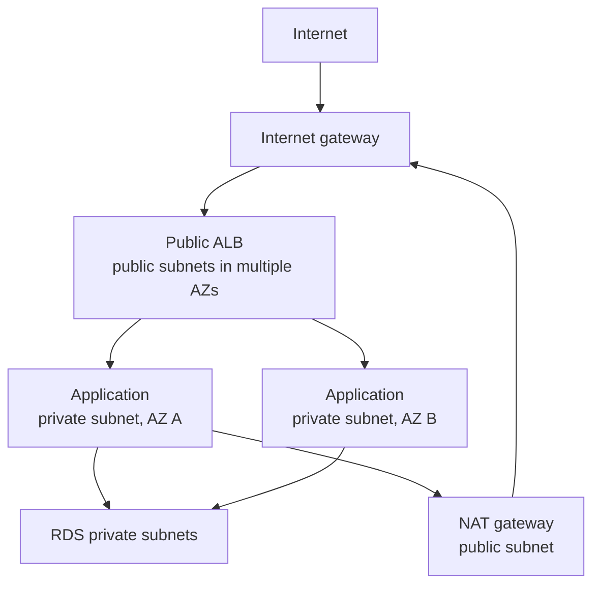

# AWS VPC And Networking

A Virtual Private Cloud is a logically isolated regional network. Its CIDR
range is divided into subnets, and each subnet belongs to exactly one
Availability Zone (AZ).

## Public And Private Subnets

A **public subnet** has a route to an internet gateway. A resource is not
public merely because it is in that subnet: it also needs a public address and
security rules that permit the traffic.

A **private subnet** has no direct route to an internet gateway. Private
workloads can initiate internet access through a NAT gateway in a public subnet,
or use VPC endpoints to reach supported AWS services without traversing the
public internet. A NAT gateway does not accept unsolicited inbound connections.

## CIDR Notation And Subnet Math

A CIDR block such as `10.0.0.0/16` states the network address and a prefix
length: the prefix length is how many leading bits are fixed for the
network, leaving `32 - prefix` bits for host addresses. A `/16` has
`2^(32-16) = 65,536` addresses; AWS reserves 5 addresses per subnet (network,
broadcast-equivalent, and 3 for its own DNS/routing use), so a `/24` subnet
(256 addresses) usable count is `256 - 5 = 251`.

Worked example — sizing a `10.0.0.0/16` VPC for a checkout path spread
across 3 Availability Zones, with public subnets for load balancers/NAT and
private subnets for the order, payment, and inventory services:

| Subnet | CIDR | Usable addresses | Purpose |
|---|---|---|---|
| `10.0.0.0/24` | AZ-a public | 251 | ALB, NAT gateway |
| `10.0.1.0/24` | AZ-b public | 251 | ALB, NAT gateway |
| `10.0.2.0/24` | AZ-c public | 251 | ALB, NAT gateway |
| `10.0.10.0/24` | AZ-a private | 251 | order-service, payment-service, inventory-service tasks |
| `10.0.11.0/24` | AZ-b private | 251 | order-service, payment-service, inventory-service tasks |
| `10.0.12.0/24` | AZ-c private | 251 | order-service, payment-service, inventory-service tasks |

A `/16` split into `/24` subnets yields up to 256 subnets of 251 usable
addresses each — far more than this example needs, but sizing generously up
front avoids a disruptive VPC CIDR expansion later. A smaller `/28` subnet
(16 addresses, 11 usable) is a common mistake for an EKS private subnet: EKS
assigns a secondary IP to every pod by default, so a handful of nodes can
exhaust an undersized subnet's address space even though instance count
looks small.

NAT gateways are deployed per AZ (not shared) when cross-AZ data-transfer
cost and the blast radius of losing one AZ's NAT path both matter; a single
shared NAT gateway is cheaper but makes every other AZ's egress depend on
one AZ staying healthy.

**Security groups** are stateful: a rule that allows outbound traffic
automatically allows the matching return traffic without a separate inbound
rule. **Network ACLs** are stateless: an NACL permitting outbound traffic on
an ephemeral port range must also have an inbound rule permitting the
return traffic on that same ephemeral range, or the response is silently
dropped — a frequent root cause of "security group looks correct but the
connection still fails" tickets.

## Route Tables And Gateways

- A route table chooses the next hop using the most-specific matching destination.
- Every subnet is associated with one route table; a table can serve many subnets.
- The local route enables traffic inside the VPC CIDR.
- An internet gateway connects eligible public-address traffic to the internet.
- A NAT gateway gives private resources outbound IPv4 access; deploy per AZ when cross-AZ dependency and charges matter.
- Gateway or interface VPC endpoints provide private access to supported services.
- A transit gateway connects many VPCs and on-premises networks at hub scale.

## Security Layers

**Security groups** are stateful rules attached to network interfaces. Prefer
referencing another security group, such as allowing the application group to
reach the database group, instead of broad CIDR rules.

**Network ACLs** are stateless subnet-boundary rules. They are useful for coarse
controls but are not a substitute for security groups. DNS, ephemeral ports,
return paths, and asymmetric routes are common troubleshooting areas.

## Production Checklist

- Use at least two AZs for load-balanced production tiers.
- Keep databases and application instances private; expose a load balancer or API gateway.
- Avoid overlapping CIDRs if networks may later connect.
- Enable VPC Flow Logs where investigation and compliance require them.
- Use endpoints for high-volume AWS-service traffic when security and cost justify them.
- Monitor NAT, endpoint, load-balancer, and cross-AZ data costs.
- Treat routing, security groups, and endpoints as reviewed infrastructure code.

## Interview Questions

**How many usable host addresses does a `/27` subnet have on AWS?** A `/27`
has `2^(32-27) = 32` addresses; AWS reserves 5, leaving 27 usable.

**Two VPCs use `10.0.0.0/16` and `10.0.5.0/24`. Can they be peered?** No —
`10.0.5.0/24` falls entirely inside `10.0.0.0/16`, so the ranges overlap.
VPC peering (and most hybrid-connectivity options) requires non-overlapping
CIDR blocks; overlap must be resolved before connecting them, not after.

**A connection succeeds outbound but the response never arrives, even
though the security group looks correct. What would you check next?** The
subnet's Network ACL: NACLs are stateless, so the inbound rule for the
ephemeral port range the client used for the return traffic may be missing
even though the security group (stateful) is configured correctly.
