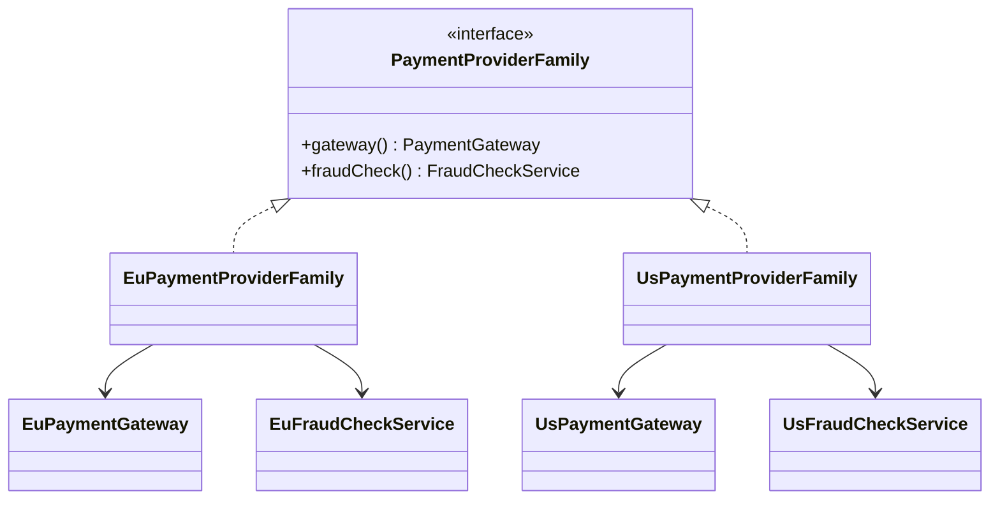

# Abstract Factory Pattern in Java and Spring

<DocLabels items={[{label: 'GoF creational', tone: 'advanced'}, {label: 'Product families', tone: 'foundation'}, {label: 'Architecture', tone: 'production'}]} />

Abstract Factory provides an interface for creating a **family of related
products** without exposing their concrete classes. Its important promise is
compatibility across the whole family, not merely hiding `new`.

## The Problem

Shopverse accepts payments in multiple regions. Each region's payment
provider requires a matching fraud-check service — EU transactions must be
screened by the EU-licensed fraud provider under the same contractual
agreement as the EU payment gateway, and mixing providers across regions is
a compliance violation, not just a bug. If application code selects each
client independently, it can accidentally assemble a mismatched pair:

```java
PaymentGateway gateway = new EuPaymentGateway(properties);
FraudCheckService fraudCheck = new UsFraudCheckService(properties); // accidental mismatch
```

Provider conditionals then spread across configuration classes, tests, and
business services. Adding a region changes every switch, and nothing in the
design guarantees that the selected gateway and fraud checker belong
together.

## What The Pattern Changes



Clients see only application-owned product contracts. One factory owns the
decision about which concrete family is valid, so a gateway and its fraud
checker can never be assembled from different regions.

## Implementation 1: Classic Java Abstract Factory

```java
public interface PaymentGateway {
    PaymentResult charge(PaymentCommand command);
}

public interface FraudCheckService {
    FraudDecision screen(PaymentCommand command);
}

public interface PaymentProviderFamily {
    PaymentGateway gateway();
    FraudCheckService fraudCheck();
}
```

```java
public final class EuPaymentProviderFamily implements PaymentProviderFamily {
    private final EuRegionProperties properties;

    public EuPaymentProviderFamily(EuRegionProperties properties) {
        this.properties = properties;
    }

    @Override
    public PaymentGateway gateway() {
        return new EuPaymentGateway(properties.gateway());
    }

    @Override
    public FraudCheckService fraudCheck() {
        return new EuFraudCheckService(properties.fraudCheck());
    }
}
```

The composition root chooses exactly one family:

```java
PaymentProviderFamily providers = switch (configuration.region()) {
    case EU -> new EuPaymentProviderFamily(configuration.eu());
    case US -> new UsPaymentProviderFamily(configuration.us());
};

CheckoutPaymentHandler handler = new CheckoutPaymentHandler(
        providers.gateway(),
        providers.fraudCheck()
);
```

### Drawbacks

- Adding a **new family** (region) is localized: implement one factory and its
  two products.
- Adding a **new product type** (e.g. a currency-conversion service every
  region also needs) is expensive: every factory interface and every concrete
  family must change.
- A factory that creates new clients on every call can duplicate connection
  pools and threads.

### Remedies

Keep the family narrow and cohesive. Return cached, lifecycle-managed clients
when they are expensive. If products do not need to vary together, use
independent factories or direct dependency injection instead.

### The Bug: A Mismatched Family Slips Past The Compiler

Nothing in plain field assignment stops this, because `PaymentGateway` and
`FraudCheckService` are each independently valid types — the invariant
Abstract Factory exists to protect is invisible to the type system once two
objects are constructed separately:

```java
@Configuration
class MisconfiguredPaymentWiring {

    @Bean
    PaymentGateway gateway(EuRegionProperties euProperties) {
        return new EuPaymentGateway(euProperties.gateway());
    }

    @Bean
    FraudCheckService fraudCheck(UsRegionProperties usProperties) {
        // BUG: wired from US properties into a bean that serves EU traffic
        return new UsFraudCheckService(usProperties.fraudCheck());
    }
}
```

```java
// An EU customer's card is charged by the EU gateway...
PaymentResult result = gateway.charge(command);
// ...but screened by a fraud service that is not licensed for EU data and
// does not share the EU gateway's chargeback/dispute agreement. The charge
// succeeds; the compliance violation is invisible until an audit.
fraudCheck.screen(command);
```

Routing both beans through one `PaymentProviderFamily` per region removes
the possibility entirely: there is no code path that can construct a
gateway and fraud checker from different regions, because `gateway()` and
`fraudCheck()` on the same factory instance are the only way to obtain either
one.

## Implementation 2: Spring Configuration Families

Spring can make the application context the family assembly boundary:

```java
@Configuration
@Profile("eu")
class EuPaymentProviderConfiguration {

    @Bean
    PaymentGateway paymentGateway(EuRegionProperties properties) {
        return new EuPaymentGateway(properties.gateway());
    }

    @Bean
    FraudCheckService fraudCheckService(EuRegionProperties properties) {
        return new EuFraudCheckService(properties.fraudCheck());
    }
}
```

An equivalent `UsPaymentProviderConfiguration` activates under the `us`
profile, reading only `UsRegionProperties`. Business services inject the two
contracts and never inspect the active region — and because each
configuration class reads from exactly one region's properties, the
mismatched-bean bug above cannot happen through profile-scoped wiring.

### Drawbacks

- String profile names can be misspelled or activated together.
- Conditional configuration can become difficult to trace.
- Context-heavy tests are slower than plain unit tests.

### Remedies

Validate that exactly one region profile is configured, group region
properties with `@ConfigurationProperties`, use focused context tests for
wiring, and keep business behavior in plain unit-testable classes.

## Implementation 3: An Immutable Product-Family Record

When the family only groups already-created collaborators, a record can be
clearer than creation methods:

```java
public record RegionalPaymentProviders(
        PaymentGateway gateway,
        FraudCheckService fraudCheck
) {
    public RegionalPaymentProviders {
        Objects.requireNonNull(gateway);
        Objects.requireNonNull(fraudCheck);
    }
}
```

This is not the textbook GoF shape, but it preserves the compatibility
boundary without pretending that the group constructs objects repeatedly.

## When Not To Use It

Avoid Abstract Factory when:

- only one product varies—use Factory Method or direct injection;
- the family members have no compatibility relationship;
- provider selection occurs once in Spring configuration and an extra factory
  adds no useful boundary;
- callers need arbitrary mixing, because the pattern would enforce a false
  invariant.

## Testing The Design

Define contract tests once and run them against every family:

```java
abstract class PaymentProviderFamilyContract {
    protected abstract PaymentProviderFamily family();

    @Test
    void gatewayAndFraudCheckAgreeOnRegion() {
        PaymentResult result = family().gateway().charge(sampleCommand());
        FraudDecision decision = family().fraudCheck().screen(sampleCommand());

        assertThat(result.region()).isEqualTo(decision.region());
    }
}
```

Running the same contract against `EuPaymentProviderFamily` and
`UsPaymentProviderFamily` is exactly what would have caught the mismatched-bean
bug above: the test fails the moment `gateway().region()` and
`fraudCheck().region()` disagree, regardless of which configuration class or
constructor call produced them. Also test provider-selection failure,
lifecycle cleanup, and configuration validation. A useful architecture test
can assert that domain packages do not import vendor SDK packages.

## Interview-Ready Answer

> Abstract Factory creates a compatible family of related products behind
> application-owned contracts. It makes adding a new family easy but adding a
> new product expensive because all families must change. In Spring I often
> express the family as conditional configuration, validate that exactly one
> family is active, and keep expensive clients container-managed.

## Related Patterns

- [Factory Method](./factory.md) selects one product rather than a family.
- [Builder](./builder.md) assembles one complex product step by step.
- [Adapter](./adapter.md) can wrap each vendor product behind the
  application-owned contracts used by the factory.

## Official References

- [Spring Java-based container configuration](https://docs.spring.io/spring-framework/reference/core/beans/java.html)
- [Spring bean definition profiles](https://docs.spring.io/spring-framework/reference/core/beans/environment.html#beans-definition-profiles)
