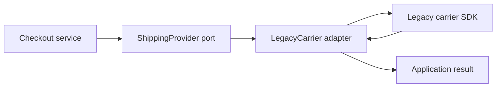

# Adapter Pattern in Spring

<DocLabels items={[{label: 'Interview priority', tone: 'advanced'}, {label: 'Structural', tone: 'foundation'}, {label: 'Integration', tone: 'production'}]} />

Adapter translates an incompatible interface into the contract the application
expects. It is the implementation at a port in ports-and-adapters architecture.

## Keep the Port Application-Owned

```java
public interface ShippingProvider {
    ShipmentQuote quote(ShipmentRequest request);
    TrackingStatus track(TrackingNumber trackingNumber);
}

public record ShipmentRequest(
        OrderId orderId,
        Address origin,
        Address destination,
        Weight weight
) {}
```

The contract uses application language and types. A provider adapter owns all
vendor translation. `LegacyCarrierClient` is a decade-old SDK this application
did not design and cannot change:

```java
@Component
final class LegacyCarrierAdapter implements ShippingProvider {
    private final LegacyCarrierClient client;

    public ShipmentQuote quote(ShipmentRequest request) {
        LegacyRateResponse response = client.getRate(
                request.origin().zip(),
                request.destination().zip(),
                request.weight().grams() / 1000.0 // SDK takes kilograms, as a double
        );

        return switch (response.rateCode()) {
            case 100 -> ShipmentQuote.available(Money.ofCents(response.costCents()));
            case 404 -> ShipmentQuote.unavailable("no service to destination");
            default -> throw new UnknownCarrierRateCode(response.rateCode());
        };
    }

    public TrackingStatus track(TrackingNumber trackingNumber) {
        LegacyTrackResponse response = client.track(trackingNumber.value());
        return TrackingStatus.valueOf(response.statusText().toUpperCase());
    }
}
```

The adapter may use `WebClient`, RestClient, a generated client, or an SDK. Those
choices must not leak through the port.

## Translation Responsibilities

- convert units without rounding or type mistakes (the SDK above takes a
  `double` kilogram value; the domain stores integer grams);
- map vendor status/rate codes to owned domain outcomes;
- translate transport exceptions into a small failure taxonomy;
- attach idempotency and correlation identifiers;
- validate provider responses instead of accepting unknown values silently;
- keep credentials and timeouts in typed configuration;
- record provider-safe metrics without sensitive data.



<DocCallout type="mistake" title="Do not leak provider types through the port">

Returning `LegacyRateResponse` forces business code and tests to understand the
vendor. Return an application-owned `ShipmentQuote`; preserve raw provider data
only where audit or support requirements justify it.

</DocCallout>

## The Failure Without An Adapter

Suppose checkout code calls `LegacyCarrierClient` directly instead of through a
port, because it seemed faster to wire up:

```java
double rate = legacyCarrierClient
        .getRate(origin.zip(), destination.zip(), weightGrams) // bug: still grams, not kg
        .costCents();
```

This compiles and works in every test that happens to ship light packages,
because small gram values divided by 1000 and multiplied back by the vendor's
internal kg-to-cents formula produce numbers that look plausible. In production,
a 20kg package is quoted as if it weighs 20,000kg — the vendor's rate engine
silently returns its heaviest-tier flat rate instead of erroring, and checkout
charges the customer the wrong shipping cost for weeks before anyone notices the
revenue-per-shipment numbers are wrong. The root cause is not a typo caught by a
compiler: it is that the unit conversion the adapter is responsible for
(`request.weight().grams() / 1000.0`) was duplicated, incorrectly, at every call
site that bypassed the port. Centralizing the conversion in one adapter does not
prevent every mistake, but it means there is exactly one place to find and fix
it, and one set of mapping tests that would have caught it.

## Multiple Providers

One adapter per provider can implement the same port. Select it with a
[Strategy](./strategy.md) registry or [Factory](./factory.md). Avoid a single
adapter containing provider switches and unrelated mappings.

## Testing

Unit-test mapping boundaries, including unknown status/rate codes, malformed
response, unit conversion (the kg/grams boundary above is exactly the kind of
case to assert with a fixed input and an exact expected output), and exception
translation. Use a mock HTTP server or vendor sandbox for transport contract
tests. A shared contract test suite can verify that every adapter honors the
port's success and failure semantics.

## Adapter Versus Facade

Adapter changes an interface for compatibility. Facade simplifies a complex
subsystem behind a higher-level API. One class may do both, but naming the primary
intent keeps responsibilities reviewable.

## Interview-Ready Answer

> Adapter lets the application depend on its own port while a Spring bean
> translates to and from a vendor API. I keep provider DTOs, status codes,
> exceptions, money units, and credentials inside the adapter and verify it with
> mapping and contract tests. This reduces vendor coupling, but it should not
> become a second business-service layer.

## Related Patterns

- [Bridge](./bridge.md) separates two application-controlled dimensions of
  variation; Adapter reconciles an existing incompatible API.
- [Decorator](./decorator.md) can add metrics or resilience around the port.

## Official References

- [Spring HTTP interface clients](https://docs.spring.io/spring-framework/reference/integration/rest-clients.html#rest-http-interface)
- [Spring `HandlerAdapter`](https://docs.spring.io/spring-framework/reference/web/webmvc/mvc-servlet/special-bean-types.html)
