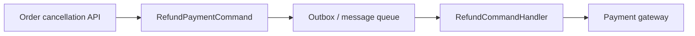

# Command Pattern in Spring

<DocLabels items={[{label: 'Interview priority', tone: 'advanced'}, {label: 'Behavioral', tone: 'foundation'}, {label: 'Spring', tone: 'production'}]} />

Command turns a request to perform an action into a standalone object,
decoupling the caller that triggers the action from the handler that
executes it — and letting that object be queued, logged, retried, or
reversed instead of only invoked synchronously and immediately.

## Recognize the Problem

A direct method call (`paymentService.refund(paymentReference, amount)`)
cannot easily be queued for later, retried after a transient failure,
audited as a discrete record, or undone. Representing the refund request as
a `RefundPaymentCommand` object turns "an action" into "a value that
describes an action" — which is exactly what a durable queue, an audit log,
or a retry mechanism needs to operate on.



## Spring Implementation

```java
public record RefundPaymentCommand(
        String paymentReference,
        BigDecimal amount,
        String reason
) {
}

public interface CommandHandler<C> {
    void handle(C command);
}

@Component
final class RefundPaymentCommandHandler implements CommandHandler<RefundPaymentCommand> {
    private final PaymentGateway gateway;

    @Override
    public void handle(RefundPaymentCommand command) {
        gateway.refund(command.paymentReference(), command.amount());
    }
}
```

A dispatcher resolves the right handler without the caller knowing which one:

```java
@Service
final class CommandDispatcher {
    private final Map<Class<?>, CommandHandler<?>> handlers;

    CommandDispatcher(List<CommandHandler<?>> candidates) {
        this.handlers = candidates.stream().collect(Collectors.toUnmodifiableMap(
                CommandDispatcher::commandType,
                Function.identity()
        ));
    }

    @SuppressWarnings("unchecked")
    <C> void dispatch(C command) {
        CommandHandler<C> handler = (CommandHandler<C>) handlers.get(command.getClass());
        if (handler == null) {
            throw new UnsupportedCommandException(command.getClass());
        }
        handler.handle(command);
    }
}
```

Because the command is a plain record, it can be serialized into an outbox
row or a queue message exactly as it is, instead of needing a bespoke
serialization format per action type.

## Runtime and Design Decisions

- A command should be a plain, serializable **value** — no injected
  dependencies inside the record itself. Dependencies (the gateway, the
  repository) live in the handler, which is resolved at execution time, not
  baked into the command when it is created.
- Undo is a deliberate design decision, not automatic: supporting "undo
  this refund" means designing a compensating command
  (`ReverseRefundCommand`) and reasoning about whether the original action
  is even reversible (a refund that already settled with the card network
  may not be) — Command gives you a place to put that logic, it does not
  provide it for free.
- Retrying a dispatched command is only safe if the handler's action is
  idempotent; the command pattern does not make an action safe to retry by
  itself, the same idempotency discipline required everywhere else on this
  site still applies at the handler.
- Decide the failure contract up front: does a failed command stay queued
  for retry, move to a dead-letter path, or surface synchronously to the
  caller? Mixing these per command type without a stated policy makes
  failure handling unpredictable.

<DocCallout type="production" title="A command queue needs the same reliability discipline as any other queue">

Once `RefundPaymentCommand` instances are queued rather than executed
inline, every production concern that applies to a message queue applies
here too: at-least-once delivery, ordering guarantees (or the lack of
them), dead-letter handling, and poison-message detection. Command gives
you the shape to put in the queue; it does not remove the need to design
for queue failure modes.

</DocCallout>

## Testing

Test command construction/validation independently of execution (a command
with a negative refund amount should fail before it ever reaches a
handler). Test the handler against the gateway contract with success,
transient-failure, and permanent-failure cases. Test the dispatcher for a
known command type, an unregistered command type, and — if commands are
queued — that a handler failure leaves the command in the expected
retry/dead-letter state rather than silently disappearing.

## Framework Examples

- `java.lang.Runnable` and `java.util.concurrent.Callable` are the JDK's
  minimal command abstractions — an action wrapped as a value that an
  executor can run later, on a different thread, or not at all.
- Spring's `TaskExecutor`/`ThreadPoolTaskExecutor` accept `Runnable`
  commands precisely so submission is decoupled from execution.
- Undo/redo editors and Spring Batch's step-retry mechanics are both
  Command-shaped: an action is represented as data so it can be replayed or
  reasoned about outside the original call site.

## Interview-Ready Answer

> Command turns a request into a standalone, serializable object so it can
> be queued, logged, retried, or undone instead of only invoked
> synchronously. The dependencies that actually perform the action live in
> the handler, not in the command value itself. The two things people
> forget: undo is not automatic — it requires a deliberately designed
> compensating command — and once commands are queued, every normal queue
> reliability concern (idempotency, ordering, dead-lettering) applies to
> them just as it would to any other message.

## Related Patterns

- [Strategy](./strategy.md) selects an algorithm to run immediately;
  Command represents the *request* to act as data that may run later.
- [Chain of Responsibility](./chain-of-responsibility.md) passes one
  request through ordered handlers; Command typically routes one request
  to exactly one handler.
- [Template Method](./template-method.md) fixes a sequence of steps in one
  class; a command handler is usually a single, focused step.

## Official References

- [`java.util.concurrent.Callable`](https://docs.oracle.com/en/java/javase/21/docs/api/java.base/java/util/concurrent/Callable.html)
- [Gang of Four Command pattern intent](https://en.wikipedia.org/wiki/Command_pattern)
