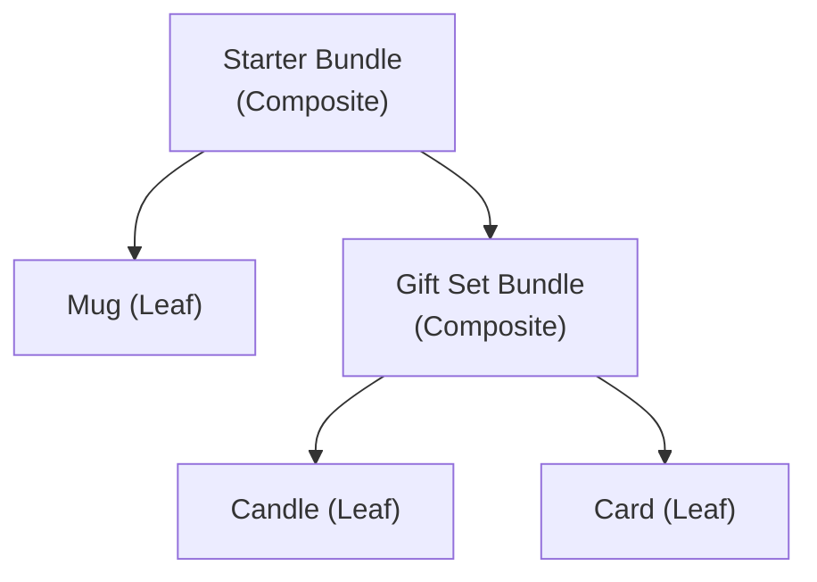

# Composite Pattern in Spring

<DocLabels items={[{label: 'Interview priority', tone: 'advanced'}, {label: 'Structural', tone: 'foundation'}, {label: 'Spring', tone: 'production'}]} />

Composite lets a caller treat a single object and a tree of objects through the
same contract. The caller does not need to know whether it holds one leaf or a
whole subtree.

## Recognize the Problem

A catalog needs to price a single SKU and a bundle (a kit of several SKUs, sold
as one line item) through the same calculation path — including a bundle that
itself contains another bundle. Without Composite, every caller that prices a
cart line must branch on "is this a plain item or a bundle", and that branch
duplicates wherever pricing, discounting, or tax calculation happens.



## Spring Implementation

A single `Priceable` contract covers both leaves and composites:

```java
public interface Priceable {
    BigDecimal price();
}

public record ProductItem(String sku, BigDecimal price) implements Priceable {
}

public final class ProductBundle implements Priceable {
    private final String bundleSku;
    private final List<Priceable> components;

    public ProductBundle(String bundleSku, List<Priceable> components) {
        this.bundleSku = bundleSku;
        this.components = List.copyOf(components);
        requireAcyclic(this, new HashSet<>());
    }

    @Override
    public BigDecimal price() {
        return components.stream()
                .map(Priceable::price)
                .reduce(BigDecimal.ZERO, BigDecimal::add);
    }

    private static void requireAcyclic(ProductBundle node, Set<String> seen) {
        if (!seen.add(node.bundleSku)) {
            throw new IllegalStateException("Cyclic bundle composition: " + node.bundleSku);
        }
        for (Priceable component : node.components) {
            if (component instanceof ProductBundle nested) {
                requireAcyclic(nested, seen);
            }
        }
    }
}
```

A pricing service calls `price()` on a cart line without caring whether it is a
leaf or a composite:

```java
@Service
final class CartPricingService {
    BigDecimal lineTotal(Priceable cartLine, int quantity) {
        return cartLine.price().multiply(BigDecimal.valueOf(quantity));
    }
}
```

## Runtime and Design Decisions

- The composite and the leaf implement the **same** interface; the caller never
  down-casts to find out which one it has.
- Build a tree-construction guard (as above) that rejects a bundle that contains
  itself, directly or transitively — an unguarded recursive composite is a
  stack-overflow and infinite-price-loop waiting to happen once catalog data is
  edited outside strict validation.
- A composite may need an operation a leaf does not support (for example,
  "list child SKUs"). Decide upfront whether leaves implement it as a no-op or
  whether the contract is split into a narrower shared interface plus a
  composite-only one — silently ignoring an operation on a leaf hides bugs.
- Caching a composite's computed price is only safe if the tree is immutable
  after construction; a mutable composite whose children change after caching
  will serve a stale total.

<DocCallout type="mistake" title="An unchecked composite can cycle">

Building a `ProductBundle` straight from persisted catalog data without cycle
detection lets one bad catalog edit (bundle A contains bundle B, which later
gets edited to contain bundle A) take down every service that prices a cart
with that bundle in it. Validate acyclicity at construction time, not only at
traversal time.

</DocCallout>

## Testing

Test a leaf alone, a composite of leaves, a composite of composites (at least
two levels deep), an empty composite (price zero, not an exception), and a
cyclic construction attempt that must fail fast. Prove the pricing service
behaves identically whether it receives a leaf or a composite — that
interchangeability is the entire point of the pattern.

## Framework Examples

- Spring's `CompositeCacheManager` delegates to an ordered list of
  `CacheManager` instances behind the single `CacheManager` contract.
- `org.springframework.validation.Errors` collects validation failures that
  can themselves be nested (`BindingResult` composing field and object errors).
- Servlet `Filter` chains are conceptually adjacent (see
  [Chain of Responsibility](./chain-of-responsibility.md)), though they pass a
  request through handlers rather than composing a priced tree.

## Interview-Ready Answer

> Composite lets a client treat a single object and a tree of objects through
> one shared interface — a bundle recursively prices its components the same
> way a single item prices itself. The design risk is an unguarded tree: a
> composite that can reference itself, directly or through a chain of other
> composites, turns a pricing call into infinite recursion. I validate
> acyclicity at construction and keep the tree immutable so a cached result
> cannot go stale.

## Related Patterns

- [Decorator](./decorator.md) wraps one delegate to add behavior; Composite
  aggregates many children to combine their results.
- [Chain of Responsibility](./chain-of-responsibility.md) passes a request
  through handlers sequentially; Composite combines results from a tree.
- [Facade](./facade.md) simplifies an API over several services; Composite
  unifies the API between a leaf and a group of the same type.

## Official References

- [Spring `CompositeCacheManager`](https://docs.spring.io/spring-framework/docs/current/javadoc-api/org/springframework/cache/support/CompositeCacheManager.html)
- [Gang of Four Composite pattern intent](https://en.wikipedia.org/wiki/Composite_pattern)
