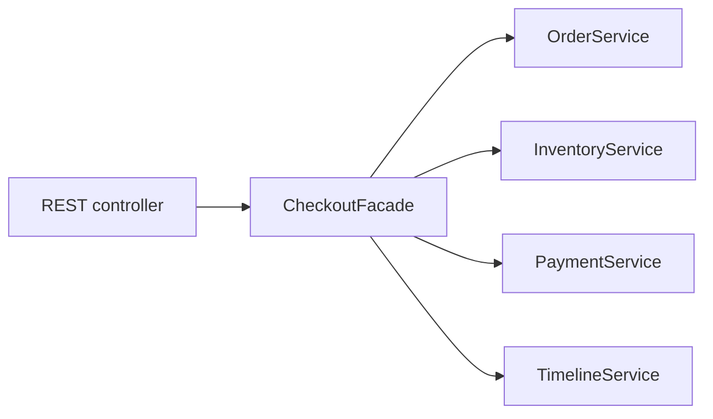

# Facade Pattern in Spring

<DocLabels items={[{label: 'Interview priority', tone: 'advanced'}, {label: 'Structural', tone: 'foundation'}, {label: 'Spring', tone: 'production'}]} />

Facade exposes one simplified entry point over several subsystems, so a caller
depends on a single, coherent API instead of orchestrating each subsystem's
details itself.

## Recognize the Problem

A checkout controller that calls the order, inventory, payment, timeline, and
notification services directly becomes the orchestration logic itself:

```java
orderService.create(request);
inventoryService.reserve(order);
paymentService.authorize(order);
timelineService.record(order);
notificationService.send(order);
```

Every caller of checkout (the REST controller, a batch replay tool, a test
harness) now has to repeat that exact sequence correctly, including error
handling and ordering. A facade owns the sequence once.



## Spring Implementation

```java
@Service
public class CheckoutFacade {

    private final OrderService orderService;
    private final InventoryService inventoryService;
    private final PaymentService paymentService;
    private final TimelineService timelineService;

    public CheckoutResponse checkout(CheckoutRequest request) {
        Order order = orderService.create(request);
        inventoryService.reserve(order);
        Payment payment = paymentService.authorize(order);
        timelineService.record(order, payment);
        return CheckoutResponse.from(order, payment);
    }
}
```

```java
@RestController
final class CheckoutController {
    private final CheckoutFacade checkoutFacade;

    @PostMapping("/checkout")
    CheckoutResponse checkout(@RequestBody CheckoutRequest request) {
        return checkoutFacade.checkout(request);
    }
}
```

## Runtime and Design Decisions

- A facade **coordinates** calls; it should not contain the business rules
  that belong in `OrderService` or `PaymentService`. The moment a facade
  starts branching on domain state — comparing an order total against a
  threshold to decide behavior, for example — it has become a second
  service layer wearing a facade's name; move that rule into the owning
  service.
- A facade does not need to expose every subsystem operation — only the
  subset a given use case needs. A different facade (or a direct call) is
  fine for a different use case over the same subsystems.
- Transaction and compensation boundaries belong at the facade (or an
  explicit saga/orchestrator) only when the use case genuinely spans
  services; within one service's own data, keep the boundary there instead.
- A facade is not a free performance improvement: it still makes the same
  calls to the same subsystems, in the same order, just from one place.

<DocCallout type="mistake" title="A facade that grows business logic stops being a facade">

If `CheckoutFacade` starts deciding discount eligibility, retry policy, or
fraud scoring inline, it has absorbed responsibilities that belong to
dedicated services. The test for whether a facade is still a facade: could
you delete it and replace every call site with the same five calls in the
same order, with no behavior lost? If not, logic has leaked in.

</DocCallout>

## The Failure When A Facade Absorbs Compensation Logic

Suppose `CheckoutFacade` is extended, one incident fix at a time, to also
"handle" the case where payment fails after inventory is already reserved —
without an explicit saga or outbox, because it felt like a two-line fix at the
time:

```java
public CheckoutResponse checkout(CheckoutRequest request) {
    Order order = orderService.create(request);
    inventoryService.reserve(order);
    try {
        Payment payment = paymentService.authorize(order);
        timelineService.record(order, payment);
        return CheckoutResponse.from(order, payment);
    } catch (PaymentDeclinedException e) {
        inventoryService.release(order); // "compensation", added inline
        orderService.cancel(order);      // also added inline
        throw e;
    }
}
```

This looks correct and passes the happy-path and simple-decline tests. It
silently breaks the moment `inventoryService.release(order)` itself throws (the
inventory service is briefly unavailable, say) or the process crashes between
`release` and `cancel`: the order is now cancelled in name but inventory was
never actually released, or inventory was released but the order still shows
as pending, and nothing records that this call ever reached the compensation
branch. There is no outbox entry, no retry, no audit trail — the facade is now
quietly acting as the application's only distributed-transaction coordinator,
with none of the durability a real saga or outbox gives that responsibility.
The fix is not to make the `try`/`catch` more careful; it is to recognize that
cross-service compensation belongs in an explicit orchestrator (see
[Mediator](./mediator.md)) or outbox-backed saga, not inline in a facade method
that was only ever meant to call five services in order.

## Testing

Test the facade's **orchestration**: that it calls the right subsystems in
the right order, that a failure partway through (e.g., payment declines
after inventory is reserved) triggers the expected compensation path, and
that the response is assembled correctly from each subsystem's result. Do
not re-test each subsystem's own business rules through the facade — those
belong in that subsystem's own test suite.

## Framework Examples

- `JdbcTemplate` is a facade over raw `java.sql` resource management
  (connections, statements, result sets, exception translation).
- `RestTemplate`/`RestClient` facade HTTP connection handling, serialization,
  and error mapping behind a small method-call surface.
- Spring's `JavaMailSender` facades the underlying JavaMail API's session,
  transport, and message-construction details.

## Interview-Ready Answer

> Facade gives callers one simplified entry point over several subsystems so
> the orchestration sequence lives in one place instead of being repeated by
> every caller. The risk is scope creep: a facade should coordinate calls,
> not accumulate the business rules that belong in the services it
> coordinates. I keep that boundary explicit by asking whether the facade
> could be deleted and inlined at every call site with identical behavior —
> if not, logic has leaked into it that should move back out.

## Related Patterns

- [Chain of Responsibility](./chain-of-responsibility.md) runs ordered
  handlers that each decide to continue or stop; Facade runs a fixed known
  sequence of subsystem calls.
- [Composite](./composite.md) unifies the API between a leaf and a group of
  the *same* type; Facade unifies access to several *different* subsystems.
- [Decorator](./decorator.md) adds behavior around one delegate; Facade
  simplifies access to several independent delegates.

## Official References

- [Spring `JdbcTemplate`](https://docs.spring.io/spring-framework/reference/data-access/jdbc/core.html)
- [Gang of Four Facade pattern intent](https://en.wikipedia.org/wiki/Facade_pattern)
