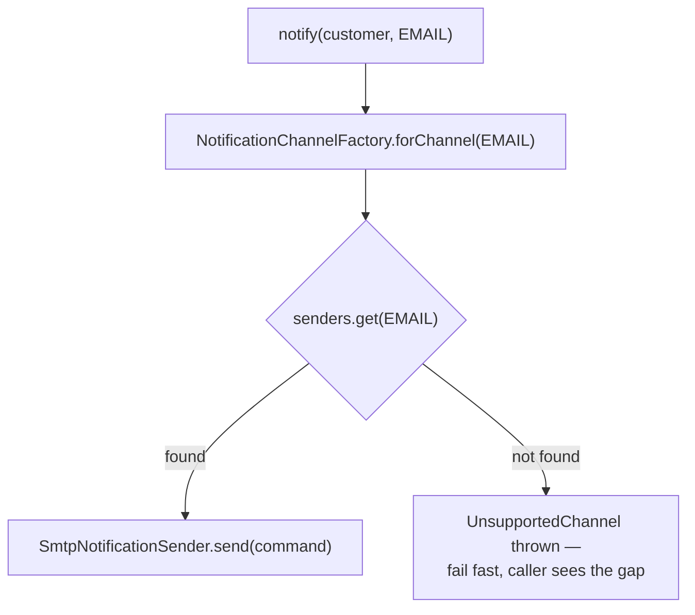

# Factory Method Pattern in Java and Spring

<DocLabels items={[{label: 'Interview priority', tone: 'advanced'}, {label: 'Creational', tone: 'foundation'}, {label: 'Spring', tone: 'production'}]} />

Factory centralizes a construction decision so callers depend on a product
contract rather than concrete classes or wiring details.

## The Problem

Without a factory, the order-confirmation use case can become responsible for
policy, configuration, construction, and execution:

```java
NotificationResult notify(NotificationChannel channel, OrderConfirmedCommand command) {
    NotificationSender sender = switch (channel) {
        case EMAIL -> new SmtpNotificationSender(smtpHost, smtpPort, templateEngine);
        case SMS -> new TwilioNotificationSender(accountSid, authToken);
        case PUSH -> new FcmNotificationSender(fcmCredentials);
    };
    return sender.send(command);
}
```

The business method now changes whenever a channel is added. Tests must know
every constructor, and manually created dependencies may bypass Spring proxies,
configuration, metrics, or lifecycle management.

The stable boundary should be `NotificationSender`; channel selection and
creation should have one explicit owner.

## Factory Method, Simple Factory, And Registry

These implementations are often all called “factory” in application code:

| Shape | Selection owner | Best fit |
|---|---|---|
| GoF Factory Method | subclasses override a creation method | a framework owns an algorithm but lets subclasses choose a product |
| simple factory | one method uses input to construct a product | a small, closed set of runtime-created products |
| injected registry | a key maps to an existing managed product | Spring beans selected at runtime |
| `FactoryBean<T>` | Spring extension point creates a bean | complex third-party object integration |

The intent matters more than forcing the textbook class diagram.

## Implementation 1: Classic Factory Method

The creator owns a stable workflow and delegates only the product decision:

```java
public abstract class OrderConfirmationProcessor {

    public final NotificationResult process(OrderConfirmedCommand command) {
        validate(command);
        NotificationSender sender = createSender();
        return sender.send(command);
    }

    protected abstract NotificationSender createSender();

    private void validate(OrderConfirmedCommand command) {
        Objects.requireNonNull(command);
    }
}

public final class TestOrderConfirmationProcessor extends OrderConfirmationProcessor {
    @Override
    protected NotificationSender createSender() {
        return new RecordingNotificationSender();
    }
}
```

### Drawback And Solution

Each product variant may require another creator subclass, and inheritance
couples selection to the workflow. Prefer composition—a simple factory or
injected registry—when callers only need a product and no overridable workflow.

## Choose the Right Factory

| Need | Prefer |
|---|---|
| choose among existing singleton beans | injected registry |
| create a short-lived object from runtime data | application factory |
| customize how Spring creates a complex bean | `@Bean` method or `FactoryBean` |
| request scoped/prototype bean from a singleton | `ObjectProvider<T>` |
| only wire a fixed dependency graph | constructor injection, no custom factory |

## Implementation 2: Spring-Managed Registry

For managed notification channels, the factory should return existing beans
rather than call `new` and bypass Spring lifecycle behavior:

```java
public interface NotificationSender {
    NotificationChannel channel();
    NotificationResult send(OrderConfirmedCommand command);
}

@Component
final class NotificationChannelFactory {
    private final Map<NotificationChannel, NotificationSender> senders;

    NotificationChannelFactory(List<NotificationSender> candidates) {
        this.senders = candidates.stream().collect(Collectors.toUnmodifiableMap(
                NotificationSender::channel,
                Function.identity()
        ));
    }

    NotificationSender forChannel(NotificationChannel channel) {
        return Optional.ofNullable(senders.get(channel))
                .orElseThrow(() -> new UnsupportedChannel(channel));
    }
}
```

This is often called a factory in application code, although it combines lookup
with Spring-managed registration.



### Drawbacks And Solutions

- Duplicate channel keys can fail only at startup. Collect with a merge
  function that throws a descriptive exception and cover it with a context test.
- A string-keyed map is typo-prone. Prefer a domain enum or value type.
- Returning singleton beans is not object creation. Name the type `Registry` or
  `Resolver` when accurate terminology improves the design.

### The Bug: Falling Through To A Default Instead Of Failing Fast

The diagram above throws on a missing key. Here is the version that does not,
and the production incident it causes:

```java
NotificationSender forChannel(NotificationChannel channel) {
    // BUG: silently falls back to EMAIL instead of failing fast
    return senders.getOrDefault(channel, senders.get(NotificationChannel.EMAIL));
}
```

```java
// Customer opted into SMS-only notifications and has no email on file.
NotificationSender sender = factory.forChannel(NotificationChannel.SMS);
sender.send(command);
// NotificationChannel.SMS was never registered (its bean failed to start
// because of a missing Twilio credential), so this silently sends an email
// — to an address that does not exist. send() returns success. The customer
// never learns their order confirmed, and nothing in the logs says why.
```

The `orElseThrow` version from the main implementation would have failed the
request immediately with `UnsupportedChannel(SMS)`, surfacing the missing
Twilio bean at the call site instead of three support tickets later. A test
that registers only `EMAIL` and asserts `forChannel(SMS)` throws — rather than
asserts it returns *something* — is what catches this before production does.

## Implementation 3: A Simple Factory For Runtime Objects

When each call must construct a new domain object, pass runtime data explicitly:

```java
public final class RefundFactory {
    private final Clock clock;

    public Refund create(RefundCommand command) {
        if (command.amount().signum() <= 0) {
            throw new IllegalArgumentException("refund amount must be positive");
        }
        return Refund.requested(
                RefundId.newId(),
                command.paymentId(),
                command.amount(),
                clock.instant()
        );
    }
}
```

This factory owns creation invariants but does not turn the domain object into a
Spring bean.

### Drawback And Solution

A generic `create(String type, Map<String, Object> values)` API discards type
safety and becomes a dumping ground. Keep each factory cohesive, accept typed
commands, and return one product hierarchy.

## Implementation 4: `FactoryBean` And `ObjectProvider`

`BeanFactory` is Spring's foundational container contract. `ApplicationContext`
extends it with events, resource loading, and other application services.

A `FactoryBean<T>` is itself a bean that produces another object:

```java
final class ReportingClientFactoryBean implements FactoryBean<ReportingClient> {
    private final ReportingProperties properties;

    public ReportingClient getObject() {
        return ReportingClient.builder()
                .endpoint(properties.endpoint())
                .connectTimeout(properties.connectTimeout())
                .build();
    }

    public Class<?> getObjectType() { return ReportingClient.class; }
    public boolean isSingleton() { return true; }
}
```

Injecting `ReportingClient` gets the product. Looking up `&beanName` gets the
factory itself. For ordinary application configuration, a clear `@Bean` method is
usually easier to understand.

<DocCallout type="mistake" title="Do not turn a factory into a service locator">

Passing `ApplicationContext` around and calling `getBean()` hides dependencies,
weakens compile-time guidance, and complicates tests. Inject the candidates or an
`ObjectProvider` into one explicit factory boundary.

</DocCallout>

## Drawbacks, Remedies, And Tests

| Risk | Remedy | Proving test |
|---|---|---|
| factory grows into a large switch | use a typed registry or split unrelated product families | every supported key resolves |
| dependencies become hidden | inject the factory and its collaborators explicitly | unit test without an application context |
| factory bypasses container lifecycle | return managed beans or create only non-managed domain objects | verify advice/configuration on selected beans |
| unsupported input fails vaguely | throw a domain-specific exception listing the key | unsupported-key test |
| pattern adds indirection with one stable product | remove the factory and inject the product directly | call-site remains simpler |

Test selection, unsupported keys, duplicate registrations, and construction
invariants. If construction is one obvious stable constructor call, keep it
direct.

## Interview-Ready Answer

> Factory Method lets a creator defer which concrete product is returned while
> clients depend on the product contract. In Spring, dependency injection
> already creates fixed object graphs, so I add an application factory only for
> runtime selection, runtime construction, or specialized bean creation. I
> prefer an injected typed registry over `ApplicationContext` lookups.

## Related Patterns

- [Strategy](./strategy.md) is frequently returned by a factory.
- [Abstract Factory](./abstract-factory.md) creates a compatible family rather
  than one product.
- [Builder](./builder.md) assembles one complex product step by step.
- [Singleton](./singleton.md) describes product scope, not creation selection.

## Official References

- [Spring container overview](https://docs.spring.io/spring-framework/reference/core/beans/basics.html)
- [Spring `FactoryBean` extension point](https://docs.spring.io/spring-framework/reference/core/beans/factory-extension.html)
