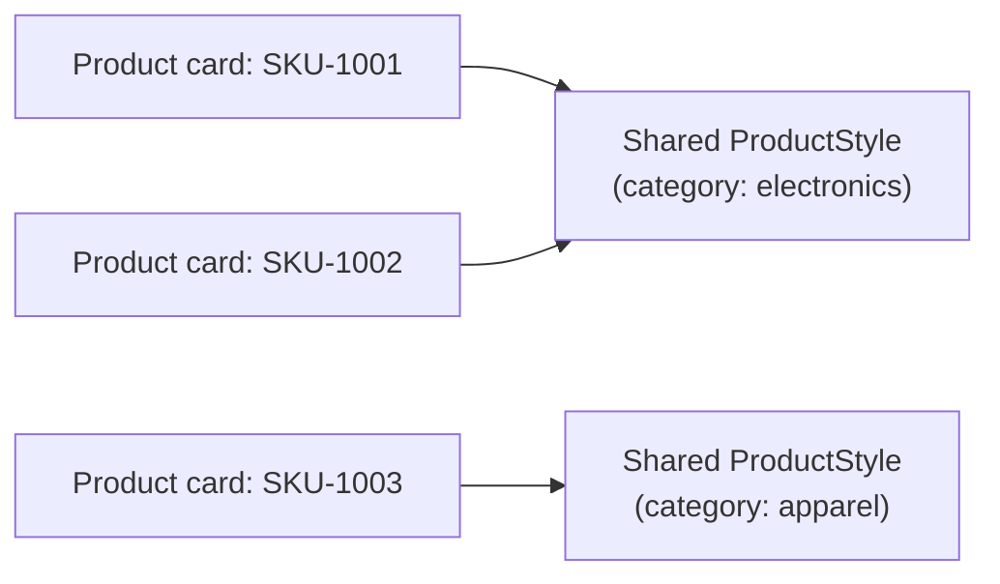

# Flyweight Pattern in Spring

<DocLabels items={[{label: 'Interview priority', tone: 'advanced'}, {label: 'Structural', tone: 'foundation'}, {label: 'Spring', tone: 'production'}]} />

Flyweight shares one immutable object across many logical uses instead of
allocating a near-identical copy per use. It separates **intrinsic** state
(shared, identical across every user) from **extrinsic** state (supplied by
the caller for each specific use).

## Recognize the Problem — And When Not To Reach For It

A product catalog page renders thousands of product cards, and many of them
share the same category display style (icon, accent color, badge layout).
Allocating a fresh `ProductStyle` object per rendered card is measurable
waste only if profiling actually shows GC pressure or memory from that
allocation pattern — Flyweight is a targeted fix for a measured problem, not
a default optimization to reach for before evidence exists.



## Spring Implementation

The flyweight itself holds only intrinsic, immutable, safely shared state:

```java
public record ProductStyle(String icon, String accentColor, String badgeLayout) {
}

@Component
public final class ProductStyleFactory {
    private final ConcurrentMap<String, ProductStyle> cache = new ConcurrentHashMap<>();
    private final CategoryStyleRepository repository;

    public ProductStyle styleFor(String category) {
        return cache.computeIfAbsent(category, repository::loadStyle);
    }
}
```

Extrinsic, per-item state (SKU, price, stock level) stays in the caller and
is never merged into the cached object:

```java
public record ProductCardView(String sku, BigDecimal price, ProductStyle style) {
}

@Service
final class ProductCardAssembler {
    private final ProductStyleFactory styleFactory;

    ProductCardView assemble(ProductSummary product) {
        return new ProductCardView(
                product.sku(),
                product.price(),
                styleFactory.styleFor(product.category())
        );
    }
}
```

## Runtime and Design Decisions

- The shared object must be **immutable** or otherwise safe to hand to
  concurrent callers without synchronization — a mutable "shared" object is
  a concurrency bug waiting for load, not a flyweight.
- `ConcurrentHashMap.computeIfAbsent` gives thread-safe lazy population, but
  the mapping function itself (`repository::loadStyle` above) must not
  recursively call back into the same map, which can deadlock under some
  JDK versions' `computeIfAbsent` implementations.
- The cache itself has a lifecycle: an unbounded cache keyed by unpredictable
  input (user-supplied text, for example) is a memory-growth risk, not a
  savings. Key by a bounded, known-cardinality dimension (category, locale,
  currency) rather than by arbitrary request input.
- Decide what "equal" means for cache keys up front — a flyweight keyed by a
  value that is not a stable, well-defined equality (a mutable entity instead
  of an immutable value) can silently create duplicate "shared" objects that
  defeat the pattern's purpose.

<DocCallout type="mistake" title="A shared object that is not actually immutable">

If `ProductStyle` later grows a mutable field (say, a cached rendering flag
one caller flips), every other caller holding the same shared instance now
sees that caller's local change — a correctness bug that is hard to
reproduce because it depends on cache-population order and which caller
touched the object first. Keep flyweights immutable by construction (final
fields, no setters, defensively-copied collections) rather than by
convention alone.

</DocCallout>

## Testing

Test that two logically identical keys (`"electronics"` called twice)
return the **same** cached instance (`assertSame`, not just `assertEquals`),
that distinct keys return distinct instances, that concurrent first-access
from multiple threads does not create duplicate instances or throw, and
that mutating a caller's extrinsic data (price, SKU) never affects another
caller's view that shares the same flyweight.

## Framework Examples

- `java.lang.Integer.valueOf` caches boxed values in the `-128..127` range —
  the canonical JDK flyweight, and the reason `==` on boxed `Integer` values
  outside that range is a classic interview trap.
- `String` literal interning shares identical string constants across the
  constant pool.
- Spring's `ConversionService` and `PropertyEditorRegistry` commonly cache
  stateless, reusable converter instances rather than constructing one per
  conversion call.

## Interview-Ready Answer

> Flyweight shares one immutable object across many uses instead of
> allocating a near-duplicate per use, splitting state into intrinsic
> (shared) and extrinsic (caller-supplied) parts. What makes an object safe
> to share as a flyweight is strict immutability and a well-defined,
> bounded cache key — if either breaks, the pattern turns into a hidden
> concurrency bug or an unbounded cache instead of a saving. I only reach
> for it after profiling shows the allocation pattern actually matters;
> otherwise it is complexity without a measured benefit.

## Related Patterns

- [Singleton](./singleton.md) shares exactly one instance application-wide;
  Flyweight shares many instances, keyed by intrinsic state, with distinct
  extrinsic state per use.
- [Prototype](./prototype.md) deliberately creates independent copies;
  Flyweight deliberately avoids copies.
- [Builder](./builder.md) constructs one configured object per call; a
  flyweight factory instead returns a cached, shared instance.

## Official References

- [`Integer.valueOf` caching](https://docs.oracle.com/en/java/javase/21/docs/api/java.base/java/lang/Integer.html#valueOf(int))
- [Gang of Four Flyweight pattern intent](https://en.wikipedia.org/wiki/Flyweight_pattern)
