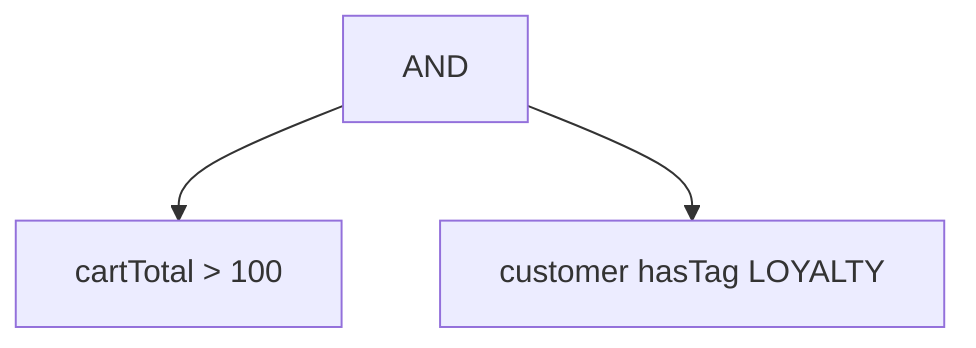

# Interpreter Pattern in Spring

<DocLabels items={[{label: 'Interview priority', tone: 'advanced'}, {label: 'Behavioral', tone: 'foundation'}, {label: 'Spring', tone: 'production'}]} />

Interpreter represents a small language's grammar as a tree of objects,
where evaluating the tree *is* evaluating the expression.

## Recognize the Problem

Marketing wants to configure promotion rules like "10% off when cart total
exceeds $100 AND customer is a loyalty member" without a deploy for every
new rule combination. Hardcoding each combination as Java `if` statements
means every new rule shape is a code change. Interpreter represents the
rule as a small tree built from a handful of expression types
(`GreaterThan`, `And`, `Or`, `HasTag`), each of which knows how to evaluate
itself against a cart — new *combinations* of existing expression types
need no new code, only new tree data.



Use Interpreter when the rule *shapes* are genuinely open-ended and
non-technical users (or configuration) need to compose them, and the
vocabulary of primitive expressions is small and stable. If the actual set
of rules is small and fixed, a `Predicate<Cart>` per rule registered in a
list is simpler and should be preferred — see the boundary below.

## Spring Implementation

Each expression type is a small, independently testable object that
evaluates itself against a context:

```java
public interface PromotionExpression {
    boolean evaluate(PromotionContext ctx);
}

public record GreaterThan(String field, BigDecimal threshold) implements PromotionExpression {
    public boolean evaluate(PromotionContext ctx) {
        return ctx.numericField(field).compareTo(threshold) > 0;
    }
}

public record HasTag(String tag) implements PromotionExpression {
    public boolean evaluate(PromotionContext ctx) {
        return ctx.customerTags().contains(tag);
    }
}

public record And(List<PromotionExpression> terms) implements PromotionExpression {
    public boolean evaluate(PromotionContext ctx) {
        return terms.stream().allMatch(t -> t.evaluate(ctx));
    }
}
```

A small builder (or a JSON deserializer mapping configuration into these
types) assembles the tree; evaluation is then a single recursive call:

```java
@Service
final class PromotionRuleEngine {
    boolean applies(PromotionExpression rule, PromotionContext ctx) {
        return rule.evaluate(ctx);
    }
}
```

```java
PromotionExpression rule = new And(List.of(
        new GreaterThan("cartTotal", new BigDecimal("100")),
        new HasTag("LOYALTY")
));
boolean discountApplies = ruleEngine.applies(rule, promotionContext);
```

## Runtime and Design Decisions

- Keep the primitive vocabulary (`GreaterThan`, `HasTag`, `And`, `Or`,
  `Not`) small and closed; an ever-growing set of ad-hoc expression types
  defeats the point and starts to resemble writing a general-purpose
  language instead of a bounded rule DSL.
- Parsing untrusted input (a rule string typed by a non-technical user)
  into this tree is a separate concern from evaluating it — validate and
  bound the parsed tree's depth/size before evaluation, so a malformed or
  adversarial rule cannot cause unbounded recursion.
- `PromotionExpression` instances should be side-effect-free and safe to
  cache/reuse across evaluations; keep per-evaluation data in the
  `PromotionContext`, not in the expression objects themselves.
- Never evaluate a rule string directly as code (a scripting engine with
  unrestricted access) just to avoid building the tree — that trades a
  bounded, auditable rule language for an open-ended security surface.

<DocCallout type="mistake" title="Interpreter is overkill for a short, fixed list of rules">

If marketing's actual rule catalog is five known combinations that rarely
change, a list of named `Predicate<Cart>` implementations selected by key
is simpler to read, test, and debug than a tree-walking interpreter. Reach
for Interpreter only when composability of a small, genuinely open-ended
grammar is the actual requirement.

</DocCallout>

## The Failure In Practice

Nothing in the expression types above stops a rule-authoring tool (or a bug
in one) from building a cyclic tree — `evaluate()` has no visited-node
tracking:

```java
And left = new And(new ArrayList<>());
And right = new And(List.of(left));
left.terms().add(right); // left now contains right, which contains left
```

```java
boolean result = left.evaluate(promotionContext);
```

```text
Exception in thread "main" java.lang.StackOverflowError
	at PromotionExpression$And.evaluate(PromotionExpression.java:71)
	at PromotionExpression$And.evaluate(PromotionExpression.java:71)
	... (repeats until the stack is exhausted)
```

There is no malicious input here — a configuration UI that lets rules
reference other saved rules by name can produce this by accident the first
time two rules reference each other. The fix is a depth/visited guard in
the tree-builder (reject cycles before they are ever evaluated), not a
try/catch around `StackOverflowError` at evaluation time:

```java
PromotionExpression build(RuleNode node, Set<String> visiting) {
    if (!visiting.add(node.id())) {
        throw new InvalidRuleException("cyclic rule reference: " + node.id());
    }
    // ... build children, then visiting.remove(node.id()) on the way back out
}
```

## Testing

Unit-test each primitive expression (`GreaterThan`, `HasTag`) against
boundary values independently. Unit-test composite expressions
(`And`/`Or`/`Not`) with mocked child expressions to verify short-circuit
and combination logic without re-testing the primitives. Add one test that
builds a deeply nested tree and confirms it is rejected (or bounded) rather
than evaluated, to prove the depth/size guard actually works.

## Framework Examples

Spring's own `SpEL` (Spring Expression Language) is a full implementation
of this pattern: an expression string is parsed into an AST of `SpelNode`
objects, and evaluating the expression means walking that tree — exactly
the Interpreter shape, at a much larger scale than a bounded promotion-rule
DSL needs.

## Interview-Ready Answer

> Interpreter represents a small rule language as a tree of objects where
> evaluating the tree is evaluating the expression. For promotion rules, I
> keep a small, closed set of primitive expression types composed with
> AND/OR/NOT, which lets configuration (not code) express new rule
> combinations. It is the right tool only when the rule vocabulary is
> genuinely open-ended and needs composition — a short fixed rule list is
> simpler as a list of named predicates, and I'd choose that first.

## Related Patterns

- [Strategy](./strategy.md) selects one of several interchangeable whole
  algorithms; Interpreter composes small primitive expressions into
  arbitrarily many combinations.
- [Composite](./composite.md) is the structural shape Interpreter's
  expression tree itself uses — a composite of leaf and branch nodes that
  all implement the same `evaluate` contract.

## Official References

- [Spring Expression Language (SpEL)](https://docs.spring.io/spring-framework/reference/core/expressions.html)
