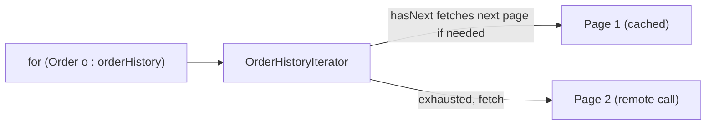

# Iterator Pattern in Spring

<DocLabels items={[{label: 'Interview priority', tone: 'advanced'}, {label: 'Behavioral', tone: 'foundation'}, {label: 'Spring', tone: 'production'}]} />

Iterator provides a uniform way to traverse a collection's elements without
exposing whether that collection is a list, a tree, a paged remote result
set, or something else entirely.

## Recognize the Problem

Code that iterates an in-memory `List<Order>` looks identical to code that
should iterate a remote, paginated order-history result — but the second
case has I/O, failure, and retry concerns the first does not. Java's
`Iterable`/`Iterator` contract covers both, but only if the paged
implementation is deliberately designed; naively implementing `Iterator`
over a remote source without thinking through lazy fetch and failure
semantics produces an iterator that looks correct in a unit test and fails
unpredictably in production.



## Spring Implementation

A simple in-memory case needs nothing beyond the JDK contract:

```java
for (Order order : orderHistory) {
    reconcile(order);
}
```

A remote-paged iterator has to make its I/O and failure boundaries explicit
rather than hiding them behind the innocent-looking `for` loop above:

```java
public final class OrderHistoryIterator implements Iterator<Order> {
    private final OrderHistoryClient client;
    private final String customerId;
    private Deque<Order> currentPage = new ArrayDeque<>();
    private String nextPageToken;
    private boolean exhausted = false;

    @Override
    public boolean hasNext() {
        if (!currentPage.isEmpty()) {
            return true;
        }
        if (exhausted) {
            return false;
        }
        fetchNextPage();
        return !currentPage.isEmpty();
    }

    @Override
    public Order next() {
        if (!hasNext()) {
            throw new NoSuchElementException();
        }
        return currentPage.poll();
    }

    private void fetchNextPage() {
        OrderHistoryPage page = client.fetchPage(customerId, nextPageToken);
        currentPage.addAll(page.orders());
        nextPageToken = page.nextPageToken();
        exhausted = (nextPageToken == null);
    }
}
```

## Runtime and Design Decisions

- **Lazy fetch**: `hasNext()` triggers the next page fetch, not the
  constructor — eager-fetching every page upfront defeats the point of
  paging and can exhaust memory on a large history.
- **Failure semantics**: a network failure during `fetchNextPage()` should
  surface as an explicit, documented exception from `hasNext()`/`next()`,
  not swallow the error and silently report `hasNext() == false` — the
  latter makes a transient outage look identical to "no more orders."
- **Fail-fast vs. weakly-consistent traversal**: `java.util`'s standard
  collections throw `ConcurrentModificationException` via a fail-fast
  iterator when the backing collection changes mid-traversal. A remote
  paged iterator has no such guarantee by default — document whether a
  customer's order placed mid-traversal may or may not appear, rather than
  leaving that question for a caller to discover the hard way.
- **Resource ownership**: if the iterator wraps a resource that must be
  closed (a cursor, a stream), prefer `Iterable`/try-with-resources patterns
  (or expose it as a `Stream` with `onClose`) over an iterator with no
  defined close contract.

<DocCallout type="mistake" title="Hiding expensive calls behind innocent-looking iteration">

`for (Order order : orderHistory)` reads identically whether `orderHistory`
is an in-memory list or a remote-paged client wrapper. That is the
pattern's strength and its risk: a caller who does not know the
implementation may run an accidental N+1-style traffic pattern (re-creating
the iterable inside a loop, for example) with no visible warning sign in
the calling code. Document — in the type name or Javadoc, not just
internally — when an `Iterable` performs remote I/O.

</DocCallout>

## The Failure In Practice

The paged iterator above has no idea the underlying order history changed
between page fetches:

```java
OrderHistoryIterator it = new OrderHistoryIterator(client, "cust-42");
// page 1: orders [A, B] with nextPageToken = "p2"

while (it.hasNext()) {
    Order order = it.next();
    reconcile(order);
    // ... between next() calls, the customer places a new order "C",
    // which the backing store now sorts ahead of B on page 2
}
```

```text
Fetched page 1: [A, B]
Fetched page 2: [B, C]   // B appears twice; a brand-new order "C" shifted the page boundary
```

`hasNext()`/`next()` only know about the page they already fetched — they
have no transaction isolation across the two remote calls, so an insert
between page 1 and page 2 can shift every subsequent page's boundary. `B`
gets processed twice (`reconcile` must tolerate that, or the iterator needs
a stable cursor — a token tied to `createdAt`/`id` rather than a raw page
offset — to avoid it):

```java
// stable-cursor token instead of an offset-based page token
OrderHistoryPage page = client.fetchPage(customerId, "after:" + lastSeenOrderId);
```

A cursor anchored to the last-seen row survives inserts ahead of the
cursor position; an offset-based page token does not. Document which
guarantee the iterator actually provides — most remote paging APIs give you
one or the other, not both.

## Testing

Test an empty source (`hasNext()` immediately `false`), a single-page
source, a multi-page source (confirm the second page is only fetched when
the first is exhausted, proving laziness), a page-fetch failure
(`hasNext()`/`next()` propagates the failure rather than hiding it), and —
for the fail-fast case — concurrent modification during traversal if the
underlying collection is mutable.

## Framework Examples

- `java.util.Iterator`/`Iterable` are the direct JDK implementation; Java's
  `for-each` loop is syntactic sugar over them.
- Spring Data's `Slice`/`Page` abstractions solve the same paged-traversal
  problem at a higher level, returning an explicit page object with
  metadata (has-next, total count) rather than a raw `Iterator` — prefer
  `Slice`/`Page` for typical Spring Data repository paging over hand-rolling
  an `Iterator`, and reach for a custom iterator mainly when integrating a
  non-Spring-Data paged source.
- `java.util.Scanner` and `BufferedReader.lines()` are iterator-shaped
  traversals over an I/O stream with their own lazy-fetch and resource
  considerations.

## Interview-Ready Answer

> Iterator provides one traversal contract regardless of whether the
> underlying source is an in-memory collection or a remote, paged result
> set — the caller's `for` loop looks the same either way. The design work
> is in the paged case: `hasNext()` must lazily fetch rather than eagerly
> loading everything, a fetch failure must surface as a real exception
> instead of silently reporting "no more elements," and the consistency
> guarantee during concurrent writes needs to be stated explicitly rather
> than assumed from the standard library's fail-fast behavior.

## Related Patterns

- [Composite](./composite.md) is often traversed with an iterator once a
  tree structure is built; the two frequently appear together.
- [Chain of Responsibility](./chain-of-responsibility.md) also processes a
  sequence, but each handler decides whether to continue — an iterator
  exposes the sequence itself, not a continue/stop decision.
- [Strategy](./strategy.md) can vary *how* a single element is processed
  inside the loop body an iterator drives.

## Official References

- [`java.util.Iterator`](https://docs.oracle.com/en/java/javase/21/docs/api/java.base/java/util/Iterator.html)
- [Spring Data `Slice` and `Page`](https://docs.spring.io/spring-data/commons/reference/repositories/query-return-types-reference.html)
- [Gang of Four Iterator pattern intent](https://en.wikipedia.org/wiki/Iterator_pattern)
