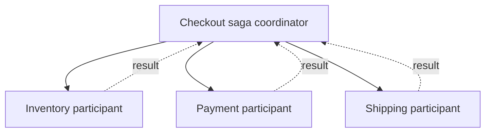

# Mediator Pattern in Spring

<DocLabels items={[{label: 'Interview priority', tone: 'advanced'}, {label: 'Behavioral', tone: 'foundation'}, {label: 'Spring', tone: 'production'}]} />

Mediator centralizes how a set of collaborating objects communicate, so the
collaborators reference the mediator instead of referencing each other
directly.

## Recognize the Problem

A checkout saga needs inventory reservation, payment capture, and shipping
label creation to happen in a coordinated order, with compensation if a
later step fails. Without a mediator, the inventory service would need to
know how to call payment, payment would need to know how to call shipping,
and every participant would need to know the compensation path for every
other participant — an all-to-all coupling that grows quadratically as
participants are added.



Use Mediator when three or more participants must coordinate and the
coordination logic (ordering, compensation, retries) is itself a thing
worth naming and testing on its own. Two participants talking directly is
not yet a mediator problem.

## Spring Implementation

Each participant exposes a narrow contract to the coordinator and knows
nothing about the other participants:

```java
public interface SagaParticipant {
    StepResult execute(CheckoutSagaContext ctx);
    void compensate(CheckoutSagaContext ctx);
}

@Component
final class InventoryParticipant implements SagaParticipant {
    public StepResult execute(CheckoutSagaContext ctx) {
        return inventoryClient.reserve(ctx.orderId(), ctx.items())
                ? StepResult.success()
                : StepResult.failure("insufficient-stock");
    }

    public void compensate(CheckoutSagaContext ctx) {
        inventoryClient.release(ctx.orderId());
    }
}
```

The coordinator owns the ordering and compensation policy; participants
never call each other:

```java
@Service
final class CheckoutSagaCoordinator {
    private final List<SagaParticipant> participants; // ordered: inventory, payment, shipping

    public SagaResult run(CheckoutSagaContext ctx) {
        List<SagaParticipant> completed = new ArrayList<>();
        for (SagaParticipant participant : participants) {
            StepResult result = participant.execute(ctx);
            if (!result.success()) {
                compensateInReverse(completed, ctx);
                return SagaResult.failed(result.reason());
            }
            completed.add(participant);
        }
        return SagaResult.succeeded();
    }

    private void compensateInReverse(List<SagaParticipant> completed, CheckoutSagaContext ctx) {
        Collections.reverse(completed);
        completed.forEach(p -> p.compensate(ctx));
    }
}
```

## Runtime and Design Decisions

- Participant order is business policy (reserve stock before capturing
  payment, not after) — keep it explicit and tested, not an accident of
  bean-wiring order.
- Compensation must be idempotent: a crash mid-saga and a retry of the same
  compensation step must not double-release inventory or double-refund a
  payment.
- This in-process coordinator pattern fits a single-service saga. A saga
  that spans separate microservices (inventory-service, payment-service,
  order-service as independent deployables) needs the choreography/outbox
  approach covered under this site's reliability docs — Mediator describes
  the coordination *shape*, not the cross-process delivery mechanism.
- Keep the mediator itself free of business rules belonging to a
  participant (e.g. how inventory decides "insufficient stock") — it
  orchestrates, it does not reimplement participant logic.

<DocCallout type="mistake" title="A mediator that knows every participant's internals is not decoupling anything">

If the coordinator has to branch on which concrete participant it is
talking to, the mediator has just become a new coupling point instead of
removing one. Keep the `SagaParticipant` contract narrow enough that the
coordinator never needs to know more than execute/compensate.

</DocCallout>

## Testing

Unit-test each participant's `execute`/`compensate` in isolation with
stubbed dependencies. Unit-test the coordinator with fake participants to
verify ordering and that a failure at step *N* triggers compensation for
steps `1..N-1` in reverse order, not forward order and not for step *N*
itself (which never completed). Add one integration test exercising a real
failure injected at each step position.

## Framework Examples

Spring's `DispatcherServlet` acts as a mediator between an incoming HTTP
request and the handler mapping, interceptors, and view resolution
machinery — none of those collaborators call each other directly; they are
all coordinated through the dispatcher.

## Interview-Ready Answer

> Mediator centralizes coordination logic so collaborating participants
> don't need to know about each other. For a checkout saga, I give each
> participant a narrow execute/compensate contract and let a coordinator own
> ordering and reverse-order compensation on failure. It is worth it once
> three or more participants must coordinate with real compensation logic —
> for cross-service sagas the same shape applies, but delivery needs an
> outbox/choreography mechanism instead of in-process method calls.

## Related Patterns

- [Chain of Responsibility](./chain-of-responsibility.md) passes one request
  along a sequence of handlers, any of which may stop it; Mediator
  coordinates several distinct participants that each do unrelated work.
- [Observer](./observer.md) broadcasts a fact to independent listeners with
  no return coordination; Mediator actively orchestrates a result,
  including compensation on failure.

## Official References

- [Spring Web MVC DispatcherServlet](https://docs.spring.io/spring-framework/reference/web/webmvc/dispatcher-servlet.html)
