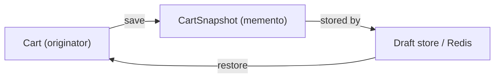

# Memento Pattern in Spring

<DocLabels items={[{label: 'Interview priority', tone: 'advanced'}, {label: 'Behavioral', tone: 'foundation'}, {label: 'Spring', tone: 'production'}]} />

Memento captures an object's internal state at a point in time so it can be
restored later, without exposing that internal state to the code holding
the snapshot.

## Recognize the Problem

A shopping cart accumulates line items, applied promotions, and a selected
shipping option as the customer edits it. For abandoned-cart recovery (the
customer leaves and returns an hour later, or a session expires and is
restored from a saved draft), the system needs to capture "what the cart
looked like" and later put the cart back into exactly that state — without
every caller that stores a snapshot needing to know the cart's internal
field layout, and without the snapshot itself being mutable in a way that
could let unrelated code corrupt it after capture.



Use Memento when you need to capture and later restore an object's state
without exposing its internals, and the snapshot itself needs to be an
opaque, immutable value the caller cannot pick apart or mutate. If callers
are already allowed to read and reconstruct the object from its public
fields, a memento adds nothing a plain DTO would not already give you.

## Spring Implementation

The cart (the **originator**) is the only thing that knows how to produce
and apply a snapshot; the snapshot itself is an immutable value with no
behavior:

```java
public record CartSnapshot(
        UUID cartId,
        List<LineItem> items,
        String promotionCode,
        ShippingOption shipping,
        Instant capturedAt
) {}

public final class Cart {
    private final UUID id;
    private final List<LineItem> items = new ArrayList<>();
    private String promotionCode;
    private ShippingOption shipping;

    public CartSnapshot save() {
        return new CartSnapshot(id, List.copyOf(items), promotionCode, shipping, Instant.now());
    }

    public void restore(CartSnapshot snapshot) {
        if (!snapshot.cartId().equals(id)) {
            throw new IllegalArgumentException("snapshot belongs to a different cart");
        }
        items.clear();
        items.addAll(snapshot.items());
        this.promotionCode = snapshot.promotionCode();
        this.shipping = snapshot.shipping();
    }
}
```

The **caretaker** stores snapshots but never reads or modifies their
contents — it treats `CartSnapshot` as opaque:

```java
@Service
final class CartDraftStore {
    private final RedisTemplate<String, CartSnapshot> redis;

    void saveDraft(Cart cart, Duration ttl) {
        redis.opsForValue().set("cart-draft:" + cart.id(), cart.save(), ttl);
    }

    Optional<CartSnapshot> loadDraft(UUID cartId) {
        return Optional.ofNullable(redis.opsForValue().get("cart-draft:" + cartId));
    }
}
```

## Runtime and Design Decisions

- `List.copyOf(items)` at capture time is what makes the memento safe: if
  `save()` instead stored a reference to the live mutable list, later edits
  to the cart would silently corrupt an already-captured snapshot.
- The memento (`CartSnapshot`) should expose no mutator methods and no way
  for the caretaker to reach back into the originator's internals — only the
  originator (`Cart.restore`) knows how to apply it.
- A memento is a point-in-time value, not a versioned history by itself. If
  the business needs "undo my last three edits," the caretaker needs to
  keep a bounded stack of mementos, not just the single most recent one.
- For abandoned-cart recovery specifically, the snapshot needs an expiry
  (TTL) and a defined policy for what happens if the underlying catalog
  prices or stock changed since capture — restoring a stale snapshot
  verbatim can silently resurrect an order at a price or quantity that is
  no longer valid.

<DocCallout type="mistake" title="A memento that leaks a mutable reference is not a memento">

If `save()` returns a live reference to internal mutable state (the same
`List` instance the cart keeps editing), the caretaker's "snapshot" changes
underneath it as the cart continues to be edited. Always copy on capture.

</DocCallout>

## Testing

Unit-test that mutating the cart after calling `save()` does not change the
previously captured `CartSnapshot` (this is the test that catches the
mutable-reference mistake above). Unit-test `restore()` against a snapshot
for a different cart ID and confirm it is rejected. Add one integration
test against the real draft store (Redis/test container) covering TTL
expiry and a restore after expiry returning empty.

## Framework Examples

Spring Session's serialized session attributes are a memento-shaped
mechanism: the session's state is captured into a storable, opaque form
(the session repository's representation) and later rehydrated into a live
`HttpSession`-backed object, without session-consuming code needing to know
the storage format.

## Interview-Ready Answer

> Memento captures an object's state in an immutable, opaque value so it can
> be restored later without exposing internals to whatever is holding the
> snapshot. For abandoned-cart recovery, the cart is the only thing that
> knows how to produce or apply a snapshot; the draft store just persists
> an opaque value with a TTL. The detail that actually matters in practice
> is copying mutable internal collections at capture time — a memento that
> leaks a live reference is not actually isolated from later mutation.

## Related Patterns

- [State](./state.md) models which transitions are legal from the current
  state; Memento captures and restores a snapshot of state without caring
  about transition rules.
- [Builder](./builder.md) constructs a new object step by step; Memento
  captures and restores an *existing* object's state as a whole.

## Official References

- [Spring Session](https://docs.spring.io/spring-session/reference/)
- [Spring Data Redis](https://docs.spring.io/spring-data/redis/reference/)
