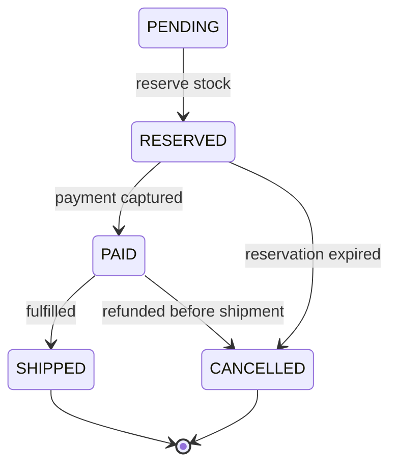

# State Pattern in Spring

<DocLabels items={[{label: 'Interview priority', tone: 'advanced'}, {label: 'Behavioral', tone: 'foundation'}, {label: 'Spring', tone: 'production'}]} />

State lets an object's behavior change with its internal state, by giving
each state its own object instead of branching on a status field everywhere
that field is read.

## Recognize the Problem

An order moves through `PENDING -> RESERVED -> PAID -> SHIPPED`, with
`CANCELLED` reachable from several of those. Representing this as a plain
`OrderStatus status` field with `if (status == PAID)` checks scattered
across the order service, the cancellation handler, and the refund handler
works at first, but every new rule ("can you cancel a shipped order?")
means hunting down every place that reads the field.



Use State when the *set of legal transitions* is itself business logic that
needs to be enforced consistently, not just a label for display. Do not use
it for a field that is only ever read, never branched on — that is just
data.

## Spring Implementation

Give each state its own responsibility for which transitions it permits,
rather than asking the context to know every rule:

```java
public enum OrderStatus { PENDING, RESERVED, PAID, SHIPPED, CANCELLED }

public interface OrderState {
    OrderStatus status();
    OrderState pay(OrderContext ctx);
    OrderState cancel(OrderContext ctx);
    OrderState ship(OrderContext ctx);
}

final class ReservedState implements OrderState {
    public OrderStatus status() { return OrderStatus.RESERVED; }

    public OrderState pay(OrderContext ctx) {
        ctx.capturePayment();
        return new PaidState();
    }

    public OrderState cancel(OrderContext ctx) {
        ctx.releaseReservation();
        return new CancelledState();
    }

    public OrderState ship(OrderContext ctx) {
        throw new IllegalOrderTransition(status(), "ship");
    }
}
```

The order aggregate holds the current state object and delegates to it,
instead of switching on an enum itself:

```java
@Entity
public class Order {
    @Enumerated(EnumType.STRING)
    private OrderStatus status;

    @Transient
    private OrderState state;

    public void pay(OrderContext ctx) {
        this.state = currentState().pay(ctx);
        this.status = this.state.status();
    }

    private OrderState currentState() {
        return OrderStateFactory.forStatus(this.status);
    }
}
```

`OrderStatus` persists as a plain enum column; `OrderState` objects are
stateless and reconstructed from that column on load — this is what keeps
State compatible with a JPA entity instead of requiring the behavior object
itself to be persisted.

## Runtime and Design Decisions

- An illegal transition (`ship()` on a `PENDING` order) should throw a
  specific, catchable exception the API layer maps to a stable error
  response — not a generic `IllegalStateException` the caller cannot
  distinguish from a bug.
- State objects should be stateless and reusable (or cheap to construct);
  the mutable state lives in the context (`Order`), not in the state object
  itself, so one `PaidState` instance can safely serve every order.
- Persist the enum, not the behavior object. Reconstructing `OrderState`
  from the persisted `OrderStatus` on each load keeps the pattern compatible
  with normal JPA entity lifecycle and avoids ever persisting code.
- Concurrent transitions on the same order are a correctness hazard
  independent of this pattern: use optimistic locking (a `@Version` column)
  so two concurrent `pay()`/`cancel()` calls on the same order cannot both
  succeed and leave an inconsistent status.

<DocCallout type="mistake" title="A state object is not automatically better than an enum switch">

If every transition rule is simple, stable, and lives in exactly one place
already, converting it to a State hierarchy adds classes without removing
real complexity. State earns its cost when the *same* transition logic
would otherwise be duplicated or drift across multiple call sites.

</DocCallout>

## Testing

Unit-test each state's legal and illegal transitions directly — a
`ReservedState` should accept `pay()` and `cancel()`, and reject `ship()`
with the specific exception. Test the factory/reconstruction path
separately (given a persisted `OrderStatus`, does it rebuild the correct
state object). Add one integration test proving optimistic-lock conflict
detection on two concurrent transitions against the same order row.

## Framework Examples

Spring's bean lifecycle is itself state-driven internally (a bean
progresses through defined phases — instantiation, property population,
initialization, destruction — and different internal behavior applies at
each phase), though Spring does not expose this as a public `State`
interface for application code to extend.

## Interview-Ready Answer

> State gives each stage of an object's lifecycle its own object responsible
> for which transitions are legal from there, instead of branching on a
> status field everywhere that field is read. For an order lifecycle, I
> persist the status as a plain enum and reconstruct a stateless behavior
> object from it on load, so the pattern stays compatible with JPA. It is
> worth the extra classes when transition rules are genuinely business logic
> that must stay consistent across call sites — not for a status field that
> is only ever displayed.

## Related Patterns

- [Strategy](./strategy.md) selects one of several interchangeable
  algorithms for the same input; State changes which transitions are legal
  as the object's own lifecycle progresses — the two are structurally
  similar but answer different questions.
- [Chain of Responsibility](./chain-of-responsibility.md) routes a request
  through an ordered set of handlers; State routes based on the object's
  own current phase, not an external handler chain.

## Official References

- [Spring bean lifecycle](https://docs.spring.io/spring-framework/reference/core/beans/factory-nature.html)
- [Spring Data JPA optimistic locking](https://docs.spring.io/spring-data/jpa/reference/jpa/locking.html)
