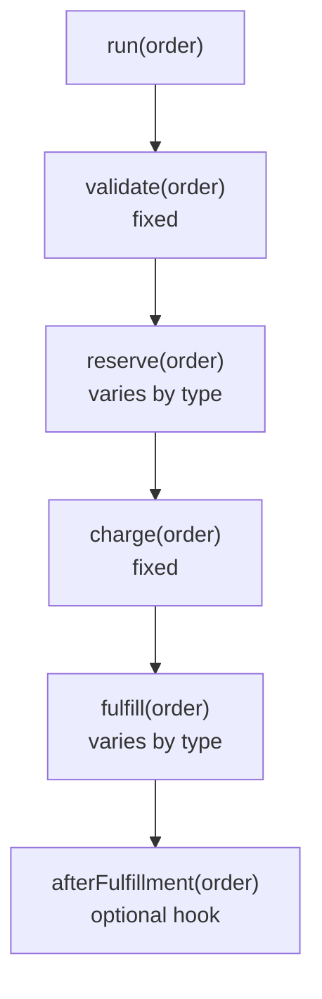

# Template Method Pattern in Spring

<DocLabels items={[{label: 'Interview priority', tone: 'advanced'}, {label: 'Behavioral', tone: 'foundation'}, {label: 'Workflow', tone: 'production'}]} />

Template Method defines an algorithm skeleton in a base class and lets subclasses
customize selected steps without changing their order.

## Example: Order Fulfillment Workflow

Every fulfillment type — digital download, physical shipment, or
subscription renewal — follows the same four steps in the same order:
validate, reserve, charge, then fulfill. What differs is *how* each type
reserves capacity and what "fulfill" means.



```java
public abstract class OrderFulfillmentTemplate {
    public final FulfillmentReceipt run(Order order) {
        validate(order);
        reserve(order);
        PaymentResult payment = charge(order);
        FulfillmentReceipt receipt = fulfill(order, payment);
        afterFulfillment(receipt);
        return receipt;
    }

    protected void validate(Order order) {
        if (order.items().isEmpty()) {
            throw new InvalidOrder(order.id());
        }
    }

    protected abstract void reserve(Order order);
    protected abstract PaymentResult charge(Order order);
    protected abstract FulfillmentReceipt fulfill(Order order, PaymentResult payment);
    protected void afterFulfillment(FulfillmentReceipt receipt) { }
}
```

The `final` method protects the invariant sequence — a subclass cannot
charge before reserving, or skip validation. Abstract methods are required
steps; `afterFulfillment` is an optional hook. Keep hooks few and
semantically clear.

```java
@Component
final class DigitalDownloadFulfillment extends OrderFulfillmentTemplate {
    protected void reserve(Order order) {
        // no physical stock to reserve; confirm license capacity instead
        licenseService.reserve(order.items());
    }

    protected PaymentResult charge(Order order) {
        return paymentService.chargeImmediately(order);
    }

    protected FulfillmentReceipt fulfill(Order order, PaymentResult payment) {
        return downloadLinkService.issueLinks(order, payment);
    }
}

@Component
final class PhysicalShipmentFulfillment extends OrderFulfillmentTemplate {
    protected void reserve(Order order) {
        inventoryService.reserveStock(order.items());
    }

    protected PaymentResult charge(Order order) {
        return paymentService.authorize(order); // captured on shipment, not here
    }

    protected FulfillmentReceipt fulfill(Order order, PaymentResult payment) {
        return shippingService.scheduleDispatch(order, payment);
    }
}
```

## Spring Template APIs

Spring's template classes express a related idea through callbacks:

```java
List<OrderView> orders = jdbcTemplate.query(
        "select id, status from orders where customer_id = ?",
        (rs, rowNum) -> new OrderView(rs.getLong("id"), rs.getString("status")),
        customerId
);
```

`JdbcTemplate` owns resource acquisition, execution, exception translation, and
cleanup; the callback supplies the variable mapping step. `TransactionTemplate`,
`RedisTemplate`, `JmsTemplate`, and other Spring APIs similarly hold repetitive
infrastructure mechanics in one place.

## Template Method Versus Strategy

| Concern | Template Method | Strategy |
|---|---|---|
| reuse mechanism | inheritance | composition |
| what varies | selected workflow steps | complete algorithm/collaborator |
| runtime replacement | awkward | natural |
| flow ownership | base class | context/orchestrator |
| coupling | subclass to base internals | caller to interface |

Prefer Strategy when behavior needs independent dependencies, runtime selection,
or broad variation. Prefer Template Method when the sequence itself is an
invariant and subclasses only fill narrow steps.

<DocCallout type="mistake" title="Beware the fragile base class">

Many protected methods, Boolean hooks, and access to base-class mutable state make
subclasses depend on implementation details. At that point, replace inheritance
with a small orchestrator composed from explicit step interfaces.

</DocCallout>

## Failure: A Subclass Breaks An Assumption The Template Relied On

`PhysicalShipmentFulfillment.charge` deliberately only **authorizes** the
payment — the base class comment says capture happens at shipment, not at
charge time. A new subclass written without reading that comment captures
immediately instead:

```java
@Component
final class SubscriptionRenewalFulfillment extends OrderFulfillmentTemplate {
    protected PaymentResult charge(Order order) {
        return paymentService.chargeImmediately(order); // captures now
    }

    protected FulfillmentReceipt fulfill(Order order, PaymentResult payment) {
        FulfillmentReceipt receipt = renewalService.extendSubscription(order);
        if (!receipt.succeeded()) {
            inventoryService.releaseReservation(order); // wrong assumption: nothing was reserved to release
        }
        return receipt;
    }
}
```

The base template's sequence (`validate -> reserve -> charge -> fulfill`)
assumed `reserve` always reserves something `fulfill` can release on
failure — true for physical shipments, false for subscriptions, which have
nothing to "reserve." When `renewalService.extendSubscription` fails after
`chargeImmediately` already captured the customer's money, the subclass
calls `releaseReservation` on a reservation that was never made, and the
customer is left charged with no subscription extended and no compensating
action taken. The bug is not in any single step — it is in a subclass
inheriting a sequence whose steps make an assumption (`reserve` always has
something to release) that only held for the sibling subclass the original
author had in mind.

The fix is not a new `if` branch in the shared template; it is making the
assumption explicit in the contract (`reserve` returns a `Reservation` value
that is `Optional.empty()` when nothing was reserved, and `fulfill` is
required to handle that case) or, once enough subclasses disagree on the
steps' meaning, replacing inheritance with the explicit per-type
orchestrator the callout above recommends.

## Transactions and Failure

Place the transaction boundary on a public Spring bean method, not on a protected
template step that relies on proxy interception. Define which steps may perform
side effects and what happens if a later step fails. A hook is not a durable
after-commit mechanism; use transaction synchronization, an application event, or
an outbox when those semantics are required.

## Testing

Test the base flow with a minimal test subclass that records call order. Test each
concrete implementation's reserve/charge/fulfill behavior, including the exact
scenario above: a fulfillment type whose `reserve` step legitimately has
nothing to reserve must not crash (or silently no-op incorrectly) when a later
step tries to compensate. Include failure cases proving that later steps do
not run after an earlier failure, and that compensation logic matches what
the specific subclass actually reserved.

## Interview-Ready Answer

> Template Method fixes an algorithm skeleton in a base class while subclasses
> override selected steps. Spring's template APIs apply the same principle with
> callbacks: the framework owns resource and error handling while application
> code supplies the variable operation. It is useful for a stable mandatory flow,
> but Strategy is more flexible when behaviors vary substantially.

## Related Patterns

- [Strategy](./strategy.md) uses composition for interchangeable algorithms.
- [Chain of Responsibility](./chain-of-responsibility.md) distributes steps among
  ordered handlers and may short-circuit dynamically.

## Official References

- [Spring JDBC `JdbcTemplate`](https://docs.spring.io/spring-framework/reference/data-access/jdbc/core.html)
- [Spring `TransactionTemplate`](https://docs.spring.io/spring-framework/reference/data-access/transaction/programmatic.html)
