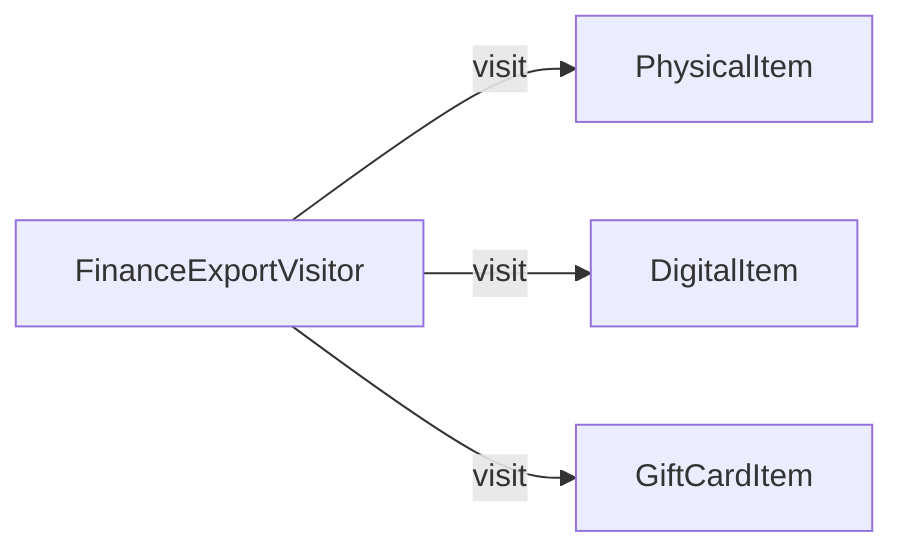

# Visitor Pattern in Spring

<DocLabels items={[{label: 'Interview priority', tone: 'advanced'}, {label: 'Behavioral', tone: 'foundation'}, {label: 'Spring', tone: 'production'}]} />

Visitor separates an operation from the object structure it operates on, so
a new operation can be added without modifying every class in that
structure.

## Recognize the Problem

An order contains a mix of line-item types — `PhysicalItem`,
`DigitalItem`, `GiftCardItem` — each needing different handling for tax
calculation, shipping-label generation, and now a new requirement: a
finance export report that formats each type differently. Adding an
`exportToFinanceReport()` method to every line-item class for one new
reporting requirement couples unrelated reporting logic into the domain
classes, and the next new operation (an audit export, a CSV export) means
touching every line-item class again.



Use Visitor when you need to add new *operations* over a stable, closed set
of types without touching those types again for each new operation. Java's
sealed interfaces plus pattern-matching `switch` often cover the same need
more simply today — see the boundary note below before reaching for a
classic double-dispatch Visitor.

## Spring Implementation

Each line-item type accepts a visitor and calls back the matching method
(double dispatch — the call resolves on both the line-item's type and the
visitor's method overload):

```java
public sealed interface LineItem permits PhysicalItem, DigitalItem, GiftCardItem {
    <R> R accept(LineItemVisitor<R> visitor);
}

public record PhysicalItem(String sku, BigDecimal weight, BigDecimal price) implements LineItem {
    public <R> R accept(LineItemVisitor<R> visitor) {
        return visitor.visit(this);
    }
}

public interface LineItemVisitor<R> {
    R visit(PhysicalItem item);
    R visit(DigitalItem item);
    R visit(GiftCardItem item);
}
```

A new operation is a new visitor implementation — no existing line-item
class changes:

```java
@Component
final class FinanceExportVisitor implements LineItemVisitor<FinanceRow> {
    public FinanceRow visit(PhysicalItem item) {
        return FinanceRow.taxable(item.sku(), item.price(), "PHYSICAL");
    }

    public FinanceRow visit(DigitalItem item) {
        return FinanceRow.taxable(item.sku(), item.price(), "DIGITAL");
    }

    public FinanceRow visit(GiftCardItem item) {
        return FinanceRow.nonTaxable(item.sku(), item.price(), "GIFT_CARD");
    }
}
```

## Modern Alternative: Sealed Types And Pattern Matching

Since Java's sealed interfaces plus exhaustive pattern-matching `switch`,
much of what classic Visitor provided — compile-time guarantee that every
type is handled for a new operation — is available without the
`accept`/double-dispatch machinery:

```java
FinanceRow toFinanceRow(LineItem item) {
    return switch (item) {
        case PhysicalItem p -> FinanceRow.taxable(p.sku(), p.price(), "PHYSICAL");
        case DigitalItem d -> FinanceRow.taxable(d.sku(), d.price(), "DIGITAL");
        case GiftCardItem g -> FinanceRow.nonTaxable(g.sku(), g.price(), "GIFT_CARD");
    };
}
```

The compiler rejects this `switch` if a new `LineItem` subtype is added
without a corresponding case — the same safety classic Visitor achieved
through `accept`/`visit`, with less ceremony. Reach for the classic
interface-based Visitor when the operations themselves need to be pluggable
Spring beans (discovered, injected, composed at runtime), not just an
exhaustive compile-time match.

## Runtime and Design Decisions

- `permits`/`sealed` is what makes either approach safe: without a closed
  type hierarchy, neither the Visitor interface nor the pattern-matching
  `switch` can guarantee every type is handled when a new one is added.
- A visitor should not mutate the line items it visits unless that is
  explicitly the operation's contract — prefer returning a result
  (`FinanceRow`) over visitors with side effects, to keep traversal
  order-independent and safely parallelizable.
- Adding a new line-item type is the expensive direction for Visitor: every
  existing visitor implementation must be updated with a new `visit`
  overload. Visitor trades "easy to add operations" for "expensive to add
  types" — confirm which direction of change is actually more frequent
  before choosing it.

<DocCallout type="mistake" title="Visitor for a type hierarchy that changes more often than its operations">

If new line-item types are added regularly but the set of operations
(tax, export, shipping) is comparatively stable, Visitor inverts the
problem: every new type requires touching every existing visitor. A normal
polymorphic method on each type (or a sealed-type `switch`) handles that
direction better.

</DocCallout>

## The Failure In Practice

The interface-based `LineItemVisitor` above is safe specifically because
every implementation must provide every `visit` overload — the compiler
rejects a visitor missing one. That guarantee disappears the moment someone
"simplifies" a visitor with an `instanceof` chain instead of implementing
the interface:

```java
// looks equivalent to FinanceExportVisitor, but is NOT an implementation
// of LineItemVisitor — it is a free-standing method with its own dispatch
FinanceRow exportRow(LineItem item) {
    if (item instanceof PhysicalItem p) {
        return FinanceRow.taxable(p.sku(), p.price(), "PHYSICAL");
    }
    if (item instanceof DigitalItem d) {
        return FinanceRow.taxable(d.sku(), d.price(), "DIGITAL");
    }
    return null; // GiftCardItem falls through — nobody meant to skip it
}
```

```java
LineItem item = new GiftCardItem("GC-1", new BigDecimal("25.00"));
FinanceRow row = exportRow(item);
// row == null — the finance export silently drops every gift card line,
// and nothing fails: no exception, no log, no test that happens to cover it
```

Six months later a new `BundleItem` type is added as a fourth
`LineItem permits` member. The real `LineItemVisitor` interface forces a
compile error in every implementation until `visit(BundleItem)` is added
everywhere. The `instanceof`-chain version above compiles unchanged and
silently returns `null` for bundles too — exactly the failure sealed
interfaces plus exhaustive `switch`, or classic Visitor, exist to prevent.

## Testing

Unit-test each `visit` overload against its specific line-item type and
expected `FinanceRow` shape. Add a compile-time safety test (or just rely
on the sealed interface/exhaustive `switch` compiler error) proving that
adding a new `LineItem` subtype without updating `FinanceExportVisitor`
fails to compile rather than silently skipping the new type at runtime.

## Framework Examples

Spring's `BeanDefinitionVisitor` and ASM-based classfile visitors
(`ClassVisitor`/`MethodVisitor`, used internally by Spring's bytecode
tooling) are classic Visitor implementations over a structure (a class
file's methods, fields, and annotations) that must support new operations
(a new kind of analysis or transformation) without modifying the
underlying classfile model itself.

## Interview-Ready Answer

> Visitor separates an operation from the object structure it runs over, so
> a new operation needs a new visitor, not a change to every existing type.
> For heterogeneous order-line-item export logic, I'd reach for a sealed
> interface and an exhaustive `switch` first — it gives the same
> compile-time safety with less ceremony — and use the classic
> interface-based Visitor only when the operations themselves need to be
> pluggable, injectable Spring beans. Either way, the real trade-off is
> that adding a new line-item type costs more than adding a new operation.

## Related Patterns

- [Strategy](./strategy.md) selects one interchangeable algorithm per call;
  Visitor applies one operation consistently across an entire heterogeneous
  structure.
- [Composite](./composite.md) structures often get traversed by a Visitor —
  the composite defines the structure, the visitor defines the operation
  performed while walking it.

## Official References

- [Java sealed classes and pattern matching](https://docs.oracle.com/en/java/javase/21/language/sealed-classes-and-interfaces.html)
- [Spring BeanDefinitionVisitor](https://docs.spring.io/spring-framework/docs/current/javadoc-api/org/springframework/beans/factory/config/BeanDefinitionVisitor.html)
