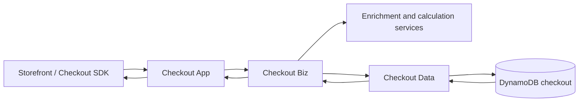
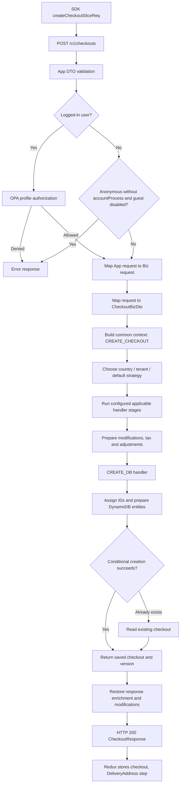
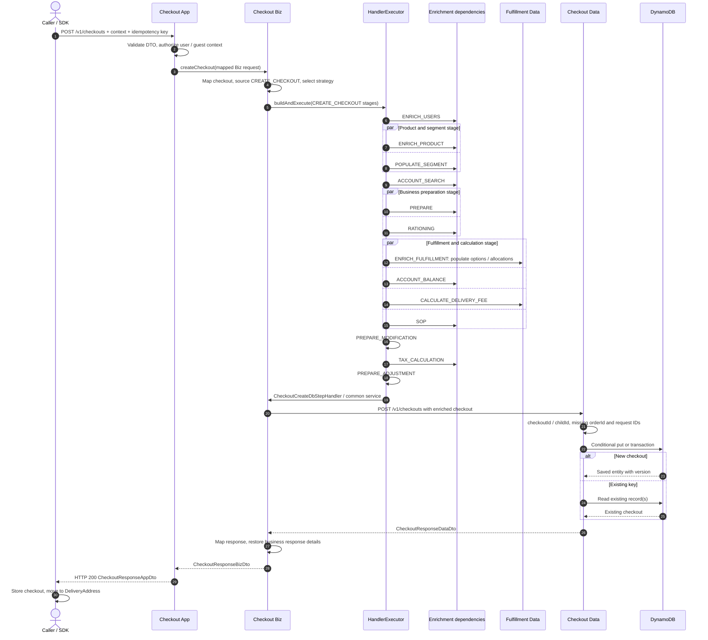

# mycheckout — Create Checkout — Complete Flow — Part 1

Source names are anonymized; original evidence dates and runtime limitations apply.

| Import record | Value |
|---|---|
| Source document | `CREATE-CHECKOUT-FLOW.md` |
| Source SHA256 | `625ad65626685134a1f9418f07dc1a7a3035c3800df732b0eb3b01abf30d06ab` |
| Guide part | 1 of 2 |

[Part 1](/mycheckout/create-checkout-flow/part-1) · [Part 2](/mycheckout/create-checkout-flow/part-2)

## Create Checkout — Complete Flow {#create-checkout--complete-flow}

Verified by static source inspection on **12 November 2026**. This document follows `POST /v1/checkouts` from the checkout SDK through app, business, and data services to the saved checkout and client response. It includes the preparation steps needed before [placing the order](/mycheckout/place-order-flow/part-1).

**Result:** an enriched checkout in `CREATED` state, with `checkoutId`, `orderId`, `version`, fulfillment choices, calculated amounts, and any business modifications. An `orderId` can already exist at this point; it does not prove that an order has been placed. Reservation, payment transaction processing, and the sales-order event handoff belong to place order. [C05] [C10] [C11]

## Contents {#contents}

1. [Scope and service responsibilities](/mycheckout/create-checkout-flow/part-1#1-scope-and-service-responsibilities)
2. [API and data contract](/mycheckout/create-checkout-flow/part-1#2-api-and-data-contract)
3. [Overall flow diagram](/mycheckout/create-checkout-flow/part-1#3-overall-flow-diagram)
4. [End-to-end sequence diagram](/mycheckout/create-checkout-flow/part-1#4-end-to-end-sequence-diagram)
5. [Execution walkthrough](/mycheckout/create-checkout-flow/part-1#5-execution-walkthrough)
6. [Country-specific pipelines](/mycheckout/create-checkout-flow/part-2#6-country-specific-pipelines)
7. [Persistence, identifiers, and idempotency](/mycheckout/create-checkout-flow/part-2#7-persistence-identifiers-and-idempotency)
8. [Failures and client behavior](/mycheckout/create-checkout-flow/part-2#8-failures-and-client-behavior)
9. [From created checkout to place order](/mycheckout/create-checkout-flow/part-2#9-from-created-checkout-to-place-order)
10. [Troubleshooting and verification scenarios](/mycheckout/create-checkout-flow/part-2#10-troubleshooting-and-verification-scenarios)
11. [Evidence and limits](/mycheckout/create-checkout-flow/part-2#11-evidence-and-limits)

## 1. Scope and service responsibilities {#1-scope-and-service-responsibilities}

| Component | Responsibility in this flow |
|---|---|
| Checkout SDK / Redux | `createCheckoutSliceReq` calls `checkoutApi.createCheckout`; fulfilled response becomes `state.checkout` and current step becomes `DeliveryAddress`. |
| `comcheckoutas` — app service | Validates request, performs create-specific authorization / guest checks, maps App DTO to Biz DTO, calls business service, maps response back. |
| `comcheckoutbs` — business service | Builds checkout context, chooses the country pipeline, enriches users/products, recalculates business values and fulfillment, and asks the data service to save. |
| `comcheckoutds` — data service | Assigns identifiers, constructs storage rows, applies conditional creation, stores checkout in DynamoDB, and returns persisted version. |
| Product / account / promotion / rationing / fulfillment / payment-balance / tax / subscription dependencies | Supply enrichment, validation, pricing, delivery options, balance, and tax information as applicable. Some implementations are outside this workspace. |

The SDK boundary is verified; a particular host storefront's cart button and navigation are outside this trace. Service paths are `/comcheckoutas`, `/comcheckoutbs`, and `/comcheckoutds`; operation paths below omit those service prefixes. [C01] [C02] [C03] [C04]

## 2. API and data contract {#2-api-and-data-contract}

### 2.1 Entry point {#21-entry-point}

| Item | Contract |
|---|---|
| Public operation | `POST /comcheckoutas/v1/checkouts` |
| Operation ID | `createCheckout` |
| Body | `CreateCheckoutRequest`, composed with `Cart` |
| Required body properties | `entries`, `user`; nested schemas and custom validators add their own constraints |
| Successful response | HTTP `200`, `CheckoutResponse` |
| Business correction response | Can also be HTTP `200` with `modification` / `modifications`; inspect the body |
| Key context headers | `X-Idempotency-Key`, `Accept-Language`, `X-mycheckout-Tenant`, `X-mycheckout-Vertical`, `X-mycheckout-Country`, `X-mycheckout-Channel` |

Use the authentication/anonymous context required by the caller's deployment. Header declarations alone do not establish deployed gateway authorization. The operation and examples are in the [app OpenAPI contract][C02].

### 2.2 Data carried through the flow {#22-data-carried-through-the-flow}

| Input / context | Transformation or use | Result / downstream role |
|---|---|---|
| `cartId` | Carried into checkout mapping | Connects checkout to cart; used later for eligible cart deletion |
| `user` | Identity, account, contact, profile and related user enrichment | Ordering context and validation |
| `entries` | Product enrichment, pricing, restrictions, promotions and inventory evaluation | Enriched checkout entries and totals |
| `subCarts` | Mapped to `childCheckouts` | Parent/child checkout structure for group flows |
| `classifications` | Strategy applicability and handler exclusions | NORMAL, group, account-process, preorder and other specialized behavior |
| `fulfillmentDetail` | Placed into `CheckoutCommonRequest.fulfillment` | Requested delivery/pickup details consumed by applicable handlers |
| `paymentDetails` | Placed into common request | Payment choice preparation; distinguish this from initiating payment transactions |
| `applyLoyaltyPoints` | Converted into a loyalty-points application request when provided | Market-specific points calculations |
| Country tuple | `forCheckout().getStrategy(country)` | Exact country override, tenant strategy, or default |
| Idempotency tuple | Used by data tier UUID generation when checkout ID is absent | Stable identity for repeated create requests |

Optional schema fields include account process, coupons, billing address, comments, SOP metadata, sale location, terminal and cashier information. This table describes their role, not a minimal valid production payload. Use the contract's market-specific examples for request construction. [C02] [C04] [C05]

### 2.3 Response interpretation {#23-response-interpretation}

Retain the returned `checkoutId` and latest `version` for subsequent mutations. Display amounts, fulfillment choices, and business modifications from the returned checkout. `orderId` is assigned by the data service whenever absent, including during create; `status` is the meaningful lifecycle indicator. Some response details, such as shipment details and modification metadata, are restored from business context after persistence and should not be assumed to be identical to the raw stored object. [C09] [C10] [C11]

## 3. Overall flow diagram {#3-overall-flow-diagram}

Technical exceptions can terminate any stage; business modifications can travel through to a normal response. The diagram shows the main control path, not a guarantee that every market executes every handler. [C03] [C04] [C06] [C07] [C08] [C12]

## 4. End-to-end sequence diagram {#4-end-to-end-sequence-diagram}

This sequence depicts the **default** create pipeline. `par` blocks represent concurrent handler stages; later stages wait for the preceding stage to complete.

Sources: SDK [C01], app [C03], orchestration [C04], pipeline [C06], executor [C07], persistence and response [C08] [C09] [C10] [C12].

## 5. Execution walkthrough {#5-execution-walkthrough}

### 5.1 SDK and app service {#51-sdk-and-app-service}

1. `createCheckoutSliceReq` forwards its payload to `checkoutApi.createCheckout`.
2. `CheckoutController.createCheckout` logs the cart identifier, runs the custom request validator, and delegates to the app checkout service.
3. `CheckoutServiceImpl.createCheckout` calls `doAuthorization` before the business client.
4. A logged-in caller is checked using the request user's profile ID through `OpaPolicyService`. For an anonymous caller with no `accountProcess`, explicitly disabled guest checkout causes `GuestCheckoutException`. Other contexts continue through this particular method; deployment policies can impose additional checks.
5. The app maps the request, invokes `CheckoutBizClient.createCheckout`, maps the business response, and returns HTTP `200`. [C01] [C03]

### 5.2 Business request construction and strategy routing {#52-business-request-construction-and-strategy-routing}

`CheckoutServiceImpl.createCheckout` maps the input to `CheckoutBizDto`. It constructs `CheckoutCommonRequest` with checkout, fulfillment request, payment details, optional loyalty application, and `Source.CREATE_CHECKOUT`. It selects `forCheckout().getStrategy(TupleService.getTuples().getmycheckoutCountry())`, then calls `HandlerExecutor.buildAndExecute(strategy.getHandlers(CREATE_CHECKOUT, request), request)`. [C04]

The request mapper maps `subCarts` to `childCheckouts`; derived-field enrichment initializes checkout state, including `CREATED`. The country factory resolves an exact country registration first, a tenant-group registration second, and default last. The LATAM group is CO, MX, HN, SV and GT; Mexico's exact-country registration wins. [C05] [C13]

### 5.3 Default handler stages {#53-default-handler-stages}

Here and below, `+` means handlers in one concurrent stage; arrows mean stages executed in order. Short names correspond to `CheckoutHandlerEnum` keys, not separate APIs.

| Stage | Handlers | Responsibility / data change |
|---|---|---|
| 1 | `ENRICH_USERS` | Populate user/account/contact and related ordering information through applicable user enrichment. |
| 2 | `ENRICH_PRODUCT + POPULATE_SEGMENT` | Enrich selected products and customer segment information. |
| 3 | `ACCOUNT_SEARCH` | Apply account-search enrichment where applicable. |
| 4 | `PREPARE + RATIONING` | Prepare promotions/business restrictions and rationing decisions. PREPARE also processes child checkouts. |
| 5 | `ENRICH_FULFILLMENT + ACCOUNT_BALANCE + DELIVERY_FEE + SOP` | Populate fulfillment/allocation options, account balance calculation, delivery fees and subscription details. |
| 6 | `PREPARE_MODIFICATION` | Assemble business changes/restrictions for the response. |
| 7 | `TAX_CALCULATION` | Calculate applicable taxes. |
| 8 | `PREPARE_ADJUSTMENT` | Prepare amount adjustments. |
| 9 | `CREATE_DB` | Persist checkout and replace request checkout with mapped persisted response. |

The fulfillment handler calls `InventoryService.populateFulfillment`, not the place-order reservation method. The normal create list contains no place-order handler. Account-balance and payment-choice work here should not be read as a payment capture. [C06] [C14] [C15]

### 5.4 Handler execution rules {#54-handler-execution-rules}

`HandlerExecutor` builds lists of handlers. Colon-joined keys form one stage and are merged with `Flux.merge`; the stages are concatenated with `Flux.concat`. Each stage completes before the next one runs. Exclusions come from handler configuration evaluated against classifications and client name. An entirely excluded stage returns the checkout unchanged. [C07]

Each `KeyBasedStepHandler.call` evaluates `isApplicable`, runs `validate`, and runs `execute` only if that handler's `hasNoErrors` accepts the result. The base implementation of `hasNoErrors` returns true: there is **no universal rule that any modification immediately stops the entire pipeline**. Handlers can override validation and applicability. The base applicability check uses checkout metadata and the configured step timeout; individual handlers can override it. A propagated reactive exception terminates execution. [C16]

The request object is mutable. CREATE_DB explicitly replaces `request.checkout` with the persisted checkout so later steps in combined flows see the saved IDs and version. [C08]

c01 (local reference: `/D:/BE Projects/checkout/checkout/commerce-checkout-webcomponents-main/source/sdk/services/features/checkoutSlice.ts:245`)
c02 (local reference: `/D:/BE Projects/checkout/checkout/commerce-checkout-api/source/checkout-app-rest/v1/openapi-rest.yml:33`)
c03 (local reference: `/D:/BE Projects/checkout/checkout/commerce-checkout-appservice/source/app/src/main/java/com/mycheckout/commerce/checkoutservice/app/service/impl/CheckoutServiceImpl.java:81`)
c04 (local reference: `/D:/BE Projects/checkout/checkout/commerce-checkout-bizservice/source/app/src/main/java/com/mycheckout/commerce/checkoutbizservice/app/service/checkout/impl/CheckoutServiceImpl.java:214`)
c05 (local reference: `/D:/BE Projects/checkout/checkout/commerce-checkout-bizservice/source/app/src/main/java/com/mycheckout/commerce/checkoutbizservice/app/mappers/checkout/CheckoutRequestMapper.java:131`)
c06 (local reference: `/D:/BE Projects/checkout/checkout/commerce-checkout-bizservice/source/app/src/main/java/com/mycheckout/commerce/checkoutbizservice/app/service/checkout/impl/tenant/DefaultCheckoutStepHandlerStrategy.java:50`)
c07 (local reference: `/D:/BE Projects/checkout/checkout/commerce-checkout-bizservice/source/app/src/main/java/com/mycheckout/commerce/checkoutbizservice/app/handler/HandlerExecutor.java:39`)
c08 (local reference: `/D:/BE Projects/checkout/checkout/commerce-checkout-bizservice/source/app/src/main/java/com/mycheckout/commerce/checkoutbizservice/app/handler/impl/checkout/CheckoutCreateDbStepHandler.java:36`)
c09 (local reference: `/D:/BE Projects/checkout/checkout/commerce-checkout-bizservice/source/app/src/main/java/com/mycheckout/commerce/checkoutbizservice/app/service/checkout/impl/CheckoutCommonServiceImpl.java:202`)
c10 (local reference: `/D:/BE Projects/checkout/checkout/commerce-checkout-dataservice/source/app/src/main/java/com/mycheckout/commerce/checkoutdataservice/app/service/impl/CheckoutServiceImpl.java:149`)
c11 (local reference: `/D:/BE Projects/checkout/checkout/commerce-checkout-dataservice/source/app/src/main/java/com/mycheckout/commerce/checkoutdataservice/app/service/impl/CheckoutServiceImpl.java:478`)
c12 (local reference: `/D:/BE Projects/checkout/checkout/commerce-checkout-dataservice/source/app/src/main/java/com/mycheckout/commerce/checkoutdataservice/app/repositories/dynamo/CheckoutRepository.java:84`)
c13 (local reference: `/D:/BE Projects/checkout/checkout/commerce-checkout-bizservice/source/app/src/main/java/com/mycheckout/commerce/checkoutbizservice/app/strategy/AbstractCountryTenantStrategyFactory.java:70`)
c14 (local reference: `/D:/BE Projects/checkout/checkout/commerce-checkout-bizservice/source/app/src/main/java/com/mycheckout/commerce/checkoutbizservice/app/handler/impl/checkout/CheckoutEnrichFulfillmentStepHandler.java:36`)
c15 (local reference: `/D:/BE Projects/checkout/checkout/commerce-checkout-bizservice/source/app/src/main/java/com/mycheckout/commerce/checkoutbizservice/app/handler/impl/checkout/CheckoutPrepareStepHandler.java:40`)
c16 (local reference: `/D:/BE Projects/checkout/checkout/commerce-checkout-bizservice/source/app/src/main/java/com/mycheckout/commerce/checkoutbizservice/app/handler/KeyBasedStepHandler.java:56`)
c17 (local reference: `/D:/BE Projects/checkout/checkout/commerce-checkout-bizservice/source/app/src/main/java/com/mycheckout/commerce/checkoutbizservice/app/service/checkout/impl/tenant/JapanCheckoutStepHandlerStrategy.java:24`)
c18 (local reference: `/D:/BE Projects/checkout/checkout/commerce-checkout-bizservice/source/app/src/main/java/com/mycheckout/commerce/checkoutbizservice/app/service/checkout/impl/tenant/LatamCheckoutStepHandlerStrategy.java:27`)
c19 (local reference: `/D:/BE Projects/checkout/checkout/commerce-checkout-bizservice/source/app/src/main/java/com/mycheckout/commerce/checkoutbizservice/app/service/checkout/impl/tenant/MexicoCheckoutStepHandlerStrategy.java:19`)
c20 (local reference: `/D:/BE Projects/checkout/checkout/commerce-checkout-bizservice/source/app/src/main/java/com/mycheckout/commerce/checkoutbizservice/app/service/checkout/impl/tenant/ThailandCheckoutStepHandlerStrategy.java:10`)

## Official References

Platform documentation explains the underlying technologies; project behavior remains grounded in the source evidence above.

- [AWS service documentation](https://docs.aws.amazon.com/)
- [Apache Kafka documentation](https://kafka.apache.org/documentation/)
- [Quarkus guides](https://quarkus.io/guides/)
