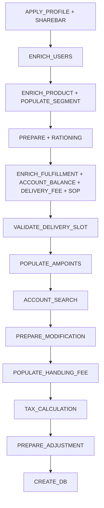
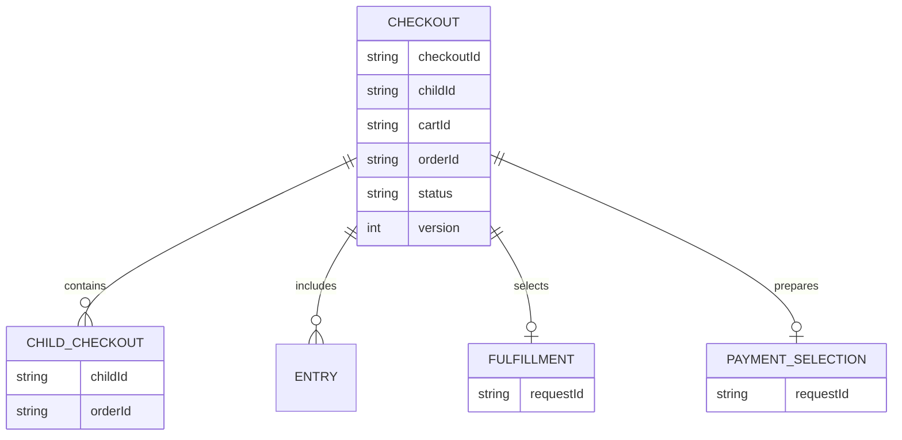
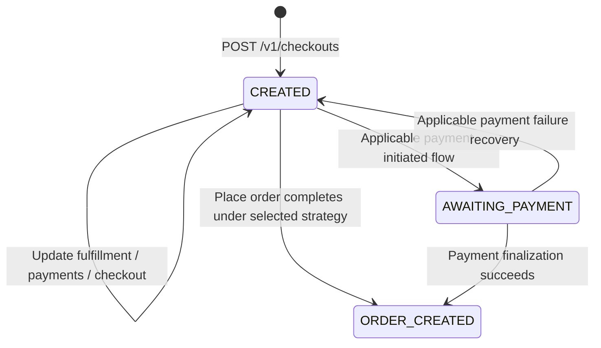

# mycheckout — Create Checkout — Complete Flow — Part 2

Source names are anonymized; original evidence dates and runtime limitations apply.

| Import record | Value |
|---|---|
| Source document | `CREATE-CHECKOUT-FLOW.md` |
| Source SHA256 | `625ad65626685134a1f9418f07dc1a7a3035c3800df732b0eb3b01abf30d06ab` |
| Guide part | 2 of 2 |

[Part 1](/mycheckout/create-checkout-flow/part-1) · [Part 2](/mycheckout/create-checkout-flow/part-2)

## 6. Country-specific pipelines {#6-country-specific-pipelines}

### 6.1 Japan create sequence {#61-japan-create-sequence}

Japan starts with checkout profile and share-bar processing, validates delivery slots, populates loyalty points and handling fees, and moves account search later in the sequence. These are the declared stages before applicability/exclusion checks. [C17]

### 6.2 Market comparison {#62-market-comparison}

| Market strategy | Difference from default create |
|---|---|
| Default | Nine stages in section 5.3. |
| Thailand | Inherits default create stages. |
| LATAM | Adds `TAX_THRESHOLD_VALIDATION` after tax calculation and before adjustments. |
| Mexico | Inherits LATAM create, including tax threshold validation; adds `PICKUP_LOCATION_AVAILABILITY` to the fulfillment/balance/delivery-fee stage. |
| Japan | Uses the explicit sequence above. |

Mexico's pickup availability check during create is distinct from `RESERVE_PICKUP_LOCATION` in the Mexico place-order pipeline. [C17] [C18] [C19] [C20]

## 7. Persistence, identifiers, and idempotency {#7-persistence-identifiers-and-idempotency}

### 7.1 Data ownership {#71-data-ownership}

This is a **logical data relationship diagram**, not a relational schema. The data service serializes parent/child checkout payloads into DynamoDB entities; large payloads can span multiple rows and use transaction operations. It is not necessarily one row per logical child. [C10] [C11]

### 7.2 Save sequence {#72-save-sequence}

1. CREATE_DB calls `CheckoutCommonServiceImpl.createCheckout`.
2. The common service sorts classifications for response use, calculates earned points, populates delivery fees on fulfillment options, maps to `CreateCheckoutRequestDataDto`, and calls the data client.
3. Data `setCheckoutAndChildId` derives a parent checkout UUID from the idempotency tuple if the request has no checkout ID; for that parent, `childId` is the same value. Existing explicit IDs are honored. Missing child IDs are randomly assigned.
4. POS/CSP channels populate mycheckout periods before saving.
5. `generateSubResourceAndOrderIds` fills missing fulfillment/payment-selection request IDs and missing order IDs. Order IDs use `OrderSequenceService`; they are generated independently of reaching `ORDER_CREATED`.
6. `prepareCheckoutEntity` creates storage entities with metadata and any configured splitting/compression. The service uses single-row save or multi-row transaction save.
7. The response returns through the common service and CREATE_DB. Shipment details and other response enrichments can be restored from the pre-save business object. CREATE_DB also preserves a preexisting invoice number in the response. [C08] [C09] [C10] [C11]

### 7.3 Idempotent create behavior {#73-idempotent-create-behavior}

The repository puts with `attribute_not_exists(Id) AND attribute_not_exists(ChildId)`. On a conditional collision, it reads the existing checkout. Multi-row save has a corresponding conditional path. With the same idempotency key and ID derivation context, this is intended to return the saved checkout rather than create another one. [C12]

Practical limits:

- Reuse the key for retries of the same logical create. A new key represents another create intent.
- The conditional write happens **after** business enrichment; repeated requests can still repeat upstream calculation/enrichment work.
- The inspected code does not establish a stored request-body hash check. Do not expect reuse of a key with a changed body to update the earlier checkout.
- The UUID generator belongs to the service chassis; its full key-namespace behavior was not inspected here.
- DynamoDB idempotent creation does not establish exactly-once execution across external services.

## 8. Failures and client behavior {#8-failures-and-client-behavior}

| Point | Source-backed behavior | Caller implication |
|---|---|---|
| Invalid create DTO | App controller runs the custom validator before delegation. | Correct the request according to validation response. |
| Logged-in authorization denied | `doAuthorization` propagates the OPA result. | Creation does not proceed through this app method. |
| Guest disabled | Anonymous + no account process + explicitly disabled guest config yields `GuestCheckoutException`. | Market configuration determines whether this guest path is available. |
| Business restrictions / unavailable product or promotion | Contract includes HTTP `200` checkout examples with business modifications; common service preserves modification details. | Read response modifications; do not treat every `200` as ready to order. |
| Propagated downstream failure | Reactive execution fails unless a dependency client/handler handles it. | Exact behavior depends on that dependency; there is no single global fallback for all create calls. |
| Repeated create with same identity | Conditional write returns existing checkout. | Use the returned state/version rather than assuming the new body replaced it. |
| Failure before CREATE_DB | Final checkout save has not yet occurred through this pipeline. | This does not imply rollback of every upstream side effect. |
| Success response | SDK reducer sets checkout and advances to DeliveryAddress. | Hosting UI still needs to interpret business modifications. |

The app OpenAPI lists technical error responses. This document does not infer every exception-to-HTTP mapping from those declarations, and no running API was invoked. [C01] [C02] [C03] [C07] [C09] [C12]

## 9. From created checkout to place order {#9-from-created-checkout-to-place-order}

The last four transitions are explained in [Place Order — Complete Flow](/mycheckout/place-order-flow/part-1); payment and checkout states are different state machines.

Typical preparation APIs between create and place order:

| Operation | Purpose |
|---|---|
| `GET /v1/checkouts/{checkoutId}` | Refresh/enrich checkout view; do not assume a GET persists recalculation. |
| `PATCH /v1/checkouts/{checkoutId}` | Update checkout-level fields using the current version. |
| `POST /v1/checkouts/{checkoutId}/fulfillments` | Add chosen fulfillment information. |
| `PUT /v1/checkouts/{checkoutId}/fulfillments/{fulfillmentId}` | Change fulfillment selection/details. |
| `POST /v1/checkouts/{checkoutId}/payments` | Add selected payment methods. |
| `PUT /v1/checkouts/{checkoutId}/payments/{paymentOptionId}` | Change a payment selection. |
| `POST /v1/checkouts/{checkoutId}/place-order` | Attempt placement using the latest checkout version. |

Each operation has its own strategy/validation path. Selecting a payment method is a separate operation from processing its payment transaction. `POST /v1/orders` is the combined `CREATE_ORDER` path and is covered in the place-order document. [C02] [C06]

## 10. Troubleshooting and verification scenarios {#10-troubleshooting-and-verification-scenarios}

| Symptom | Trace in order |
|---|---|
| Checkout not created | App DTO validation → authorization/guest config → biz country selection → last completed handler → CREATE_DB → data save. |
| Unexpected amount | Product/segment → PREPARE/RATIONING → fulfillment/fees/balance/SOP → modifications → tax → adjustments → response enrichment. |
| Missing handler behavior | Country exact override → tenant fallback → HandlerConfig exclusion → handler `isApplicable` → handler validation. |
| Duplicate-looking checkout requests | Compare idempotency key, checkout IDs, explicit IDs, tuple context and conditional-write logs. |
| Response differs from stored payload | Check common-service response-only restoration before assuming persistence lost data. |
| `orderId` exists but no sales order | Check status. `CREATED` is expected to have an order ID without triggering order publication. |

Recommended verification scenarios for a future running environment: default create; same-key retry; same key with altered input; guest disabled and enabled; Japan profile/slot/points flow; LATAM tax threshold; Mexico pickup unavailable; group checkout; business modification response; downstream failure before save. These are a coverage checklist, **not tests executed for this document**.

Useful identifiers to correlate are `cartId`, `checkoutId`, `childId`, `orderId`, `version`, idempotency key, and country/channel/client context. Avoid copying payment payloads or user contact details into diagnostic notes.

## 11. Evidence and limits {#11-evidence-and-limits}

**Directly checked:** app contract and create service/controller, SDK thunks/reducers, business create orchestrator, mapper, country stage lists, executor and base handler rules, common-service save/response mapping, data ID generation/save/concurrency code, and conditional repository writes. Evidence links below identify local source lines.

**Reference documents used:** [End-to-End System Guide](/mycheckout/end-to-end-system/part-1), [Guest Checkout Flow](/mycheckout/guest-checkout-flow/part-1), and [Fulfillment End-to-End](/mycheckout/fulfillment-docs/fulfillment-end-to-end/part-1). Current source takes precedence over older prose.

**Limits:** this was static inspection. No application build, live API, payment, reservation or event transaction was run. Dependency internals outside the workspace, deployed feature/master-data values, host-storefront behavior before the SDK call, and production operational timing are not established. Dependency responsibilities above summarize their checkout call boundary; they are not a claim that each external implementation was traced in full.

### Source index {#source-index}

<!-- SOURCE_INDEX -->

| Ref | Source and verified starting line |
|---|---|
| C01 | [SDK create thunk and checkout response reducers][C01] |
| C02 | [App create-checkout contract; schemas and examples in the same file][C02] |
| C03 | [App create service and authorization][C03] |
| C04 | [Biz create orchestrator][C04] |
| C05 | [Request mapping; derived-field methods initialize CREATED][C05] |
| C06 | [Default checkout handler lists][C06] |
| C07 | [Sequential stages, parallel handlers, exclusions][C07] |
| C08 | [CREATE_DB and request checkout replacement][C08] |
| C09 | [Create persistence request and response enrichment][C09] |
| C10 | [Data create orchestration and ID assignment][C10] |
| C11 | [Order ID generation, entity preparation and saveCheckout][C11] |
| C12 | [Conditional creation, collision handling and transaction methods][C12] |
| C13 | [Exact country, tenant group and default resolution][C13] |
| C14 | [Fulfillment enrichment call boundary][C14] |
| C15 | [Business preparation including child checkouts][C15] |
| C16 | [Applicability, validation and execution template][C16] |
| C17 | [Japan create and other checkout stage lists][C17] |
| C18 | [LATAM create tax-threshold stage][C18] |
| C19 | [Mexico inherited create list with pickup availability][C19] |
| C20 | [Thailand default-stage inheritance][C20] |

Additional handoff and specialization evidence:

- App create controller and validator (local reference: `/D:/BE Projects/checkout/checkout/commerce-checkout-appservice/source/app/src/main/java/com/mycheckout/commerce/checkoutservice/app/controllers/CheckoutController.java:57`)
- App place-order controller (local reference: `/D:/BE Projects/checkout/checkout/commerce-checkout-appservice/source/app/src/main/java/com/mycheckout/commerce/checkoutservice/app/controllers/PlaceOrderController.java:54`)
- Biz create controller (local reference: `/D:/BE Projects/checkout/checkout/commerce-checkout-bizservice/source/app/src/main/java/com/mycheckout/commerce/checkoutbizservice/app/controllers/CheckoutController.java:66`)
- Biz place-order controller (local reference: `/D:/BE Projects/checkout/checkout/commerce-checkout-bizservice/source/app/src/main/java/com/mycheckout/commerce/checkoutbizservice/app/controllers/PlaceOrderController.java:64`)
- Base handler execution rules (local reference: `/D:/BE Projects/checkout/checkout/commerce-checkout-bizservice/source/app/src/main/java/com/mycheckout/commerce/checkoutbizservice/app/handler/KeyBasedStepHandler.java:56`)
- Country-to-strategy grouping (local reference: `/D:/BE Projects/checkout/checkout/commerce-checkout-bizservice/source/app/src/main/java/com/mycheckout/commerce/checkoutbizservice/app/enumerations/StrategyEnum.java:26`)
- Internal country strategy selection (local reference: `/D:/BE Projects/checkout/checkout/commerce-checkout-bizservice/source/app/src/main/java/com/mycheckout/commerce/checkoutbizservice/app/service/placeorder/internal/InternalPlaceOrderStrategyFactory.java:32`)
- Preorder extension applicability (local reference: `/D:/BE Projects/checkout/checkout/commerce-checkout-bizservice/source/app/src/main/java/com/mycheckout/commerce/checkoutbizservice/app/handler/impl/preorder/PreOrderReserveHandler.java:47`)
- LATAM default normal-strategy inheritance (local reference: `/D:/BE Projects/checkout/checkout/commerce-checkout-bizservice/source/app/src/main/java/com/mycheckout/commerce/checkoutbizservice/app/service/checkout/impl/LatamNormalPlaceOrderStrategy.java:16`)
- Thailand default normal-strategy inheritance (local reference: `/D:/BE Projects/checkout/checkout/commerce-checkout-bizservice/source/app/src/main/java/com/mycheckout/commerce/checkoutbizservice/app/service/checkout/impl/ThailandNormalPlaceOrderStrategy.java:16`)

c01 (local reference: `/D:/BE Projects/checkout/checkout/commerce-checkout-webcomponents-main/source/sdk/services/features/checkoutSlice.ts:245`)

c02 (local reference: `/D:/BE Projects/checkout/checkout/commerce-checkout-api/source/checkout-app-rest/v1/openapi-rest.yml:33`)

c03 (local reference: `/D:/BE Projects/checkout/checkout/commerce-checkout-appservice/source/app/src/main/java/com/mycheckout/commerce/checkoutservice/app/service/impl/CheckoutServiceImpl.java:81`)

c04 (local reference: `/D:/BE Projects/checkout/checkout/commerce-checkout-bizservice/source/app/src/main/java/com/mycheckout/commerce/checkoutbizservice/app/service/checkout/impl/CheckoutServiceImpl.java:214`)

c05 (local reference: `/D:/BE Projects/checkout/checkout/commerce-checkout-bizservice/source/app/src/main/java/com/mycheckout/commerce/checkoutbizservice/app/mappers/checkout/CheckoutRequestMapper.java:131`)

c06 (local reference: `/D:/BE Projects/checkout/checkout/commerce-checkout-bizservice/source/app/src/main/java/com/mycheckout/commerce/checkoutbizservice/app/service/checkout/impl/tenant/DefaultCheckoutStepHandlerStrategy.java:50`)

c07 (local reference: `/D:/BE Projects/checkout/checkout/commerce-checkout-bizservice/source/app/src/main/java/com/mycheckout/commerce/checkoutbizservice/app/handler/HandlerExecutor.java:39`)

c08 (local reference: `/D:/BE Projects/checkout/checkout/commerce-checkout-bizservice/source/app/src/main/java/com/mycheckout/commerce/checkoutbizservice/app/handler/impl/checkout/CheckoutCreateDbStepHandler.java:36`)

c09 (local reference: `/D:/BE Projects/checkout/checkout/commerce-checkout-bizservice/source/app/src/main/java/com/mycheckout/commerce/checkoutbizservice/app/service/checkout/impl/CheckoutCommonServiceImpl.java:202`)

c10 (local reference: `/D:/BE Projects/checkout/checkout/commerce-checkout-dataservice/source/app/src/main/java/com/mycheckout/commerce/checkoutdataservice/app/service/impl/CheckoutServiceImpl.java:149`)

c11 (local reference: `/D:/BE Projects/checkout/checkout/commerce-checkout-dataservice/source/app/src/main/java/com/mycheckout/commerce/checkoutdataservice/app/service/impl/CheckoutServiceImpl.java:478`)

c12 (local reference: `/D:/BE Projects/checkout/checkout/commerce-checkout-dataservice/source/app/src/main/java/com/mycheckout/commerce/checkoutdataservice/app/repositories/dynamo/CheckoutRepository.java:84`)

c13 (local reference: `/D:/BE Projects/checkout/checkout/commerce-checkout-bizservice/source/app/src/main/java/com/mycheckout/commerce/checkoutbizservice/app/strategy/AbstractCountryTenantStrategyFactory.java:70`)

c14 (local reference: `/D:/BE Projects/checkout/checkout/commerce-checkout-bizservice/source/app/src/main/java/com/mycheckout/commerce/checkoutbizservice/app/handler/impl/checkout/CheckoutEnrichFulfillmentStepHandler.java:36`)

c15 (local reference: `/D:/BE Projects/checkout/checkout/commerce-checkout-bizservice/source/app/src/main/java/com/mycheckout/commerce/checkoutbizservice/app/handler/impl/checkout/CheckoutPrepareStepHandler.java:40`)

c16 (local reference: `/D:/BE Projects/checkout/checkout/commerce-checkout-bizservice/source/app/src/main/java/com/mycheckout/commerce/checkoutbizservice/app/handler/KeyBasedStepHandler.java:56`)

c17 (local reference: `/D:/BE Projects/checkout/checkout/commerce-checkout-bizservice/source/app/src/main/java/com/mycheckout/commerce/checkoutbizservice/app/service/checkout/impl/tenant/JapanCheckoutStepHandlerStrategy.java:24`)

c18 (local reference: `/D:/BE Projects/checkout/checkout/commerce-checkout-bizservice/source/app/src/main/java/com/mycheckout/commerce/checkoutbizservice/app/service/checkout/impl/tenant/LatamCheckoutStepHandlerStrategy.java:27`)

c19 (local reference: `/D:/BE Projects/checkout/checkout/commerce-checkout-bizservice/source/app/src/main/java/com/mycheckout/commerce/checkoutbizservice/app/service/checkout/impl/tenant/MexicoCheckoutStepHandlerStrategy.java:19`)

c20 (local reference: `/D:/BE Projects/checkout/checkout/commerce-checkout-bizservice/source/app/src/main/java/com/mycheckout/commerce/checkoutbizservice/app/service/checkout/impl/tenant/ThailandCheckoutStepHandlerStrategy.java:10`)

## Official References

Platform documentation explains the underlying technologies; project behavior remains grounded in the source evidence above.

- [AWS service documentation](https://docs.aws.amazon.com/)
- [Apache Kafka documentation](https://kafka.apache.org/documentation/)
- [Quarkus guides](https://quarkus.io/guides/)
