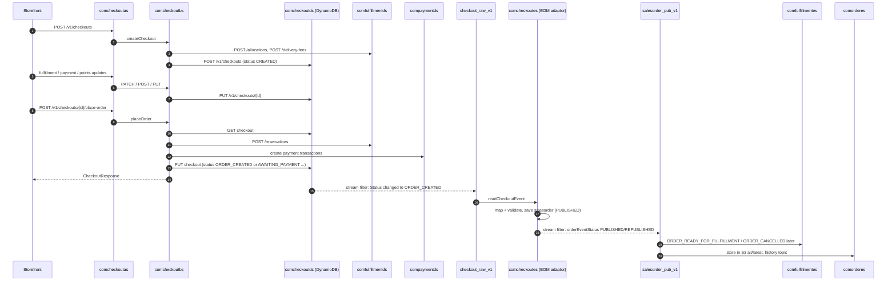

# mycheckout — NextGen Commerce: End-to-End System Guide — Part 1

Source names are anonymized; original evidence dates and runtime limitations apply.

| Import record | Value |
|---|---|
| Source document | `END-TO-END-SYSTEM.md` |
| Source SHA256 | `4d1f4d3804f7dd242a206764ce0bbf48f087371f0c8bf643aa9ecd1038ae3228` |
| Guide part | 1 of 6 |

[Part 1](/mycheckout/end-to-end-system/part-1) · [Part 2](/mycheckout/end-to-end-system/part-2) · [Part 3](/mycheckout/end-to-end-system/part-3) · [Part 4](/mycheckout/end-to-end-system/part-4) · [Part 5](/mycheckout/end-to-end-system/part-5) · [Part 6](/mycheckout/end-to-end-system/part-6)

## NextGen Commerce: End-to-End System Guide {#nextgen-commerce-end-to-end-system-guide}

<a id="shared-2807cb0817be"></a>

Verified against the local source in `D:\BE Projects\checkout` on 2026-11-04. Expanded the same day with business rules, API behaviour, security, high-volume handling and more sequence diagrams. This is the single entry point for the whole workspace: what each service does, how an order moves from cart to order history, which switches change that path, and where to go deeper.

Evidence levels used in this document:

<a id="shared-ddf2bf741ea3"></a>

- **(code)** read directly from Java source or OpenAPI/AsyncAPI contracts in this workspace.
- **(config)** read from `app-configs/`, `deployment-config/` or `infra-as-code/` files. These show what is declared, not what is deployed today.
- **(docs)** taken from an existing document and not re-verified here. The source doc is named.
- **(external)** a system outside this workspace. Behaviour is inferred from the contract only.

Nothing in this document was established by calling a running environment.

---

## Contents {#contents}

<a id="shared-326303391ed2"></a>

1. [The platform in one page](/mycheckout/end-to-end-system/part-1#1-the-platform-in-one-page)
2. [Service catalogue](/mycheckout/end-to-end-system/part-1#2-service-catalogue)
3. [Conventions shared by every service](/mycheckout/end-to-end-system/part-1#3-conventions-shared-by-every-service)
4. [The order lifecycle end to end](/mycheckout/end-to-end-system/part-1#4-the-order-lifecycle-end-to-end)
5. [Checkout bizservice internals: strategies and the handler pipeline](/mycheckout/end-to-end-system/part-2#5-checkout-bizservice-internals-strategies-and-the-handler-pipeline)
6. [Place order in detail](/mycheckout/end-to-end-system/part-2#6-place-order-in-detail)
7. [After place order: the event chain](/mycheckout/end-to-end-system/part-3#7-after-place-order-the-event-chain)
8. [Business rules reference](/mycheckout/end-to-end-system/part-3#8-business-rules-reference)
9. [API behaviour](/mycheckout/end-to-end-system/part-3#9-api-behaviour)
10. [Security](/mycheckout/end-to-end-system/part-4#10-security)
11. [Handling high order volume](/mycheckout/end-to-end-system/part-4#11-handling-high-order-volume)
12. [Domain summaries](/mycheckout/end-to-end-system/part-4#12-domain-summaries)
13. [Kafka topic map](/mycheckout/end-to-end-system/part-5#13-kafka-topic-map)
14. [Feature flags](/mycheckout/end-to-end-system/part-5#14-feature-flags)
15. [Master data that changes behaviour](/mycheckout/end-to-end-system/part-5#15-master-data-that-changes-behaviour)
16. [Markets, tenants and strategy routing](/mycheckout/end-to-end-system/part-5#16-markets-tenants-and-strategy-routing)
17. [Local development guide](/mycheckout/end-to-end-system/part-5#17-local-development-guide)
18. [Runbooks](/mycheckout/end-to-end-system/part-6#18-runbooks)
19. [Known gaps, risks and open bugs](/mycheckout/end-to-end-system/part-6#19-known-gaps-risks-and-open-bugs)
20. [Corrections to existing docs](/mycheckout/end-to-end-system/part-6#20-corrections-to-existing-docs)
21. [Coverage: what this guide does and does not establish](/mycheckout/end-to-end-system/part-6#21-coverage-what-this-guide-does-and-does-not-establish)
22. [Where to read next](/mycheckout/end-to-end-system/part-6#22-where-to-read-next)
23. [Additional flows found in the coverage audit](/mycheckout/end-to-end-system/part-6#23-additional-flows-found-in-the-coverage-audit-2026-11-04)

---

## 1. The platform in one page {#1-the-platform-in-one-page}

<a id="shared-043bbb09fbe8"></a>

Every domain follows the same tier pattern. A storefront or client calls the **app tier** (`…as`), which delegates to a **biz tier** (`…bs`) that aggregates many **data tiers** (`…ds`). **Event services** (`…es`) consume and produce Kafka events. **Job services** (`…js`) are Kubernetes CronJobs. Each domain also has an `…-api` repo that holds only contracts (OpenAPI, AsyncAPI, master data schemas, feature flags) and the CDK that publishes them.

```
                         Storefront / web components / POS / Hybris
                                         │
          ┌──────────────────────────────┼─────────────────────────────┐
          ▼                              ▼                             ▼
     comcartas                     comcheckoutas                  comfulfillmentas
          │                              │                             │
          ▼                              ▼                             ▼
     comcartbs  ───────────────▶   comcheckoutbs  ───────────────▶ comfulfillmentds
          │                     (handler pipeline:                     │  Postgres ledger,
          ▼                      product, promotion,                   │  DynamoDB locations,
     comcartds (DynamoDB)        rationing, account,                   │  Redis geo
                                 payment, tax, fulfillment,            │
                                 loyalty, segmentation …)              │
                                         │                             │
                                         ▼                             │
                                  comcheckoutds                        │
                                  DynamoDB "checkout" table            │
                                  (+ Postgres addresses)               │
                                         │ DynamoDB stream, filter:    │
                                         │ status → ORDER_CREATED      │
                                         ▼                             │
                               checkout_raw_v1 (Kafka, Avro)           │
                                         │                             │
                                         ▼                             │
                                  comcheckoutes (EOM adaptor)          │
                                  DynamoDB "salesorder" table          │
                                         │ DynamoDB stream, filter:    │
                                         │ PUBLISHED / REPUBLISHED     │
                                         ▼                             │
                               salesorder_pub_v1 (Kafka, Avro) ────────┼──▶ EOM (external)
                                         │                             │
                     ┌───────────────────┴──────────┐                  │
                     ▼                              ▼                  │
              comorderes                     comfulfillmentes ─────────┘
              S3 all/latest buckets,         stock adjust / release
              history topic, Lambda          → stocklevel CDC → inventory-availability_pub_v1
                     │
                     ▼
              comorderds (OpenSearch + Postgres) ◀── comorderas ◀── order history UI
```

The most important facts in this picture, all **(config)** or **(code)**:

<a id="shared-7670177a88ca"></a>

- Checkout does **not** call EOM or the order service directly. The hand-off is a DynamoDB stream on the checkout table, filtered to the moment `Status` changes to `ORDER_CREATED`, delivered to Kafka by a CDC Lambda connector (`commerce-checkout-dataservice/infra-as-code/cdk/app-infra/configs/*/…yaml`, `allconnectors`).
- The EOM adaptor turns checkouts into sales orders and publishes them the same way: through a second DynamoDB stream filtered on `orderEventStatus` of `PUBLISHED` or `REPUBLISHED`.
- Payments that finish asynchronously come back on `salesorderpayments_pub_v1`. The EOM adaptor calls checkout biz `place-order` again for checkouts still in `AWAITING_PAYMENT` (§6.6).
- EOM means **Enterprise Order Management** (and ERM, Enterprise Return Management), per `commerce-order-eventservice` docs. The EOM adaptor's own CLAUDE.md calls it "End-of-Month", which is wrong (§20).

---

## 2. Service catalogue {#2-service-catalogue}

Stack is taken from the Gradle build files **(code)**, not from CLAUDE.md files, because several CLAUDE.md files are out of date.

### 2.1 Checkout (`checkout/`, git clones) {#21-checkout-checkout-git-clones}

<a id="shared-04070ec7b517"></a>

| Repo | Backstage / path | Stack | Role |
|---|---|---|---|
| `commerce-checkout-api` | `comcheckoutapi` | OpenAPI, AsyncAPI, Avro, JSON master data, CDK | Contracts: `checkout-app-rest`, `checkout-biz-rest`, `checkout-data-rest`, `checkout-eom-rest`, `checkout-event` (sales order), `checkout-internal-event` (checkout raw), `address*`, `config`, `handlerconfig`, and the 45 flag definitions in `source/features-flags/` |
| `commerce-checkout-appservice` | `/comcheckoutas` | **Quarkus** on the checked-out branch `fix/NCHECK-7668` (MicroProfile config, Mutiny), OPA | Thin façade over biz: validation, OPA authorization, request/response mapping. Also hosts preorder endpoints (`/v1/preorder…`) that biz does not expose. Its `FeatureToggleKey` enum is a placeholder (`TOGGLE_KEY`) |
| `commerce-checkout-bizservice` | `/comcheckoutbs` | Spring Boot 3 WebFlux (reactive), MapStruct | All checkout logic. Country strategies select ordered lists of step handlers; ~45 handlers call ~25 downstream services (§5) |
| `commerce-checkout-dataservice` | `/comcheckoutds` | Spring Boot 3, DynamoDB (`checkout`, `checkoutprofile`, mycheckout periods, order sequence), PostgreSQL + Flyway (addresses per market) | System of record for checkouts. Its DynamoDB stream is the source of `checkout_raw_v1` |
| `commerce-checkout-eomadaptorservice` | `/comcheckoutes` | Spring Boot 3, Spring Cloud Stream Kafka, Avro CloudEvents, DynamoDB | Consumes `checkout_raw_v1`, builds sales orders, stores them in DynamoDB (`salesorder`), whose stream publishes `salesorder_pub_v1`. Also consumes payments, address and registration events |
| `commerce-checkout-jobservice` | `/comcheckoutjs` | Spring Boot scaffold | **Contains no job logic.** Only `CheckoutServiceApplication` and a test mock. Deployed as an hourly CronJob (`0 * * * *`) in global dev/qa that starts the app and exits (§19) |
| `commerce-checkout-mockservice-main` | `comcheckoutms` | Microcks (`ci-config/microcks`) | Mock server built from downstream OpenAPI specs (account, blocks, contact, Manhattan promising, LOS, OMS shipping restriction, payment, product biz, profile, promotion, rationing) for global dev/perf |
| `commerce-checkout-webcomponents-main` | — | Front-end | Checkout UI components; reads the UI-scoped flags |

### 2.2 Other domains {#22-other-domains}

<a id="shared-25fd2b5332a8"></a>

| Domain | Repo | Path | Stack | Role |
|---|---|---|---|---|
| Cart | `commerce-cart-appservice` | `/comcartas` | Spring Boot WebFlux | Façade over cart biz |
| | `commerce-cart-bizservice` | `/comcartbs` | Spring Boot | Cart aggregation: product, fulfillment, promotion, account, tax, rationing, payment, subscription |
| | `commerce-cart-dataservice` | `/comcartds` | Spring Boot, DynamoDB | Carts, entries, sub-carts. Checkout biz deletes the cart asynchronously after an order is created (§6.4) |
| Fulfillment | `commerce-fulfillment-appservice` | `/comfulfillmentas` | **Quarkus** | Façade, filters, OTP, pickup checks |
| | `commerce-fulfillment-dataservice` | `/comfulfillmentds` | **Quarkus**, Hibernate Reactive, PostgreSQL ledger, DynamoDB, Redis | ATS, allocations, reservations, locations, fees, dates. Checkout biz calls this directly |
| | `commerce-fulfillment-eventservice` | `/comfulfillmentes` | **Quarkus**, SmallRye Kafka | AS400 inventory in, sales orders in, stock CDC in, `inventory-availability` out |
| | `commerce-fulfillment-jobservice` | — | Spring Boot `CommandLineRunner` | Triggers location-load commands |
| Order | `commerce-order-appservice` | `/comorderas` | **Quarkus 3.33, native build** (corrected in the coverage audit; earlier listed as Spring Boot WebFlux) | Order history, returns, cancellations, invoices, tracking; calls OMS, Manhattan, Apigee |
| | `commerce-order-dataservice` | `/comorderds` | **Quarkus 3.33, native build** (Mutiny `Uni`), OpenSearch, PostgreSQL (corrected) | Order search/read model and job/cancel/return state |
| | `commerce-order-eventservice` | `/comorderes` | Spring Boot, Kafka batch consumers, S3, Lambda | Stores every order/return/payment event in S3 ("all" and "latest" buckets), re-routes to history, DLQ, RLQ |
| | `commerce-order-jobservice` | — | Run-once Java app (`java -jar app.jar <jobType>`) | Five cancellation CronJobs; see §23.5 |
| Product | `commerce-product-ingestservice` | — | Spring Boot | ContentStack webhooks → product data, bundles; produces bundle availability/price topics |
| | `commerce-product-publishservice` | — | Spring Boot | Consumes product CDC (`product_raw_v2`, `price_raw_v2`, `inventory_raw_v1`, …) and publishes `product_pub_v1`, tuples and search-index updates. Supports multi-tenant mode for ap2 (`nx.framework.instance.enabled`) |
| | `commerce-product-appservice` / `bizservice` / `dataservice` | `/comproductas` `bs` `ds` | Spring Boot | Product read APIs. Checkout biz calls `comproductbs` |
| Taxation | `commerce-taxation-dataservice` | `/comtaxationds` | **Quarkus**, PostgreSQL | Tax calculation and tax details. Called by checkout biz and EOM adaptor |
| | `commerce-tax-api` | — | Contracts | Tax and taxation contracts |
| CSP | `commerce-csp-appservice` / `dataservice` | `/comcspas` `/comcspds` | **Quarkus** (Java 21), PostgreSQL schema `csp` | Customer Service Portal: Do-Not-Disturb and Upsell Playbook. Not part of the order path |

<a id="shared-519d6cef956a"></a>

Services that checkout depends on but that are **not** in this workspace **(external)**: payment (`compaymentds`), promotion (`compromotionds`, `compromotionbs`), rationing, purchase restriction, account, account search, blocks and privileges, LOS, profile, contact, registration, subscription (SOP), loyalty points, OTP and identity, segmentation, share bar, tax (`comtaxds`), Hybris (Japan preorder), indexed-order command service, and EOM itself.

---

## 3. Conventions shared by every service {#3-conventions-shared-by-every-service}

<a id="shared-ac7eaec681a4"></a>

| Topic | Convention | Evidence |
|---|---|---|
| Internal DNS | `http://<svc>.${TENANT_NAME}-${TENANT_ENV}/<svc>` (biz configmap uses `INSTANCE_OR_TENANT_*`) | (config) bizservice `app-configs/configmap.yml` |
| Tenants | `global`, `jpn`, `latam`, `tha`, `ap2`; envs `dev`, `qa`, `uat`, `perf`, `prod` | (config) |
| Tenant (affiliate) codes in topic names | `000` global, `070` Japan, `170` LATAM, `200` Thailand, `100` MSB (MY/SG/BN), `220` Indonesia, `350` Philippines | (config) topic names; product publishservice multi-tenancy doc |
| Topic name | `commerce_<env>_<tenantCode>_<entity>_<raw|pub|error>_v<N>` | (config) |
| Consumer groups | `ngcom_<svc>_<tenantName><env>`, e.g. `ngcom_comcheckoutes_jpnqa` | (config) |
| Event format | Avro inside CloudEvents (binary), Confluent Schema Registry, `CustomSubjectNamingStrategy` | (config) |
| Country context | Request "tuple" headers (`TupleService.getTuples().getmycheckoutCountry()`) drive strategy selection | (code) |
| Contracts | Server stubs (`api` module) and WebClient clients (`domain` module) are generated from versioned contract artifacts in CodeArtifact | (code) `build.gradle` |
| Feature flags | flagd/OpenFeature via `feature-toggle-starter`. Definitions live in `<domain>-api/…/feature-flags` | (code) |
| Master data | `master-data-starter`, schemas and per-market data in `<domain>-api/source/<name>/v1/data-*.json` | (code) |
| Config | `app-configs/configmap.yml` plus `configmap_<tenant>_<env>.yml`, mounted at `/etc/app/config/` | (config) |
| Deploy | Helm values in `deployment-config/ngcom-microservice/`, ArgoCD, CodePipeline/CodeBuild, CDK in `infra-as-code/cdk/` | (config) |

---

## 4. The order lifecycle end to end {#4-the-order-lifecycle-end-to-end}

### 4.1 Checkout statuses {#41-checkout-statuses}

`CheckoutStatus` in `checkout-biz-rest` has exactly four values **(code)**:

<a id="shared-4c0a6fddfaf7"></a>

| Status | Meaning |
|---|---|
| `CREATED` | Checkout exists and is being edited (fulfillment, payment, points, entries) |
| `AWAITING_PAYMENT` | Order submitted, payment confirmation pending (asynchronous payment) |
| `PAYMENT_REQUIRED` | Payment failed or needs retry |
| `ORDER_CREATED` | Order placed. The DynamoDB record's transition into this status triggers the hand-off to EOM |

### 4.2 Two ways to create an order {#42-two-ways-to-create-an-order}

<a id="shared-6f9774b19ad5"></a>

| Path | Calls | Used by |
|---|---|---|
| **Interactive** | `POST /v1/checkouts` → many `PATCH`/`POST` updates → `POST /v1/checkouts/{id}/place-order` | Storefront checkout pages |
| **One-shot** | `POST /v1/orders` (`createOrder`) runs enrichment, persistence and place-order in one pipeline | Batch/system callers (the controller records `CHECKOUT_BATCH_ORDER_REQUESTED_COUNT`) |

### 4.3 Interactive lifecycle {#43-interactive-lifecycle}

<a id="shared-04928536b6e9"></a>

| Step | App/biz operation | Biz flow (`CheckoutFlow` / `PlaceOrderFlow`) | What happens |
|---|---|---|---|
| 1 | `POST /v1/checkouts` | `CREATE_CHECKOUT` | Enrich users and products, segment, account search, promotions ∥ rationing, fulfillment ∥ balance ∥ delivery fee ∥ SOP, modifications, tax, adjustments, **create in data tier** |
| 2 | `GET /v1/checkouts/{id}` | `GET_CHECKOUT` | Recalculate without persisting (POS recalculation can be disabled by `disable.pos.checkout.recalculation`) |
| 3 | `POST/PATCH …/fulfillments` | `ADD_FULFILLMENT` / `UPDATE_FULFILLMENT` | Recalculate around the chosen delivery method; update in data tier |
| 4 | `PATCH …/loyalty-points` | `UPDATE_AMPOINTS` | Recalculate with points applied |
| 5 | `PATCH /v1/checkouts/{id}` | `UPDATE_CHECKOUT` | Business-logic update, modifications, update in data tier |
| 6 | `POST/PUT …/payments` | `UPDATE_PAYMENT_GENERAL` or, if already `ORDER_CREATED`, `UPDATE_PAYMENT_ORDER_CREATED` | Validate and store payment methods |
| 7 | `GET …/validate` | — | Field validation |
| 8 | `POST …/place-order` | `PLACE_ORDER_*` (§6) | Reserve inventory, take payment, set status, persist, side effects |
| 9 | *(async)* | DynamoDB stream → `checkout_raw_v1` | Only when status changed to `ORDER_CREATED` |
| 10 | *(async)* | EOM adaptor | Sales order built, validated, stored, published to `salesorder_pub_v1` |
| 11 | *(async)* | Fulfillment eventservice, order eventservice, EOM | Stock consumed or released later; order history indexed |

### 4.4 Full sequence {#44-full-sequence}



---

## Official References

Platform documentation explains the underlying technologies; project behavior remains grounded in the source evidence above.

- [AWS service documentation](https://docs.aws.amazon.com/)
- [Apache Kafka documentation](https://kafka.apache.org/documentation/)
- [Quarkus guides](https://quarkus.io/guides/)
