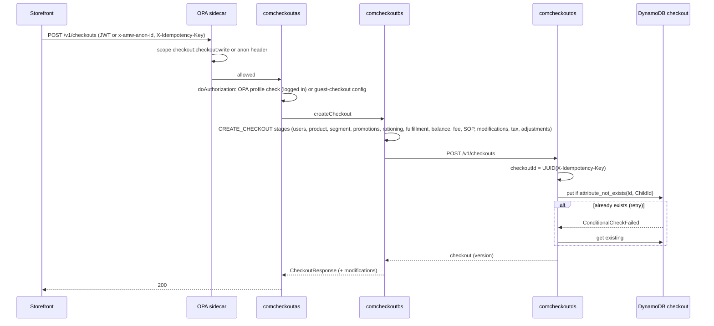
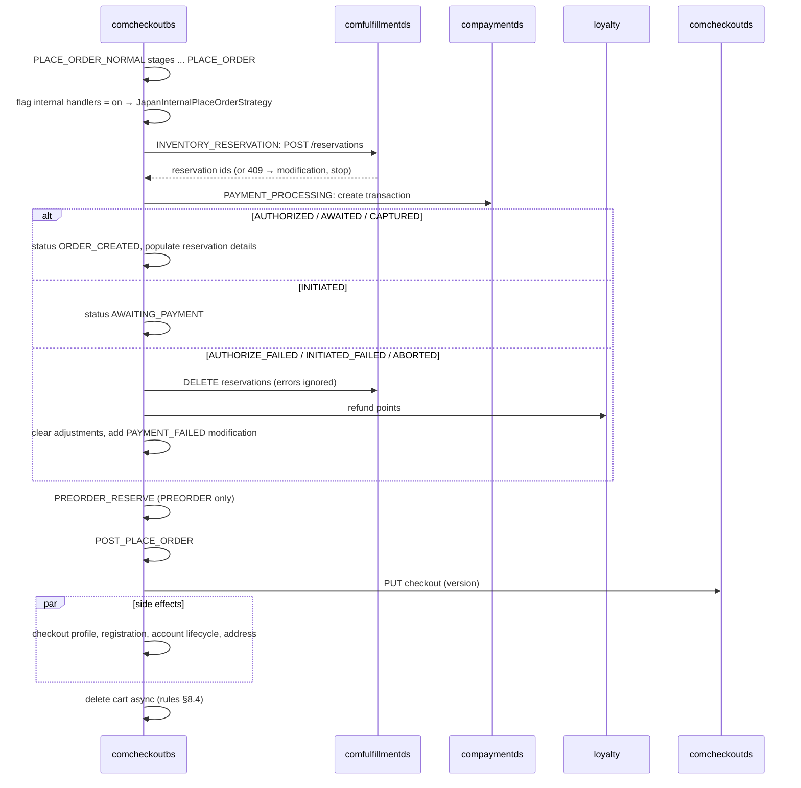
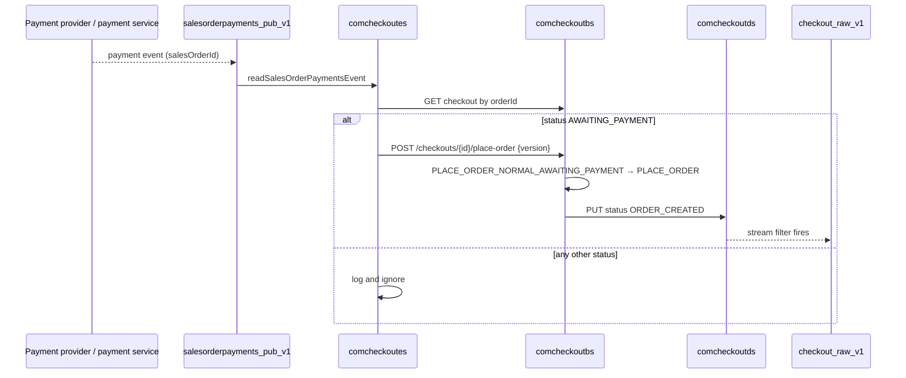
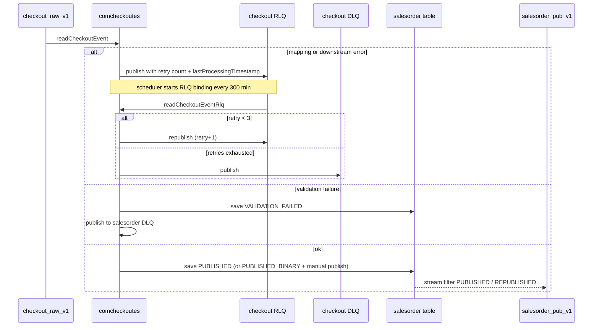

# mycheckout — NextGen Commerce: End-to-End System Guide — Part 2

Source names are anonymized; original evidence dates and runtime limitations apply.

| Import record | Value |
|---|---|
| Source document | `END-TO-END-SYSTEM.md` |
| Source SHA256 | `4d1f4d3804f7dd242a206764ce0bbf48f087371f0c8bf643aa9ecd1038ae3228` |
| Guide part | 2 of 6 |

[Part 1](/mycheckout/end-to-end-system/part-1) · [Part 2](/mycheckout/end-to-end-system/part-2) · [Part 3](/mycheckout/end-to-end-system/part-3) · [Part 4](/mycheckout/end-to-end-system/part-4) · [Part 5](/mycheckout/end-to-end-system/part-5) · [Part 6](/mycheckout/end-to-end-system/part-6)

## 5. Checkout bizservice internals: strategies and the handler pipeline {#5-checkout-bizservice-internals-strategies-and-the-handler-pipeline}

### 5.1 Strategy resolution {#51-strategy-resolution}

There are three independent strategy families. Mixing them up is the most common source of confusion.

<a id="shared-e70e787c9e9e"></a>

| Family | Selects | Keyed by | Classes |
|---|---|---|---|
| **Step-handler strategy** (`CheckoutStepHandlerStrategy`, `PlaceOrderStepHandlerStrategy`) | The ordered handler list for a flow | Country, then tenant group, then default | `{Default,Japan,Latam,Mexico,Thailand}{Checkout,PlaceOrder}StepHandlerStrategy` |
| **Legacy place-order strategy** (`PlaceOrderStrategyFactory`) | What the `CHECKOUT_PLACE_ORDER_HANDLER_KEY` handler does when the internal-handler flag is off | Tenant group + status + POS | `{Default,Japan,Latam,Thailand}{Normal,PaymentRetry,Pos}PlaceOrderStrategy` |
| **Internal place-order strategy** (`InternalPlaceOrderStrategyFactory`) | The sub-pipeline the same handler runs when the flag is on | Exact country key, else `DEFAULT` | `DefaultInternalPlaceOrderStrategy`, `JapanInternalPlaceOrderStrategy` |

<a id="shared-901b2468288c"></a>

Resolution for the step-handler factories (`AbstractCountryTenantStrategyFactory`) **(code)**: exact `countryCode()` match, then the tenant group from `StrategyEnum.fromCountryCode()`, then the `@Primary` default. `StrategyEnum` groups are:

<a id="shared-b691b35527f5"></a>

| Group | Countries |
|---|---|
| `JAPAN_STRATEGY` | JP |
| `THAILAND_STRATEGY` | TH |
| `LATAM_STRATEGY` | CO, MX, HN, **SV**, GT |
| `DEFAULT_STRATEGY` | everything else (including AR, CL, PA, CR and the ap2 markets) |

<a id="shared-480ea374b303"></a>

`MexicoPlaceOrderStepHandlerStrategy` and `MexicoCheckoutStepHandlerStrategy` register by exact country `MX`, so they override the LATAM group for Mexico only. Thailand strategies only set the tenant code and inherit every list from Default.

### 5.2 How the pipeline runs (`HandlerExecutor`) {#52-how-the-pipeline-runs-handlerexecutor}

**(code)** `handler/HandlerExecutor.java`, `KeyBasedStepHandler.java`, `CheckoutUtil.isHandlerExcluded`.

<a id="shared-fcc9ed06b125"></a>

1. A strategy returns `List<String>` of handler keys. A key joined with `:` (written ∥ below) is one **stage** whose handlers run concurrently (`Flux.merge`). Stages run in order (`Flux.concat`).
2. Before a stage runs, `prepareSteps` **drops** any handler that the `HandlerConfig` master data excludes for the checkout's classifications and client id (§15). Dropped handlers are logged as `CH_BIZ_SKIPPED_HANDLERS_INFO`. If all handlers in a stage are dropped, the stage returns the checkout unchanged.
3. For each remaining handler, `KeyBasedStepHandler.call` runs `isApplicable` → `validate` → `execute`. `execute` is skipped when `validate` leaves a modification on the checkout (`hasNoErrors`).
4. Default `isApplicable` returns true only when the checkout has no metadata or its `lastUpdatedAt` is older than `checkout.operation.place-order.skip-step.timeout.seconds` (0 in `application.yml`, 60 in the base configmap). Handlers can override `isApplicable`; this is how BOOKING-channel and PREORDER exclusions coded in Java work.
5. Errors propagate as `Mono.error` and end the pipeline. The shared `CheckoutCommonRequest` and `CheckoutCommonResponse` objects are mutated in place.

<a id="shared-1cb788d6e9e8"></a>

The property `checkout.operation.place-order.step-handlers` (`ENRICH_PRODUCT_DETAILS,EVALUATE_APPLY_PROMOTION,INVENTORY_SHIPPING_FEE_CALCULATE`) is declared in `application.yml` and the configmap but **no Java code reads it** (searched `source/app/src/main/java`). The pipelines are hard-coded in the strategy classes.

### 5.3 Handler inventory {#53-handler-inventory}

<a id="shared-fbf6eb9930fa"></a>

Keys come from `CheckoutHandlerEnum`. Downstream calls are summarised from service names and the earlier trace in `docs/checkout-chat-history-2026-10-21.md`; individual call paths were not all re-read.

<a id="shared-010bcbe71e1f"></a>

| Handler key (short) | Class | Main dependency |
|---|---|---|
| ENRICH_USERS | `CheckoutEnrichUsersStepHandler` | account, profile, LOS, blocks (via the user handlers below) |
| ENRICH_PRODUCT | `CheckoutEnrichProductStepHandler` | `comproductbs` |
| POPULATE_SEGMENT | `CheckoutPopulateSegmentStepHandler` | segmentation |
| ACCOUNT_SEARCH | `CheckoutAccountSearchStepHandler` | `comaccountsearchds` |
| SHAREBAR | `CheckoutShareBarStepHandler` | `comsharebards` (Japan) |
| PREPARE | `CheckoutPrepareStepHandler` | promotions, rationing v1, purchase restriction |
| RATIONING | `CheckoutRationingStepHandler` | rationing v2 |
| UPDATE_ACCOUNT_PROCESS_VERSION | `CheckoutUpdateAccountProcessVersionStepHandler` | registration / account process |
| ENRICH_FULFILLMENT | `CheckoutEnrichFulfillmentStepHandler` | `comfulfillmentds` `POST /allocations` |
| ACCOUNT_BALANCE_CALCULATION | `CheckoutAccountBalanceCalculationStepHandler` | payment account balance |
| CALCULATE_DELIVERY_FEE | `CheckoutCalculateDeliveryFeeStepHandler` | `comfulfillmentds` `POST /delivery-fees` |
| SOP | `CheckoutSopStepHandler` | subscription (SOP / auto-ship) |
| VALIDATE_INVENTORY | `CheckoutValidateInventoryStepHandler` | fulfillment |
| VALIDATE_DELIVERY_SLOT | `CheckoutValidateDeliverySlotHandler` | fulfillment slots (Japan) |
| PICKUP_LOCATION_AVAILABILITY | `CheckoutValidatePickupLocationAvailabilityHandler` | fulfillment + Estafeta (Mexico) |
| RESERVE_PICKUP_LOCATION | `CheckoutReservePickupLocationStepHandler` | fulfillment pickup confirmation (Mexico) |
| POPULATE_AMPOINTS | `CheckoutPopulateAmpointsStepHandler` | loyalty points (Japan) |
| POPULATE_HANDLING_FEE | `CheckoutPopulateHandlingFeeHandler` | internal (Japan) |
| TAX_CALCULATION | `CheckoutTaxCalculationStepHandler` | `comtaxationds` / `comtaxds` |
| TAX_THRESHOLD_VALIDATION | `CheckoutTaxDetailsValidationHandler` | tax details (LATAM) |
| POPULATE_INVOICE_NUMBER | `CheckoutPopulateInvoiceNumberStepHandler` | internal (Japan) |
| PREPARE_ADJUSTMENT | `CheckoutPrepareAdjustmentStepHandler` | internal |
| PREPARE_MODIFICATION | `CheckoutPrepareModificationStepHandler` | product restrictions |
| APPLY_PROFILE | `CheckoutApplyProfileStepHandler` | checkout profile (Japan create) |
| UPDATE_BUSINESS_LOGIC | `CheckoutUpdateBusinessLogicStepHandler` | internal |
| UPDATE_PAYMENT_OPTIONS / ADD_PAYMENT_OPTIONS | `CheckoutUpdatePaymentOptionsStepHandler` / `CheckoutAddPaymentOptionsStepHandler` | data tier |
| CREATE_DB / UPDATE_DB | `CheckoutCreateDbStepHandler` / `CheckoutUpdateDbStepHandler` | `comcheckoutds` POST / PUT |
| PLACE_ORDER | `CheckoutPlaceOrderStepHandler` | §6 |
| INVENTORY_RESERVATION, PAYMENT_PROCESSING, CALCULATE_EARNED_AMPOINT, POST_PLACE_ORDER | `handler/impl/placeorder/*` | internal place-order sub-pipeline (§6.3) |
| PREORDER, PREORDER_RESERVE | `handler/impl/preorder/*` | Hybris preorder app (Japan) |
| User handlers | `handler/impl/user/*` (`Account`, `Address`, `JapanAddress`, `AwardLevels`, `BlocksAndPrivileges`, `PaymentBlocksAndPriviliges`, `DownlinesLos`, `Los`, `Email`, `Phone`, `Preferences`, `Profile`, `ProfileMapping`, `Tax`) | account, contact, LOS, blocks, profile |

### 5.4 Checkout (non-order) flows per market {#54-checkout-non-order-flows-per-market}

`DefaultCheckoutStepHandlerStrategy` **(code)**:

<a id="shared-8d6563a6e175"></a>

| Flow | Stages |
|---|---|
| `CREATE_CHECKOUT` | ENRICH_USERS → ENRICH_PRODUCT ∥ POPULATE_SEGMENT → ACCOUNT_SEARCH → PREPARE ∥ RATIONING → ENRICH_FULFILLMENT ∥ ACCOUNT_BALANCE ∥ DELIVERY_FEE ∥ SOP → PREPARE_MODIFICATION → TAX_CALCULATION → PREPARE_ADJUSTMENT → CREATE_DB |
| `GET_CHECKOUT` | ENRICH_USERS → POPULATE_SEGMENT → PREPARE ∥ RATIONING → ACCOUNT_BALANCE ∥ SOP → VALIDATE_INVENTORY → DELIVERY_FEE → TAX → ADJUSTMENT → MODIFICATION (no persistence) |
| `ADD_FULFILLMENT` | POPULATE_SEGMENT → PREPARE ∥ RATIONING → ENRICH_FULFILLMENT ∥ ACCOUNT_BALANCE ∥ SOP → MODIFICATION → TAX → ADJUSTMENT → UPDATE_DB |
| `UPDATE_FULFILLMENT` | POPULATE_SEGMENT → PREPARE ∥ RATIONING → ENRICH_FULFILLMENT ∥ ACCOUNT_BALANCE ∥ DELIVERY_FEE ∥ SOP → MODIFICATION → TAX → ADJUSTMENT → UPDATE_DB |
| `UPDATE_AMPOINTS` | PREPARE ∥ RATIONING → ENRICH_FULFILLMENT ∥ ACCOUNT_BALANCE ∥ DELIVERY_FEE ∥ SOP → MODIFICATION → TAX → ADJUSTMENT → UPDATE_DB |
| `UPDATE_CHECKOUT` | UPDATE_BUSINESS_LOGIC → PREPARE_MODIFICATION → UPDATE_DB |

Market overrides, by the handler keys each class references **(code)**:

<a id="shared-355629d24b17"></a>

- **Japan** adds SHAREBAR, APPLY_PROFILE, VALIDATE_DELIVERY_SLOT, POPULATE_AMPOINTS and POPULATE_HANDLING_FEE, and overrides most flows.
- **LATAM** overrides `CREATE_CHECKOUT` and `GET_CHECKOUT` to add TAX_THRESHOLD_VALIDATION and VALIDATE_INVENTORY.
- **Mexico** overrides the fulfillment parallel stage to add PICKUP_LOCATION_AVAILABILITY.
- **Thailand** uses Default unchanged.

---

## 6. Place order in detail {#6-place-order-in-detail}

### 6.1 Which `PlaceOrderFlow` runs {#61-which-placeorderflow-runs}

<a id="shared-0e64d0c27835"></a>

`PlaceOrderServiceImpl.placeOrder` **(code)** loads the checkout from the data tier, copies `version`, `originIp`, `subscriptionSetId` and durable-entry subscription flags from the request, clears modifications, then picks a flow in this order:

<a id="shared-6c07c8c2ca18"></a>

| Condition (first match wins) | Flow | Notes |
|---|---|---|
| `clientName` is a POS client (`checkoutUtil.isPosStrategyApplicable`) | `PLACE_ORDER_POS` | Payment response is populated first |
| status is `ORDER_CREATED` or `PAYMENT_REQUIRED` | `PLACE_ORDER_RETRY` | Payment retry |
| status is `AWAITING_PAYMENT` | `PLACE_ORDER_NORMAL_AWAITING_PAYMENT` | Only the PLACE_ORDER handler; this is what the payments event triggers (§6.6) |
| otherwise (`CREATED`) | `PLACE_ORDER_NORMAL` | Full recalculation then place order |

<a id="shared-01136e079905"></a>

`PLACE_ORDER_NORMAL_CHECKOUT_FAILED` (full recalculation ending in UPDATE_DB instead of PLACE_ORDER) is not selected here. `PaymentServiceImpl.executeAwaitingPaymentFailureFlow` runs it when a payment fails for a checkout in `AWAITING_PAYMENT`, after resetting the status to `CREATED` (§8.3).

### 6.2 Handler lists per market {#62-handler-lists-per-market}

<a id="shared-ce421ba930e8"></a>

Abbreviations: SEGMENT = POPULATE_SEGMENT, BALANCE = ACCOUNT_BALANCE_CALCULATION, UPDATE_APV = UPDATE_ACCOUNT_PROCESS_VERSION, TAX = TAX_CALCULATION, ADJUSTMENT = PREPARE_ADJUSTMENT, MODIFICATION = PREPARE_MODIFICATION.

<a id="shared-dfb0f2ecc815"></a>

| Flow | Default / Thailand | LATAM (CO, HN, SV, GT) | Mexico | Japan |
|---|---|---|---|---|
| `PLACE_ORDER_NORMAL` | ENRICH_USERS → ENRICH_PRODUCT ∥ SEGMENT → PREPARE ∥ RATIONING ∥ UPDATE_ACCOUNT_PROCESS_VERSION → ENRICH_FULFILLMENT ∥ BALANCE ∥ DELIVERY_FEE ∥ SOP → TAX → ADJUSTMENT → MODIFICATION → **PLACE_ORDER** | Default + TAX_THRESHOLD_VALIDATION after TAX | LATAM list without TAX_THRESHOLD, + RESERVE_PICKUP_LOCATION before MODIFICATION | SHAREBAR → ENRICH_USERS → ACCOUNT_SEARCH → ENRICH_PRODUCT ∥ SEGMENT → PREPARE ∥ RATIONING ∥ UPDATE_APV → ENRICH_FULFILLMENT ∥ BALANCE ∥ DELIVERY_FEE ∥ SOP → VALIDATE_DELIVERY_SLOT → POPULATE_AMPOINTS → HANDLING_FEE → TAX ∥ INVOICE_NUMBER → ADJUSTMENT → MODIFICATION → **PLACE_ORDER** |
| `PLACE_ORDER_POS` | SEGMENT → PREPARE ∥ RATIONING ∥ UPDATE_APV → DELIVERY_FEE ∥ SOP → BALANCE → TAX → ADJUSTMENT → MODIFICATION → PLACE_ORDER | Default | Default | SEGMENT → PREPARE ∥ RATIONING ∥ UPDATE_APV → DELIVERY_FEE → TAX ∥ INVOICE_NUMBER → MODIFICATION → PLACE_ORDER |
| `PLACE_ORDER_RETRY` | UPDATE_APV → PLACE_ORDER | Default | Default | Default |
| `PLACE_ORDER_NORMAL_AWAITING_PAYMENT` | PLACE_ORDER | Default | Default | Default |
| `CREATE_ORDER` (`POST /v1/orders`) | ENRICH_USERS → ENRICH_PRODUCT → SEGMENT → PREPARE ∥ RATIONING → ENRICH_FULFILLMENT ∥ BALANCE ∥ DELIVERY_FEE ∥ SOP → MODIFICATION → TAX → ADJUSTMENT → **CREATE_DB** → PLACE_ORDER | Default + TAX_THRESHOLD_VALIDATION after TAX | inherits LATAM | Default + VALIDATE_DELIVERY_SLOT after the fulfillment stage, POPULATE_AMPOINTS, HANDLING_FEE, TAX ∥ INVOICE_NUMBER |
| `UPDATE_PAYMENT_GENERAL` | SEGMENT → PREPARE ∥ RATIONING → BALANCE ∥ SOP → VALIDATE_INVENTORY → DELIVERY_FEE → MODIFICATION → TAX → ADJUSTMENT → UPDATE_PAYMENT_OPTIONS | Default | Default | Default + VALIDATE_DELIVERY_SLOT, POPULATE_AMPOINTS, HANDLING_FEE |
| `UPDATE_PAYMENT_ORDER_CREATED` | UPDATE_PAYMENT_OPTIONS | Default | Default | Default |

### 6.3 The place-order switch: `place.order.internal.handle.support.enable` {#63-the-place-order-switch-placeorderinternalhandlesupportenable}

<a id="shared-5474437ce0fa"></a>

`CheckoutPlaceOrderStepHandler.execute` **(code)** branches on `FeatureToggleKey.CHECKOUT_PLACE_ORDER_INTERNAL_HANDLERS_SUPPORT` (key `checkout.place.order.internal.handle.support.enable`, code default `false`, registry default variant `off`).

<a id="shared-99714b31c89d"></a>

| Flag | Path | Steps |
|---|---|---|
| **off** (default) | `executePlaceOrder` → `PlaceOrderStrategyFactory.findStrategy(status, isPos, classifications, country)` | POS (unless the checkout is `WHT`) → `posPlaceOrderStrategy`; status `ORDER_CREATED` → `retryPlaceOrderStrategy`; else `normalPlaceOrderStrategy`. Default normal runs **reservation and payment concurrently** (`Mono.zip`), then sets `ORDER_CREATED`, populates reservation details, and calculates and prorates earned points. Then the post-order steps in §6.4 |
| **on** | `InternalPlaceOrderStrategyFactory.findStrategy(country)` runs a sub-pipeline | **Default**: INVENTORY_RESERVATION ∥ PAYMENT_PROCESSING → CALCULATE_EARNED_AMPOINT → POST_PLACE_ORDER. **Japan**: INVENTORY_RESERVATION → PAYMENT_PROCESSING → PREORDER_RESERVE → CALCULATE_EARNED_AMPOINT → POST_PLACE_ORDER (sequential). Reservation and payment use strategy factories keyed by classifications and client name (`Default`, `DefaultPos`, `Japan`, `JapanPos`) |

Things to know about the "on" path:

<a id="shared-e08e2406a229"></a>

- Only `DEFAULT` and `JP` keys are registered, so LATAM and Thailand use the default sub-pipeline, where reservation and payment run in parallel.
- `CalculateEarnedAmpointsStepHandler` returns immediately for JP; Japan's points come from POPULATE_AMPOINTS earlier in the outer pipeline.
- `PostPlaceOrderHandler` repeats the persistence and side effects of `executePlaceOrder`.

<a id="shared-cdf417d0ed1b"></a>

The deployed value of the flag is not visible in this workspace. Check flagd for the environment before reasoning about a specific incident. Fulfillment-side reservation behaviour (NEXTGEN ledger for Japan, Manhattan elsewhere, 409 on insufficient stock, release on payment failure) is in `fulfillment/docs/FULFILLMENT-END-TO-END.md` §14.3 to §14.5.

### 6.4 What happens after the strategy returns (both paths) {#64-what-happens-after-the-strategy-returns-both-paths}

From `CheckoutPlaceOrderStepHandler.executePlaceOrder` and `PostPlaceOrderHandler` **(code)**:

<a id="shared-cc62aea8a4a4"></a>

1. Build `UpdateCheckoutRequestDataDto`. If the new status is `ORDER_CREATED`, move `selectedPaymentMethods` into `paymentHistory` and clear `fulfillmentOptions`.
2. In parallel (`Mono.zip`):
   - Persist: `ORDER_CREATED` uses a plain data-tier update; any other status prepares modifications and uses `checkoutCommonService.updateCheckout`.
   - Update the checkout profile (only on `CREATED`/`AWAITING_PAYMENT` → `ORDER_CREATED`/`PAYMENT_REQUIRED`, and not for DIGITAL, BOOKING, POS or excluded clients; failures are logged and ignored).
   - Patch the registration to `PAYMENT_INITIATED` for account-process checkouts.
   - Create the shipping address for registration.
   - Set renewal or business-nature lifecycle to `PROCESSING` for RENEWAL, UPGRADE or DOWNGRADE orders.
3. Record order metrics on first placement, or `CHECKOUT_RETRY_PAYMENT_ORDER_COUNT` on retries.
4. Delete the cart asynchronously (`cartService.deleteCartAsync`) on first transition to an order status, except for Japan POS, SYSTEM channel (auto-SOP), and "dummy" carts for account process or registration.

<a id="shared-f3f50990e6d5"></a>

`validate()` on the same handler runs first: NO_CHARGE orders must total zero (`NoChargeOrderException`); existing modifications cause an update and stop; when master-data `preSalesOrderValidationEnable` and flag `fields.validation.support.enable` are both on, field validation runs and errors stop the order.

### 6.5 Persistence and the hand-off trigger {#65-persistence-and-the-hand-off-trigger}

<a id="shared-64f352523d73"></a>

The data tier stores the checkout in the DynamoDB table `checkout<tenant><env>` (partition `Id`, sort `ChildId`, GSI `OrderIdIndex`, TTL `expireAt`, stream `NEW_AND_OLD_IMAGES`) **(config)**. A CDC Lambda connector (`pluginType: DYNAMODB`, `cdcType: COMPLETE`, value Avro, subject `commerce_checkout-event_raw_v1-record`) forwards records that match:

```json
{"dynamodb":{"NewImage":{"Status":{"S":["ORDER_CREATED"]}},
             "OldImage":{"Status":{"S":[{"anything-but":["ORDER_CREATED"]}]}}}}
```

<a id="shared-360b1b86062f"></a>

So exactly one `checkout_raw_v1` event is emitted per checkout record when it first becomes an order. A later update that stays in `ORDER_CREATED` (for example a payment-option update) does not re-emit. A record created directly in `ORDER_CREATED` has no OldImage; whether the filter matches it was not verified. Connector failures go to `checkout-comcheckoutds-dlq_error_v1`.

### 6.6 Asynchronous payment completion {#66-asynchronous-payment-completion}

`SalesOrderPaymentsEventConsumer` → `SalesOrderPaymentsServiceImpl.placeOrder` in the EOM adaptor **(code)**:

<a id="shared-7834a263554a"></a>

1. Read `salesOrderId`, affiliate and country from a `salesorderpayments_pub_v1` event.
2. `GET` checkout biz by order id.
3. If the status is `AWAITING_PAYMENT`, call biz `POST /v1/checkouts/{id}/place-order` with only the `version`. Biz then runs `PLACE_ORDER_NORMAL_AWAITING_PAYMENT`, which reaches `ORDER_CREATED` and fires the stream filter.
4. For any other status, log "already created" and ignore.

The same topic is also archived by order eventservice into the S3 payment bucket.

### 6.7 Sequence diagrams {#67-sequence-diagrams}

**Create checkout (idempotent).**



**Place order, internal-handler path, Japan, with payment failure.**



**Asynchronous payment completion.**



**EOM hand-off failure and retry.**



---

## Official References

Platform documentation explains the underlying technologies; project behavior remains grounded in the source evidence above.

- [AWS service documentation](https://docs.aws.amazon.com/)
- [Apache Kafka documentation](https://kafka.apache.org/documentation/)
- [Quarkus guides](https://quarkus.io/guides/)
