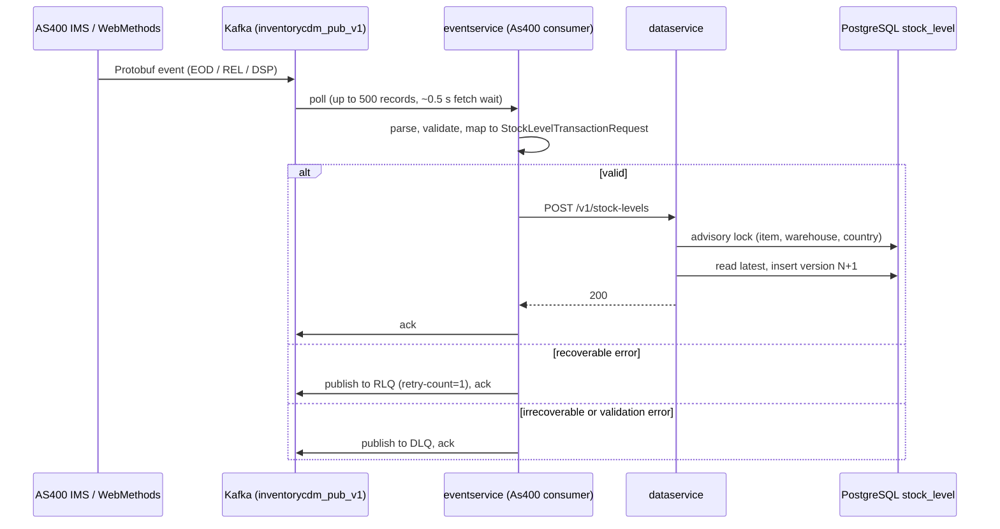
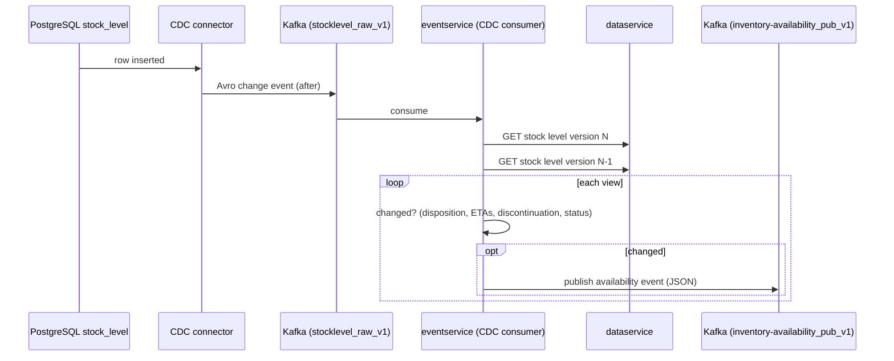
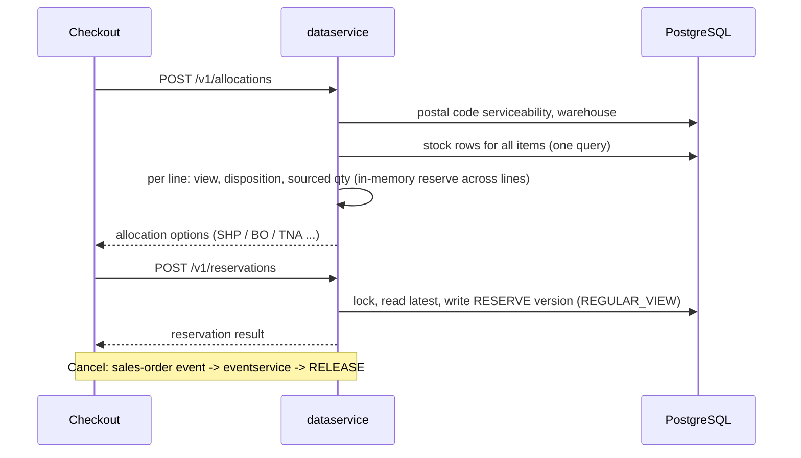
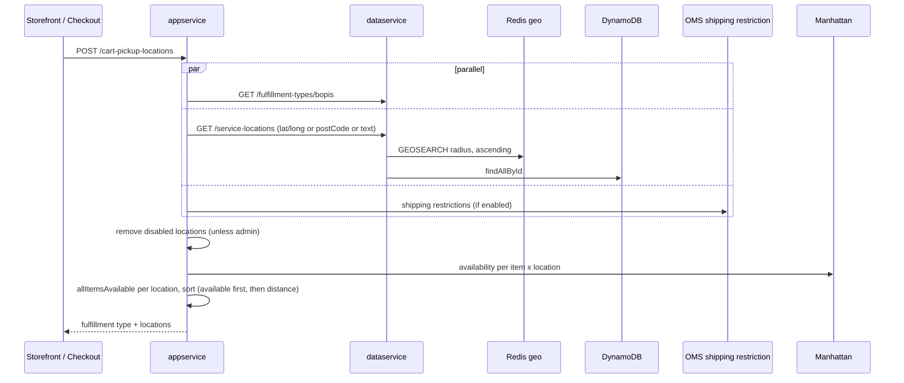
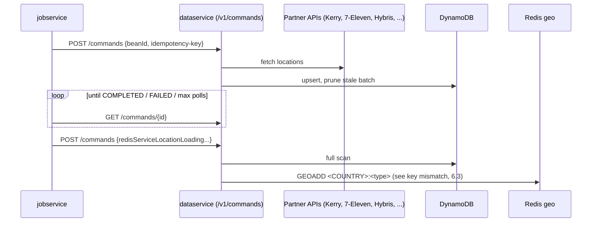

# mycheckout — Fulfillment: End-to-End Guide — Part 3

Source names are anonymized; original evidence dates and runtime limitations apply.

| Import record | Value |
|---|---|
| Source document | `fulfillment docs/FULFILLMENT-END-TO-END.md` |
| Source SHA256 | `5c0985b97fc0201d78f7a2cbf248cb7b16dba20c5e63a9f422c6568376b97eed` |
| Guide part | 3 of 6 |

[Part 1](/mycheckout/fulfillment-docs/fulfillment-end-to-end/part-1) · [Part 2](/mycheckout/fulfillment-docs/fulfillment-end-to-end/part-2) · [Part 3](/mycheckout/fulfillment-docs/fulfillment-end-to-end/part-3) · [Part 4](/mycheckout/fulfillment-docs/fulfillment-end-to-end/part-4) · [Part 5](/mycheckout/fulfillment-docs/fulfillment-end-to-end/part-5) · [Part 6](/mycheckout/fulfillment-docs/fulfillment-end-to-end/part-6)

## 8. Delivery fees {#8-delivery-fees}

Entry point: `POST /delivery-fees` on appservice (`DeliveryFeesServiceImpl`, map DTOs) → dataservice `POST /v1/delivery-fees` → `ServiceFeesServiceImpl.getDeliveryFees`.

<a id="shared-b048e93e2832"></a>

**Where fee rules live.** Each fulfillment type has service levels (for example `homedelivery` → `standard` 3–5 days, `express` 1–2, `premium` 1; dev config). Each service level holds a list of `ServiceFee` rules, each with:

- `startDate`
- `userType[]` and `orderType[]` (or `ANY`)
- `thresholdType` (`PV`, `BV`, or amount) and `minimumThresholdAmount`
- `serviceFee` (the fee amount)

**Calculation** *(code)*:

<a id="shared-cb789418a02e"></a>

1. Request items are grouped by `fulfillmentTypeId` (+ `serviceLevelId`). If no service level is given, the fee is computed for **every** service level of the type.
2. **Order total** per request = sum of `lineAmount` over all lines and bundle lines, **excluding service items** (`product.flags.isServiceItem`). Point value (PV) and business volume (BV) are summed the same way.
3. **Filter the fee rules** (`ServiceFeesFilter`):
   - keep only rules at the **latest `startDate` that is already in the past** (one effective set);
   - narrow by user type and order type, trying an exact match first and falling back to `ANY`, with user type and order type as prioritized criteria;
   - if several rules share the same minimum threshold, prefer the exact user/order match, else take the first.
4. **Pick the fee.** Sort the remaining rules by `minimumThresholdAmount` **descending**. Take the first rule whose measured total (PV, BV or amount according to `thresholdType`) is greater than or equal to its threshold. Its `serviceFee` is the fee. If none match, the fee is 0.
5. **Zero-fee cases:** no applicable rules, or the order total is 0 and every item is a service item.
6. **Free-delivery threshold** returned to the UI = the `minimumThresholdAmount` (and type) of the first rule whose fee is 0.
7. **Group + combined orders** (`isGroupOrder && isCombinedOrder`): totals are summed across all requests. The fee is charged **once on the first (parent) request**, and the others get 0.

> Example (illustrative values): rules {≥ 0 → 100, ≥ 1000 → 0}. Total 1,200 → fee 0 (free). Total 400 → fee 100. Free-delivery threshold = 1000.

<a id="shared-ed993e6fb0a9"></a>

**Related eligibility rule.** `FulfillmentTypeFilter` hides a fulfillment type only if **both** its restricted order types **and** restricted user types match the request. If only one of the two lists is populated, the type is never hidden. This may be intended, so please confirm *(unverified)*.

---

## 9. Delivery dates and slots {#9-delivery-dates-and-slots}

<a id="shared-257e9a26fadd"></a>

- `GET /delivery-slots/availability?postalCode=…` finds the postal code's **zone** in `postalcode_serviceability` (Postgres, valid for the order timestamp and country).
- The selected ordering time (or current time when omitted) is converted to the **country's time zone** from sales-entity master data.
- If the serviceability row has `timedDelivery=true`, time slots come from the country's `DeliveryTimeSlot` master data and its zone entry.
- Available dates come from `delivery_dates`: zone matches, selected ordering time lies within the row's order-day window, and deliveryDate is strictly after ordering time. If the postal code is not serviceable, a non-recoverable "postal code not serviceable" validation error is returned in the response.
- The same serviceability row also drives warehouse selection for allocation (§7).

---

## 10. Jobs summary {#10-jobs-summary}

<a id="shared-417062bb8f9b"></a>

| Job / worker | Type | Trigger | What it does |
|---|---|---|---|
| `jobservice` | Run-once batch | Kubernetes CronJobs declared in Helm values (§16) | Runs the configured country command list sequentially, polling each. The current command POST itself awaits strategy completion. |
| Command beans | On-demand `POST /commands` | Called by `jobservice` or manually | Load locations from partners into DynamoDB, prune stale rows, rebuild the Redis geo index. |
| `purgeOldStockLevels()` | Service method | **Nothing in this repo calls it.** | Would delete versions older than `retention-period-hours` (default 720 h = 30 days) while keeping `min-versions-to-retain` (default 10) per item/warehouse. The docs' "7 days" is a design target, not the default. |
| Kafka consumers | Always-on listeners | Messages | See §5. |

---

## 11. Known gaps and observations {#11-known-gaps-and-observations}

Verified in code during this pass:

<a id="shared-450935a53d3b"></a>

1. **Redis key mismatch** between loader and search (§6.3).
2. **No Redis removal** of deleted locations (§6.3).
3. **Purge is not wired** to any trigger (§10).
4. **Aggregated daily-feed consumer sends an empty request**: `AggregatedDailyFeedInventoryEventConsumer` calls `createStockLevel(new StockLevelTransactionRequestDataDto())` and never maps the payload. It is disabled by default, so the impact is limited to environments that enable it.
5. **`EOD` can overwrite reserved quantity** for flagged or listed SKUs (§4.2).
6. **`StockLevelCdcEventConsumer.processEvent(event)`** (one-argument overload) is an empty stub. Only the two-argument version is used.
7. **BOPIS availability is evaluated against Manhattan, not our own ledger**, so the pickup flow and the home-delivery ATS flow can disagree.
8. **`calculateAndUpdateServiceFees` is unused in production**, so allocation groups never get a `fee` from the data service (§7).
9. **RLQ publish failures are swallowed**, so an event can be lost if the RLQ topic is unreachable (§5.3).

Additional source observations checked in this expansion (older analysis remains in the related context files):

<a id="shared-5b3a6c48f457"></a>

- Unguarded null arithmetic in the three view strategies.
- Release can drive counters negative.
- TNA/NLA/NYA/NAW allocation entries omit `sourcedQuantity` and `backorderableQuantity`.
- Audit endpoint lists `MANUAL` rows only, and its `page` is not applied as an offset.
- Reservation is hardcoded to `REGULAR_VIEW` while allocation uses `SOP_VIEW` for AUTO_SOP.
- Earlier reports of stale view-test assertions remain historical review notes; tests were not run here. The DTO/entity overload difference must be accounted for before treating a mutation assertion as stale.

<a id="shared-9c9f457742d9"></a>

Remaining evidence boundaries and how to close them are listed in §18. Scheduling and repository channel overrides have been checked; the Redis prefix mismatch remains present in the checked source/configuration. Do not treat a missing external answer as an implementation fact.

---

## 12. Related docs {#12-related-docs}

<a id="shared-7a1003656512"></a>

| Doc | Use it for |
|---|---|
| [FULFILLMENT-INTERVIEW-PREP.md](/mycheckout/fulfillment-docs/fulfillment-interview-prep/part-1) | Interview-style summary, exact transaction arithmetic, scenarios and a Q&A bank |
| [FULFILLMENT-REDIS-AND-DELIVERY-FEE.md](/mycheckout/fulfillment-docs/fulfillment-redis-and-delivery-fee/part-1) | Redis usage and delivery-fee algorithm in detail, with worked examples and mock probes |
| [fulfillment-availability-issue-fix.md](/mycheckout/fulfillment-docs/fulfillment-availability-issue-fix) | The double-deduction and partial-backorder fix (BO 90 / BO 909 example) |
| [FULFILLMENT-BUG-CONTEXT.md](/mycheckout/fulfillment-docs/fulfillment-bug-context) | Call flow, mutation audit, status table and findings J1–J10 |
| [FULFILLMENT-COMPLETE-CONTEXT.md](/mycheckout/fulfillment-docs/fulfillment-complete-context/part-1) | Reservation and audit analysis, test-gap list, API runner plan |
| [Fulfilment-Understanding-Notes.md](/mycheckout/fulfillment-docs/fulfilment-understanding-notes/part-1) | Ledger design, SQL diagnostics, ATS formulas, feed design, decision register D01–D16 |
| `Fulfilment-Engineering-Reference.docx` | Word version of the engineering reference (not read for this pass) |

---

## 13. Sequence diagrams {#13-sequence-diagrams}

Diagrams render in any Markdown viewer with Mermaid support. Steps match the code described above.

### 13.1 AS400 inventory feed {#131-as400-inventory-feed}



### 13.2 Stock change to availability event (CDC) {#132-stock-change-to-availability-event-cdc}



### 13.3 Checkout allocation and reservation {#133-checkout-allocation-and-reservation}

<a id="shared-8b64a6de2f97"></a>

*This diagram shows the fulfillment API interaction only. Japan reserves before payment; the default normal strategy starts payment and reservation in parallel. See §14 for flags, skips and cleanup.*



### 13.4 Pickup locations (BOPIS) {#134-pickup-locations-bopis}



### 13.5 Delivery fee {#135-delivery-fee}

```mermaid
sequenceDiagram
    participant UI as Checkout
    participant AS as appservice
    participant DS as dataservice
    participant D as DynamoDB (fulfillment types)
    UI->>AS: POST /delivery-fees
    AS->>DS: POST /v1/delivery-fees
    DS->>D: fulfillment types and service levels
    DS->>DS: total per request (exclude service items; PV / BV / amount)
    DS->>DS: latest effective fee set, filter user and order type
    DS->>DS: highest threshold met -> fee; first zero-fee rule -> free-delivery threshold
    DS-->>AS: shipment details (fees, free-delivery threshold)
    AS-->>UI: mapped response
```

### 13.6 Service-location load job {#136-service-location-load-job}



## Official References

Platform documentation explains the underlying technologies; project behavior remains grounded in the source evidence above.

- [AWS service documentation](https://docs.aws.amazon.com/)
- [Apache Kafka documentation](https://kafka.apache.org/documentation/)
- [Quarkus guides](https://quarkus.io/guides/)
