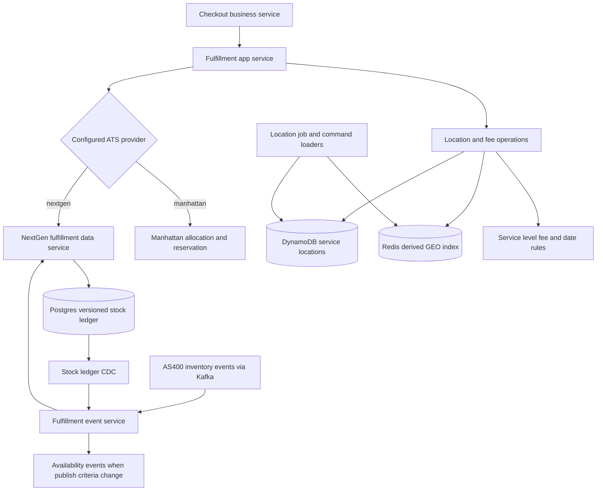
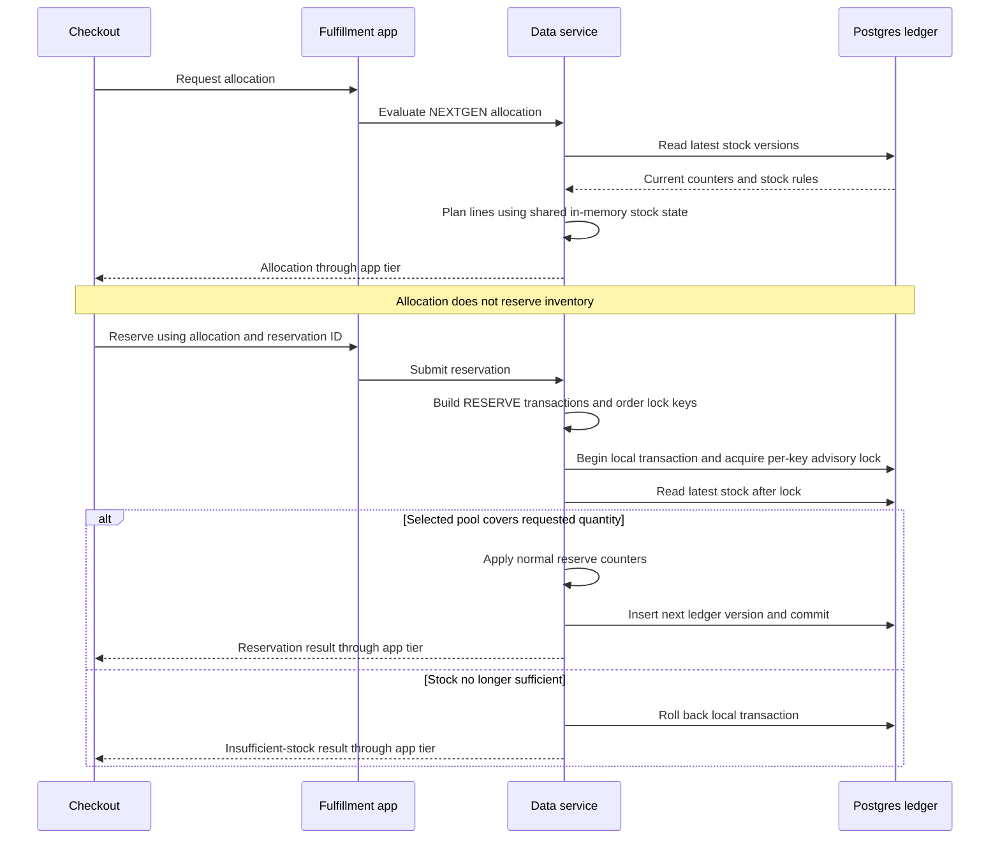
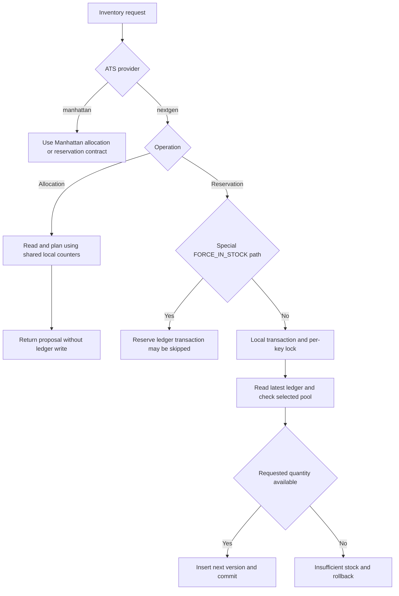

# mycheckout — Fulfillment: Interview Prep Guide — Part 3

Source names are anonymized; original evidence dates and runtime limitations apply.

| Import record | Value |
|---|---|
| Source document | `fulfillment docs/FULFILLMENT-INTERVIEW-PREP.md` |
| Source SHA256 | `d7d34dfba3e369822088d37fe08b7a41eb8c28450b1b737c08d5a7a3726f77d8` |
| Guide part | 3 of 3 |

[Part 1](/mycheckout/fulfillment-docs/fulfillment-interview-prep/part-1) · [Part 2](/mycheckout/fulfillment-docs/fulfillment-interview-prep/part-2) · [Part 3](/mycheckout/fulfillment-docs/fulfillment-interview-prep/part-3)

## 14. What I would say if asked something unknown {#14-what-i-would-say-if-asked-something-unknown}

<a id="shared-21d84702ad3b"></a>

- "AS400 publication cadence is external; location-job schedules are in Helm values, and I would check rendered manifests for the deployed schedule."
- "On Manhattan markets I understand the reservation is held in MAO; I haven't traced how on-hand gets there."
- "Checkout bizservice calls fulfillment dataservice directly. Japan normal orders reserve and validate before payment; the default normal strategy subscribes to reservation and payment in parallel. A feature flag selects legacy strategies versus internal handlers."

## 16. Additional end-to-end interview questions {#16-additional-end-to-end-interview-questions}

<a id="shared-3e180e95253b"></a>

**Q43. Does every checkout call go through fulfillment appservice?** No. Storefront façade calls can, but checkout bizservice uses generated dataservice clients directly for allocations, reservations, fees and pickup confirmation.

<a id="shared-4d024de801cb"></a>

**Q44. What is the Japan place-order order?** Allocation/fees/enrichment happen before the place-order stage. Japan normal flow reserves and validates inventory before payment. `CHECKOUT_PLACE_ORDER_INTERNAL_HANDLERS_SUPPORT` chooses the legacy strategy or sequential internal handlers.

<a id="shared-c85d9ff3be76"></a>

**Q45. Is that ordering universal?** No. Default normal place order uses `Mono.zip` for reservation and payment. POS, retry, subscription, booking and preorder policies have separate paths.

<a id="shared-727cc7d349f1"></a>

**Q46. What if stock changes after allocation?** Reserve re-evaluates current stock under a per-key advisory lock and returns 409 if insufficient. Checkout client maps errors to an empty optional; Japan validation can return a fulfillment modification.

**Q47. Is a stock batch atomic?** The local ledger batch is transactional and locks keys in deterministic order. Payment, checkout persistence and Kafka are separate operations.

<a id="shared-e04d77a3da29"></a>

**Q48. Are all messages idempotent?** No. Deduplication is strategy-specific. EOD/REL inherit an empty duplicate check; replayed REL can apply twice even though the event id is copied into transaction fields.

**Q49. Does CDC publish every stock quantity change?** No. It compares disposition, dates and stock status; numeric ATS changes alone are not a publish condition.

<a id="shared-3e282f000bee"></a>

**Q50. Is a command POST fire-and-forget?** In the current Quarkus code it awaits the strategy and stores COMPLETED/FAILED before returning. The job still polls afterward. A command id derived from an idempotency key does not prevent re-execution in the recovered-existing-entity path.

<a id="shared-b78b0b2e141b"></a>

**Q51. Do reservations expire after six minutes?** The six-minute TTL is for the Estafeta Redis validation token. No automatic NEXTGEN stock-reservation expiration trigger was established.

<a id="shared-b0636220e1f4"></a>

**Q52. How do we trace an order?** Correlate country/item/warehouse, reservation reference id, reservation line transaction id, ledger version, AS400 event id and incoming sales-order identifiers. The full guide §14.7 maps them.

<a id="shared-2f5cfaf0a8cd"></a>

**Q53. Is the shipping fee always fulfillment's result?** Checkout can exempt certain orders, apply promotions, or use fallback configuration. Trace both fulfillment's rule calculation and checkout's final shipping charge.

<a id="shared-5b6ee4c7e6ef"></a>

**Q54. What is genuinely still unknown?** AS400 cadence, Manhattan supply ingestion, live deployed flags/configuration, Japan UAT/prod command profiles, physical carrier/returns processing and downstream display consumers. The full guide §18 lists evidence needed for each.

---

## 15. Glossary {#15-glossary}

<a id="shared-930df3ee9730"></a>

ATS available-to-sell · SHP ship · BO backorder · TNA temporarily not available · NLA no longer available · NYA not yet available · NAW not available at warehouse · SOP subscription/auto-ship order · BOPIS buy online pick up in store · PV/BV point value / business volume · RLQ/DLQ retry / dead-letter queue · CDC change data capture · MAO Manhattan Active Omni · IMS inventory management (Manhattan inventory API client; also AS400 IMS source) · NGC NextGen Commerce.

## 17. Visual interview walkthrough {#17-visual-interview-walkthrough}

<a id="shared-fbfa0a098b21"></a>

Added 2026-11-12. The diagrams summarize selected flows from the existing reference and current source anchors noted below. They do not establish deployed configuration. Java and SQL fragments are explicitly labelled as teaching examples or source excerpts.

### Architecture and storage responsibilities {#architecture-and-storage-responsibilities}



**Explain it in five steps:**

<a id="shared-48374799a7e0"></a>

1. Fulfillment exposes allocation, reservation, pickup-location and delivery-related capabilities to checkout.
2. The ATS configuration selects NEXTGEN ledger or Manhattan behavior; do not apply ledger internals to both providers.
3. On NEXTGEN, Postgres is the authoritative versioned stock ledger. Availability is derived from its counters.
4. DynamoDB holds location records. Redis is a derived location index, not an established NEXTGEN ATS cache.
5. Events update the ledger and publish selected availability changes. A numeric quantity change alone is not necessarily a publish trigger.

### Sequence Allocation is planning Reservation is a write {#sequence-allocation-is-planning-reservation-is-a-write}

The reservation part below is the **NEXTGEN normal-stock path**. FORCE_IN_STOCK has special behavior and can skip the reserve ledger transaction.



<a id="shared-346d9276a8fa"></a>

**Source anchors:** `StockLevelReservationService.reserveInventory` builds a batch from allocation entries; `StockLevelTransactionHelper` orders lock keys and acquires the lock before reading the latest state; `StockLevelDataRepository.lockStockLevelKey` calls `pg_advisory_xact_lock`. Files are under `fulfillment/commerce-fulfillment-dataservice/source/app/src/main/java/com/mycheckout/commerce/fulfillmentdataservice/app/` relative to the workspace root. HTTP mapping and checkout's interpretation are separate layers.

### Provider and operation decision flow {#provider-and-operation-decision-flow}



### Worked answer one Two customers buy the last item {#worked-answer-one-two-customers-buy-the-last-item}

<a id="shared-5824973de27c"></a>

1. Explain that allocation is only a proposal. Both customers can observe the same available quantity before reservation.
2. On NEXTGEN, serialize competing writes for the same item, warehouse and country through the per-key transaction advisory lock.
3. Read the latest ledger row after acquiring the lock, then re-evaluate the requested quantity.
4. The first successful reservation writes a new version. The second evaluates the reduced availability and may fail.
5. Keep the guarantee local: payment and checkout persistence are outside this stock transaction. Special stock rules such as FORCE_IN_STOCK also change the normal check.

**Source SQL shape from `StockLevelDataRepository`** (named binding supplied by the repository):

```sql
SELECT pg_advisory_xact_lock(hashtext(:lockKey));
```

**Teaching pseudocode for the transaction boundary:**

```text
within one database transaction:
    acquire advisory lock for item + warehouse + country
    read latest ledger version
    apply strategy-specific duplicate and stock checks
    insert next ledger version
commit, or roll back all changes on failure
```

<a id="shared-347e9ac08a89"></a>

**Twist:** “Why not use Java `synchronized`?” It only coordinates threads using that monitor in one process. The database lock coordinates the participating database transactions across pods; every writer must follow the same locking protocol.

### Worked answer two Feed reports zero stock while reservations exist {#worked-answer-two-feed-reports-zero-stock-while-reservations-exist}

<a id="shared-a69c867c3a69"></a>

1. Identify the feed type. EOD is an absolute on-hand assignment; REL is a delta; DSP changes stock status.
2. Do not assume EOD resets reserved quantity. It carries reservations forward unless an explicit reservation-sync value is supplied.
3. Calculate raw ATS, then clamp customer-visible ATS to zero. A negative raw value remains a useful reconciliation signal.
4. Apply stock-rule disposition separately; backorder capacity or FORCE_IN_STOCK may change the result.
5. Do not say the feed automatically cancels reservations or that the reserved quantity equals a count of orders.

**Java teaching fragment for the normal REGULAR_VIEW arithmetic** (non-null bounded inputs; disposition and backorder rules are intentionally separate):

```java
static long sellableOnHand(long onHand, long reserved,
                          long backorderReserve, long sopProtection) {
    long raw = onHand - reserved - backorderReserve - sopProtection;
    return Math.max(0L, raw);
}

// sellableOnHand(0, 89, 0, 0) returns 0; raw ATS was -89.
```

<a id="shared-7107ef9c07d9"></a>

For extreme long values use checked arithmetic or an explicit bounded-domain contract. The actual DTO fields and null-handling policies belong to the production strategy, not this arithmetic-only fragment.

### Worked answer three Is Redis caching our inventory {#worked-answer-three-is-redis-caching-our-inventory}

<a id="shared-ef7f5f2c9dc4"></a>

1. Separate the question into stock availability, pickup locations and carrier validation tokens.
2. NEXTGEN ATS is calculated from Postgres; this inspection does not establish a Redis cache on that ATS path.
3. Location loaders write DynamoDB and build a Redis GEO index where configured.
4. A coordinate query looks up nearby IDs and distances, then hydrates location details from DynamoDB.
5. Mention the documented writer-reader key mismatch and stale-member behavior. Proposed fixes must not be described as deployed.

**Proposed teaching helper for key consistency**, not a claim that this fix is applied:

```java
static String geoKey(String country, String fulfillmentType) {
    return country + ":" + fulfillmentType;
}
// Both writer and reader would call geoKey("TH", "bopis").
```

**Redis command shapes** (same derived key on write and read):

```text
GEOADD TH:bopis <longitude> <latitude> <locationId>
GEOSEARCH TH:bopis FROMLONLAT <longitude> <latitude> BYRADIUS 10 MI ASC WITHDIST
```

These are placeholders showing command structure. The six-minute Redis token TTL belongs to carrier validation, not an established NEXTGEN stock-reservation expiry.

### Worked answer four Why keep stock versions instead of overwriting {#worked-answer-four-why-keep-stock-versions-instead-of-overwriting}

<a id="shared-ed379bb3b290"></a>

1. State the model: each write inserts a new ledger version; the latest version represents the current counters.
2. Use the version history to explain investigation and reconciliation of feed updates, reservations, releases and adjustments.
3. Explain the cost: storage growth, latest-version query efficiency, and retention requirements.
4. Connect correctness to locking and strategy rules. Version history alone does not prevent overselling or duplicate transactions.
5. Give the known limit: deduplication is transaction-strategy-specific; a copied event ID alone does not prove repeated REL events are harmless.

### A compact interview answer structure {#a-compact-interview-answer-structure}

<a id="shared-0dd7b951a4a4"></a>

1. Name the provider and operation before describing internal behavior.
2. Trace input, calculation, persistence and response in order.
3. State the transaction boundary and what happens on failure.
4. Give one concrete counter example, then a replay or concurrency example.
5. Separate source facts, proposed improvements and behavior that needs a running environment to verify.

## Official References

Platform documentation explains the underlying technologies; project behavior remains grounded in the source evidence above.

- [AWS service documentation](https://docs.aws.amazon.com/)
- [Apache Kafka documentation](https://kafka.apache.org/documentation/)
- [Quarkus guides](https://quarkus.io/guides/)
