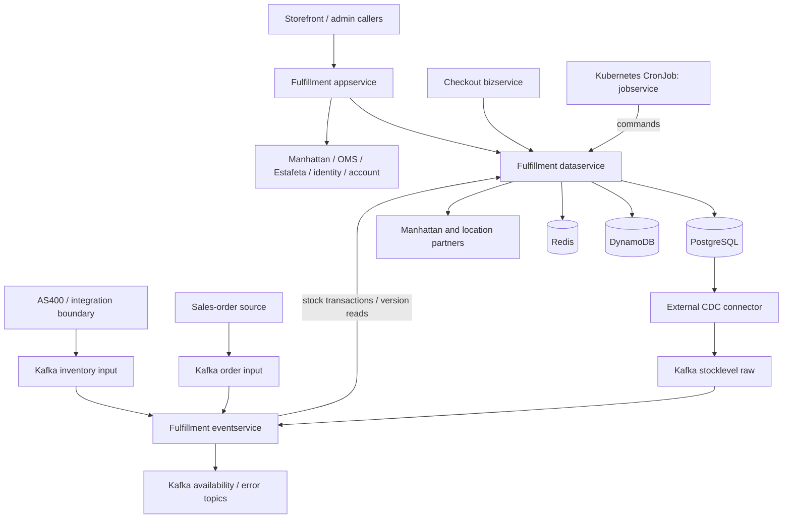

# mycheckout — Fulfillment reverse-engineering reference — Part 1

Source names are anonymized; original evidence dates and runtime limitations apply.

| Import record | Value |
|---|---|
| Source document | `fulfillment docs/FULFILLMENT-REVERSE-ENGINEERING.md` |
| Source SHA256 | `bea47a9e058dda62a758b40ad017f76fdb9aeacf2790b1fbf00e28f127c57d5c` |
| Guide part | 1 of 2 |

[Part 1](/mycheckout/fulfillment-docs/fulfillment-reverse-engineering/part-1) · [Part 2](/mycheckout/fulfillment-docs/fulfillment-reverse-engineering/part-2)

## Fulfillment reverse-engineering reference {#fulfillment-reverse-engineering-reference}

Verified from the local working trees on **2026-10-26**. This is the entry point to the reverse-engineered documentation set: it connects the service boundaries, API inventory, execution flows, feeds, persistence, configuration and failure behavior. It builds on the detailed [end-to-end guide](/mycheckout/fulfillment-docs/fulfillment-end-to-end/part-1), rather than replacing its arithmetic and sequence diagrams.

## 1. Scope and how to use the evidence {#1-scope-and-how-to-use-the-evidence}

The checked scope contains five fulfillment repositories: API contracts, appservice, dataservice, eventservice and jobservice. The adjacent checkout business service was traced for fulfillment callers in the previous pass; those handoffs are documented in the end-to-end guide §14. No production endpoints, Kafka brokers, payment services or partner systems were called.

The reproducible extraction found **86 REST contract operations**: 37 appservice and 49 dataservice, with **17 incoming/outgoing Kafka channel registrations** and 455 main Java source files across the four executable fulfillment services. It also records 83 Java configuration annotation registrations and six event/master-data contract documents. The [API catalog](/mycheckout/fulfillment-docs/fulfillment-api-catalog/part-1) lists every operation, inputs, request/response schema references, declared status codes and concrete controller matches. The [JSON catalog](/mycheckout/fulfillment%20docs/FULFILLMENT-CATALOG.json) preserves complete contract components, enums, required fields, constraints, examples, security declarations, channel wiring, source method inventories and inspected Git revisions.

There are **14 appservice operations without a matching handwritten controller method**. These cover district/postcode/state/subdistrict/DANE lookups, delivery-date item/create mutations, and postal-code serviceability operations. All 49 dataservice contract operations have concrete method-name matches. The mismatch is evidence of contract/implementation drift to investigate; it does not prove what a deployed generated interface or gateway exposes. Older summaries incorrectly treated every declared appservice route as implemented.

The API repository's last inspected revision is `b45406a`; executable revisions are recorded in the JSON snapshot. Dataservice has pre-existing local changes in the availability strategy and two application configuration files; jobservice has untracked IDE metadata. This analysis reads the working tree, not an assumed clean release. Application source was not edited for this documentation work.

## 2. Architecture and ownership {#2-architecture-and-ownership}

| Component | What it owns | What completion means |
|---|---|---|
| appservice (`/comfulfillmentas/v1`) | Customer/admin façade, pickup orchestration, address authorization/OTP, fee administration and mapping | Façade response; external downstream systems may still have later work |
| dataservice (`/comfulfillmentds/v1`) | Stock ledger, planning/reservations, rule/location storage, serviceability/dates, address persistence, commands | Local read/write or external-provider response; not a global transaction |
| eventservice | Feed/order/CDC consumers, stock API calls, availability/error publications | Input processing and acknowledgment/routing; not downstream index application |
| jobservice | Country command selection, invocation and polling | Process exit; not proof each source refresh succeeded |
| API repo | OpenAPI, AsyncAPI/Avro and master-data schemas | Declared contract; not evidence of a running endpoint |

Appservice, dataservice and eventservice use Quarkus; jobservice is Spring Boot. Some older CLAUDE.md descriptions still describe Spring components for migrated services. Use imports/build/source wiring as implementation evidence.

## 3. API and capability map {#3-api-and-capability-map}

The exhaustive method/path inventory is in the [API catalog](/mycheckout/fulfillment-docs/fulfillment-api-catalog/part-1). The following map explains the behavior behind those operations.

| Capability | Main entry | Connected implementation | Observable result / important branches |
|---|---|---|---|
| Fulfillment-type discovery | app/data GET fulfillment types | controller → type service → Dynamo repository → user/order criteria filter | Applicable delivery types with nested service levels; restriction filter uses both user and order matches |
| Fulfillment-type administration | data POST/PUT/PATCH/DELETE | `FulfillmentTypesServiceImpl` → mapper/repository; PATCH fetches stored entity, merges and validates | Changes stored rule/type definition; PATCH is present, despite its omission from the older summary |
| Allocation | data POST allocations | `AllocationsServiceImpl` → provider-selected helper → stock ledger or Manhattan shipping/pickup strategies | Planning options, quantities, warehouse, dispositions; no persisted hold |
| Reservation | data POST/DELETE reservations | `ReservationsController` → provider-selected reservation service | NEXTGEN counter versions or Manhattan confirmed promise; insufficient NEXTGEN stock maps to 409 |
| Stock administration | app façade/data stock endpoints | stock controller → validator → stock service → insertion strategy → transaction helper/repository | Versioned writes, listing/detail/history; audit endpoint is MANUAL-only |
| Pickup selection | app POST cart-pickup-locations | strategy selection → common helper / BOPIS / Estafeta | Candidate locations, restrictions, distance and availability sorting |
| Location CRUD/query | data service-locations | service → Dynamo query/scan or Redis geo → hydrate Dynamo rows | Search/text/postcode/geo/list branches; geo key mismatch remains |
| Pickup validation/confirmation | data service-locations item subresources | Estafeta client → Redis checkout-token → later confirm | Carrier validation token/confirmation, separate from inventory reservation |
| Post-location CRUD | data post-locations | `PostLocationsController` → service/mapper → `PostLocationDataRepository` | Dynamo postal-location records with country, postcode and warehouse set |
| Warehouse lookup | app/data GET warehouses | app mapper/client → dataservice `WarehousesServiceImpl` | Country default, or Manhattan postcode lookup with default fallback |
| Fee calculation | app/data POST delivery-fees | map request → `ServiceFeesServiceImpl` → type/service-level fee rules | Per-request fee and free-delivery threshold; no weight/distance pricing engine |
| Fee administration | app service-fees CRUD | `ServiceFeesServiceImpl` → GET/PATCH/PUT fulfillment type | Edits nested service-level fee definitions, not a standalone SQL fee table |
| Delivery dates/slots | data date CRUD and slot read; app slot façade | postcode validity → zone → delivery-date repository and slot master data | Candidate dates/slots or business errors; no read-time capacity reservation |
| Postal serviceability | data CRUD/query | country/time-aware repository → selected zone/warehouse | Also feeds NEXTGEN allocation warehouse choice |
| Shipping addresses | app/data CRUD/search | app authorization/OTP → country enrichment/strategy → SQL repository | New/idempotent address, search/update/delete; optional billing creation |
| Challenges | app POST challenges | JWT profile/account → account phone → identity OTP client | Identity challenge; fulfillment does not deliver SMS itself |
| Commands | data POST/GET commands | command record → named CDI strategy → terminal status | POST currently awaits execution although controller returns 202 |

In the handwritten appservice controller, warehouse handling is GET-only. Avoid repeating the older `GET/POST /warehouses` shorthand. Full contract parameter names and requiredness are in the generated catalog.

## 4. Core execution traces {#4-core-execution-traces}

### 4.1 Discovery, planning, reservation and order completion {#41-discovery-planning-reservation-and-order-completion}

Storefront reads fulfillment options and pickup candidates. Checkout bizservice independently calls dataservice directly through generated allocation/fee/reservation clients. It does not require an appservice hop. Allocation maps parent/child checkout lines, applies provider logic, and returns planning options. Non-GO requests are merged/split; GO requests are evaluated separately. Japan allocation normally chooses REGULAR_VIEW or SOP_VIEW according to order type, while reservation explicitly uses REGULAR_VIEW.

On place order, Japan normal flow reserves and validates before payment. The feature flag `CHECKOUT_PLACE_ORDER_INTERNAL_HANDLERS_SUPPORT` chooses the older country strategy or internal-handler pipeline. The default normal strategy subscribes to reservation and payment with `Mono.zip`, so Japan's serial order is not universal. Booking/non-inventory/FORCE_IN_STOCK/SOP/POS/preorder policies can change eligibility and ordering; see the end-to-end guide §14 for source-traced branches.

The reservation id becomes the ledger reference id. Reservation-line ids become stock transaction ids and are carried into order data. Later sales-order READY_FOR_FULFILLMENT or POS COMPLETE events produce ON_HAND_ADJUSTMENT; cancellation produces RELEASE. These are incoming event triggers, not proof of physical delivery. Failed payment/invalid-reservation paths can attempt compensating deletes; swallowed client failures and timeouts prevent a universal cleanup guarantee.

### 4.2 Japan feed ingress and sync {#42-japan-feed-ingress-and-sync}

The documented upstream boundary is AS400 → WebMethods → Kafka. Fulfillment subscribes to the Kafka inventory topic; it does not poll AS400 SQL. The source extraction/export scheduler is not in this workspace. Eventservice parses Protobuf, sets tenant context, validates, maps and POSTs a stock transaction. Japan topic/configuration overrides are detailed in the end-to-end guide §16.3.

| Feed code | Mapping | Existing stock | Important edge |
|---|---|---|---|
| EOD | DAY_END_EVENT, absolute on-hand from AVAILABLE | Can create first row; preserves existing stock status and normally reservations | Flag/list-based reservation sync can replace reserved quantity |
| REL | INTRA_DAY_EVENT, delta on-hand | Requires prior stock | Replay can apply the delta again |
| DSP | INTRA_DAY_EVENT, null quantity and mapped status | Requires prior stock | Changes selling status independently of physical quantity |

The transaction helper locks `(item, warehouse, country)` before reading current state and appends the next version. Batch locks are ordered deterministically and responses restored to original order. Reads calculate ATS from committed counters; there is no stock cache to invalidate. Feed messages and checkout reservations therefore share the same local stock-key serialization.

The feed validator checks ISO country, but missing-event-id rejection is commented out. Unknown event codes are logged and fall through to intraday mapping; a missing AVAILABLE quantity defaults to zero. Mapper time is processing time, not source-event time. These are gaps, so do not describe the feed as fully validated, order-safe or exactly-once.

### 4.3 Availability projection {#43-availability-projection}

PostgreSQL inserts → external CDC connector → stocklevel raw topic → CDC consumer → dataservice version N/N−1 reads → per-view comparison → JSON availability producer. The publish predicate compares disposition, dates and stock status, not numerical ATS alone. Configured view aliases can create additional events.

`InventoryAvailabilityEventProducer` uses key `itemId_locationId`, adds `SelectedOrganization` and random `MSG_ID_PK` headers, substitutes the tenant in the target topic, and waits for producer completion up to its timeout. **It catches and logs publication exceptions instead of propagating them.** Consequently downstream publication failure can be hidden from the input consumer; neither blocking send nor an input ack proves delivery to Product/Search. No outbox or cross-system atomic transaction was established.

### 4.4 Location loading and discovery {#44-location-loading-and-discovery}

Kubernetes starts jobservice with tenant profile and country. It selects configured command bean ids, generates command idempotency UUIDs, POSTs commands and polls their status. Dataservice stores a command, executes the strategy in the POST chain, and records COMPLETED/FAILED. Recovering an existing command record still re-enters execution; a deterministic record id is not an exactly-once execution guard.

Partner loaders fetch locations from Manhattan/Hybris/Kerry/7-Eleven/Estafeta/Pickit as appropriate, map/upsert Dynamo records and use batch cleanup where implemented. Bean existence is not evidence it is in a country's schedule. Thailand and most LATAM command lists include a final Redis scan/GEOADD step; Mexico prod and Japan QA do not. Japan UAT/prod schedules exist but matching command profiles are absent in checked source. Complete cron times are in the end-to-end guide §16.

At query time, dataservice selects text search, coordinate radius search, postcode lookup, default-location geo search or plain list. Redis ids are paged in memory, hydrated from DynamoDB and assigned distances. Appservice adds disabled-location filtering and restrictions; BOPIS asks Manhattan stock per location, then sorts availability first and distance second. This BOPIS check is not selected by the NEXTGEN ledger provider switch. Redis writes `<COUNTRY>:<type>` while the query reads `<type>`; no compensating prefix was found. GEOADD also does not remove obsolete members.

### 4.5 Fees and fee maintenance {#45-fees-and-fee-maintenance}

Calculation: gather eligible line/bundle totals excluding service items → group by fulfillment type/service level → select latest effective start-date rule generation → match user/order criteria → scan descending threshold → return fee and first encountered zero-fee threshold. PV/BV can be the comparison unit. No match gives zero. Combined group requests aggregate within their service-level group and charge the first request. Rules' endDate is not used by this selection.

Maintenance: appservice service-fees GET loads the parent fulfillment type and extracts the service-level rules. Create checks for a matching definition and patches nested fees; delete loads the type, removes the matching fee from its service level and updates the type. Versions are carried from the type. There is no separate fee resource repository in this path. Checkout can apply exemptions/promotions/fallback fees afterward. The detailed examples are in [Redis and delivery fees](/mycheckout/fulfillment-docs/fulfillment-redis-and-delivery-fee/part-1).

### 4.6 Warehouses, postcode mapping and post locations {#46-warehouses-postcode-mapping-and-post-locations}

`WarehousesServiceImpl.getAllWarehouses` returns the configured country default as a singleton; it is not a scan of all physical warehouses. With a postcode and Manhattan enabled, `getWarehouseForPostalCode` calls Manhattan's location-code lookup and falls back to the configured default for a missing result or failure. Under NEXTGEN it returns the country default in this service. **NEXTGEN allocation separately uses the postal-code serviceability service to select its warehouse**, so those two routes should not be conflated.

Post locations are a separate Dynamo resource (`PostLocationEntity`): id, country, postcode and warehouse set. CRUD maps directly through its repository. PUT currently saves the body DTO; the controller does not overwrite its id from the path argument, so path/body identity should be checked by a caller. This resource is not proof that allocation uses it; the verified allocation selection uses serviceability instead.

### 4.7 Dates, slots and serviceability {#47-dates-slots-and-serviceability}

Serviceability writes persist postcode/country/zone/warehouse, timed-delivery flag, validity range and version. Update checks the request version against stored data; the implementation retrieves via the body id, so path/body agreement needs attention. Date rows store order-day start/end and delivery date. Slot queries convert ordering time to the country's time zone and select valid serviceability. Date selection requires `orderDayStartTime <= orderTime <= orderDayEndTime` and `deliveryDate > orderTime`, sorted by delivery date; slots come from the country's zone master data. The date repository query filters zone/time without an explicit country predicate, so zone uniqueness and tenant/schema isolation matter. Nonserviceability is represented as a business error in the response; do not infer an HTTP error from that field alone. No carrier tracking, slot capacity decrement or date generation scheduler was established.

### 4.8 Addresses and OTP {#48-addresses-and-otp}

Appservice validates create/update DTOs, reads address master configuration, optionally validates an identity OTP challenge, applies address access checks and delegates to dataservice. `AddressOpaAuthorizationImpl` checks account ownership/upline relationships; validated addresses use a different update rule from not-validated addresses. Its current `checkUpdate` treats a nonempty auth-context scope list as authorized. The shared auth framework and ingress policies must be read before interpreting the scope list's trust boundary.

Dataservice chooses Thailand/Japan/LATAM address enrichment and service/repository strategies from tuple country, then maps/persists SQL entities. Optional billing creation and shipping persistence are separate calls. Challenge creation derives account/profile from JWT, looks up the user's phone and calls identity OTP. Existing challenge verification compares context and verified status; fulfillment is not an OTP issuance/delivery engine. See end-to-end guide §20 for create response/idempotency details.

## Official References

Platform documentation explains the underlying technologies; project behavior remains grounded in the source evidence above.

- [AWS service documentation](https://docs.aws.amazon.com/)
- [Apache Kafka documentation](https://kafka.apache.org/documentation/)
- [Quarkus guides](https://quarkus.io/guides/)
