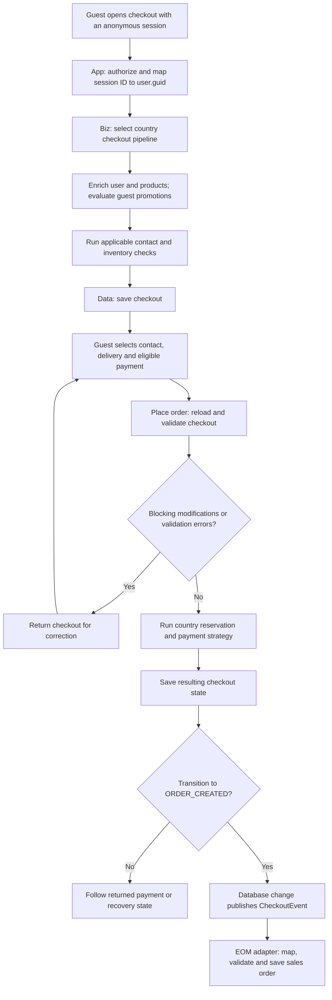
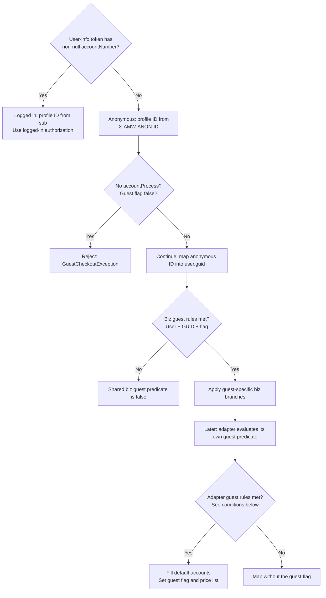
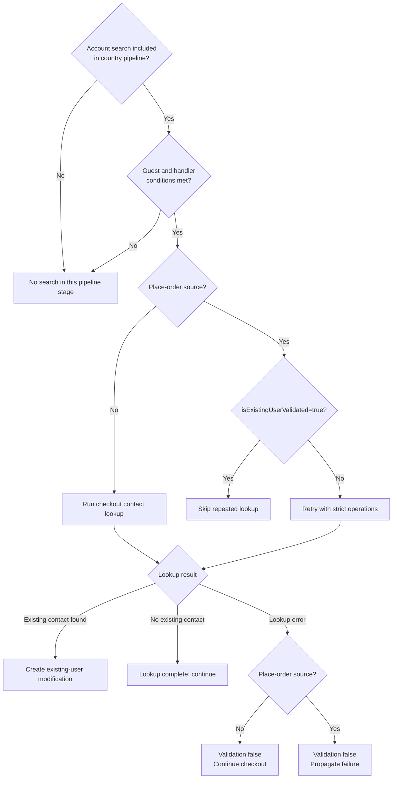
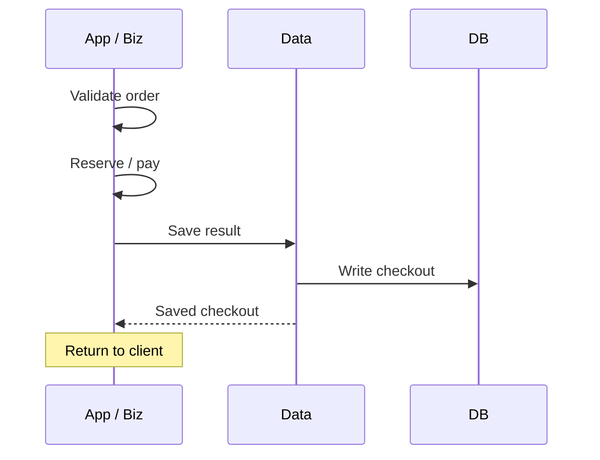
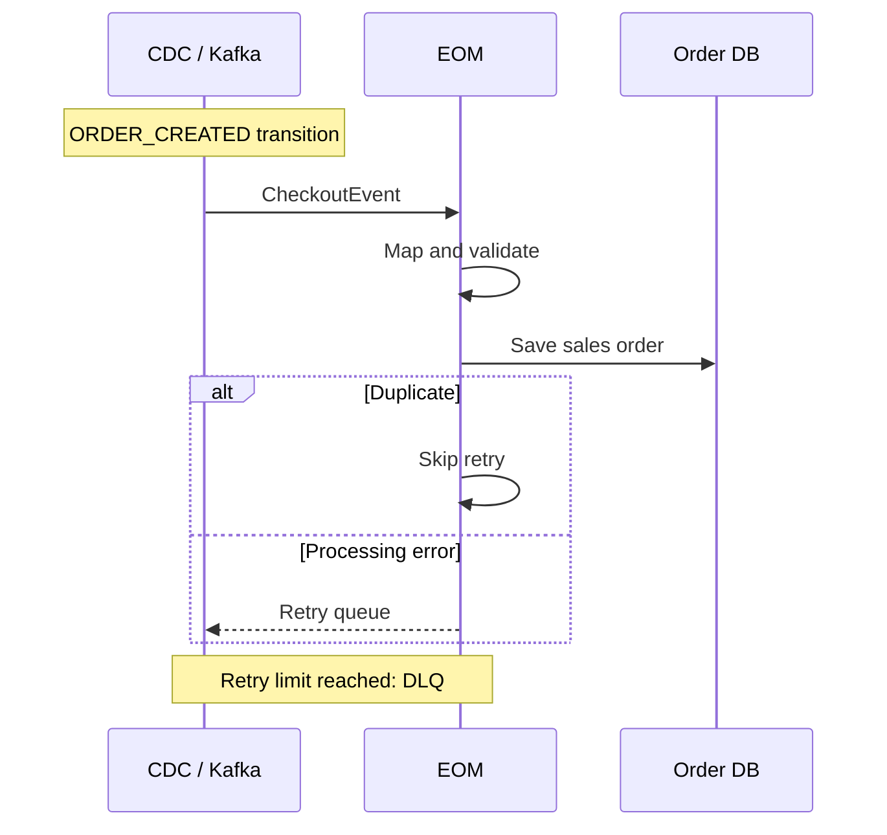

# mycheckout — Guest checkout: end-to-end flow — Part 1

Source names are anonymized; original evidence dates and runtime limitations apply.

| Import record | Value |
|---|---|
| Source document | `guest-checkout-flow.md` |
| Source SHA256 | `6b8a6caf945ae7c3e81033809ca5bb26bff4624bba366a221eeefb191ddc345a` |
| Guide part | 1 of 6 |

[Part 1](/mycheckout/guest-checkout-flow/part-1) · [Part 2](/mycheckout/guest-checkout-flow/part-2) · [Part 3](/mycheckout/guest-checkout-flow/part-3) · [Part 4](/mycheckout/guest-checkout-flow/part-4) · [Part 5](/mycheckout/guest-checkout-flow/part-5) · [Part 6](/mycheckout/guest-checkout-flow/part-6)

## Guest checkout: end-to-end flow {#guest-checkout-end-to-end-flow}

Source review: 12 November 2026. Scope: frontend request construction → checkout app service → biz service → data service → EOM adapter and outgoing events. Evidence includes sibling repository source and the local built `quarkus-auth-starter-1.7.0-SNAPSHOT.jar`. This is static inspection, not a production execution. Backend identity classification and profile-ID selection are verified for that artifact. Frontend anonymous-ID generation/header injection, deployed configuration, upstream token verification/issuance, payment-service internals and downstream physical delivery remain outside the verified scope.

## Short summary: guest checkout in 10 steps {#short-summary-guest-checkout-in-10-steps}

1. **Classify and identify the guest:** backend reads parsed user info from `X-User-Token`; a non-null `accountNumber` means logged in, otherwise anonymous. For anonymous users, read `X-AMW-ANON-ID` into the context profile ID, then map it to `user.guid` and clear `user.id`; incoming user ID is a fallback. Checkout does not generate that anonymous ID.
2. **Check permission:** reject anonymous checkout when there is no account process and guest checkout is explicitly disabled.
3. **Prepare checkout:** select the country pipeline and enrich user, product and applicable default-account details.
4. **Check existing contacts:** where the pipeline includes the check, search email/mobile and return a modification if an existing user is found.
5. **Calculate the order:** promotions still run with guest targeting; segmentation, rationing and account-credit calculation skip for guests.
6. **Check delivery and stock:** run applicable fulfillment/inventory checks; guest backorder options become unavailable. Configuration can bypass inventory checks.
7. **Save guest selections:** persist checkout details, contact information, delivery selection and eligible payment method. No explicit guest-only COD ban was found in the inspected checkout code.
8. **Place the order:** reload checkout, run applicable validations, and process inventory reservation/payment using the country strategy. Blocking errors or modifications must be resolved.
9. **Publish asynchronously:** when saved status transitions to `ORDER_CREATED`, database change capture publishes the checkout event. This status alone does not prove successful payment capture.
10. **Create the EOM sales order:** the adapter applies its stricter guest check, fills missing default accounts, sets the guest flag/price list, validates and saves the sales order. Processing failures use retry/DLQ handling.

**Flow to remember:** token-based classification → anonymous header identity → permission → enrichment and checks → delivery/payment selection → place order → checkout persistence → raw event → EOM persistence → public sales-order event.

For the frontend request, both persistence boundaries and the outgoing EOM event, see [the complete journey](/mycheckout/guest-checkout-flow/part-5#13-complete-journey-frontend-to-persistence-to-eom-events).

## Guest rules and restrictions: quick reference {#guest-rules-and-restrictions-quick-reference}

Distinguish guest-specific rules from general country/product/payment rules that also apply to guests. These are source-backed checkout behaviours; deployed eligibility lists and payment/fulfillment-service policy were not queried.

### Payment {#payment}

| Rule | Condition and effect | Scope |
|---|---|---|
| COD / online-only | No explicit guest-and-COD rejection or universal online-only requirement was found in the inspected checkout validators. This does not prove COD is offered or accepted downstream. | Unverified provider/storefront/runtime eligibility |
| Default payment | `applyCheckoutProfile()` clears the default profile's payment when the shared guest predicate is true, before mapping the profile. Guests do not inherit that default payment through this path. | Guest-specific, where profile application runs |
| Account credit/voucher balance | Guest predicate true → skip account-balance calculation handler. This skip alone is not a payment-method prohibition. | Guest-specific |
| AmPoints population | Skip population for guest AND restricted Japan client. This does not mean all point calculations are disabled. | Guest + client-specific |
| Shipping-address/payment combination | Japan shipping-type address plus selected method in `restrictedPaymentMethodsForShippingAddressType` → address-not-applicable modification. | General country/config rule |
| Backorder/payment combination | Backorder items plus a configured restricted payment method → modification. Guests separately have BO fulfillment options converted to TNA. | General config rule |
| Payment/provider error | Recognized payment-service method errors become checkout modifications; provider-specific eligibility still applies. | General payment rule |

Source for default payment: CheckoutProfileServiceImpl.java:236 (local reference: `/D:/BE Projects/checkout/checkout/commerce-checkout-bizservice/source/app/src/main/java/com/mycheckout/commerce/checkoutbizservice/app/service/checkoutprofile/impl/CheckoutProfileServiceImpl.java:236`). Payment restrictions: PaymentMethodsValidator.java:53 (local reference: `/D:/BE Projects/checkout/checkout/commerce-checkout-bizservice/source/app/src/main/java/com/mycheckout/commerce/checkoutbizservice/app/validator/PaymentMethodsValidator.java:53`).

### Delivery and stock {#delivery-and-stock}

| Rule | Condition and effect | Scope |
|---|---|---|
| Backorders | Guest + BO allocation entry → TNA, backorderable quantity zero and ETA null. | Guest-specific |
| Home delivery / pickup | No blanket guest-only ban was found in the inspected checkout fulfillment path. Available options still depend on fulfillment results, stock, address, product restrictions and country configuration. | Not proof that every option is offered |
| Unavailable/restricted option | Missing allocation group or `isRestricted=true` can produce fulfillment modifications asking for a delivery change or cart review; DIGITAL/auto-SOP exceptions exist. | General applicability rules |
| Delivery slots | In the slot service, restricted selected payment or full backorder clears selected delivery date and skips availability lookup. Missing fulfillment or digital-only checkout clears date/time selections. Slot eligibility is not the same as delivery-method eligibility. | General slot-service rules |
| ATS bypass | Inventory decision strategy can bypass allocation/validation based on configuration/channel and checkout details. | General configurable rule |
| Fulfillment fields | When detailed validation runs and fulfillment exists, fulfillment ID is required; warehouse ID is required except for JP booking. | General validation rule |
| Address contact identity | Guest fulfillment-address update generates a contact UUID if the address contact ID is blank. This UUID is not the guest user ID. | Guest-specific |

Sources: InventoryServiceImpl.java:185 (local reference: `/D:/BE Projects/checkout/checkout/commerce-checkout-bizservice/source/app/src/main/java/com/mycheckout/commerce/checkoutbizservice/app/service/fulfillment/impl/InventoryServiceImpl.java:185`), fulfillment restrictions:1146 (local reference: `/D:/BE Projects/checkout/checkout/commerce-checkout-bizservice/source/app/src/main/java/com/mycheckout/commerce/checkoutbizservice/app/service/fulfillment/impl/InventoryServiceImpl.java:1146`), delivery slots:65 (local reference: `/D:/BE Projects/checkout/checkout/commerce-checkout-bizservice/source/app/src/main/java/com/mycheckout/commerce/checkoutbizservice/app/service/fulfillment/impl/DeliverySlotsAvailabilityServiceImpl.java:65`), fulfillment validation:150 (local reference: `/D:/BE Projects/checkout/checkout/commerce-checkout-bizservice/source/app/src/main/java/com/mycheckout/commerce/checkoutbizservice/app/service/validation/strategy/impl/DefaultValidationStrategy.java:150`).

### Other important conditions {#other-important-conditions}

1. **Products can prohibit anonymous purchase.** `flags.restrictFromAnonymous=true` plus anonymous GUID adds the item to `PURCHASE_RESTRICTION`. Product enrichment does not mean every product is eligible for guests. See ProductServiceImpl.java:1177 (local reference: `/D:/BE Projects/checkout/checkout/commerce-checkout-bizservice/source/app/src/main/java/com/mycheckout/commerce/checkoutbizservice/app/service/product/impl/ProductServiceImpl.java:1177`).
2. **Country guest flag must allow the flow.** The app rejects anonymous non-account-process checkout when the flag is explicitly false; the biz helper requires true plus user/GUID to classify a guest.
3. **Existing contact details can cause a modification.** Applicable searches check active non-employee accounts and identity; place-order retries depend on the country pipeline and validation flag.
4. **Promotions remain; segment/rationing skip.** Promotion eligibility can target GUEST. Never equate skipping segmentation with skipping promotions or product purchase restrictions.
5. **Volume account remains required by account validation.** Guest ordering/order-for account requirements are relaxed, but volume-account checks remain where detailed validation runs.
6. **OTP challenge creation is not verification.** The inspected create/place-order path does not establish a mandatory guest OTP-verification gate.
7. **Blocking modifications/errors must be resolved.** Pre-order field validation is gated by country config plus feature flag; applicable handler validations still matter.
8. **Adapter classification is stricter.** It additionally requires non-empty classifications excluding REGISTRATION and a configured default account before marking the sales order guest.
9. **ORDER_CREATED is not a payment receipt.** Payment outcome, reservation outcome and asynchronous adapter completion are distinct from the saved checkout status.

Examples: an anonymous-restricted product produces a purchase restriction; a guest BO option becomes unavailable; a configured payment restriction can remove a selected delivery date without banning all delivery; a guest with a default checkout profile must supply an eligible payment rather than inheriting that profile's payment.

## Visual guide: start here {#visual-guide-start-here}

Read the overview first, then the guest decisions, then the asynchronous handoff. The sequence diagrams use three participants each to keep labels readable. Section 2 contains the detailed service sequence. These diagrams summarize the source-backed behaviour explained below; country strategies and feature flags still control which steps run.

### A. The whole journey at a glance {#a-the-whole-journey-at-a-glance}

**Remember:** promotions and product enrichment remain. Segmentation, rationing and account-credit calculation skip for guests. Inventory checks are conditional. ORDER_CREATED alone does not prove payment capture or physical delivery.

### B. How each layer recognizes a guest {#b-how-each-layer-recognizes-a-guest}

**Why two checks matter:** a checkout can satisfy biz's guest predicate but fail the adapter's predicate, for example when classifications are empty or contain REGISTRATION. Registration/account-process checkout also has its own enrichment path.

### C. Existing-contact search and retry decisions {#c-existing-contact-search-and-retry-decisions}

Japan normal place order includes this handler; default normal place order does not. A true validation flag means the lookup completed, not that no existing user was found.

### D. Where the API ends and asynchronous EOM processing begins {#d-where-the-api-ends-and-asynchronous-eom-processing-begins}

### D1. Save and return the API response {#d1-save-and-return-the-api-response}

### D2. Process the event independently {#d2-process-the-event-independently}

The asynchronous event path can run before or after the API response. Neither diagram implies that the API waits for EOM.

The two paths can overlap: the client response does not wait for adapter completion. A later EOM failure therefore needs event retry/recovery rather than assuming the original API request failed. This diagram stops at adapter storage; enterprise consumption and warehouse delivery remain outside this trace.

## Official References

Platform documentation explains the underlying technologies; project behavior remains grounded in the source evidence above.

- [AWS service documentation](https://docs.aws.amazon.com/)
- [Apache Kafka documentation](https://kafka.apache.org/documentation/)
- [Quarkus guides](https://quarkus.io/guides/)
