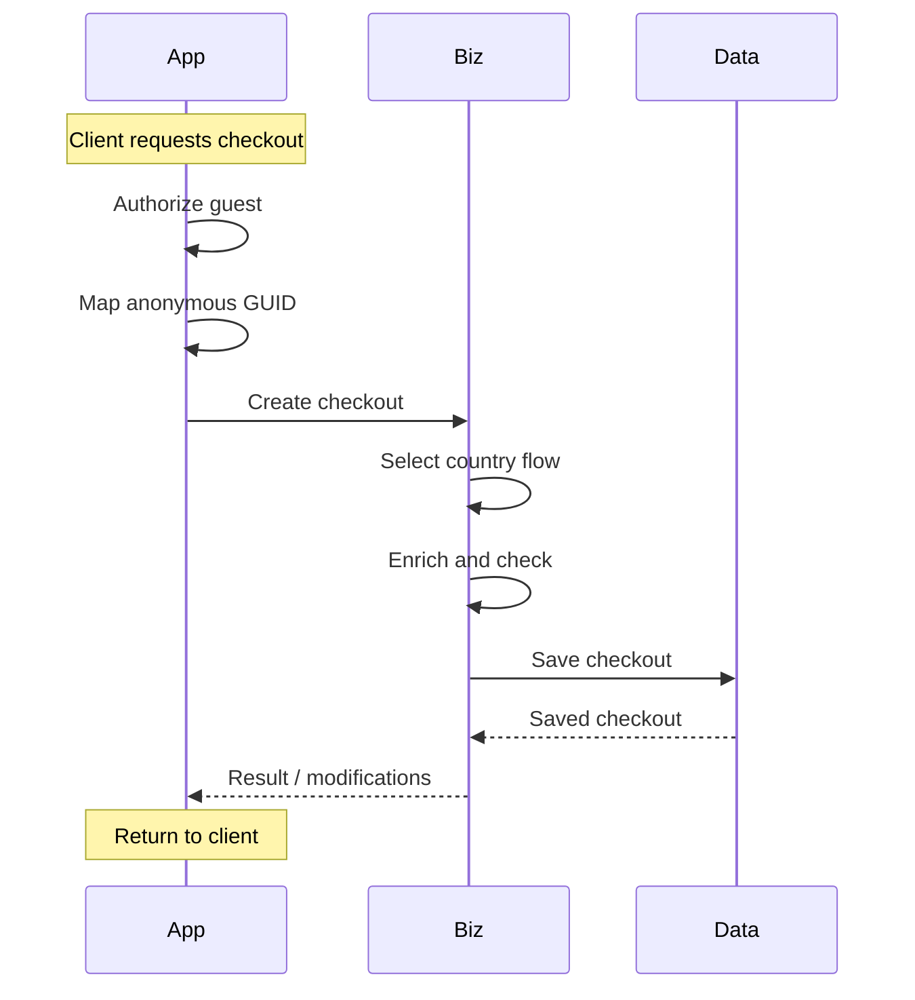
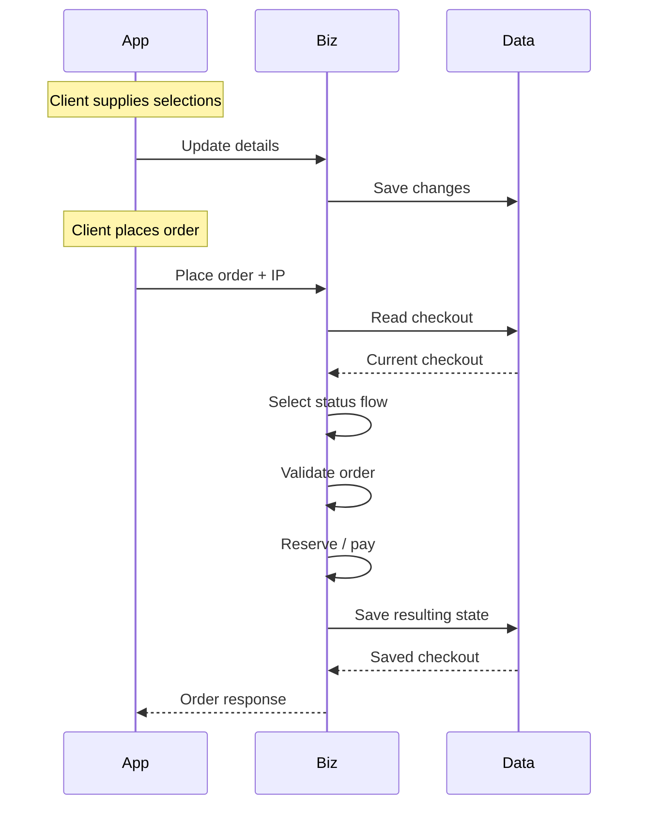
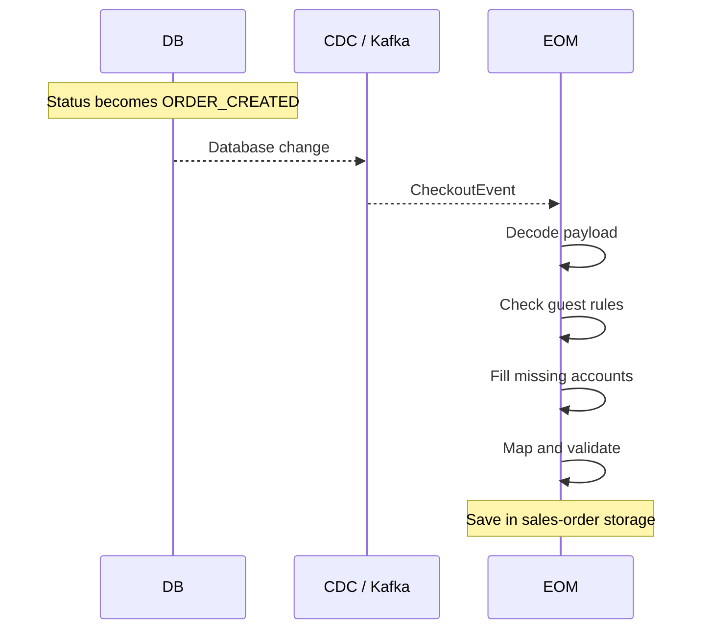

# mycheckout — Guest checkout: end-to-end flow — Part 2

Source names are anonymized; original evidence dates and runtime limitations apply.

| Import record | Value |
|---|---|
| Source document | `guest-checkout-flow.md` |
| Source SHA256 | `6b8a6caf945ae7c3e81033809ca5bb26bff4624bba366a221eeefb191ddc345a` |
| Guide part | 2 of 6 |

[Part 1](/mycheckout/guest-checkout-flow/part-1) · [Part 2](/mycheckout/guest-checkout-flow/part-2) · [Part 3](/mycheckout/guest-checkout-flow/part-3) · [Part 4](/mycheckout/guest-checkout-flow/part-4) · [Part 5](/mycheckout/guest-checkout-flow/part-5) · [Part 6](/mycheckout/guest-checkout-flow/part-6)

## 1. What makes a checkout a guest checkout? {#1-what-makes-a-checkout-a-guest-checkout}

<a id="shared-7fb02c8f3475"></a>

A guest uses the ordinary checkout APIs and handler pipeline. There is no separate guest-order persistence API. First, the backend auth context checks the parsed user-info token's account number to classify logged-in versus anonymous. For anonymous users, context profile ID comes from `X-AMW-ANON-ID`; app maps it into `user.guid` and clears `user.id`. Biz then uses GUID and country configuration to identify guest checkouts. The adapter applies a stricter predicate before marking the sales order as guest. These are separate checks at separate layers.

<a id="shared-504a29b9b914"></a>

| Question | Verified behaviour |
|---|---|
| Does checkout generate a random guest UUID? | No. It takes the authentication profile ID, falling back to the request user ID. The UUID generated during guest address updates is a contact ID. Session-ID generation is upstream and was not traced. |
| Are all account checks skipped? | No. Some registered-account field requirements are skipped; volume-account validation and applicable existing-contact searches remain. |
| Are promotions skipped? | No. Promotion preparation/evaluation remains in the pipeline; anonymous non-registration users can be targeted as `GUEST`. |
| Is segmentation skipped? | Yes, when the biz guest predicate is true. |
| Are products enriched? | Yes, the create and normal place-order pipelines include product enrichment. |
| Is ATS always checked? | Inventory/allocation participates where applicable, but inventory decision configuration can bypass checks. Missing fulfillment/address can also prevent allocation. Guest status alone does not mean ATS is bypassed. |
| Can guests backorder? | Guest fulfillment options convert `BO` to `TNA`, zero backorderable quantity, and clear ETA. |
| Must guests pay online? | No explicit guest→COD rejection or universal online-only rule was found in checkout's inspected payment validators. Payment-service eligibility and runtime configuration remain unverified. |
| Does the API wait for EOM? | No. Saved `ORDER_CREATED` transitions are published through change capture and consumed asynchronously. |

## 2. Connected sequence {#2-connected-sequence}

### 2.1 Create checkout {#21-create-checkout}



### 2.2 Update details and place order {#22-update-details-and-place-order}



<a id="shared-a926d0c18a9e"></a>

Details include contact, fulfillment and eligible payment selections. Country strategy controls validation, reservation and payment behaviour. Blocking modifications return for correction; a successful API response does not imply EOM has completed.

### 2.3 Publish and map the order {#23-publish-and-map-the-order}



Only the configured transition from a non-ORDER_CREATED status to ORDER_CREATED triggers this connector filter. Sales-order storage is separate from checkout storage.

The last stages create an EOM sales-order representation. They do not demonstrate warehouse picking, shipment or delivery completion.

## 3. App entry, authorization and identity {#3-app-entry-authorization-and-identity}

### How do we decide whether the user is logged in? {#how-do-we-decide-whether-the-user-is-logged-in}

The app calls the shared authentication context:

```java
authContext.isLoggedInUser()
authContext.isAnonymousUser()
```

<a id="shared-61bc31190327"></a>

`authContext` is an injected `NextgenAuthenticationContext` from `com.mycheckout.commerce.framework.security.context`. These methods report the identity classification resolved by the security framework for the request. Checkout consumes that classification; it does not decide login status simply by checking whether the request body's account ID, email or user ID is missing.

<a id="shared-51a70c1a8c8a"></a>

The compiled local Quarkus auth dependency was inspected. In that artifact, `isAnonymousUser()` is exactly `!isLoggedInUser()`, and logged-in detection checks a non-null account number in the parsed `X-User-Token` user-info object. Backend classification and anonymous header-to-profile mapping are verified below. The separate frontend session generator and header-injection implementation remain unverified.

The actual create authorization branch is shown below. In simplified explanatory form:

```java
// Explanatory summary; exact implementation follows below.
if (authContext.isLoggedInUser()) {
  // Authorize the requested profile through OPA.
} else if (authContext.isAnonymousUser()) {
  // Reject when accountProcess is absent and guest flag is explicitly false.
}
```

For registered users, app mapping enriches identity fields from the authenticated context/token:

```java
if (authContext.isLoggedInUser()) {
  user.setPartyId(authContext.getPartyId());
  user.setFirstName(tokenUtil.getGivenNameFromToken());
  user.setLastName(tokenUtil.getFamilyNameFromToken());
  user.setAccountType(AccountTypeBizDto.valueOf(tokenUtil.getUserTypeFromJwtToken()));
}
```

<a id="shared-2f54a014ddda"></a>

Source excerpt, excluding logging: CheckoutMapper.java:493 (local reference: `/D:/BE Projects/checkout/checkout/commerce-checkout-appservice/source/app/src/main/java/com/mycheckout/commerce/checkoutservice/app/mappers/checkout/CheckoutMapper.java:493`).

<a id="shared-aa0803321a1f"></a>

`TokenUtil.getUserIdFromJwtToken()` reads `authContext.getProfileId()` and throws for a missing profile ID when classified as logged in. `getUserTypeFromJwtToken()` returns null for anonymous users. `getAccountIdFromToken()` starts with null and populates it only for logged-in users. These are application behaviours, not the internal implementation of login detection. See TokenUtil.java:69 (local reference: `/D:/BE Projects/checkout/checkout/commerce-checkout-appservice/source/app/src/main/java/com/mycheckout/commerce/checkoutservice/app/util/TokenUtil.java:69`).

### What are `user.id` and `user.guid`? {#what-are-userid-and-userguid}

<a id="shared-8ea2b53dc820"></a>

In this checkout implementation, these fields distinguish registered profile identity from anonymous session identity. Their meaning comes from how the code maps and checks them, not just their names.

<a id="shared-0eed501fef58"></a>

| Field | Meaning in the covered flow | Example | Important behaviour |
|---|---|---|---|
| `user.id` | Registered customer profile identifier in the registered flow | `profile-demo-123` | Anonymous app mapping explicitly clears it to null. It is not the sales account number or order ID. |
| `user.guid` | Anonymous identity carried through checkout for an anonymous/guest session | `anon-demo-456` | On the anonymous path, context profile ID reads `X-AMW-ANON-ID`; app copies it, falling back to incoming user ID. Biz uses non-null GUID as its anonymous discriminator. |

<a id="shared-137c11c49423"></a>

**Example 1: registered customer.** A logged-in customer has a registered profile identity. Think of `user.id` as "which registered profile is this checkout for?" Logged-in authentication, authorization and enrichment still determine what is accepted; clients cannot establish login status just by sending an ID.

```json
{
  "user": {
    "id": "profile-demo-123",
    "guid": null,
    "firstName": "Maya"
  }
}
```

This is an illustrative registered identity fragment, not a claim that every registered mapping forcibly clears GUID.

<a id="shared-9671c6ce566a"></a>

**Example 2: guest customer.** The customer has no registered profile identity in this checkout path. The anonymous identity lets the flow associate the request with that anonymous session.

```json
{
  "user": {
    "id": null,
    "guid": "anon-demo-456",
    "firstName": "Maya"
  }
}
```

The app's exact anonymous mapping is:

```java
user.setGuid(getAnonymousGuid(user));
user.id(null);
```

<a id="shared-fe570514f2fe"></a>

`getAnonymousGuid(user)` first reads `authContext.getProfileId()`, then falls back to a non-blank incoming `user.id`, otherwise returns null. This happens before the incoming ID is cleared. See CheckoutMapper.java:486 (local reference: `/D:/BE Projects/checkout/checkout/commerce-checkout-appservice/source/app/src/main/java/com/mycheckout/commerce/checkoutservice/app/mappers/checkout/CheckoutMapper.java:486`) and fallback method:536 (local reference: `/D:/BE Projects/checkout/checkout/commerce-checkout-appservice/source/app/src/main/java/com/mycheckout/commerce/checkoutservice/app/mappers/checkout/CheckoutMapper.java:536`).

Biz anonymous detection then uses:

```java
public static boolean isAnonymousUser(UserBizDto userBizDto) {
  return Objects.nonNull(userBizDto.getGuid());
}
```

<a id="shared-a283098f38ea"></a>

Source: CheckoutUtil.java:629 (local reference: `/D:/BE Projects/checkout/checkout/commerce-checkout-bizservice/source/app/src/main/java/com/mycheckout/commerce/checkoutbizservice/app/util/CheckoutUtil.java:629`). The shared guest-checkout helper additionally requires guest checkout enabled and non-null checkout/user. Therefore GUID presence is an anonymous discriminator in biz; it is not, by itself, the complete guest-order eligibility rule.

Important distinctions:

<a id="shared-bc7c70e9d2c7"></a>

- **Neither field is the order ID, cart ID, payment transaction ID or sales account number.** Those identify different resources.
- **A GUID value is not proof of authentication.** The app relies on the security context's classification; upstream verification is separate from storing an identifier.
- **The name GUID does not prove this method generates or validates a UUID.** This mapping copies identity; UUID generation was not found here.
- **Anonymous does not always mean plain guest purchase.** Registration flows can retain GUID while populating registration user data, so later registration state may contain both fields. Do not assume they are globally mutually exclusive.
- **Configured sales accounts do not make a guest logged in.** They support order mapping; user identity remains a separate concern.

<a id="shared-99deb8e5252d"></a>

**Memory aid:** `user.id` identifies a registered profile; `user.guid` carries anonymous identity in the covered guest flow. Authentication classifies the request first, and checkout maps these fields afterward.

### Verified framework implementation: exact anonymous detection {#verified-framework-implementation-exact-anonymous-detection}

<a id="shared-c4c38a318b83"></a>

The local built app includes `quarkus-auth-starter-1.7.0-SNAPSHOT.jar`. Bytecode inspection of `NextgenAuthenticationContextImpl` and its token processors establishes the following equivalent Java logic (reconstructed, not original source):

```java
public boolean isLoggedInUser() {
  return getStsUserInfoToken()
      .map(StsUserInfoToken::getAccountNumber)
      .isPresent();
}

public boolean isAnonymousUser() {
  return !isLoggedInUser();
}

private Optional<String> getAnonymousUserId() {
  return Optional.ofNullable(headers.getHeaderString("X-AMW-ANON-ID"));
}

public String getProfileId() {
  return isLoggedInUser()
      ? getStsUserInfoToken().map(StsUserInfoToken::getSub).orElse(null)
      : getAnonymousUserId().orElse(null);
}
```

#### Reading the Optional chain in plain language {#reading-the-optional-chain-in-plain-language}

For `getStsUserInfoToken().map(StsUserInfoToken::getAccountNumber).isPresent()`:

<a id="shared-7dd9925f4b92"></a>

1. Obtain the Optional user-info token parsed from `X-User-Token`.
2. If a token object exists, extract its account number.
3. If the token is absent **or its account number is null**, Optional is empty.
4. `isPresent()` returns true only for a non-null account number.
5. `isAnonymousUser()` returns the opposite Boolean.

<a id="shared-a5582ad8f545"></a>

**Classification versus identity:** the account-number check decides logged-in/anonymous status. `X-AMW-ANON-ID` does not decide that status; it supplies the anonymous identity afterward through `getProfileId()`. No header means that identity is null, even though this predicate can still return anonymous=true. This does not bypass request authorization.

Detailed request processing:

<a id="shared-0e8c5d3d961b"></a>

1. `StsAuthTokenProcessor` reads `Authorization` and parses its payload as `StsAuthToken`.
2. `UserTokenProcessor` reads `X-User-Token` and parses its payload as `StsUserInfoToken`.
3. Authentication context combines the processors' claim maps and looks up the typed `stsUserInfoToken` object.
4. `isLoggedInUser()` maps that object to `getAccountNumber()` and checks Optional presence. A non-null account number makes it true. It does not test for a positive number, registered-profile subject presence, a guest flag or anonymous header presence in this method.
5. `isAnonymousUser()` negates that result. Therefore an absent user-info object or null account number makes it anonymous in this implementation, provided context processing completes normally.
6. Logged-in `getProfileId()` reads user-info `sub`. Anonymous `getProfileId()` reads the raw `X-AMW-ANON-ID` header.
7. Checkout's `getAnonymousGuid(user)` copies that profile ID to GUID, falling back to the incoming user ID, then app mapping clears `user.id`.

<a id="shared-339ff02f966e"></a>

| Parsed user-info token | `accountNumber` | Anonymous header | Logged in? | Anonymous? | Context profile ID |
|---|---|---|---|---|---|
| Present | Non-null | Absent | true | false | User-info `sub` |
| Present | Non-null | Present | true | false | User-info `sub`; anonymous header is not selected |
| Absent | — | Present | false | true | Anonymous header |
| Present | Null | Present | false | true | Anonymous header |
| Absent | — | Absent | false | true | null |

<a id="shared-12f0cfb49c9e"></a>

These are method-level cases, not an authorization acceptance table. In particular, anonymous=true does not prove a usable GUID exists or that the gateway/policies accept the request. A non-null account number with missing `sub` can classify as logged-in while profile ID remains null; app token helpers can reject the missing profile ID later.

<a id="shared-ccf6ffbeba15"></a>

There is no `isGuest=true` check in these methods. `Authorization` existing alone does not establish logged-in status through this predicate. No special guest token claim is required by this specific classification method; separate gateway/security validation may still apply. Token parsing here does not establish end-to-end signature validation or token issuance, which remain separate boundaries.

<a id="shared-9df31cb22ce1"></a>

Evidence: saved javap output (local reference: `guest-auth-framework-bytecode.txt`), especially `isLoggedInUser`, `isAnonymousUser`, `getProfileId`, `UserTokenProcessor` and `StsAuthTokenProcessor`. The account-number method reference was additionally confirmed through verbose bytecode bootstrap metadata. This is the local built SNAPSHOT artifact, not confirmation that every deployed framework version behaves identically.

### Which fields differ from a registered order? {#which-fields-differ-from-a-registered-order}

The following describes a typical anonymous non-registration checkout after app mapping. Missing fields alone must not be used to classify a request as guest.

<a id="shared-858ecee35273"></a>

| Field / identity | Registered path | Guest path / qualification |
|---|---|---|
| Authentication classification | Parsed `X-User-Token` user info has non-null accountNumber | Opposite of logged-in predicate; anonymous profile ID comes from `X-AMW-ANON-ID`. Token issuance/signature validation remain separate upstream concerns. |
| `user.id` | Registered profile identity in the registered flow | Explicitly cleared to null by anonymous app mapping |
| `user.guid` | Not the registered identity discriminator | Populated from resolved anonymous profile ID, falling back to incoming user ID |
| Token-derived account ID | Read for logged-in user | Token helper returns null; later account objects can still be populated from configuration |
| `user.accountType` | Enriched from token in logged-in mapping | Anonymous token helper returns null; default-account enrichment can set an account type later |
| `user.partyId` | Enriched from logged-in authentication context | Not populated by that logged-in branch; do not assume every guest payload forcibly clears it |
| Ordering / order-for / ship-to accounts | Registered account details as applicable | May initially be absent; default configuration or adapter mapping can fill them |
| `accountProcess` | Present only for relevant account-process flows | Normally absent for plain guest purchase; anonymous registration can have it and takes a different enrichment branch |
| Name, email and mobile | Customer/contact details | Still needed by applicable contact/delivery flows; being a guest does not mean these are always missing |
| Products, address, currency, volume account and payment | Subject to applicable checkout validation | Guest status does not remove applicable requirements; volume-account validation remains |

Illustrative identity fragments only; these are not complete valid request bodies:

```json
{
  "registeredAfterEnrichment": {
    "user": {"id": "profile-demo-123", "partyId": "party-demo-123", "accountType": "BUSINESS_OWNER"}
  },
  "guestAfterAnonymousAppMapping": {
    "user": {"id": null, "guid": "anon-demo-123", "firstName": "Maya", "email": "maya@example.test"},
    "accountProcess": null
  }
}
```

<a id="shared-ab885e303dfb"></a>

**Order of decisions:** security framework classifies request → app selects logged-in/anonymous handling → app maps identity → biz guest helper checks enabled flag and GUID → adapter applies its stricter guest-order conditions. A guest may end up with configured sales-account fields without becoming a logged-in customer.

### Create authorization and identity mapping {#create-authorization-and-identity-mapping}

<a id="shared-b2b78d390e15"></a>

`CheckoutController.createCheckout()` validates the request and calls `CheckoutServiceImpl.createCheckout()`. The service authorizes, maps to the biz DTO, invokes `CheckoutBizClient.createCheckout()`, then maps the response back.

<a id="shared-bdfa83eefade"></a>

The create authorization check rejects only when the session is anonymous, `accountProcess` is null and `enableGuestCheckout` is explicitly false. Logged-in users use OPA. A null config Boolean is not rejected by this `Boolean.FALSE.equals(...)` check, while biz requires explicitly true to classify a guest. Do not treat the separate injected `checkout.guestCheckout.enable` field as the gate used by this method.

<a id="shared-6225faa77900"></a>

Source: commerce-checkout-appservice/source/app/src/main/java/com/mycheckout/commerce/checkoutservice/app/service/impl/CheckoutServiceImpl.java:100 (local reference: `/D:/BE Projects/checkout/checkout/commerce-checkout-appservice/source/app/src/main/java/com/mycheckout/commerce/checkoutservice/app/service/impl/CheckoutServiceImpl.java:100`)

```java
  private Uni<Void> doAuthorization(CreateCheckoutRequestAppDto createCheckoutRequestAppDto) {
    if (authContext.isLoggedInUser()) {
      return opaPolicyService.validate(
          OpaRequest.builder().profileId(createCheckoutRequestAppDto.getUser().getId()).build());
    } else if (authContext.isAnonymousUser()
            && Objects.isNull(createCheckoutRequestAppDto.getAccountProcess())
            && Boolean.FALSE.equals(
        checkoutUtil.getCheckoutConfig().getEnableGuestCheckout())) {
      return Uni.createFrom().failure(new GuestCheckoutException());
    }
    return Uni.createFrom().voidItem();
```

Identity mapping clears registered `user.id` for anonymous requests. It does not generate a guest ID:

<a id="shared-8eb3e496f0d0"></a>

Source: commerce-checkout-appservice/source/app/src/main/java/com/mycheckout/commerce/checkoutservice/app/mappers/checkout/CheckoutMapper.java:486 (local reference: `/D:/BE Projects/checkout/checkout/commerce-checkout-appservice/source/app/src/main/java/com/mycheckout/commerce/checkoutservice/app/mappers/checkout/CheckoutMapper.java:486`)

```java
  private void updateUserDetails(UserBizDto user) {
    if (authContext.isAnonymousUser()) {
      user.setGuid(getAnonymousGuid(user));
      //Making it null for the anonymous user.
      LoggerUtil.logDebug(log, CH_APP_RE_SETTING_USER_ID_DEBUG, user.getId());
      user.id(null);
    }
```

<a id="shared-a8379d75364f"></a>

Source: commerce-checkout-appservice/source/app/src/main/java/com/mycheckout/commerce/checkoutservice/app/mappers/checkout/CheckoutMapper.java:536 (local reference: `/D:/BE Projects/checkout/checkout/commerce-checkout-appservice/source/app/src/main/java/com/mycheckout/commerce/checkoutservice/app/mappers/checkout/CheckoutMapper.java:536`)

```java
  private String getAnonymousGuid(UserBizDto user) {
    if (StringUtils.isNotEmpty(authContext.getProfileId())) {
      return authContext.getProfileId();
    } else if (Objects.nonNull(user) && StringUtils.isNotBlank(user.getId())) {
      return user.getId();
    }
    return null;
  }
```

Illustrative mapping, not a complete API request:

```json
{
  "authenticationProfileId": "anon-demo-123",
  "incomingUser": {"id": "fallback-demo", "firstName": "Maya"},
  "mappedBizUser": {"id": null, "guid": "anon-demo-123", "firstName": "Maya"}
}
```

<a id="shared-cd5c59510038"></a>

If authentication profile ID is absent, a non-blank incoming user ID is the fallback. If neither exists, GUID is null. This snippet alone does not establish the framework's upstream authentication acceptance rules.

## Official References

Platform documentation explains the underlying technologies; project behavior remains grounded in the source evidence above.

- [AWS service documentation](https://docs.aws.amazon.com/)
- [Apache Kafka documentation](https://kafka.apache.org/documentation/)
- [Quarkus guides](https://quarkus.io/guides/)
