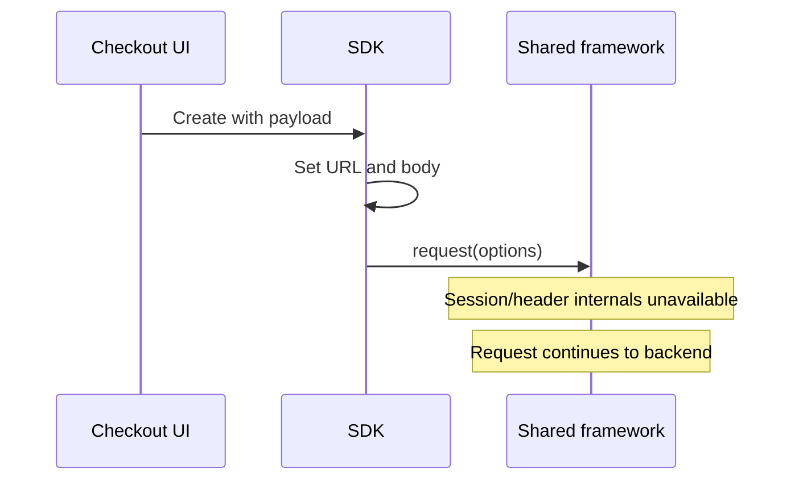
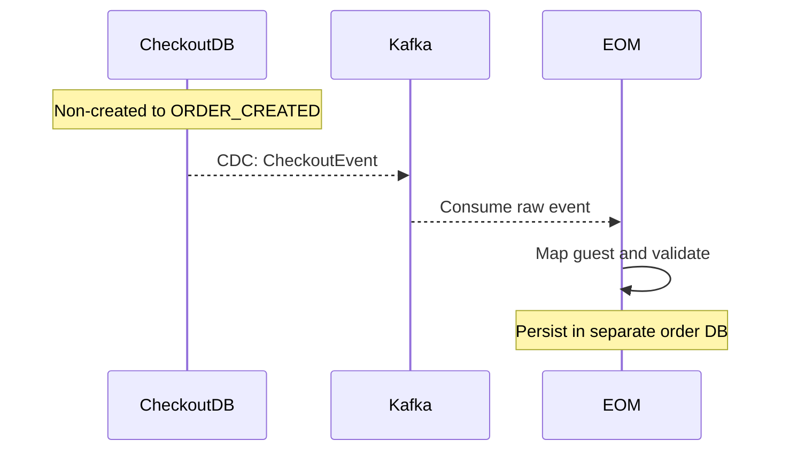
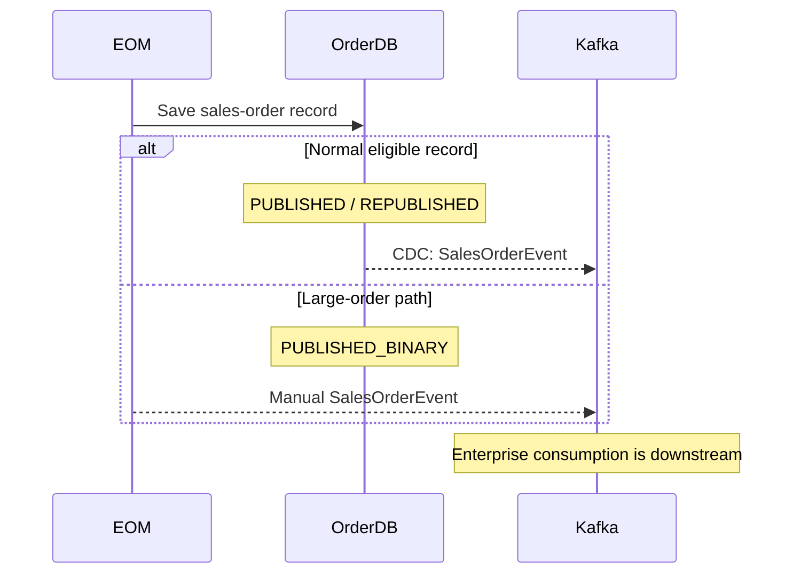

# mycheckout — Guest checkout: end-to-end flow — Part 5

Source names are anonymized; original evidence dates and runtime limitations apply.

| Import record | Value |
|---|---|
| Source document | `guest-checkout-flow.md` |
| Source SHA256 | `6b8a6caf945ae7c3e81033809ca5bb26bff4624bba366a221eeefb191ddc345a` |
| Guide part | 5 of 6 |

[Part 1](/mycheckout/guest-checkout-flow/part-1) · [Part 2](/mycheckout/guest-checkout-flow/part-2) · [Part 3](/mycheckout/guest-checkout-flow/part-3) · [Part 4](/mycheckout/guest-checkout-flow/part-4) · [Part 5](/mycheckout/guest-checkout-flow/part-5) · [Part 6](/mycheckout/guest-checkout-flow/part-6)

## 13. Complete journey: frontend to persistence to EOM events {#13-complete-journey-frontend-to-persistence-to-eom-events}

### 13.1 Read this as one connected journey {#131-read-this-as-one-connected-journey}

<a id="shared-04f02632f768"></a>

| Step | Component | What happens | Identity/data carried forward |
|---|---|---|---|
| 1 | Hosting storefront / shared session framework | Establish or reuse an anonymous session. UUID creation/storage is not implemented in the inspected checkout/cart webcomponent sources. | Existing anonymous identity; generation remains unverified. |
| 2 | Cart webcomponent | Uses framework request/session APIs. Cart request handling can save returned cart ID and anonymous cart data in local storage. | Cart response ID and cart contents; a cart ID is not the guest identity. |
| 3 | Checkout webcomponent | `createCheckoutSliceReq` calls `checkoutApi.createCheckout`; it copies the create request configuration, attaches the supplied payload and invokes `handleCheckoutRequest`. | Checkout create payload. |
| 4 | Shared frontend framework | `handleCheckoutRequest` delegates to imported `request()`. The local SDK does not explicitly set the anonymous header at that call site. | Final anonymous-header injection remains an unverified frontend boundary; backend header consumption is verified. |
| 5 | Backend app / auth dependency | Parse user info from `X-User-Token`; non-null accountNumber means logged in, otherwise anonymous. Logged-in profile ID is user-info sub; anonymous profile ID reads `X-AMW-ANON-ID`. App copies anonymous profile ID to `user.guid`, with incoming user ID fallback, and clears `user.id`. | Identity classification, GUID and country/channel context; gateway authorization remains separate. |
| 6 | Biz create pipeline | Select country handlers; enrich user/products; apply promotions and applicable account, fulfillment, inventory and tax checks. | Enriched checkout and any errors/modifications. |
| 7 | Data create/persistence | Map data request, generate identifiers and save checkout entity/entities in DynamoDB. Return saved checkout through biz/app. | Checkout ID, order ID, version, user GUID and checkout state. |
| 8 | Frontend selections | Submit supported contact, delivery and eligible payment updates. Each relevant backend update processes and persists state. | Saved selections and updated version. |
| 9 | Place order | App maps request and origin IP. Biz reloads saved checkout, selects country/status flow, validates and runs reservation/payment strategy. | Resulting payment, reservation and lifecycle state. |
| 10 | Data update/persistence | Save resulting checkout. Reaching ORDER_CREATED is the event-producing lifecycle transition. | Persisted order data; API returns independently of adapter completion. |
| 11 | Checkout database connector | Match non-ORDER_CREATED → ORDER_CREATED; publish raw CheckoutEvent. | Serialized checkout data plus event metadata. |
| 12 | EOM adapter consumer | Establish tenant context, decode event, map checkout(s), apply stricter guest predicate and fill missing default accounts. | Sales-order entity, event information, guest flag and guest price list where eligible. |
| 13 | Adapter persistence | Validate entities, assign publication/error state and save sales-order record(s) in a separate DynamoDB table. | Sales-order ID and orderEventStatus; this is a second persistence boundary. |
| 14 | Sales-order publication | Normal eligible records publish via adapter table change capture; large orders use manual publishing after save. | Public SalesOrderEvent. |
| 15 | Downstream enterprise consumers | Consume the published event outside this inspected path. | Enterprise processing, warehouse execution and delivery completion are not verified here. |

### 13.2 Frontend request construction: what is proven {#132-frontend-request-construction-what-is-proven}

Checkout API source:

```typescript
createCheckout(params: createCheckoutProps): Promise<CheckoutApiResponse> {
  if (!params.payload) {
    return Promise.resolve(BadRequest);
  }
  const req = { ...createCheckoutDetailsReqObj };
  req.body = params.payload as unknown as BodyInit;
  return handleCheckoutRequest(req);
}
```

<a id="shared-71e0d37897dd"></a>

checkoutApi.ts:147 (local reference: `/D:/BE Projects/checkout/checkout/commerce-checkout-webcomponents-main/source/sdk/services/requests/checkoutApi.ts:147`) uses the POST request definition in checkoutApiEndPoints.ts:42 (local reference: `/D:/BE Projects/checkout/checkout/commerce-checkout-webcomponents-main/source/sdk/services/config/checkoutApiEndPoints.ts:42`). The route is `/comcheckoutas/{version}/checkouts` in this SDK, while the app controller route is `/v1/checkouts`; the deployment's gateway routing is outside this trace.

Framework handoff:

```typescript
const handleCheckoutRequest = async (req: RequestOptions): Promise<CheckoutApiResponse> => {
  const response: CheckoutApiResponse = await request(
    { ...req, timeout: 20000 },
    {
      customKeyGenerator: () => uuidv5(req.url + uniqueId(), uuidv5.URL),
    },
  );
  return Promise.resolve(response);
};
```

<a id="shared-6c5e143128f4"></a>

Source: checkoutApi.ts:600 (local reference: `/D:/BE Projects/checkout/checkout/commerce-checkout-webcomponents-main/source/sdk/services/requests/checkoutApi.ts:600`). `request`, `uniqueId` and `SessionService` come from `@nextgen-web-framework/core`. The `customKeyGenerator` here is a request/cache key hook, not evidence of guest identity creation.

<a id="shared-7497d5ad2a88"></a>

Cart's cartApi.ts:561 (local reference: `/D:/BE Projects/checkout/cart/commerce-cart-webcomponents-main/source/sdk/services/requests/cartApi.ts:561`) can generate `X-Idempotency-Key` for its applicable request path. Its anonymous storage branch:598 (local reference: `/D:/BE Projects/checkout/cart/commerce-cart-webcomponents-main/source/sdk/services/requests/cartApi.ts:598`) stores cart data for anonymous sessions. Neither identifies where the anonymous ID itself is generated. The hard-coded anonymous header in `getSampleReqObj` is sample configuration, not evidence of production random-ID generation.



<a id="shared-81da90a741fe"></a>

An illustrative wire identity is `X-AMW-ANON-ID: anon-demo-123`. This is an identifier, not proof of a signed JWT or access token. Do not generate a fresh guest ID for each request and assume it will retain ownership: the checked-in checkout policy compares anonymous header ID with saved ownership identity.

Policy excerpt:

```rego
anon_id := input.headers["x-amw-anon-id"]
anon_id != null
checkout_user_id := input.data.profileId
checkout_user_id != null
anon_id == checkout_user_id
```

<a id="shared-6591a82ef24a"></a>

Source: checkoutPolicy.rego:31 (local reference: `/D:/BE Projects/checkout/checkout/commerce-checkout-appservice/policies-as-code/src/checkoutPolicy.rego:31`). This proves the policy's equality rule; it does not establish every deployed route's policy binding. Separately, the inspected local auth dependency verifies that anonymous `getProfileId()` reads `X-AMW-ANON-ID`, as explained in Section 3.

### 13.3 Follow the identifiers and persistence {#133-follow-the-identifiers-and-persistence}

<a id="shared-054be3c59f80"></a>

| Identifier/state | Purpose | Do not confuse with |
|---|---|---|
| Anonymous session ID / `user.guid` | Guest identity used by backend guest checks | Request UUID, cart ID, OTP, signed auth token |
| Cart ID | Cart resource reference; frontend can retain returned ID locally | Guest identity |
| Checkout ID | Saved checkout resource for reads/updates/place order | EOM publication acknowledgement |
| Order ID / mapped sales-order ID | Order identifier carried into adapter mapping, with ID normalization | Payment transaction ID |
| Version | Optimistic concurrency for saved checkout updates | Identity or idempotency key |
| Address contact ID | Identify the guest's address/contact; generated if missing in the covered update path | Guest GUID |
| Idempotency/request key | Request-level handling | Stable guest identity |
| `status` | Checkout lifecycle, including ORDER_CREATED | Proof payment is captured |
| `orderEventStatus` | Adapter publication/validation state | Proof enterprise processing completed |

<a id="shared-e25927543b56"></a>

Create persistence handoff is `CheckoutCreateDbStepHandler` → `CheckoutCommonServiceImpl.createCheckout()` → `CheckoutDataTierClient.createCheckout()` → data service → checkout repository. The exact mapping/call appears in CheckoutCommonServiceImpl.java:215 (local reference: `/D:/BE Projects/checkout/checkout/commerce-checkout-bizservice/source/app/src/main/java/com/mycheckout/commerce/checkoutbizservice/app/service/checkout/impl/CheckoutCommonServiceImpl.java:215`). The adapter stores separate sales-order entities; it does not merely update the checkout table.

### 13.4 Two different events, two database boundaries {#134-two-different-events-two-database-boundaries}

<a id="shared-d85097fe0f31"></a>

| Event | Origin and trigger | Destination |
|---|---|---|
| Internal CheckoutEvent | Checkout table change with new Status ORDER_CREATED and old Status other than ORDER_CREATED | `commerce_{tenantEnv}_{tenantCode}_checkout_raw_v1` |
| Public SalesOrderEvent | Adapter sales-order table change whose new `orderEventStatus` is PUBLISHED or REPUBLISHED | `commerce_{tenantEnv}_{tenantCode}_salesorder_pub_v1` |
| Public SalesOrderEvent for large orders | Adapter manual publisher after successful persistence; binary stored record is marked PUBLISHED_BINARY to skip the normal CDC filter | Sales-order publishing binding via SalesOrderProducer |

<a id="shared-d9235e9d99c5"></a>

Raw checkout connector: data tenants-common.yaml:75 (local reference: `/D:/BE Projects/checkout/checkout/commerce-checkout-dataservice/infra-as-code/cdk/app-infra/configs/tenants-common.yaml:75`). Public sales-order connector: adapter tenants-common.yaml:52 (local reference: `/D:/BE Projects/checkout/checkout/commerce-checkout-eomadaptorservice/infra-as-code/cdk/app-infra/configs/tenants-common.yaml:52`). Shared config is not confirmation of a particular environment's deployed overrides.





<a id="shared-0d2d434dd034"></a>

For large orders, see SalesOrderServiceImpl.java:217 (local reference: `/D:/BE Projects/checkout/checkout/commerce-checkout-eomadaptorservice/source/app/src/main/java/com/mycheckout/commerce/checkoutadaptorservice/service/impl/SalesOrderServiceImpl.java:217`) and SalesOrderProducer.java:60 (local reference: `/D:/BE Projects/checkout/checkout/commerce-checkout-eomadaptorservice/source/app/src/main/java/com/mycheckout/commerce/checkoutadaptorservice/producer/SalesOrderProducer.java:60`). The producer maps a SalesOrderEvent and uses sales-order ID as the Kafka key. See the earlier failure section before treating publication status as a delivery guarantee.

### 13.5 Failure boundaries and completion meaning {#135-failure-boundaries-and-completion-meaning}

<a id="shared-bd795affc107"></a>

- **Frontend/API failure:** handle the response or checkout modification; no EOM success should be inferred.
- **Checkout saved:** proves backend persistence returned, not downstream sales-order publication or payment capture.
- **Raw event consumption fails:** checkout consumer uses retry queue and then DLQ; duplicate-order exceptions do not retry.
- **Adapter validation fails:** binding validation failures set VALIDATION_FAILED, record reasons and publish to sales-order DLQ. Other validation exceptions set ERROR. The normal connector filter selects PUBLISHED/REPUBLISHED, not those error states. The large-order branch has separate status handling, so do not generalize the normal CDC behaviour to every payload.
- **Adapter stored / event publication eligible:** distinct from a downstream enterprise acknowledgement. Connector and consumer health remain necessary.
- **Public event published:** the verified path ends at the outgoing event contract; enterprise acceptance, physical fulfillment and delivery require downstream traces.

<a id="shared-edc55008ee3b"></a>

Adapter validation and states: SalesOrderServiceImpl.java:184 (local reference: `/D:/BE Projects/checkout/checkout/commerce-checkout-eomadaptorservice/source/app/src/main/java/com/mycheckout/commerce/checkoutadaptorservice/service/impl/SalesOrderServiceImpl.java:184`).

<a id="shared-d00f68c20e01"></a>

**Journey to remember:** frontend session and cart → checkout SDK → app identity mapping → biz rules → checkout database → raw checkout event → EOM mapping → sales-order database → public sales-order event → downstream enterprise systems.

## Official References

Platform documentation explains the underlying technologies; project behavior remains grounded in the source evidence above.

- [AWS service documentation](https://docs.aws.amazon.com/)
- [Apache Kafka documentation](https://kafka.apache.org/documentation/)
- [Quarkus guides](https://quarkus.io/guides/)
