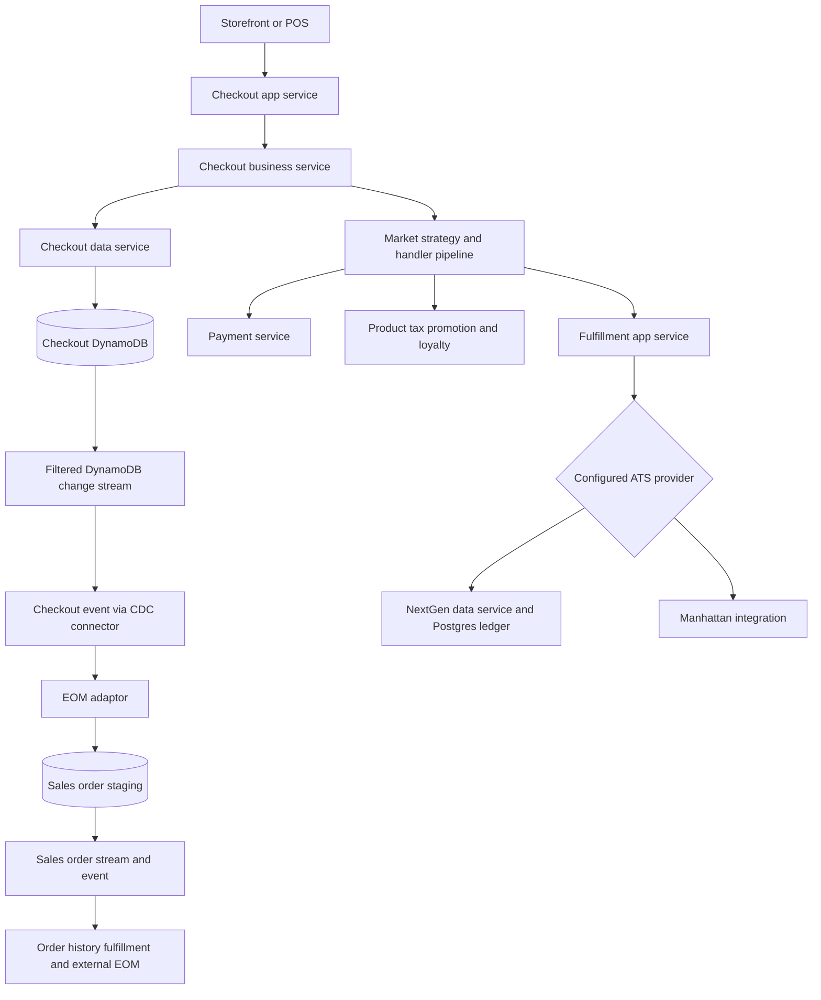
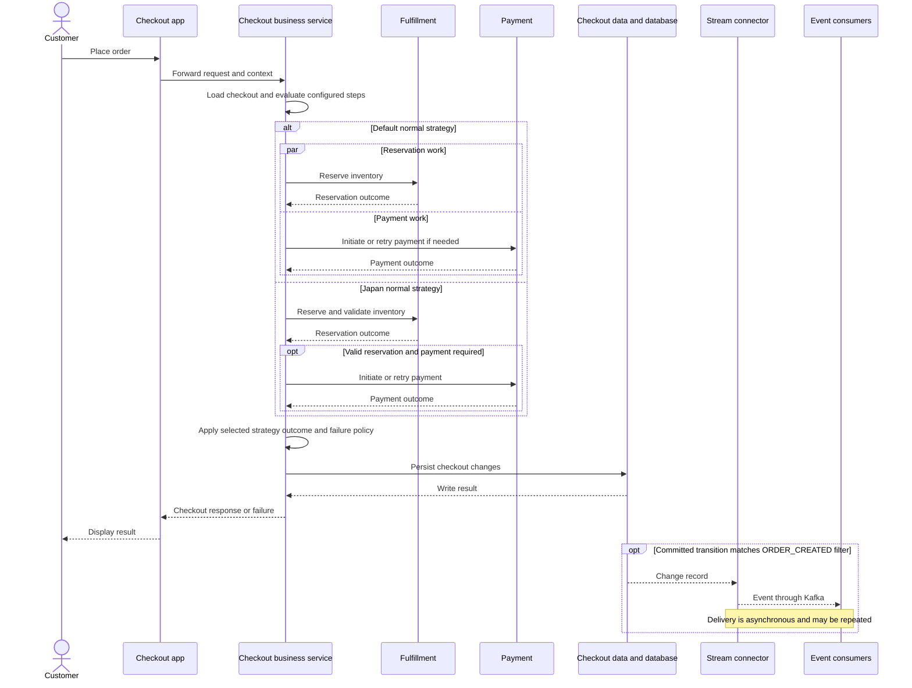
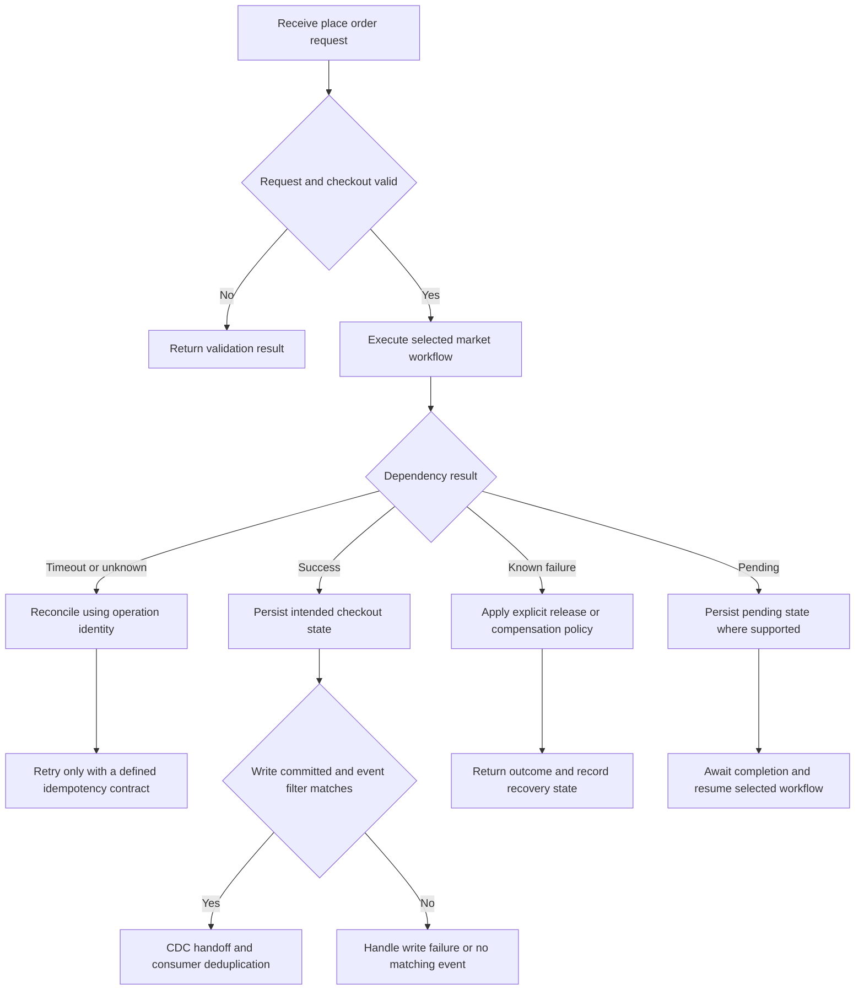

# mycheckout — Checkout Platform: Interview Preparation — Part 7

Source names are anonymized; original evidence dates and runtime limitations apply.

| Import record | Value |
|---|---|
| Source document | `INTERVIEW-PREP.md` |
| Source SHA256 | `d66d6ba6319504f369415902a6e00eb5d3899fda752d33ddc02b69eb911129ef` |
| Guide part | 7 of 7 |

[Part 1](/mycheckout/interview-prep/part-1) · [Part 2](/mycheckout/interview-prep/part-2) · [Part 3](/mycheckout/interview-prep/part-3) · [Part 4](/mycheckout/interview-prep/part-4) · [Part 5](/mycheckout/interview-prep/part-5) · [Part 6](/mycheckout/interview-prep/part-6) · [Part 7](/mycheckout/interview-prep/part-7)

<a id="shared-73fe20c33dd6"></a>

**H1. Price changed between cart and order. What happens?** Ours: place order re-runs the full pipeline (products, promotions, tax). Differences come back as **modifications** with HTTP 200 so the UI shows the new price before the customer confirms. General: always re-price server-side at commit; never trust client prices.

<a id="shared-e9dcb14bd12f"></a>

**H2. Customer double-clicks "Place order".** Ours: optimistic `version` on the checkout (the second request has a stale version), idempotency key on create, and the order event fires only on the first transition to `ORDER_CREATED`. General: idempotency keys on every state-changing call.

<a id="shared-ac023c04f932"></a>

**H3. Abandoned checkouts and held stock?** Ours: stock is only reserved at place order, not while browsing, so abandoned carts don't hold stock; checkouts expire by TTL (90 days). Gap: no automatic expiry of ledger reservations. General: hold with a timeout (e.g. 10–15 min) and a sweeper or Redis key expiry.

<a id="shared-8e839eb3d5f1"></a>

**H4. Payment authorised but order failed (or the other way round)?** Compensation: release reservation, refund points, void/refund payment; async payment methods wait in `AWAITING_PAYMENT` and complete via a payment event. General: payment state machine + reconciliation job against the provider's reports.

<a id="shared-6804f2e19813"></a>

**H5. Asynchronous payment methods (bank transfer, convenience-store payment, 3-D Secure redirects)?** Ours: `INITIATED` → `AWAITING_PAYMENT`; a payment event later re-triggers place order. Downstream only sees the order once paid.

<a id="shared-8b84a9996f47"></a>

**H6. Promotions and coupons?** Ours: a promotion handler in the pipeline calls the promotion service; fired promotions and coupons come from the cart and are re-validated. General: stacking rules, exclusivity, budget/usage limits enforced atomically, proration of discounts per line (needed for returns and tax).

<a id="shared-274be43252be"></a>

**H7. Tax across countries?** Ours: tax handler per market, a taxation service, a LATAM tax-threshold check, GROSS vs NET price strategies, and the order adaptor can recalculate tax. General: tax-inclusive vs exclusive pricing, rounding per line vs per order, invoice numbering (Japan has an invoice-number step).

<a id="shared-aab5e00d53b5"></a>

**H8. Purchase limits / rationing?** Ours: rationing and purchase-restriction handlers per customer. General: enforce at place order, not only in the UI; count across orders in a period.

<a id="shared-735a70d890f0"></a>

**H9. Backorders and split shipments?** Ours: dispositions per line (ship, backorder, not available) with separate backorder stock pools. General: let the customer choose ship-complete vs ship-available; each shipment has its own status and tracking.

<a id="shared-6fa546324fe5"></a>

**H10. Buy online, pick up in store (BOPIS)?** Ours: pickup locations from DynamoDB + Redis geo, per-store stock check, carrier pickup points with a 6-minute validation hold (see Q12).

<a id="shared-90ad10ae7c76"></a>

**H11. Omnichannel / POS?** Ours: POS has its own place-order flow and handler lists, and the cart isn't deleted for POS in Japan. General: same order model across channels, channel-specific rules.

<a id="shared-2648585b67ee"></a>

**H12. Subscriptions / auto-ship?** Ours: system-channel orders, a subscription handler, and a stock quantity protected for subscriptions (subtracted from regular ATS). General: scheduled order generation, payment retries, skip/pause.

<a id="shared-cf3f56128954"></a>

**H13. Loyalty points?** Ours: points applied during checkout, earned points calculated after order, points refunded if payment fails. General: treat points like a payment tender with its own transaction and reversal.

<a id="shared-f14dafce7d1e"></a>

**H14. Returns, refunds and cancellations?** Ours: order app service handles returns, replacements and cancellations through the OMS; cancellation releases stock via the sales-order event. General: refund to the original tender, restock vs write-off, prorated promotions.

**H15. Order status visibility for millions of orders?** Ours: CQRS read model in OpenSearch, every event archived in S3 for rebuilds. See E6.

<a id="shared-2ee65d89ec32"></a>

**H16. Integration with ERP/WMS/OMS?** Ours: AS400 inventory feed, Manhattan for inventory/promising, EOM for orders, all through Kafka adaptors with retry and dead-letter topics. General: anti-corruption layer per external system, idempotent consumers, reconciliation jobs.

<a id="shared-71ec4292414e"></a>

**H17. Peak readiness (Black Friday / month-end)?** Code freeze, load test at 2–3× expected peak, pre-scale (ours: KEDA queue triggers), raise DB/Kafka capacity, feature-flag kill switches for non-critical features, war room with dashboards, rollback plan.

<a id="shared-4eed6977c7ca"></a>

**H18. Which metrics would you watch?** Business: orders per minute, conversion, payment failure rate, out-of-stock modifications, average order value. Technical: p95/p99 latency per endpoint and per dependency, error rate, DynamoDB throttles, Kafka consumer lag, DLQ counts, pod restarts.

<a id="shared-2481409f49f2"></a>

**H19. Guest checkout?** Ours: enabled per market; the checkout is tied to an anonymous id header. General: bind it to a signed session token, rate limit, offer account creation after the order.

<a id="shared-829d54ef2359"></a>

**H20. Personal data (GDPR / local privacy laws)?** Minimise and expire (ours: TTLs, per-market schemas), mask in logs, right-to-erasure process, regional data residency (ours: regional tenants).

<a id="shared-ef2f199a8aba"></a>

**H21. Address validation and delivery dates?** Ours: address master configuration and validation in fulfillment; delivery dates from serviceability by post code; Japan delivery slots are validated at place order. General: validate early, re-validate at commit.

**H22. Order numbers that customers can read?** Ours: counter per country. See E3 for scaling it.

<a id="shared-80d8d3f0c20a"></a>

**H23. Search and catalogue freshness?** Ours: product publish service consumes product, price and inventory CDC and publishes product and search-index updates. General: event-driven indexing with a full re-index path.

**H24. Fraud?** Not visible in this workspace (likely in the payment provider). General: risk scoring before capture, velocity checks, 3-D Secure, manual review queue.

<a id="shared-e2473cc9245c"></a>

**H25. Multi-currency and locale?** Ours: per-market tenant config and locale context propagated through requests. General: store amounts in minor units with currency code; never use floating point for money.

### I. Questions added after the coverage audit {#i-questions-added-after-the-coverage-audit}

<a id="shared-c4821aa09b3b"></a>

**I1. What happens to orders that never get paid?** Ours: order job service CronJobs (`cancelweborderpaymentawaited`, `cancelweborderpaymentretry`) search OpenSearch for matching orders in a configured time window, write them to a cancel-record table, and Postgres CDC publishes `cancelorder_raw_v1` for the cancelling system. Criteria are data, not code (JSONB in `order_cancel_properties`), so the window can change without a deploy. (E2E §23.5)

<a id="shared-5a400c6a3768"></a>

**I2. How are loyalty points returned when payment fails?** Synchronous call to the loyalty service, falling back to a reconciliation event on failure; a flag can make it always event-based. A `FAILED` marker on the loyalty payment entry prevents double refunds. (E2E §23.1) Good example of "sync with async fallback" and idempotency.

**I3. How does guest checkout verify the customer?** OTP challenge through the identity service, purpose `GUEST_CHECKOUT` (also `ADDRESS` for address changes). (E2E §23.2)

<a id="shared-7040822cfb30"></a>

**I4. What are mycheckout periods and why does checkout care?** Business-volume periods (order period, bonus period) that decide which month an order counts toward, which is what makes month-end a traffic spike. POS/CSP checkouts get them looked up at create; others send them. (E2E §23.3)

<a id="shared-47f13ec4d825"></a>

**I5. How do you issue tax invoices to companies?** The checkout stores a tax document (individual or corporation, VAT registration, branch); a dedicated endpoint lists the identities the customer can invoice to. (E2E §23.4)

<a id="shared-9b33859ee1c8"></a>

**I6. How do you know your documentation is complete?** I audited it: parsed every OpenAPI/AsyncAPI contract (about 600 operations), every topic in configmaps and every CronJob, and checked each against the docs. It found missing flows (above), a framework mislabel (order services are Quarkus, not Spring), placeholder AsyncAPI files and a topic configured only in dev. (`docs/COVERAGE-AUDIT.md`)

---

## Closing: "What would you improve?" (good to have ready) {#closing-what-would-you-improve-good-to-have-ready}

<a id="shared-7674e6f0d35d"></a>

1. Shard or block-allocate the per-country order counter.
2. Reserve stock before charging in every market (or authorise-then-capture) to cut compensations.
3. Raise partition counts on the order hand-off topics and connector concurrency for flash sales.
4. Enforce ownership on every checkout operation and remove header-based policy relaxations; make biz private-only.
5. Replace placeholder smoke tests with real post-deploy checks and add canary analysis.
6. Flag hygiene: many registered flags have no backend reference.
7. Right-size the Quarkus app tier pods (still sized like the Spring version in some prods) and remove JVM flags that native binaries ignore.
8. Add rate limiting at the edge and circuit breakers on optional dependencies.

## Quick-reference numbers (safe to say) {#quick-reference-numbers-safe-to-say}

<a id="shared-301dd9b51062"></a>

| Thing | Value |
|---|---|
| Checkout handlers / downstream services | ~45 / ~25 |
| Checkout statuses | CREATED, AWAITING_PAYMENT, PAYMENT_REQUIRED, ORDER_CREATED |
| Biz replicas (prod) | 2–15 with KEDA (CPU 75% + month-end and flash-sale queue triggers) |
| Mesh timeout for biz | 22 s; payment client 15 s; product 1.5 s |
| Checkout TTL | 90 days; sales order staging TTL 1 hour |
| Hand-off topic partitions (Japan prod) | 3 |
| Retry topic cycle | scheduled every few hours, 3 attempts, then DLQ |
| Feature flags (checkout) | 45 registered |
| Tenants × envs | 5 × 5 (dev, qa, uat, perf, prod) |

## Visual interview walkthrough {#visual-interview-walkthrough}

<a id="shared-409f73c28331"></a>

Added 2026-11-12. Read the architecture first, trace one request in the sequence, then explain the decisions and failure cases. These diagrams summarize source and the existing [end-to-end guide](/mycheckout/end-to-end-system/part-1); deployment values and external integration behavior are not established by static inspection. The snippets labelled **teaching fragment** illustrate mechanisms and are not production patches.

### Architecture and responsibility boundaries {#architecture-and-responsibility-boundaries}



**How to explain this in an interview:**

<a id="shared-c2d3ca503ee3"></a>

1. Start at the customer-facing app tier and identify the business service as the orchestration boundary.
2. Name the synchronous dependencies needed to answer the customer's request, such as fulfillment and payment.
3. Show that checkout persistence and downstream event processing are separate boundaries.
4. Explain the CDC handoff and the EOM adaptor, then name the consumers without claiming direct calls from checkout to each consumer.
5. Close with two risks: no single transaction covers payment and all stores; event delivery can be duplicated.

### Place order sequence with a market specific branch {#place-order-sequence-with-a-market-specific-branch}

This diagram focuses on the normal place-order strategies. It deliberately does not imply that POS, retry, preorder and booking flows have identical ordering.



<a id="shared-7bd6a25b5bc0"></a>

**Source anchors:** `DefaultNormalPlaceOrderStrategy.placeOrder` uses `Mono.zip`; `JapanNormalPlaceOrderStrategy.placeOrder` uses reservation validation before the payment-required branch. Current default strategy source contains fix-forward `ORDER_CREATED` behavior, so the older simplified payment-status mapping in Q2 must not be treated as universal. Explain the selected strategy before quoting its status rules. These classes live under `checkout/commerce-checkout-bizservice/source/app/src/main/java/com/mycheckout/commerce/checkoutbizservice/app/service/checkout/impl/` relative to the workspace root.

### Flow when a dependency fails {#flow-when-a-dependency-fails}

The following is an **interview decision flow**, not a claim that every current strategy already implements each recovery step.



### Worked answer one Why not retry the whole checkout after a timeout {#worked-answer-one-why-not-retry-the-whole-checkout-after-a-timeout}

<a id="shared-bf0afa62e8c3"></a>

1. A timeout means the caller does not know the outcome. It does not prove payment failed.
2. Identify which side effects may have completed: reservation, charge, checkout write, or event handling.
3. Reuse the same operation identity and inspect the payment or reservation outcome before repeating it.
4. Retry only an operation with an established idempotency contract; otherwise reconcile or use a compensation workflow.
5. Explain what is implemented versus what you would propose. A retry annotation alone does not provide exactly-once effects.

<a id="shared-50b04e23313b"></a>

**Twist:** “But a Command represents the action, so retries are safe?” A Command packages the request; safe repetition is a separate property of the receiver and operation identity.

### Worked answer two How can we make checkout generic {#worked-answer-two-how-can-we-make-checkout-generic}

<a id="shared-05d2789afa63"></a>

1. Clarify the meaning of generic. Reusable algorithms, typed containers and common workflow steps are different requirements.
2. If shipping behavior varies, define a `ShippingStrategy` and let checkout depend on that interface.
3. Supply the strategy through configuration, a provider or constructor injection. Strategy does not eliminate selection logic.
4. Keep unrelated rules outside that interface. Adding many optional methods to one huge interface makes the design harder to use.

**Teaching fragment using the existing lab types:**

```java
CheckoutAllPatterns.ShippingStrategy shipping =
    new CheckoutAllPatterns.ExpressShipping();

int subtotal = 800;
int total = Math.addExact(subtotal, shipping.fee(subtotal)); // 950
```

<a id="shared-4bd81e543abe"></a>

The runnable lab is CheckoutAllPatterns.java (local reference: `../checkout/commerce-checkout-bizservice/docs/design-patterns/CheckoutAllPatterns.java`). It uses invented prices and does not perform real payment or stock changes.

### Worked answer three Sequential versus parallel work in Reactor {#worked-answer-three-sequential-versus-parallel-work-in-reactor}

<a id="shared-11bf562e4a1a"></a>

1. Check the dependency: can payment start before the reservation result is validated?
2. `Mono.zip` subscribes to independent publishers and combines their results; it does not make their side effects atomic.
3. `flatMap` can make later work depend on the earlier result. Business validation must still gate the next step.
4. A failure can occur after another concurrent operation has completed. Define cancellation, reconciliation and compensation behavior explicitly.

**Reactor teaching fragment** assuming `reserve()`, `pay()`, `validate()` and `confirm()` return the declared publishers:

```java
// Independent work: no shared transaction is implied.
Mono<Result> parallel = Mono.zip(reserve(), pay())
    .map(pair -> combine(pair.getT1(), pair.getT2()));

// Dependent work: validate reservation before subscribing to payment.
Mono<Result> sequential = reserve()
    .flatMap(reservation -> validate(reservation)
        .flatMap(valid -> pay().map(payment -> confirm(valid, payment))));
```

<a id="shared-7c28958812c2"></a>

This is an explanatory fragment, not copied production code. If the publishers are cold, nothing executes until subscription. Reactor does not require a separate thread per publisher.

### Worked answer four Explain the template inside the handler pipeline {#worked-answer-four-explain-the-template-inside-the-handler-pipeline}

<a id="shared-866995103f1d"></a>

1. The executor chooses the configured handlers and calls `handler.call(request)`.
2. The final one-argument `KeyBasedStepHandler.call` controls applicability and validation, then invokes the concrete `execute` implementation and metrics mapping.
3. A payment handler and an inventory handler share this wrapper while implementing different work.
4. Keep the limitations precise: `hasNoErrors()` currently returns true, and the two-argument `call` overload in that class returns null.

**Teaching skeleton showing the pattern mechanism:**

```java
abstract class CheckoutStep {
    final void run() {
        validate();
        execute();
        recordSuccess();
    }
    protected abstract void validate();
    protected abstract void execute();
    protected abstract void recordSuccess();
}
```

<a id="shared-5275072ddc0c"></a>

The skeleton is synchronous Java; the actual handler uses Reactor. If execution fails, the success step is skipped. Fixed order is the Template Method responsibility; handler selection is a different responsibility.

### How to answer an unfamiliar design prompt {#how-to-answer-an-unfamiliar-design-prompt}

<a id="shared-e998e0a8a4a7"></a>

1. Restate the behavior and clarify what changes.
2. Identify the consistency boundary and failure cases.
3. Draw the synchronous call path first and add asynchronous handoffs separately.
4. Show the smallest interface or code fragment that explains the design.
5. Name a pattern only after explaining the mechanism, then give one trade-off and one limit.

## Official References

Platform documentation explains the underlying technologies; project behavior remains grounded in the source evidence above.

- [AWS service documentation](https://docs.aws.amazon.com/)
- [Apache Kafka documentation](https://kafka.apache.org/documentation/)
- [Quarkus guides](https://quarkus.io/guides/)
