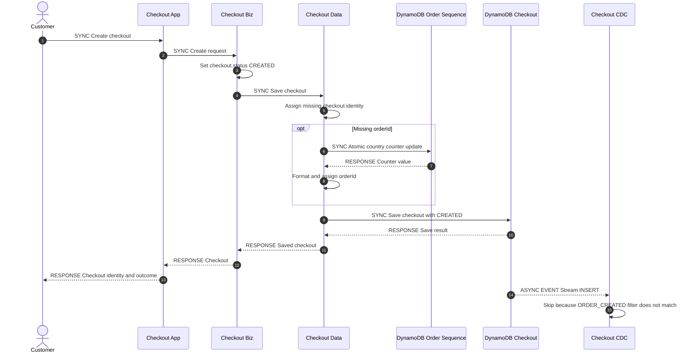
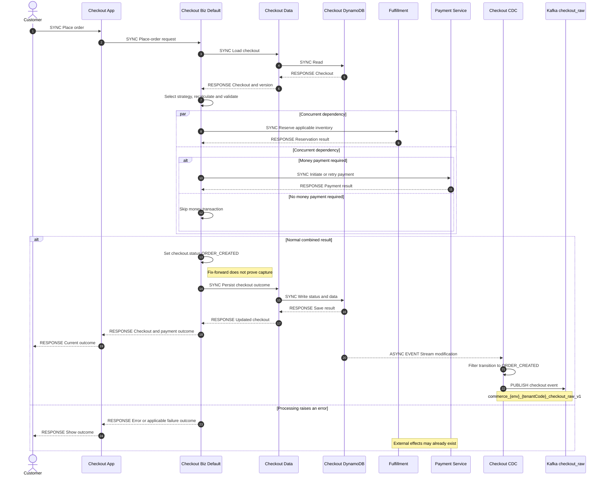

# mycheckout — Checkout Payment and CDC Complete Flow — Part 1

Source names are anonymized; original evidence dates and runtime limitations apply.

| Import record | Value |
|---|---|
| Source document | `PAYMENT-CDC-SEQUENCE-GUIDE.md` |
| Source SHA256 | `b89fb3b9e7baaf4e5fbe4d6a0d4268fb106d7eb4cdbbc562185e60ee9743cd37` |
| Guide part | 1 of 3 |

[Part 1](/mycheckout/payment-cdc-sequence-guide/part-1) · [Part 2](/mycheckout/payment-cdc-sequence-guide/part-2) · [Part 3](/mycheckout/payment-cdc-sequence-guide/part-3)

## Checkout Payment and CDC Complete Flow {#checkout-payment-and-cdc-complete-flow}

Updated 16 November 2026. Interview and implementation reference.

## 1. Main conclusions {#1-main-conclusions}

<a id="shared-77c8e507ed92"></a>

Checkout Biz decides checkout business status. Checkout Data persists that status. The EOM adapter maps checkout events into sales orders and assigns sales-order event status. DynamoDB Streams captures saved changes; CDC connectors publish them to Kafka. Kafka transports events and does not itself update checkout business status.

There are two independent CDC stages:

```text
Checkout DynamoDB -> checkout CDC -> checkout_raw topic
    -> EOM adapter -> Sales-order DynamoDB
    -> sales-order CDC -> salesorder_pub topic -> downstream consumers
```

<a id="shared-2d5b835b18c8"></a>

Japan validates applicable reservations before payment and interprets payment results. Default normal processing overlaps reservation and payment and uses fix-forward ORDER_CREATED on a normal emitted result. ORDER_CREATED is not universal proof of payment capture or downstream EOM acceptance.

<a id="shared-b1bddab03fce"></a>

This guide consolidates local static source inspection and the existing place-order guide. It does not establish deployed flags, live retry settings, payment-provider guarantees, connector internals or external EOM implementation. The source walkthrough is read-only; no payment or order transaction was executed.

## 2. Diagram notation {#2-diagram-notation}

<a id="shared-482b03316d74"></a>

| Notation | Meaning |
| --- | --- |
| Solid arrow | Operation or publication request |
| Dotted arrow labelled RESPONSE | Returned result, including responses to synchronous calls |
| Dotted arrow labelled ASYNC EVENT | Independent stream or Kafka event delivery |
| SYNC | The current workflow needs the operation result before proceeding |
| Self-arrow | Processing within the same component |
| par block | Operations overlap, but their results can still be required before proceeding |

<a id="shared-eb4478c7911c"></a>

A dotted arrow does not by itself mean asynchronous. Labels distinguish responses from events. Reactive, nonblocking Java calls can be logically synchronous dependencies: the request still waits for their results.

<a id="shared-61b830ba499a"></a>

Database stream activity can begin immediately after a write commits, before or after the customer receives the HTTP response. Diagram ordering groups the request and event paths for readability rather than imposing an HTTP-response barrier.

<a id="shared-15ae83a64dad"></a>

CDC publication arrows show an attempted publication. Exact producer acknowledgement and retry behavior belongs to the shared connector implementation and is not inferred from the arrow.

## 3. Identifiers and ownership {#3-identifiers-and-ownership}

<a id="shared-678fad502311"></a>

| Identifier | Purpose and assignment |
| --- | --- |
| checkoutId | Checkout storage identity. When absent, data service calls a UUID generator with the request idempotency key. The generator implementation is outside this trace. |
| childId | Distinguishes child or physical checkout context; checkout storage uses Id and ChildId. |
| orderId | Normally allocated during checkout creation if missing, independently of checkout UUID. |
| salesOrderId | Adapter maps checkout orderId after normalizing its country-code prefix. |
| paymentId / payment reference | Identify payment resources; not interchangeable with checkoutId or orderId. |
| reservation ID | Identifies inventory reservation resources. |
| version | Used in checkout concurrency control and subsequent placement requests. |

<a id="shared-5b70c8ad933c"></a>

Order number generation reads the country's format from master data, updates a country-specific DynamoDB atomic counter and formats countryCode + # + sequence. An illustrative stored ID is COUNTRYCODE#0000456. Adapter normalization removes the prefix, giving salesOrderId 0000456, with country stored separately. Actual formatting and counter start values come from configuration.

An allocated order number does not mean placement succeeded. Abandoned checkouts and failed attempts can leave unused numbers; do not claim the sequence is gapless.

## 4. Status fields {#4-status-fields}

<a id="shared-aa225c771a88"></a>

| Field | Values or outcomes | Owner and persistence |
| --- | --- | --- |
| Checkout status | CREATED, AWAITING_PAYMENT, ORDER_CREATED, PAYMENT_REQUIRED | Biz processing assigns it; Data persists it in checkout DynamoDB. |
| Payment status | INITIATED, AUTHORIZED, AWAITED, CAPTURED and failure outcomes | Payment processing supplies the result; checkout interprets and stores payment information. Provider internals are outside scope. |
| Sales-order orderEventStatus | PUBLISHED, REPUBLISHED, VALIDATION_FAILED, ERROR, PUBLISHED_BINARY | Adapter writes it in sales-order DynamoDB. |

<a id="shared-37d961a35506"></a>

PUBLISHED is set before the normal sales-order save. It is eligible for the configured CDC filter, not evidence that Kafka acknowledged an event. REPUBLISHED is accepted by the filter; this guide does not establish every caller that sets it. PUBLISHED_BINARY selects a different, manual-publication path. These event statuses are not shipping, delivery or external EOM business statuses.

## 5. Kafka topic map {#5-kafka-topic-map}

Replace {env} and {tenantCode} with the resolved environment and tenant values.

<a id="shared-6d2b9865bf8f"></a>

| Full topic template | Publisher | Consumer or role |
| --- | --- | --- |
| commerce_{env}_{tenantCode}_checkout_raw_v1 | Checkout CDC connector | EOM adapter checkout consumer |
| commerce_{env}_{tenantCode}_salesorder_pub_v1 | Sales-order CDC connector for normal orders; adapter manual publisher for large binary orders | Downstream sales-order consumers; their complete implementations are outside this trace |
| commerce_{env}_{tenantCode}_salesorderpayments_pub_v1 | Upstream payment event source; exact publishing implementation unverified | Adapter payment-event consumer |
| commerce_{env}_{tenantCode}_checkout-comcheckoutds-dlq_error_v1 | Checkout CDC connector configured failure route | Checkout CDC error investigation and recovery |
| commerce_{env}_{tenantCode}_checkout-comcheckoutes-rlq_error_v1 | Adapter checkout processing failure/retry routing | Adapter checkout retry consumer |
| commerce_{env}_{tenantCode}_checkout-comcheckoutes-dlq_error_v1 | Adapter retry exhaustion | Failed checkout processing investigation and replay |
| commerce_{env}_{tenantCode}_salesorder-comcheckoutes-dlq_error_v1 | Sales-order CDC configured failure route; adapter sales-order DLQ path | Failed sales-order publication or validation investigation |

<a id="shared-fdcdf46406c5"></a>

RLQ and DLQ topics hosted on the same unavailable Kafka cluster cannot independently protect against that cluster outage. Topic existence also does not establish an implemented or operational replay process.

## 6. Shared checkout creation step by step {#6-shared-checkout-creation-step-by-step}

<a id="shared-3d64b1871578"></a>

1. Customer requests checkout creation through Checkout App.
2. Checkout Biz constructs checkout data and initializes status CREATED in the normal creation mapping.
3. Checkout Data assigns checkout identity if it was not supplied.
4. The creation save path calls generateSubResourceAndOrderIds.
5. If orderId is absent, populateOrderId obtains the country-specific sequence and assigns a formatted order ID. An already supplied ID is retained rather than regenerated by this method.
6. Data prepares one or more physical checkout entities; logical checkout is not necessarily one DynamoDB item.
7. The checkout is saved and a response is returned with the resulting identity/version information.
8. The stream captures the insertion. A normal CREATED record does not match the order-created transition filter.



## 7. Default markets placement step by step {#7-default-markets-placement-step-by-step}

<a id="shared-ea299f2af619"></a>

The principal legacy default normal strategy is inherited by normal Thailand and LATAM strategies. A feature flag selects legacy versus internal-handler orchestration. The default internal implementation also uses fix-forward status handling; do not assume the flag's deployed value.

<a id="shared-8227200ff78d"></a>

1. Customer sends place-order with checkoutId and version.
2. App delegates to Biz. Biz loads checkout and selects handlers based on country, channel/client and current status.
3. Applicable recalculation and validation run. Modifications can require customer correction; not every request reaches payment.
4. Default normal processing creates reservation and payment operations and combines results with Mono.zip, allowing overlap.
5. If money payment is not required, its transaction is skipped. If an existing payment ID is present, the applicable payment retry strategy is selected; otherwise payment initiation is selected.
6. On a normal combined emitted result, the strategy attaches available payment/reservation information and sets checkout.status ORDER_CREATED. This is not a universal successful-capture check.
7. Post-placement logic prepares payment history and checkout data. For ORDER_CREATED, applicable selected payment entries move into history and selections/fulfillment options are cleared.
8. Data persists the updated checkout. Missing identifiers can be populated; an existing orderId is retained. The order timestamp is set when appropriate if absent.
9. The customer receives the current checkout/payment outcome without waiting for downstream EOM completion.
10. The persisted transition to ORDER_CREATED qualifies for checkout CDC, described in section 10.



## Official References

Platform documentation explains the underlying technologies; project behavior remains grounded in the source evidence above.

- [AWS service documentation](https://docs.aws.amazon.com/)
- [Apache Kafka documentation](https://kafka.apache.org/documentation/)
- [Quarkus guides](https://quarkus.io/guides/)
