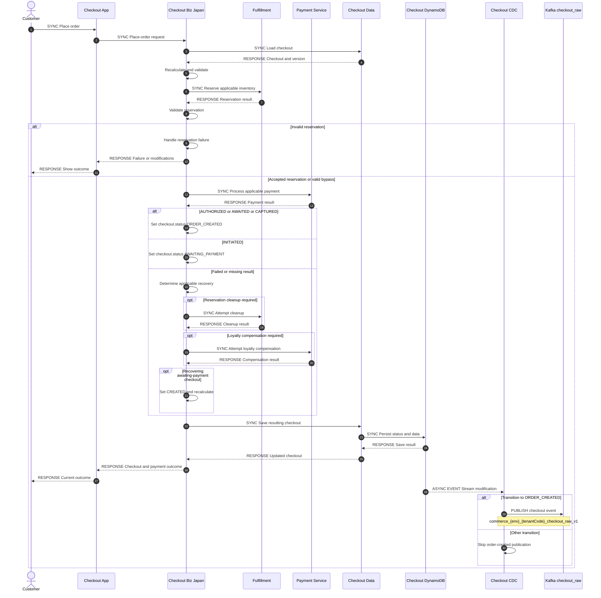
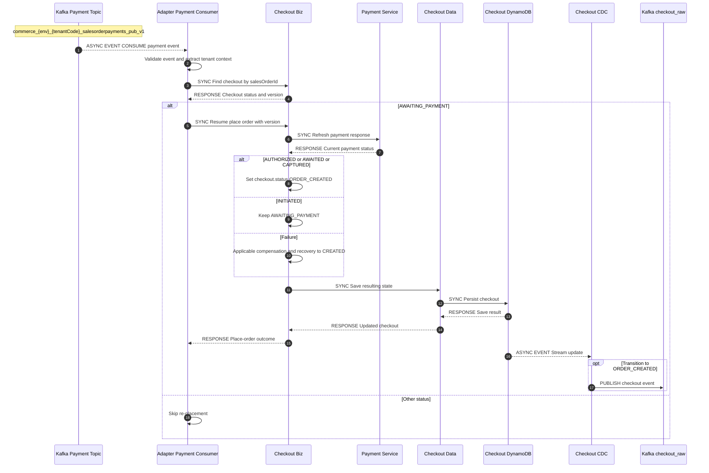
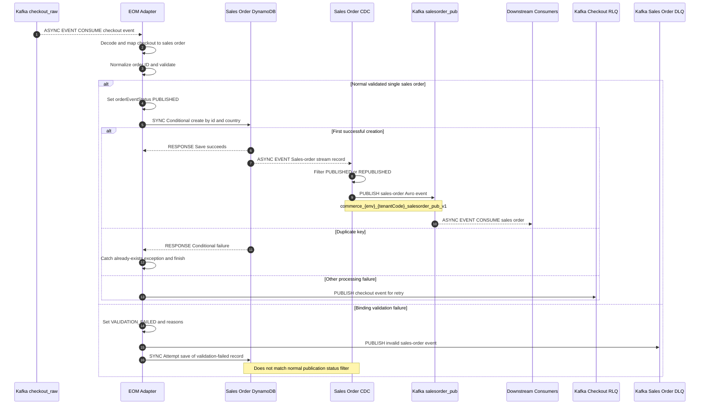
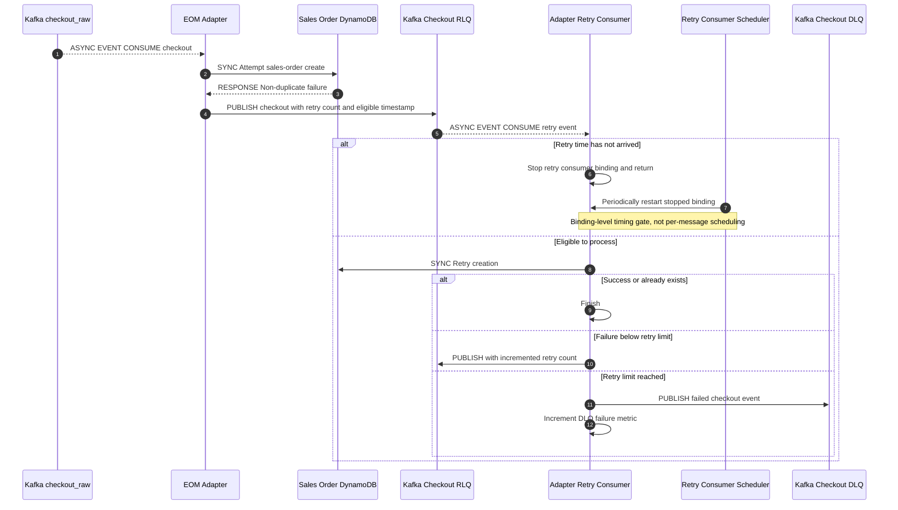

# mycheckout — Checkout Payment and CDC Complete Flow — Part 2

Source names are anonymized; original evidence dates and runtime limitations apply.

| Import record | Value |
|---|---|
| Source document | `PAYMENT-CDC-SEQUENCE-GUIDE.md` |
| Source SHA256 | `b89fb3b9e7baaf4e5fbe4d6a0d4268fb106d7eb4cdbbc562185e60ee9743cd37` |
| Guide part | 2 of 3 |

[Part 1](/mycheckout/payment-cdc-sequence-guide/part-1) · [Part 2](/mycheckout/payment-cdc-sequence-guide/part-2) · [Part 3](/mycheckout/payment-cdc-sequence-guide/part-3)

## 8. Japan placement step by step {#8-japan-placement-step-by-step}

1. Customer submits place-order. App delegates to Biz, which loads checkout and selects Japan processing.
2. Applicable recalculation and validation run.
3. For a fresh normal placement, obtain applicable inventory reservations before payment.
4. Validate the reservation. An invalid result takes the reservation-failure branch; normal payment processing does not proceed through that branch. Configured bypasses and non-inventory cases must be considered before interpreting an empty reservation as failure.
5. Process money payment when required. Loyalty-only and zero-total cases have their own guards.
6. Interpret the payment response: AUTHORIZED, AWAITED or CAPTURED sets ORDER_CREATED; INITIATED sets AWAITING_PAYMENT.
7. Failed/null status or missing payment response takes applicable failure handling. Cleanup and loyalty compensation depend on checkout and reservation context.
8. Failure while awaiting payment executes recovery to CREATED and recalculation through failure handlers.
9. Persist the resulting checkout. The customer receives its current outcome.
10. Only a qualifying transition to ORDER_CREATED starts the order-created CDC handoff. AWAITING_PAYMENT does not qualify.

## 9. Japan asynchronous payment completion {#9-japan-asynchronous-payment-completion}

1. The initial placement can persist AWAITING_PAYMENT and return to the customer.
2. Adapter consumes a later salesorderpayments_pub event. The exact upstream publishing implementation is outside the inspected scope.
3. It validates the event and extracts salesOrderId, affiliate and country context.
4. It loads checkout by order ID.
5. Only AWAITING_PAYMENT triggers a place-order call using the returned checkout version. Other states are skipped through this consumer path.
6. Applicable Japan processing refreshes the payment response using existing reservation context rather than blindly starting a fresh normal reservation path.
7. Biz interprets the result and sets ORDER_CREATED, retains AWAITING_PAYMENT or executes failure recovery to CREATED.
8. Data persists the outcome. A transition to ORDER_CREATED feeds the normal checkout CDC handoff.

## 10. First CDC and EOM adapter step by step {#10-first-cdc-and-eom-adapter-step-by-step}

1. Checkout write commits with status ORDER_CREATED.
2. Checkout table stream exposes old and new images.
3. Configured event source filtering requires new Status ORDER_CREATED and old Status different from ORDER_CREATED. Updates that leave ORDER_CREATED unchanged are not selected by that transition filter.
4. The configured Lambda-based connector publishes Avro to checkout_raw. Shared connector internals are not present in this walkthrough.
5. EOM adapter consumes the CloudEvent, chooses tenant context from the topic and decodes the checkout event.
6. It decodes binary/compressed or JSON checkout payload data as applicable and maps individual checkout data into sales-order entities.
7. It strips the country-code prefix from order IDs and maps orderId to salesOrderId.
8. It validates each sales order. Successful validation sets orderEventStatus PUBLISHED before saving. Binding validation errors set VALIDATION_FAILED, record reasons and attempt sales-order DLQ publication. Other validation-processing exceptions set ERROR.
9. Normal single-order creation uses a conditional DynamoDB save. Multiple orders use a separate transaction path.
10. A successful sales-order write produces its own stream record. This is a second CDC stage, not a direct call from the adapter into the CDC connector.

## 11. Second CDC and sales-order publication {#11-second-cdc-and-sales-order-publication}

1. Sales-order DynamoDB has its own NEW_AND_OLD_IMAGES stream.
2. Its configured connector filter accepts NewImage.orderEventStatus PUBLISHED or REPUBLISHED. Unlike the checkout filter, it does not check an old-to-new status transition; an update retaining an eligible status may also qualify.
3. The connector publishes to commerce_{env}_{tenantCode}_salesorder_pub_v1 using the configured Avro schema subject.
4. Downstream consumers process the sales-order event independently.
5. This normal path does not establish a later database update confirming broker receipt. PUBLISHED was already stored before publication.

## 12. Failure and retry sequence {#12-failure-and-retry-sequence}

Observed sample configuration uses sales-order retry count 3, eligibility timestamp offset 240 minutes and scheduler delay 300 minutes. These values are configuration examples, not confirmed live settings or an exact per-message retry schedule. Scheduling, stopped bindings and consumer position affect actual timing. Sales-order TTL also differs between base application settings and configmap examples; inspect the resolved deployed configuration.

## 13. Duplicate handling {#13-duplicate-handling}

### Repeated checkout creation {#repeated-checkout-creation}

The ID-generation path receives the request idempotency key. Checkout repository conditional creation uses attribute_not_exists(Id) AND attribute_not_exists(ChildId). This prevents overwriting an existing primary-key item. It does not by itself prove exactly-once behavior for all subsequent payment side effects.

### Repeated place order {#repeated-place-order}

Applicable strategies choose payment retry when a payment ID already exists. Existing ORDER_CREATED and PAYMENT_REQUIRED states influence outer handler selection. The exact payment-provider idempotency guarantee is outside this trace; do not claim that retry strategy selection alone prevents duplicate charges.

### Repeated payment event {#repeated-payment-event}

The payment consumer only resumes checkouts currently AWAITING_PAYMENT. A later event after successful transition to ORDER_CREATED is skipped. Two concurrent events can both read AWAITING_PAYMENT, so the status guard is not a distributed lock.

### Repeated checkout Kafka event {#repeated-checkout-kafka-event}

For a normal single sales order, the adapter uses attribute_not_exists(id) AND attribute_not_exists(countryIsoCode). Two concurrent creates for the same salesOrderId/country cannot both create that item. The loser becomes ResourceAlreadyExistException, which the checkout consumer catches and logs without routing the duplicate through its normal retry branch. No successful duplicate database modification is produced by that rejected write.

This protection lasts while the item exists. After TTL actually removes it, the same create condition can succeed again. Group-order transaction puts in the inspected code do not carry the same create-only condition, so do not generalize the single-order guarantee.

### Repeated sales-order publication {#repeated-sales-order-publication}

CDC can repeat processing, and the sales-order filter accepts eligible new status rather than only a status transition. Downstream consumers require their own durable idempotency. Kafka producer idempotence does not deduplicate every new application-level publication across Lambda retries or restarts.

## Official References

Platform documentation explains the underlying technologies; project behavior remains grounded in the source evidence above.

- [AWS service documentation](https://docs.aws.amazon.com/)
- [Apache Kafka documentation](https://kafka.apache.org/documentation/)
- [Quarkus guides](https://quarkus.io/guides/)
