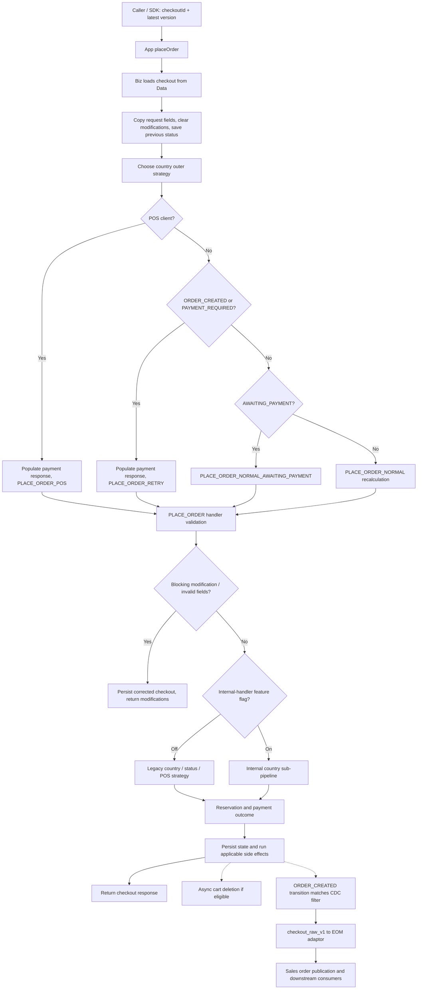
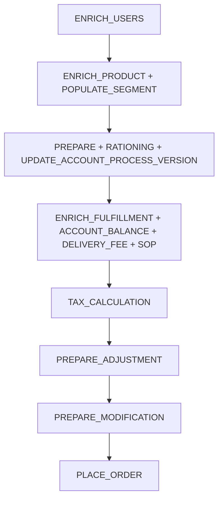

# mycheckout — Place Order — Complete Flow — Part 1

Source names are anonymized; original evidence dates and runtime limitations apply.

| Import record | Value |
|---|---|
| Source document | `PLACE-ORDER-FLOW.md` |
| Source SHA256 | `9ff8dcedefe9ba4f4d4d9170caba8c4e6dadf822f8ca8059a2655ef4f69854ab` |
| Guide part | 1 of 3 |

[Part 1](/mycheckout/place-order-flow/part-1) · [Part 2](/mycheckout/place-order-flow/part-2) · [Part 3](/mycheckout/place-order-flow/part-3)

## Place Order — Complete Flow {#place-order--complete-flow}

<a id="shared-86b945f0e1fb"></a>

Verified by static source inspection on **12 November 2026**. This document traces `POST /v1/checkouts/{checkoutId}/place-order` through status/country selection, recalculation, reservation, payment, checkout persistence, asynchronous payment finalization, and the sales-order handoff. It also covers the combined `POST /v1/orders` entry point.

<a id="shared-35c7f1bef8e3"></a>

**Result:** the API returns the checkout's current order/payment outcome. A normal placement can reach `ORDER_CREATED`; applicable payment-first flows can return `AWAITING_PAYMENT`; business modifications can require correction. The API response does not wait for EOM acceptance or the order-history projection. Read this after [Create Checkout — Complete Flow](/mycheckout/create-checkout-flow/part-1).

## Contents {#contents}

<a id="shared-dc85f2d00027"></a>

1. [Boundaries and contract](/mycheckout/place-order-flow/part-1#1-boundaries-and-contract)
2. [Overall flow diagram](/mycheckout/place-order-flow/part-1#2-overall-flow-diagram)
3. [Entry, state routing, and handler execution](/mycheckout/place-order-flow/part-1#3-entry-state-routing-and-handler-execution)
4. [Outer pipelines by market](/mycheckout/place-order-flow/part-1#4-outer-pipelines-by-market)
5. [Reservation and payment strategies](/mycheckout/place-order-flow/part-1#5-reservation-and-payment-strategies)
6. [Sequence diagrams](/mycheckout/place-order-flow/part-2#6-sequence-diagrams)
7. [State, persistence, and concurrency](/mycheckout/place-order-flow/part-2#7-state-persistence-and-concurrency)
8. [Asynchronous payment completion](/mycheckout/place-order-flow/part-2#8-asynchronous-payment-completion)
9. [After the response: sales-order handoff](/mycheckout/place-order-flow/part-2#9-after-the-response-sales-order-handoff)
10. [Combined create-order API](/mycheckout/place-order-flow/part-3#10-combined-create-order-api)
11. [Failures, retries, and troubleshooting](/mycheckout/place-order-flow/part-3#11-failures-retries-and-troubleshooting)
12. [Evidence and limits](/mycheckout/place-order-flow/part-3#12-evidence-and-limits)

## 1. Boundaries and contract {#1-boundaries-and-contract}

<a id="shared-cfdd2791bd3c"></a>

| Item | Detail |
|---|---|
| Public endpoint | `POST /comcheckoutas/v1/checkouts/{checkoutId}/place-order` |
| Operation ID | `placeOrder` |
| Request | `PlaceOrderRequest`; required schema property `version` |
| Minimal contract example | `{ "version": 1 }` — substitute the latest returned version |
| Optional app schema fields | `subscriptionSetId`, `durableEntries` with subscription-initiation flags |
| Context | Tenant, vertical, country, channel, language, authentication/anonymous context; biz also resolves origin IP |
| Success HTTP status | `200`, `CheckoutResponse` — check checkout status and modifications |
| Main synchronous services | Checkout app → checkout biz → fulfillment/payment dependencies → checkout data |
| Asynchronous boundary | Persisted checkout transition → DynamoDB CDC → `checkout_raw_v1` → EOM adaptor → sales-order publication |

<a id="shared-706e1ad4beed"></a>

The SDK thunk `placeOrderCheckoutSliceReq` calls `checkoutApi.placeOrder`. On fulfillment, its reducer replaces `state.checkout` and clears durable entries. That reducer alone does not prove payment or EOM success; response interpretation remains necessary. [P01] [P02]

<a id="shared-14f00d92ca53"></a>

The app controller delegates to `PlaceOrderServiceImpl` and maps the response. Do not assume the create-specific app `doAuthorization` method runs again on this endpoint. Deployment policies and downstream checks are separate boundaries; the data service's `getCheckoutById` includes an OPA validation on the parent checkout. [P03] [P15]

## 2. Overall flow diagram {#2-overall-flow-diagram}



<a id="shared-005a7c786040"></a>

This diagram separates the **outer flow selection** from the **inner place-order strategy**. They use different rules. A feature-flag path still has handler applicability/exclusions; the diagram describes the declared flow. [P04] [P05] [P06] [P07]

## 3. Entry, state routing, and handler execution {#3-entry-state-routing-and-handler-execution}

### 3.1 Connected call chain {#31-connected-call-chain}

```text
SDK placeOrderCheckoutSliceReq
  → checkoutApi.placeOrder
  → App PlaceOrderController.placeOrder
  → App PlaceOrderServiceImpl.placeOrder / business client
  → Biz PlaceOrderController.placeOrder
  → Biz PlaceOrderServiceImpl.placeOrder
  → CheckoutDataTierClient.getCheckoutByCheckoutId
  → forPlaceOrder().getStrategy(country)
  → HandlerExecutor.buildAndExecute(outer handlers, common request)
  → CheckoutPlaceOrderStepHandler.validate / execute
  → legacy strategy OR internal handler sub-pipeline
  → checkout update + applicable post-order work
  → response mapping → App → SDK
```

<a id="shared-e080af338994"></a>

Biz copies the request `version`, resolves `originIp`, and applies subscription-set/durable-entry subscription flags. It clears checkout modifications and sets `CheckoutCommonRequest.source = PLACE_ORDER`, preserving the previous status for side-effect decisions. Country comes from tuple context. [P03] [P04]

### 3.2 First matching outer route wins {#32-first-matching-outer-route-wins}

<a id="shared-e7df311eca65"></a>

| Priority | Loaded checkout condition | Chosen flow | Default declared stages |
|---|---|---|---|
| 1 | Client recognized as POS | `PLACE_ORDER_POS` | POS recalculation → PLACE_ORDER; payment populated before executor |
| 2 | `ORDER_CREATED` or `PAYMENT_REQUIRED` | `PLACE_ORDER_RETRY` | UPDATE_ACCOUNT_PROCESS_VERSION → PLACE_ORDER; payment populated first |
| 3 | `AWAITING_PAYMENT` | `PLACE_ORDER_NORMAL_AWAITING_PAYMENT` | PLACE_ORDER only |
| 4 | Other status, normally `CREATED` | `PLACE_ORDER_NORMAL` | Full country-specific recalculation → PLACE_ORDER |

<a id="shared-e8bd48df3401"></a>

These are selection rules, not a complete status validation whitelist. POS takes priority over loaded state in this method. `PAYMENT_REQUIRED` selects the outer retry flow, but the legacy inner factory selects a retry strategy only for `ORDER_CREATED`; do not merge those two conditions. [P04] [P06] [P08]

### 3.3 Executor behavior and placement gate {#33-executor-behavior-and-placement-gate}

<a id="shared-8d0ad73f6376"></a>

- Stages run sequentially with `Flux.concat`; handlers joined with `:` within a stage run concurrently with `Flux.merge`.
- Handler configuration can exclude a handler by classifications/client. `isApplicable` can also skip it; the base check consults metadata and a configured transition timeout.
- `call` runs validation before execution. The base `hasNoErrors` returns true; specialized handlers supply blocking rules.
- PLACE_ORDER validation clears child checkout errors, rejects a nonzero `NO_CHARGE` total, prepares/persists existing modifications, and optionally runs pre-sales-order field validation when **both** master data `preSalesOrderValidationEnable` and the field-validation feature flag enable it.
- PLACE_ORDER's `hasNoErrors` requires a checkout with no singular blocking `modification`. A validation response that does not supply an acceptable checkout prevents its execute step. [P05] [P07]

## 4. Outer pipelines by market {#4-outer-pipelines-by-market}

<a id="shared-b2764c76797a"></a>

Short names represent `CheckoutHandlerEnum` keys. `+` is a concurrent stage; arrows are sequential stages. Country strategy lookup uses exact country → tenant group → default. Mexico overrides LATAM; Thailand inherits the default outer lists. [P06] [P09] [P10] [P11] [P12]

### 4.1 Default / Thailand normal placement {#41-default--thailand-normal-placement}



<a id="shared-b2de370b9c84"></a>

This refresh is why checkout create and place order can calculate different totals: placement can re-evaluate products, restrictions, fulfillment, fees, and tax. Applicability/exclusions may reduce the work actually performed.

### 4.2 Japan normal placement {#42-japan-normal-placement}

```text
SHAREBAR
 → ENRICH_USERS
 → ACCOUNT_SEARCH
 → (ENRICH_PRODUCT + POPULATE_SEGMENT)
 → (PREPARE + RATIONING + UPDATE_ACCOUNT_PROCESS_VERSION)
 → (ENRICH_FULFILLMENT + ACCOUNT_BALANCE + DELIVERY_FEE + SOP)
 → VALIDATE_DELIVERY_SLOT
 → POPULATE_AMPOINTS
 → POPULATE_HANDLING_FEE
 → (TAX_CALCULATION + POPULATE_INVOICE_NUMBER)
 → PREPARE_ADJUSTMENT
 → PREPARE_MODIFICATION
 → PLACE_ORDER
```

### 4.3 LATAM and Mexico normal placement {#43-latam-and-mexico-normal-placement}

<a id="shared-56a6ea5f632a"></a>

| Strategy | Declared difference from default normal |
|---|---|
| LATAM | Adds `TAX_THRESHOLD_VALIDATION` after tax calculation. |
| Mexico | Uses its own normal list: default stages through adjustments → `RESERVE_PICKUP_LOCATION` → modifications → PLACE_ORDER. It does **not** include LATAM's tax-threshold handler in this normal place-order override. |

<a id="shared-6811b9e249d2"></a>

Mexico create-checkout still inherits LATAM's tax threshold validation; the two operations intentionally have different declared lists in the inspected code. Pickup availability during create and pickup reservation during placement are distinct handlers. [P10] [P11]

### 4.4 Specialized outer lists {#44-specialized-outer-lists}

<a id="shared-7f1fb7fd6ab4"></a>

| Flow | Default | Japan |
|---|---|---|
| POS | SEGMENT → (PREPARE + RATIONING + UPDATE_ACCOUNT_PROCESS_VERSION) → (DELIVERY_FEE + SOP) → ACCOUNT_BALANCE → TAX → ADJUSTMENT → MODIFICATION → PLACE_ORDER | SEGMENT → (PREPARE + RATIONING + UPDATE_ACCOUNT_PROCESS_VERSION) → DELIVERY_FEE → (TAX + INVOICE_NUMBER) → MODIFICATION → PLACE_ORDER |
| Retry | UPDATE_ACCOUNT_PROCESS_VERSION → PLACE_ORDER | Inherits default |
| Awaiting payment | PLACE_ORDER | Inherits default |
| `PLACE_ORDER_NORMAL_CHECKOUT_FAILED` | Normal recalculation ending in UPDATE_DB | Japan-specific recovery recalculation ending in UPDATE_DB |

The failure-recovery list is invoked by payment failure recovery, not selected as the normal entry route in `PlaceOrderServiceImpl.placeOrder`. [P04] [P06] [P09] [P13]

## 5. Reservation and payment strategies {#5-reservation-and-payment-strategies}

### 5.1 Two implementations behind PLACE_ORDER {#51-two-implementations-behind-place_order}

<a id="shared-ee36ffb934f5"></a>

The feature toggle is `CHECKOUT_PLACE_ORDER_INTERNAL_HANDLERS_SUPPORT` (configuration key `checkout.place.order.internal.handle.support.enable`). Its deployed value was not inspected. [P07] [P14]

<a id="shared-da346f9b817b"></a>

| Flag | Selection | Processing |
|---|---|---|
| Off | `PlaceOrderStrategyFactory.findStrategy(status, isPos, classifications, country)` | Country strategy factory, then POS unless WHT, else retry if `ORDER_CREATED`, else normal. |
| On | `InternalPlaceOrderStrategyFactory.findStrategy(country).getHandlers()` | Country/default internal stages; reservation/payment strategies further specialize by checkout/client context. |

**Default internal:** `(INVENTORY_RESERVATION + PAYMENT_PROCESSING)` → `CALCULATE_EARNED_AMPOINT` → `POST_PLACE_ORDER`.

**Japan internal:** `INVENTORY_RESERVATION` → `PAYMENT_PROCESSING` → `PREORDER_RESERVE` → `CALCULATE_EARNED_AMPOINT` → `POST_PLACE_ORDER`.

<a id="shared-4931a995212f"></a>

Default and JP implementations are registered. JP's earned-points handler skips its own calculation, relying on Japan's earlier points logic. PREORDER_RESERVE is an applicable-flow extension, not a reservation step for every order. [P17] [P18] [P19]

### 5.2 Default normal placement: concurrent reservation and payment {#52-default-normal-placement-concurrent-reservation-and-payment}

<a id="shared-8ba0870bddf3"></a>

`DefaultNormalPlaceOrderStrategy.placeOrder` creates reservation and payment Monos and combines them with `Mono.zip`. On a normal emitted result it sets `ORDER_CREATED`, attaches payment if present, populates reservation details, and calculates/prorates earned points. LATAM and Thailand normal legacy strategies inherit this implementation. [P20]

<a id="shared-8bf698716c4e"></a>

Existing payment ID selects payment retry; otherwise payment initiation is selected, and transactions are skipped when payment is not required. A returned payment object is not the same as verified capture. Default normal is a fix-forward path: its state decision must not be generalized into “every market creates an order only after successful capture.” Default internal payment processing also sets `ORDER_CREATED` on its normal emitted result. [P20] [P21]

### 5.3 Japan normal placement: reservation before payment {#53-japan-normal-placement-reservation-before-payment}

For a fresh Japan placement:

<a id="shared-046d8656ad8b"></a>

1. Obtain inventory reservations.
2. Validate the reservation result. Invalid reservations take `handleInvalidReservation`; payment does not run through the normal successful branch.
3. If payment is required, process payment and interpret its result.
4. If no money payment is required but points are applied, capture loyalty points; successful capture is required for that loyalty-only branch to set `ORDER_CREATED`.
5. For a zero-total order without that points capture requirement, set `ORDER_CREATED` and populate checkout details.

<a id="shared-85724132389c"></a>

For a checkout already in `AWAITING_PAYMENT`, Japan's normal strategy refreshes the payment response and handles its result using the existing reservation data rather than initiating a fresh normal reservation path. Japan internal payment processing has the equivalent awaiting-payment distinction and additional reservation/bypass guards. [P22] [P23]

### 5.4 Reservation contract and conditional bypass {#54-reservation-contract-and-conditional-bypass}

<a id="shared-08b1359efc85"></a>

`InventoryReservationServiceImpl` builds a reservation from the selected fulfillment allocation group and invokes `FulfillmentDataClient.createReservation` (the fulfillment reservations API). GCO uses its group reservation path; results are associated with checkout child IDs. [P24]

<a id="shared-5a96b327b649"></a>

Reservation is conditional. The service can bypass checks by inventory configuration, and otherwise requires suitable fulfillment options, warehouse, evaluated allocation, and applicable auto-SOP settings. Japan filters non-inventory and `FORCE_IN_STOCK` entries from the reservation payload. Thus an empty reservation result is not sufficient by itself to diagnose stock failure; inspect the checkout type and bypass rules. [P24]

<a id="shared-3ebadbc1fd2e"></a>

The inspected fulfillment client catches reservation-call exceptions, logs/records failure metrics, and returns `Optional.empty()`. It does **not** directly propagate every fulfillment `409` as an API `409`. Japan's reservation validation and modification logic interpret the result afterward. Reservation deletion also logs and suppresses client errors. [P25]

### 5.5 Japan payment result interpretation {#55-japan-payment-result-interpretation}

<a id="shared-553df211aa95"></a>

These transitions belong to `PaymentServiceImpl.handlePaymentResult` / `updateCheckoutStatusForPayment`, as used by the Japan paths. They are not universal default-strategy transitions. [P13] [P22] [P23]

<a id="shared-5cfedc003f6c"></a>

| Payment outcome | Checkout handling |
|---|---|
| `AUTHORIZED`, `AWAITED`, `CAPTURED` | Set `ORDER_CREATED`; populate checkout/reservation details. |
| `INITIATED` | Set `AWAITING_PAYMENT`. |
| Failed/null status | Move selections to history where applicable and enter failure handling. |
| Missing payment response | Create payment failure modification, with cleanup when required by the current state/reservation context. |
| Failure while awaiting payment | Execute recovery: restore `CREATED` and recalculate using failure handlers; do not publish as a newly created order. |

Cleanup and loyalty refund depend on state, inventory configuration, and reservation context. They are compensation calls across services, not a distributed rollback transaction.

<a id="shared-9a837f8c744e"></a>

p01 (local reference: `/D:/BE Projects/checkout/checkout/commerce-checkout-webcomponents-main/source/sdk/services/features/checkoutSlice.ts:292`)
p02 (local reference: `/D:/BE Projects/checkout/checkout/commerce-checkout-api/source/checkout-app-rest/v1/openapi-rest.yml:1400`)
p03 (local reference: `/D:/BE Projects/checkout/checkout/commerce-checkout-appservice/source/app/src/main/java/com/mycheckout/commerce/checkoutservice/app/service/impl/PlaceOrderServiceImpl.java:111`)
p04 (local reference: `/D:/BE Projects/checkout/checkout/commerce-checkout-bizservice/source/app/src/main/java/com/mycheckout/commerce/checkoutbizservice/app/service/checkout/impl/PlaceOrderServiceImpl.java:164`)
p05 (local reference: `/D:/BE Projects/checkout/checkout/commerce-checkout-bizservice/source/app/src/main/java/com/mycheckout/commerce/checkoutbizservice/app/handler/HandlerExecutor.java:39`)
p06 (local reference: `/D:/BE Projects/checkout/checkout/commerce-checkout-bizservice/source/app/src/main/java/com/mycheckout/commerce/checkoutbizservice/app/service/checkout/impl/tenant/DefaultPlaceOrderStepHandlerStrategy.java:63`)
p07 (local reference: `/D:/BE Projects/checkout/checkout/commerce-checkout-bizservice/source/app/src/main/java/com/mycheckout/commerce/checkoutbizservice/app/handler/impl/checkout/CheckoutPlaceOrderStepHandler.java:150`)
p08 (local reference: `/D:/BE Projects/checkout/checkout/commerce-checkout-bizservice/source/app/src/main/java/com/mycheckout/commerce/checkoutbizservice/app/service/checkout/PlaceOrderStrategyFactory.java:44`)
p09 (local reference: `/D:/BE Projects/checkout/checkout/commerce-checkout-bizservice/source/app/src/main/java/com/mycheckout/commerce/checkoutbizservice/app/service/checkout/impl/tenant/JapanPlaceOrderStepHandlerStrategy.java:59`)
p10 (local reference: `/D:/BE Projects/checkout/checkout/commerce-checkout-bizservice/source/app/src/main/java/com/mycheckout/commerce/checkoutbizservice/app/service/checkout/impl/tenant/LatamPlaceOrderStepHandlerStrategy.java:28`)
p11 (local reference: `/D:/BE Projects/checkout/checkout/commerce-checkout-bizservice/source/app/src/main/java/com/mycheckout/commerce/checkoutbizservice/app/service/checkout/impl/tenant/MexicoPlaceOrderStepHandlerStrategy.java:22`)
p12 (local reference: `/D:/BE Projects/checkout/checkout/commerce-checkout-bizservice/source/app/src/main/java/com/mycheckout/commerce/checkoutbizservice/app/service/checkout/impl/tenant/ThailandPlaceOrderStepHandlerStrategy.java:10`)
p13 (local reference: `/D:/BE Projects/checkout/checkout/commerce-checkout-bizservice/source/app/src/main/java/com/mycheckout/commerce/checkoutbizservice/app/service/payment/impl/PaymentServiceImpl.java:425`)
p14 (local reference: `/D:/BE Projects/checkout/checkout/commerce-checkout-bizservice/source/app/src/main/java/com/mycheckout/commerce/checkoutbizservice/app/service/feature/flag/enums/FeatureToggleKey.java:32`)
p15 (local reference: `/D:/BE Projects/checkout/checkout/commerce-checkout-dataservice/source/app/src/main/java/com/mycheckout/commerce/checkoutdataservice/app/service/impl/CheckoutServiceImpl.java:242`)
p16 (local reference: `/D:/BE Projects/checkout/checkout/commerce-checkout-dataservice/source/app/src/main/java/com/mycheckout/commerce/checkoutdataservice/app/service/impl/CheckoutServiceImpl.java:342`)
p17 (local reference: `/D:/BE Projects/checkout/checkout/commerce-checkout-bizservice/source/app/src/main/java/com/mycheckout/commerce/checkoutbizservice/app/service/placeorder/internal/impl/DefaultInternalPlaceOrderStrategy.java:18`)
p18 (local reference: `/D:/BE Projects/checkout/checkout/commerce-checkout-bizservice/source/app/src/main/java/com/mycheckout/commerce/checkoutbizservice/app/service/placeorder/internal/impl/JapanInternalPlaceOrderStrategy.java:17`)
p19 (local reference: `/D:/BE Projects/checkout/checkout/commerce-checkout-bizservice/source/app/src/main/java/com/mycheckout/commerce/checkoutbizservice/app/handler/impl/placeorder/CalculateEarnedAmpointsStepHandler.java:36`)
p20 (local reference: `/D:/BE Projects/checkout/checkout/commerce-checkout-bizservice/source/app/src/main/java/com/mycheckout/commerce/checkoutbizservice/app/service/checkout/impl/DefaultNormalPlaceOrderStrategy.java:74`)
p21 (local reference: `/D:/BE Projects/checkout/checkout/commerce-checkout-bizservice/source/app/src/main/java/com/mycheckout/commerce/checkoutbizservice/app/service/placeorder/payment/impl/DefaultPaymentProcessingStrategy.java:53`)
p22 (local reference: `/D:/BE Projects/checkout/checkout/commerce-checkout-bizservice/source/app/src/main/java/com/mycheckout/commerce/checkoutbizservice/app/service/checkout/impl/JapanNormalPlaceOrderStrategy.java:83`)
p23 (local reference: `/D:/BE Projects/checkout/checkout/commerce-checkout-bizservice/source/app/src/main/java/com/mycheckout/commerce/checkoutbizservice/app/service/placeorder/payment/impl/JapanPaymentProcessingStrategy.java:70`)
p24 (local reference: `/D:/BE Projects/checkout/checkout/commerce-checkout-bizservice/source/app/src/main/java/com/mycheckout/commerce/checkoutbizservice/app/service/fulfillment/impl/InventoryReservationServiceImpl.java:121`)
p25 (local reference: `/D:/BE Projects/checkout/checkout/commerce-checkout-bizservice/source/app/src/main/java/com/mycheckout/commerce/checkoutbizservice/app/service/fulfillment/client/FulfillmentDataClient.java:101`)
p26 (local reference: `/D:/BE Projects/checkout/checkout/commerce-checkout-bizservice/source/app/src/main/java/com/mycheckout/commerce/checkoutbizservice/app/handler/impl/placeorder/PostPlaceOrderHandler.java:135`)
p27 (local reference: `/D:/BE Projects/checkout/checkout/commerce-checkout-eomadaptorservice/source/app/src/main/java/com/mycheckout/commerce/checkoutadaptorservice/service/impl/SalesOrderPaymentsServiceImpl.java:29`)
p28 (local reference: `/D:/BE Projects/checkout/checkout/commerce-checkout-eomadaptorservice/source/app/src/main/java/com/mycheckout/commerce/checkoutadaptorservice/consumer/SalesOrderPaymentsEventConsumer.java:42`)
p29 (local reference: `/D:/BE Projects/checkout/checkout/commerce-checkout-dataservice/infra-as-code/cdk/app-infra/configs/tenants-common.yaml:96`)
p30 (local reference: `/D:/BE Projects/checkout/checkout/commerce-checkout-eomadaptorservice/source/app/src/main/java/com/mycheckout/commerce/checkoutadaptorservice/consumer/CheckoutEventConsumer.java:68`)
p31 (local reference: `/D:/BE Projects/checkout/checkout/commerce-checkout-eomadaptorservice/source/app/src/main/java/com/mycheckout/commerce/checkoutadaptorservice/service/impl/SalesOrderServiceImpl.java:167`)
p32 (local reference: `/D:/BE Projects/checkout/checkout/commerce-checkout-eomadaptorservice/infra-as-code/cdk/app-infra/configs/tenants-common.yaml:71`)
p33 (local reference: `/D:/BE Projects/checkout/checkout/commerce-checkout-bizservice/source/app/src/main/java/com/mycheckout/commerce/checkoutbizservice/app/handler/impl/checkout/CheckoutCreateDbStepHandler.java:36`)

## Official References

Platform documentation explains the underlying technologies; project behavior remains grounded in the source evidence above.

- [AWS service documentation](https://docs.aws.amazon.com/)
- [Apache Kafka documentation](https://kafka.apache.org/documentation/)
- [Quarkus guides](https://quarkus.io/guides/)
