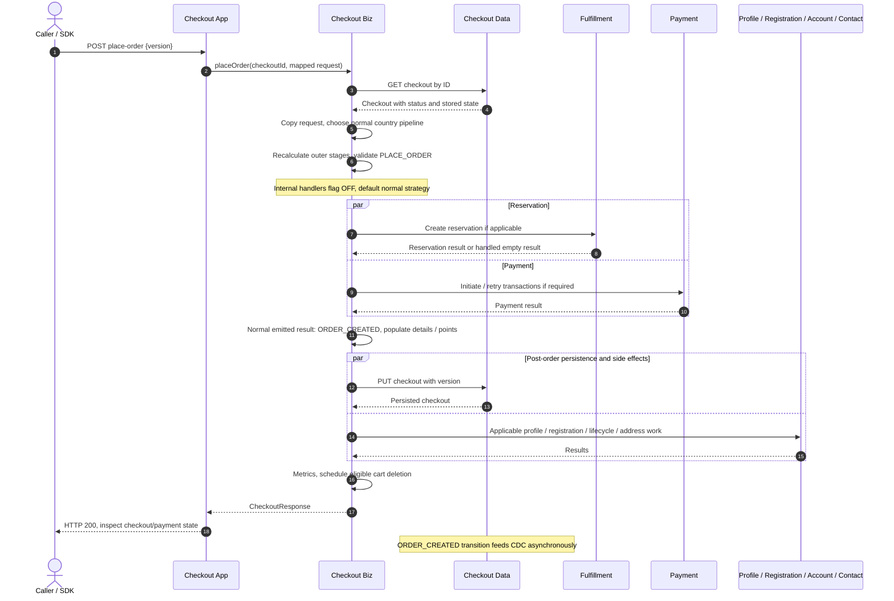
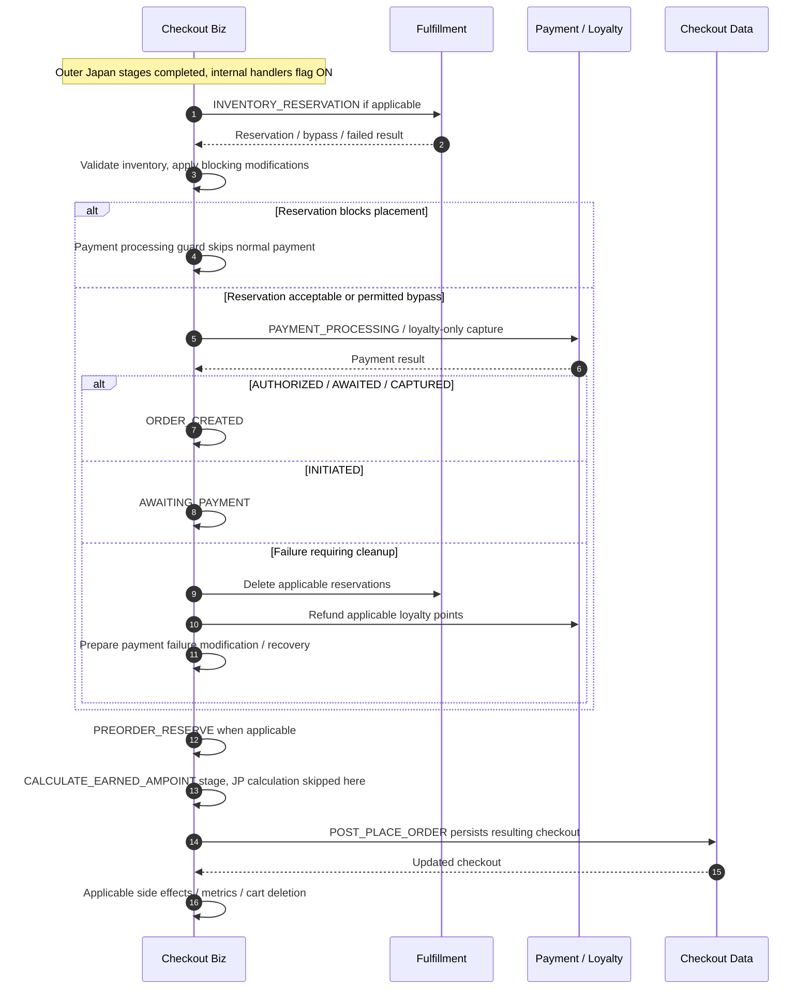
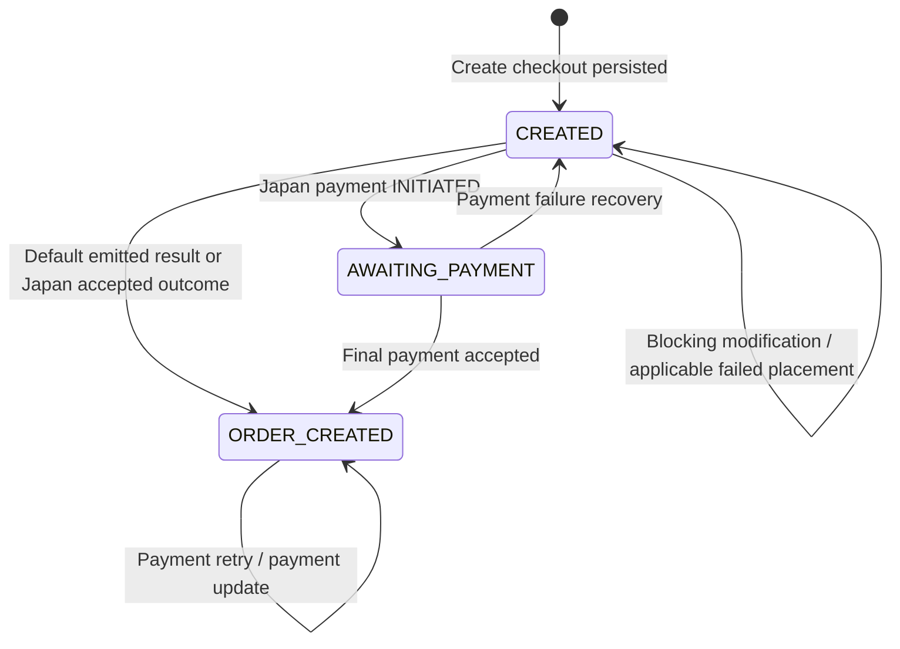
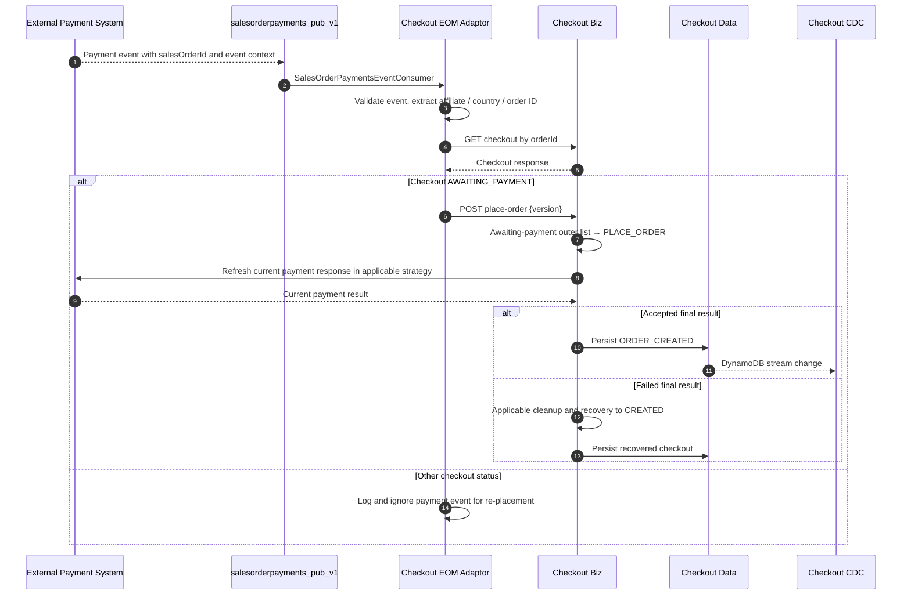
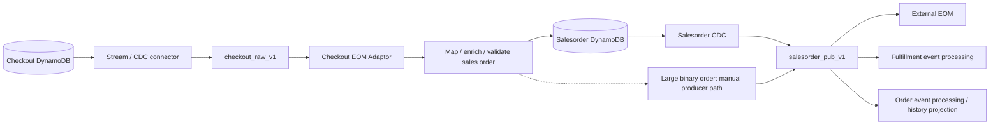
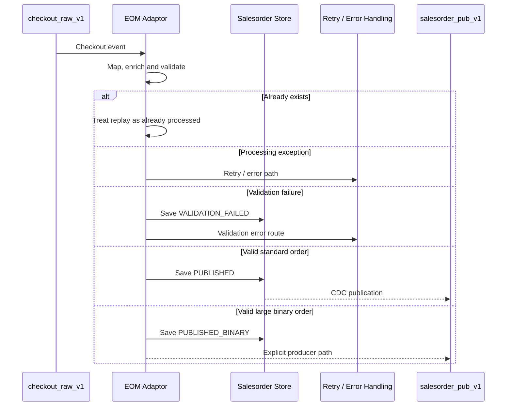

# mycheckout — Place Order — Complete Flow — Part 2

Source names are anonymized; original evidence dates and runtime limitations apply.

| Import record | Value |
|---|---|
| Source document | `PLACE-ORDER-FLOW.md` |
| Source SHA256 | `9ff8dcedefe9ba4f4d4d9170caba8c4e6dadf822f8ca8059a2655ef4f69854ab` |
| Guide part | 2 of 3 |

[Part 1](/mycheckout/place-order-flow/part-1) · [Part 2](/mycheckout/place-order-flow/part-2) · [Part 3](/mycheckout/place-order-flow/part-3)

## 6. Sequence diagrams {#6-sequence-diagrams}

### 6.1 Default legacy normal placement {#61-default-legacy-normal-placement}

This sequence is an emitted happy path. A swallowed reservation error may appear as an empty result; an unhandled reactive error ends the composed operation. Concurrent external actions have no common transaction. [P07] [P20] [P25]

### 6.2 Japan internal placement with payment branches {#62-japan-internal-placement-with-payment-branches}

Only applicable handlers execute. The PREORDER extension and zero-total/loyalty paths have their own guards; this diagram focuses on the principal reservation/payment outcomes. [P18] [P19] [P23] [P26]

## 7. State, persistence, and concurrency {#7-state-persistence-and-concurrency}

### 7.1 State model {#71-state-model}

`PAYMENT_REQUIRED` is also recognized as a loaded status by the outer retry selector. This diagram does not assign its origin to a universal branch; POS and specialized payment modes require their own strategy context. Payment status and checkout status must be inspected independently. [P04] [P13]

### 7.2 Post-placement work {#72-post-placement-work}

Legacy `executePlaceOrder` and internal `PostPlaceOrderHandler` implement corresponding post-order work. [P07] [P26]

| Action | Guard / behavior |
|---|---|
| Prepare persisted order | For `ORDER_CREATED`, append selected payment entries to `paymentHistory`, clear selections, clear `fulfillmentOptions`, retain supplied version. |
| Persist checkout | Direct data update for `ORDER_CREATED`; otherwise common-service update with modifications. |
| Checkout profile | Update on applicable first transitions; excludes DIGITAL/BOOKING/POS and configured clients; profile failures are logged/ignored. |
| Registration/account process | Patch applicable process checkout status and update renewal/upgrade/downgrade lifecycle when applicable. |
| Shipping address | Create address for registration when required. |
| Metrics | Initial-placement metrics versus retry count based on previous state. |
| Cart cleanup | Asynchronous and conditional; excludes Japan POS, SYSTEM/auto-SOP, and dummy account-process/registration carts. |

Persistence and profile/registration/account/address calls are combined with `Mono.zip`. They do not share a database transaction: a later error can coexist with a completed earlier external effect or checkout write. Cart deletion is not awaited as part of durable order creation. For cart-eligibility logic, inspect previous **and** resulting status rather than only the existence of an order ID.

### 7.3 Data-service writes and ID behavior {#73-data-service-writes-and-id-behavior}

The data service populates missing order/request identifiers, sets order timestamp when entering `ORDER_CREATED` if absent, and populates mycheckout periods. For `AWAITING_PAYMENT` it clears selected payment methods. It builds one or more DynamoDB entities and uses a single-row update or transactional multi-row update. The logical checkout may occupy multiple physical rows. [P15]

`checkoutId` identifies checkout storage; `childId` identifies child context; `orderId` is used in payment/events and can predate placement. A reservation ID, payment ID, and payment reference ID identify different external resources. Never substitute one for another in incident tracing.

### 7.4 Optimistic locking and actual conflict recovery {#74-optimistic-locking-and-actual-conflict-recovery}

The request carries a version and the repository enforces versioned updates. The data service catches `ResourceVersionMismatchException`, reloads the stored checkout, and evaluates `forceUpdateCheckout`. Current source allows the following retry-with-current-version cases: [P16]

| Stored state | Incoming state | Conflict recovery |
|---|---|---|
| `CREATED` | `ORDER_CREATED` or `AWAITING_PAYMENT` | Copy DB version to input checkouts and retry update. |
| `AWAITING_PAYMENT` | `ORDER_CREATED`, `AWAITING_PAYMENT`, or `CREATED` | Copy DB version and retry update. |
| Other combinations | Any | Return stored checkout unchanged through this recovery method. |

This is broader than the older system guide's `CREATED → ORDER_CREATED` description. A stale request is therefore not guaranteed to produce an HTTP conflict. Always inspect the returned status/version and do not assume the incoming state won.

The create idempotency key is not a blanket exactly-once guarantee for place order. Repeated requests may enter payment retry/finalization logic, and handler timeout skipping is a recalculation control rather than a transactional lock.

## 8. Asynchronous payment completion {#8-asynchronous-payment-completion}

`SalesOrderPaymentsServiceImpl` validates event/entity/eventInfo/salesOrderId, loads checkout by the event's sales-order ID, and calls biz placement only for `AWAITING_PAYMENT`, with the returned checkout version. It does not itself convert every incoming event directly to `ORDER_CREATED`; placement refreshes/interprets payment through the selected strategy. Missing checkout is logged. [P27] [P28]

Duplicate payment-event delivery after the checkout has moved out of `AWAITING_PAYMENT` does not initiate placement through this particular consumer path. This state guard is not an exactly-once event-delivery guarantee.

## 9. After the response: sales-order handoff {#9-after-the-response-sales-order-handoff}

### 9.1 Publication boundary {#91-publication-boundary}

The checkout request does not synchronously call EOM to submit a sales order. The data-tier connector is configured to match a new image with `Status = ORDER_CREATED` and an old image whose status is not `ORDER_CREATED`. A later write that remains `ORDER_CREATED` does not match that transition filter. Topic names include environment/tenant prefixes. [P29]

This filter expresses the intended transition trigger, **not exactly-once publication or delivery**. Connector retries/replays and direct inserts without an old image need separate operational consideration. No claim about a direct `ORDER_CREATED` insert matching the filter was tested.

### 9.2 Adaptor processing and publication {#92-adaptor-processing-and-publication}

`CheckoutEventConsumer.readCheckoutEvent` delegates checkout processing to the sales-order service, treats `ResourceAlreadyExistException` as an already-processed case, and handles processing errors through its retry/error path. The sales-order service maps/enriches/validates the record and assigns publication or validation-failure state. [P30] [P31]

- Valid normal-sized order: save a sales-order record with `PUBLISHED`; the sales-order connector publishes records with `PUBLISHED` or `REPUBLISHED`.
- Validation failure: preserve `VALIDATION_FAILED` and route through the service's error handling; this is distinct from a successfully published order.
- Large/binary payload: `PUBLISHED_BINARY` storage and explicit producer handling avoid relying on the normal CDC publication path for that binary record. [P31] [P32]

### 9.3 Downstream effects and completion levels {#93-downstream-effects-and-completion-levels}

| Completion point | What it establishes |
|---|---|
| Place-order HTTP response | Checkout state/result returned by checkout services. |
| Checkout saved as `ORDER_CREATED` | Durable checkout transition, subject to the actual write result. |
| Checkout event processed by adaptor | Sales-order mapping/validation/storage outcome. |
| `salesorder_pub_v1` published | Sales-order event available to consumers; not proof of EOM acceptance. |
| EOM / fulfillment / order-history consumers complete | Further external processing and eventually visible order/inventory state. |

The existing [System Guide](/mycheckout/end-to-end-system/part-1) and [Fulfillment End-to-End](/mycheckout/fulfillment-docs/fulfillment-end-to-end/part-1) describe downstream fulfillment stock adjustment/release and order-event S3/history processing. Those downstream internals were **not re-traced in full for these two documents**. The arrows to those consumers describe the referenced architecture; EOM's internal acceptance/fulfillment behavior is outside this workspace. Exact retry counts, binding schedules, topic prefixes, and environment settings should be read from the target environment configuration rather than assumed from an example.

See the [shared definition](/mycheckout/place-order-flow/part-1#shared-9a837f8c744e).

## Official References

Platform documentation explains the underlying technologies; project behavior remains grounded in the source evidence above.

- [AWS service documentation](https://docs.aws.amazon.com/)
- [Apache Kafka documentation](https://kafka.apache.org/documentation/)
- [Quarkus guides](https://quarkus.io/guides/)
