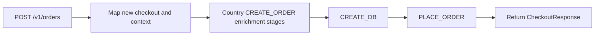

# mycheckout — Place Order — Complete Flow — Part 3

Source names are anonymized; original evidence dates and runtime limitations apply.

| Import record | Value |
|---|---|
| Source document | `PLACE-ORDER-FLOW.md` |
| Source SHA256 | `9ff8dcedefe9ba4f4d4d9170caba8c4e6dadf822f8ca8059a2655ef4f69854ab` |
| Guide part | 3 of 3 |

[Part 1](/mycheckout/place-order-flow/part-1) · [Part 2](/mycheckout/place-order-flow/part-2) · [Part 3](/mycheckout/place-order-flow/part-3)

## 10. Combined create-order API {#10-combined-create-order-api}

<a id="shared-8c5ea3e49afa"></a>

`POST /v1/orders` uses `PlaceOrderServiceImpl.createOrder` and `PlaceOrderFlow.CREATE_ORDER`. It accepts a create-order body, maps a new checkout, builds common context with fulfillment/payment/loyalty details, resolves origin IP, chooses the place-order country strategy, and executes a combined pipeline. It does not first invoke the public create-checkout API. [P02] [P04]



Default combined stages:

```text
ENRICH_USERS → ENRICH_PRODUCT → POPULATE_SEGMENT
 → (PREPARE + RATIONING)
 → (ENRICH_FULFILLMENT + ACCOUNT_BALANCE + DELIVERY_FEE + SOP)
 → PREPARE_MODIFICATION → TAX_CALCULATION → PREPARE_ADJUSTMENT
 → CREATE_DB → PLACE_ORDER
```

<a id="shared-9aab8a20f42f"></a>

Product and segment are separate sequential stages here, whereas normal place order puts them in one parallel stage. Japan adds delivery-slot validation, points, handling fee, and invoice-number calculation in its declared combined sequence. CREATE_DB sets the persisted checkout into the common request before PLACE_ORDER. If placement fails after CREATE_DB, a saved checkout can remain; the combined endpoint is not one atomic cross-service transaction. [P06] [P09] [P33]

## 11. Failures, retries, and troubleshooting {#11-failures-retries-and-troubleshooting}

### 11.1 Material failure paths {#111-material-failure-paths}

<a id="shared-f06ae34b7dee"></a>

| Condition | Actual handling / practical implication |
|---|---|
| Missing/unreadable checkout | Data lookup fails or cannot produce the expected record; outer pipeline cannot proceed normally. |
| Business modification before placement | PLACE_ORDER validation updates/returns checkout instead of executing placement. HTTP `200` alone does not establish placement. |
| Nonzero NO_CHARGE total | Throws `NoChargeOrderException`. |
| Pre-sales-order field errors | Validation is gated by master data and flag; errors can prevent PLACE_ORDER execution. |
| Reservation client exception | Converted to empty optional at the client; selected strategy/validation decides the outcome. Do not expect universal HTTP `409` propagation. |
| Default normal emitted payment result | Uses fix-forward `ORDER_CREATED` behavior; inspect payment state separately. |
| Japan initiated payment | Returns/persists `AWAITING_PAYMENT`; payment event may resume placement later. |
| Japan failed payment | Applicable reservation cleanup, points refund and modifications; awaiting-payment failures have a recovery pipeline. |
| Cleanup failure | Reservation deletion client logs and suppresses errors; investigate orphaned reservations separately. |
| Concurrent checkout change | Version-recovery matrix in section 7.4 can retry or return stored state. |
| Post-write side-effect failure | Parallel operations can partially complete; a request error does not prove that no order checkout was saved. |
| CDC/adaptor failure after response | Investigate connector, raw event, retry/error routes, sales-order state and publication; the original response does not wait for those stages. |

### 11.2 Incident trace checklist {#112-incident-trace-checklist}

<a id="shared-7f8917eb33dd"></a>

1. Correlate checkout ID, order ID, parent/child ID, version, country, channel, client name, payment/ref IDs and reservation ID.
2. Read the durable checkout status and payment state; distinguish `CREATED`, `AWAITING_PAYMENT`, `ORDER_CREATED` and loaded `PAYMENT_REQUIRED`.
3. Determine the selected outer flow, effective handler exclusions/applicability, and internal-handler flag value.
4. Find the last completed outer stage and PLACE_ORDER validation result; check singular and list modifications.
5. For reservation issues, inspect bypass/warehouse/allocation conditions before interpreting an empty reservation response.
6. For payment issues, identify default fix-forward versus Japan result-driven processing and initiation versus retry/finalization.
7. Confirm the data write result and version-recovery behavior before retrying based only on an HTTP error.
8. After `ORDER_CREATED`, follow checkout CDC → `checkout_raw_v1` → adaptor → sales-order record → publication → downstream consumer.

### 11.3 Verification scenarios {#113-verification-scenarios}

<a id="shared-5135fb694136"></a>

These are recommended scenarios, not executed tests: default normal placement; repeated placement of an existing order; `PAYMENT_REQUIRED` outer routing; POS and POS+WHT routing; internal flag on/off; Japan valid/invalid/bypassed reservation; zero-total and loyalty-only checkout; payment INITIATED then accepted event; payment INITIATED then failed event; duplicate payment event; version-conflict matrix; group checkout; Mexico pickup failure; excluded handlers; failed cart deletion; adaptor replay, validation failure, and large-order publication.

## 12. Evidence and limits {#12-evidence-and-limits}

<a id="shared-d2cc89f74012"></a>

**Directly checked:** app contract/controller/service, SDK entry and reducer, biz place/create-order orchestration, outer country lists, executor/base-handler/placement validation, legacy default/Japan strategies and factory, internal lists and payment strategies, reservation service/client, payment result handling, post-placement work, data update/version recovery, payment-event consumer/service, checkout-event consumer, sales-order publication branches, and CDC filter declarations.

<a id="shared-adf94e616918"></a>

**Reference docs:** [End-to-End System Guide](/mycheckout/end-to-end-system/part-1), Checkout Chat History (local reference: `checkout-chat-history-2026-10-21.md`), [Fulfillment End-to-End](/mycheckout/fulfillment-docs/fulfillment-end-to-end/part-1). Current code takes precedence. In particular, this document uses the broader current version-recovery rules and avoids treating the CDC filter as an exactly-once guarantee.

<a id="shared-d0b46109f0a8"></a>

**Limits:** static inspection only; no service build, live order/payment/reservation/API invocation, CDC execution or external transaction. Deployed flags/master data, exact external payment/provider behavior, EOM internals, and downstream history/inventory processing beyond the documented handoff were not established. Source links below are tied to the current local checkout and may move after code changes.

### Source index {#source-index}

<!-- SOURCE_INDEX -->

<a id="shared-9093ee25df32"></a>

| Ref | Source and verified starting line |
|---|---|
| P01 | [SDK place-order thunk and fulfilled reducer][P01] |
| P02 | [App place-order contract; createOrder contract and schemas in same file][P02] |
| P03 | [App mapping, origin IP, business-client call and response][P03] |
| P04 | [State routing, request fields, createOrder and result assembly][P04] |
| P05 | [Sequential stages, parallel handlers, exclusions][P05] |
| P06 | [Default place-order, retry, POS, recovery and combined lists][P06] |
| P07 | [Flag branch, legacy post-order work and validation gate][P07] |
| P08 | [Inner legacy factory status/POS/WHT rules][P08] |
| P09 | [Japan outer normal, POS, recovery and combined lists][P09] |
| P10 | [LATAM tax-threshold stages][P10] |
| P11 | [Mexico pickup reservation override][P11] |
| P12 | [Thailand default outer inheritance][P12] |
| P13 | [Payment results, cleanup guards, recovery and status mapping][P13] |
| P14 | [Internal-handler feature-toggle key and fallback][P14] |
| P15 | [Data update, awaiting-payment handling, timestamps and periods][P15] |
| P16 | [Actual force-update/version-recovery matrix][P16] |
| P17 | [Default internal concurrent reservation/payment stage][P17] |
| P18 | [Japan internal sequential stages][P18] |
| P19 | [JP early return in internal earned-points calculation][P19] |
| P20 | [Legacy default parallel reservation/payment and fix-forward result][P20] |
| P21 | [Internal default normal/retry payment behavior][P21] |
| P22 | [Legacy Japan reservation validation and awaiting-payment handling][P22] |
| P23 | [Internal Japan payment, bypass guards and loyalty-only flow][P23] |
| P24 | [Reservation construction, bypass and item filtering][P24] |
| P25 | [Reservation client errors become empty; deletion errors suppressed][P25] |
| P26 | [Internal post-placement persistence and side effects][P26] |
| P27 | [Payment event validation and conditional place-order invocation][P27] |
| P28 | [Payment-event consumer][P28] |
| P29 | [Checkout ORDER_CREATED transition CDC filter][P29] |
| P30 | [Checkout event, duplicate handling and RLQ/DLQ branches][P30] |
| P31 | [Sales-order mapping, validation, save and binary publication branches][P31] |
| P32 | [Salesorder PUBLISHED/REPUBLISHED connector filter][P32] |
| P33 | [CREATE_DB and request checkout replacement][P33] |

Additional handoff and specialization evidence:

See the [shared definition](/mycheckout/create-checkout-flow/part-2#shared-926831e8b982).

p01 (local reference: `/D:/BE Projects/checkout/checkout/commerce-checkout-webcomponents-main/source/sdk/services/features/checkoutSlice.ts:292`)

p02 (local reference: `/D:/BE Projects/checkout/checkout/commerce-checkout-api/source/checkout-app-rest/v1/openapi-rest.yml:1400`)

<a id="shared-a7cf349fde2f"></a>

p03 (local reference: `/D:/BE Projects/checkout/checkout/commerce-checkout-appservice/source/app/src/main/java/com/mycheckout/commerce/checkoutservice/app/service/impl/PlaceOrderServiceImpl.java:111`)

<a id="shared-e8d9f7a31a7e"></a>

p04 (local reference: `/D:/BE Projects/checkout/checkout/commerce-checkout-bizservice/source/app/src/main/java/com/mycheckout/commerce/checkoutbizservice/app/service/checkout/impl/PlaceOrderServiceImpl.java:164`)

<a id="shared-4c55b3aee35d"></a>

p05 (local reference: `/D:/BE Projects/checkout/checkout/commerce-checkout-bizservice/source/app/src/main/java/com/mycheckout/commerce/checkoutbizservice/app/handler/HandlerExecutor.java:39`)

<a id="shared-95de03754390"></a>

p06 (local reference: `/D:/BE Projects/checkout/checkout/commerce-checkout-bizservice/source/app/src/main/java/com/mycheckout/commerce/checkoutbizservice/app/service/checkout/impl/tenant/DefaultPlaceOrderStepHandlerStrategy.java:63`)

<a id="shared-4b38a75e8015"></a>

p07 (local reference: `/D:/BE Projects/checkout/checkout/commerce-checkout-bizservice/source/app/src/main/java/com/mycheckout/commerce/checkoutbizservice/app/handler/impl/checkout/CheckoutPlaceOrderStepHandler.java:150`)

<a id="shared-1db9a8dbfcd9"></a>

p08 (local reference: `/D:/BE Projects/checkout/checkout/commerce-checkout-bizservice/source/app/src/main/java/com/mycheckout/commerce/checkoutbizservice/app/service/checkout/PlaceOrderStrategyFactory.java:44`)

<a id="shared-5f42f032349d"></a>

p09 (local reference: `/D:/BE Projects/checkout/checkout/commerce-checkout-bizservice/source/app/src/main/java/com/mycheckout/commerce/checkoutbizservice/app/service/checkout/impl/tenant/JapanPlaceOrderStepHandlerStrategy.java:59`)

<a id="shared-63c2e2360429"></a>

p10 (local reference: `/D:/BE Projects/checkout/checkout/commerce-checkout-bizservice/source/app/src/main/java/com/mycheckout/commerce/checkoutbizservice/app/service/checkout/impl/tenant/LatamPlaceOrderStepHandlerStrategy.java:28`)

<a id="shared-b0c6ed8c9bba"></a>

p11 (local reference: `/D:/BE Projects/checkout/checkout/commerce-checkout-bizservice/source/app/src/main/java/com/mycheckout/commerce/checkoutbizservice/app/service/checkout/impl/tenant/MexicoPlaceOrderStepHandlerStrategy.java:22`)

<a id="shared-b1c91c6f8379"></a>

p12 (local reference: `/D:/BE Projects/checkout/checkout/commerce-checkout-bizservice/source/app/src/main/java/com/mycheckout/commerce/checkoutbizservice/app/service/checkout/impl/tenant/ThailandPlaceOrderStepHandlerStrategy.java:10`)

<a id="shared-8a633ddb4bca"></a>

p13 (local reference: `/D:/BE Projects/checkout/checkout/commerce-checkout-bizservice/source/app/src/main/java/com/mycheckout/commerce/checkoutbizservice/app/service/payment/impl/PaymentServiceImpl.java:425`)

<a id="shared-be7c58b41e2f"></a>

p14 (local reference: `/D:/BE Projects/checkout/checkout/commerce-checkout-bizservice/source/app/src/main/java/com/mycheckout/commerce/checkoutbizservice/app/service/feature/flag/enums/FeatureToggleKey.java:32`)

<a id="shared-abbdaa059ce9"></a>

p15 (local reference: `/D:/BE Projects/checkout/checkout/commerce-checkout-dataservice/source/app/src/main/java/com/mycheckout/commerce/checkoutdataservice/app/service/impl/CheckoutServiceImpl.java:242`)

<a id="shared-5043c858235c"></a>

p16 (local reference: `/D:/BE Projects/checkout/checkout/commerce-checkout-dataservice/source/app/src/main/java/com/mycheckout/commerce/checkoutdataservice/app/service/impl/CheckoutServiceImpl.java:342`)

<a id="shared-44bb56483b68"></a>

p17 (local reference: `/D:/BE Projects/checkout/checkout/commerce-checkout-bizservice/source/app/src/main/java/com/mycheckout/commerce/checkoutbizservice/app/service/placeorder/internal/impl/DefaultInternalPlaceOrderStrategy.java:18`)

<a id="shared-7bd7c01839c9"></a>

p18 (local reference: `/D:/BE Projects/checkout/checkout/commerce-checkout-bizservice/source/app/src/main/java/com/mycheckout/commerce/checkoutbizservice/app/service/placeorder/internal/impl/JapanInternalPlaceOrderStrategy.java:17`)

<a id="shared-bd2740175136"></a>

p19 (local reference: `/D:/BE Projects/checkout/checkout/commerce-checkout-bizservice/source/app/src/main/java/com/mycheckout/commerce/checkoutbizservice/app/handler/impl/placeorder/CalculateEarnedAmpointsStepHandler.java:36`)

<a id="shared-7229fb0bf6ed"></a>

p20 (local reference: `/D:/BE Projects/checkout/checkout/commerce-checkout-bizservice/source/app/src/main/java/com/mycheckout/commerce/checkoutbizservice/app/service/checkout/impl/DefaultNormalPlaceOrderStrategy.java:74`)

<a id="shared-195a6948cd21"></a>

p21 (local reference: `/D:/BE Projects/checkout/checkout/commerce-checkout-bizservice/source/app/src/main/java/com/mycheckout/commerce/checkoutbizservice/app/service/placeorder/payment/impl/DefaultPaymentProcessingStrategy.java:53`)

<a id="shared-4657d9dd2041"></a>

p22 (local reference: `/D:/BE Projects/checkout/checkout/commerce-checkout-bizservice/source/app/src/main/java/com/mycheckout/commerce/checkoutbizservice/app/service/checkout/impl/JapanNormalPlaceOrderStrategy.java:83`)

<a id="shared-2f70a2bb69ec"></a>

p23 (local reference: `/D:/BE Projects/checkout/checkout/commerce-checkout-bizservice/source/app/src/main/java/com/mycheckout/commerce/checkoutbizservice/app/service/placeorder/payment/impl/JapanPaymentProcessingStrategy.java:70`)

<a id="shared-d32a0d4721fc"></a>

p24 (local reference: `/D:/BE Projects/checkout/checkout/commerce-checkout-bizservice/source/app/src/main/java/com/mycheckout/commerce/checkoutbizservice/app/service/fulfillment/impl/InventoryReservationServiceImpl.java:121`)

<a id="shared-8d4c46a50733"></a>

p25 (local reference: `/D:/BE Projects/checkout/checkout/commerce-checkout-bizservice/source/app/src/main/java/com/mycheckout/commerce/checkoutbizservice/app/service/fulfillment/client/FulfillmentDataClient.java:101`)

<a id="shared-05bd9bb7f315"></a>

p26 (local reference: `/D:/BE Projects/checkout/checkout/commerce-checkout-bizservice/source/app/src/main/java/com/mycheckout/commerce/checkoutbizservice/app/handler/impl/placeorder/PostPlaceOrderHandler.java:135`)

<a id="shared-5defb50d9cc0"></a>

p27 (local reference: `/D:/BE Projects/checkout/checkout/commerce-checkout-eomadaptorservice/source/app/src/main/java/com/mycheckout/commerce/checkoutadaptorservice/service/impl/SalesOrderPaymentsServiceImpl.java:29`)

<a id="shared-4cd9d4460cc9"></a>

p28 (local reference: `/D:/BE Projects/checkout/checkout/commerce-checkout-eomadaptorservice/source/app/src/main/java/com/mycheckout/commerce/checkoutadaptorservice/consumer/SalesOrderPaymentsEventConsumer.java:42`)

p29 (local reference: `/D:/BE Projects/checkout/checkout/commerce-checkout-dataservice/infra-as-code/cdk/app-infra/configs/tenants-common.yaml:96`)

<a id="shared-36634008a691"></a>

p30 (local reference: `/D:/BE Projects/checkout/checkout/commerce-checkout-eomadaptorservice/source/app/src/main/java/com/mycheckout/commerce/checkoutadaptorservice/consumer/CheckoutEventConsumer.java:68`)

<a id="shared-fc095918cb2c"></a>

p31 (local reference: `/D:/BE Projects/checkout/checkout/commerce-checkout-eomadaptorservice/source/app/src/main/java/com/mycheckout/commerce/checkoutadaptorservice/service/impl/SalesOrderServiceImpl.java:167`)

p32 (local reference: `/D:/BE Projects/checkout/checkout/commerce-checkout-eomadaptorservice/infra-as-code/cdk/app-infra/configs/tenants-common.yaml:71`)

<a id="shared-6281366f60ce"></a>

p33 (local reference: `/D:/BE Projects/checkout/checkout/commerce-checkout-bizservice/source/app/src/main/java/com/mycheckout/commerce/checkoutbizservice/app/handler/impl/checkout/CheckoutCreateDbStepHandler.java:36`)

## Official References

Platform documentation explains the underlying technologies; project behavior remains grounded in the source evidence above.

- [AWS service documentation](https://docs.aws.amazon.com/)
- [Apache Kafka documentation](https://kafka.apache.org/documentation/)
- [Quarkus guides](https://quarkus.io/guides/)
