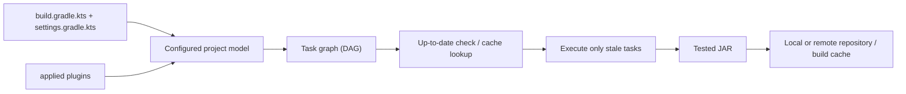

# Gradle Overview: Build Scripts, Tasks, Dependencies, And Wrapper

Gradle is a build-automation tool for JVM (and polyglot) projects built around a
**task graph** rather than a fixed lifecycle of phases. A build script (Groovy
`build.gradle` or Kotlin `build.gradle.kts`) declares a project's plugins,
dependencies, and tasks; Gradle resolves that script against the task graph of
every requested target and executes only the tasks actually needed.

## What Problem Does Gradle Solve?

Without a build tool, every project invents scripts for compiling source,
downloading libraries, running tests, packaging JARs, and publishing artifacts.
Gradle standardizes those operations the same way Maven does, but optimizes for
**incremental, cacheable execution**:

- a programmable build script instead of a fixed declarative model;
- a directed acyclic task graph instead of a linear lifecycle;
- incremental builds that skip tasks whose inputs/outputs have not changed;
- a build cache (local and remote) that can reuse another machine's task output;
- multi-project builds addressed by path (`:order-service:test`);
- plugins that contribute conventions and tasks (the Java plugin, Spring Boot's
  Gradle plugin, and so on).

Gradle makes builds fast through caching, but reproducibility still requires a
pinned wrapper version, locked dependency versions, and build logic that does
not depend on machine-specific state.

## Core Mental Model



| Term | Meaning |
|---|---|
| project | one buildable unit, described by a `build.gradle(.kts)` |
| settings script | `settings.gradle(.kts)`; declares which projects belong to the build |
| task | one unit of work (compile, test, jar) with declared inputs/outputs |
| task graph | the DAG of task dependencies Gradle computes before executing anything |
| configuration | a named bucket of dependencies, such as `implementation` or `testImplementation` |
| plugin | build extension providing conventions, tasks, and configurations |
| build cache | storage keyed by task inputs that lets Gradle skip re-running identical work |
| wrapper | `gradlew`/`gradlew.bat` plus metadata pinning the exact Gradle version for a build |

## Standard Project Layout

```text
project/
├── settings.gradle.kts
├── build.gradle.kts
├── gradle/wrapper/gradle-wrapper.properties
├── gradlew, gradlew.bat
├── src/main/java/          application source
├── src/main/resources/     runtime resources
├── src/test/java/          test source
├── src/test/resources/     test resources
└── build/                  generated build output
```

The `src/main`/`src/test` convention matches Maven's; `target/` becomes
`build/`, and a multi-project build adds a `settings.gradle.kts` that is not
optional the way a Maven aggregator POM's `<modules>` list is — without it,
subdirectories are not part of the build at all.

## A Minimal Build Script

```kotlin
// build.gradle.kts
plugins {
    java
    id("org.springframework.boot") version "3.5.0"
}

group = "com.shopverse"
version = "1.0.0-SNAPSHOT"

java {
    toolchain {
        languageVersion = JavaLanguageVersion.of(21)
    }
}

repositories {
    mavenCentral()
}

dependencies {
    implementation("org.springframework.boot:spring-boot-starter-web")
    testImplementation("org.junit.jupiter:junit-jupiter:5.12.2")
}

tasks.test {
    useJUnitPlatform()
}
```

Coordinates (`group`/`version`) identify the project the same way Maven's
`groupId:artifactId:version` do, but configuration (`implementation`,
`testImplementation`) replaces Maven's dependency `<scope>`, and tasks are
configured directly in the script rather than bound through plugin
`<executions>`.

## Tasks, Not Phases

Gradle has no fixed lifecycle of phases the way Maven does. Instead, the
**Java plugin** contributes a conventional task graph (`compileJava`,
`processResources`, `test`, `jar`, `assemble`, `check`, `build`), and tasks
declare their own dependencies on each other:

```text
build
 └─ check
     └─ test
         └─ compileTestJava
             └─ compileJava
 └─ assemble
     └─ jar
         └─ compileJava
```

Running `./gradlew build` runs every task `build` transitively depends on,
in dependency order — conceptually similar to Maven's `mvn verify` reaching
every earlier phase, but the dependency graph is explicit and
project-specific rather than a fixed, universal sequence.

<ExpandableAnswer title="Dry run: ./gradlew clean build">

1. Gradle reads `settings.gradle.kts` to determine which projects exist, then
   evaluates each project's `build.gradle.kts` to configure its model.
2. `clean` deletes the `build/` directory's tracked outputs.
3. Gradle computes the task graph required to produce `build`'s declared
   dependencies (compile, test, jar, assemble, check).
4. For each task, Gradle checks whether its inputs/outputs are unchanged
   since the last run (and, if a build cache is configured, whether another
   execution already produced the same output) before deciding whether to
   skip it as up-to-date or execute it.
5. A successful build leaves the packaged artifact and reports under
   `build/`; nothing is published anywhere because no publishing task was
   requested.

</ExpandableAnswer>

## Dependencies And Repositories

Gradle resolves direct and transitive dependencies through declared
**configurations**. `implementation` dependencies are on the compile and
runtime classpath but hidden from consumers of this project as a
dependency; `api` dependencies (Java Library plugin) are exposed
transitively to consumers — the central decision Maven does not force
explicitly, since Maven's `compile` scope is always transitive. Conflicting
transitive versions are resolved to the highest requested version by
default (not "nearest wins" as in Maven); inspect the resolved graph rather
than assuming which input dependency actually wins.

## Essential Commands

```bash
./gradlew --version
./gradlew clean build
./gradlew test
./gradlew :order-service:test
./gradlew dependencies
./gradlew :order-service:dependencies --configuration runtimeClasspath
./gradlew build --scan
./gradlew dependencyUpdates
```

| Command | Purpose |
|---|---|
| `clean build` | clean and run compile, test, and assembly |
| `:project:task` | run one task in one project of a multi-project build |
| `dependencies` | display the resolved dependency graph for a project |
| `--scan` | publish a build scan with timing, cache, and dependency detail |
| `--offline` | resolve only from already-cached dependencies |
| `-x test` | exclude a task (and everything that only exists to feed it) |
| `--parallel` | build independent projects in a multi-project build concurrently |

## Common Mistakes

- confusing `implementation` and `api` and leaking internal dependencies to
  every consumer transitively;
- assuming `clean` repairs a stale configuration-cache or dependency
  resolution problem;
- deleting the entire Gradle cache (`~/.gradle/caches`) before inspecting
  the actual resolution failure;
- declaring dependency versions inconsistently across subprojects instead
  of using a version catalog;
- depending on undeclared transitive libraries that happen to be present
  on the classpath today;
- letting local developer builds and CI use different Gradle versions
  because the wrapper was not committed or was edited by hand.

## Official References

- [Gradle User Manual](https://docs.gradle.org/current/userguide/userguide.html)
- [Build lifecycle](https://docs.gradle.org/current/userguide/build_lifecycle.html)
- [The Java plugin](https://docs.gradle.org/current/userguide/java_plugin.html)
- [Dependency management basics](https://docs.gradle.org/current/userguide/dependency_management_terminology.html)
- [The Gradle Wrapper](https://docs.gradle.org/current/userguide/gradle_wrapper.html)

## Recommended Next

Continue with the [Gradle Engineering Learning Path](./GRADLE-ENGINEERING-PATH.md).
