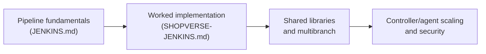

# Jenkins Architect Path

Jenkins mastery beyond "write a Jenkinsfile" means reusing pipeline logic
across many repositories without duplicating it, routing many branches and
pull requests through the right pipeline automatically, and keeping a
controller/agent fleet available and secure as the number of jobs grows.

## At-A-Glance Topics

| Area | Why it matters |
|---|---|
| Declarative Pipeline blocks | the vocabulary every other topic on this path builds on |
| shared libraries (`vars/`, `src/`) | turns copy-pasted pipeline logic into one reviewed, versioned dependency |
| multibranch pipelines | routes every branch/PR through the correct `Jenkinsfile` without manual job creation |
| agent provisioning and labels | separates "a pipeline is slow" from "there is no capacity to run it" |
| plugin and credential trust boundary | a Jenkins controller is a high-value target; unreviewed plugins and global credentials widen the blast radius |

## Complete Route

1. [Jenkins Fundamentals](./JENKINS.md) — Declarative Pipeline blocks, credentials, reuse principles.
2. [Shopverse Jenkins Implementation](./SHOPVERSE-JENKINS.md) — a complete worked pipeline building, testing, and deploying real services.
3. [Shared Libraries And Multibranch Pipelines](./jenkins/JENKINS-SHARED-LIBRARIES-MULTIBRANCH.md) — reusing pipeline logic across repositories and routing branches/PRs automatically.
4. [Scaling, Security, And Operations](./jenkins/JENKINS-SCALING-SECURITY-OPERATIONS.md) — agent provisioning at scale, controller HA, plugin/credential trust boundaries, incident runbooks.

## Completion Standard

You are ready when you can explain why a shared-library change is a
blast-radius risk and not just a convenience, configure a multibranch
pipeline so a feature branch and `main` run different stages without
duplicating the `Jenkinsfile`, size agent capacity from executor/queue
evidence rather than guesswork, and reason about why a Jenkins controller's
plugin list and global credentials are a security boundary, not
implementation detail.

## Official References

- [Jenkins Pipeline documentation](https://www.jenkins.io/doc/book/pipeline/)
- [Jenkins Shared Libraries documentation](https://www.jenkins.io/doc/book/pipeline/shared-libraries/)
- [Jenkins security documentation](https://www.jenkins.io/doc/book/security/)

## Recommended Next

Begin with [Jenkins Fundamentals](./JENKINS.md) if you have not already, then
continue with [Shared Libraries And Multibranch Pipelines](./jenkins/JENKINS-SHARED-LIBRARIES-MULTIBRANCH.md).
