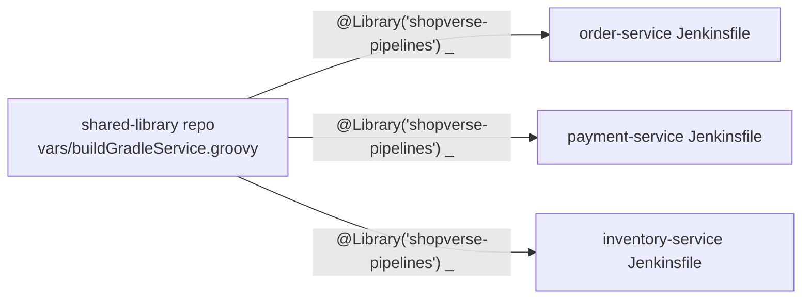

# Jenkins Shared Libraries And Multibranch Pipelines

A **shared library** is a separate, version-controlled Groovy repository
that every consuming `Jenkinsfile` imports instead of each repository
re-implementing its own version of the same pipeline logic. A
**multibranch pipeline** is a job type that automatically discovers
branches and pull requests in a repository and runs whichever
`Jenkinsfile` exists on that branch, instead of a human creating one job
per branch by hand.

## Page Overview

This page covers: shared-library structure and import syntax, writing a
reusable step, versioning and testing a shared library, multibranch
pipeline configuration and branch-conditional behavior, and the failure
mode unique to centralizing pipeline logic — a single bad shared-library
change breaking every consuming pipeline at once.

## Prerequisites

- [Jenkins Fundamentals](../JENKINS.md) — Declarative Pipeline blocks,
  credentials handling.
- [Shopverse Jenkins Implementation](../SHOPVERSE-JENKINS.md) — a worked
  pipeline this page's reuse patterns would extract logic from.

## Core Terminology

- **`vars/`**: shared-library directory holding one Groovy file per
  global pipeline step; the filename becomes the step name callable from
  any `Jenkinsfile`.
- **`src/`**: shared-library directory holding ordinary Groovy classes
  (helpers, not directly callable as pipeline steps) under a package
  structure, imported with a normal `import` statement.
- **`@Library('name') _`**: the annotation a consuming `Jenkinsfile` uses
  to import a shared library by its configured name; the trailing `_` is
  required when the file has no other top-level statement to attach the
  annotation to.
- **Multibranch pipeline**: a Jenkins job type that scans a repository's
  branches/PRs and creates one sub-job per branch automatically, each
  running that branch's own `Jenkinsfile`.

## Mental Model



One shared-library file now backs every service's build stage. This is the
point of the pattern — and, read the other direction, the risk: one
change to `vars/buildGradleService.groovy` changes behavior for every
repository on the diagram simultaneously, without any of those
repositories' own code or history changing.

## First Working Example

A shared-library step that wraps the Gradle build-and-test logic already
duplicated across the Order/User/Discovery `Jenkinsfile`s referenced in
[Shopverse Jenkins Implementation](../SHOPVERSE-JENKINS.md):

```groovy title="vars/buildGradleService.groovy"
def call(String serviceDir, Map opts = [:]) {
    def javaVersion = opts.javaVersion ?: '21'
    dir(serviceDir) {
        sh "./gradlew test --no-daemon -Dorg.gradle.java.home=/opt/java/${javaVersion}"
        junit allowEmptyResults: true,
                testResults: 'build/test-results/test/*.xml'
    }
}
```

```groovy title="consuming Jenkinsfile"
@Library('shopverse-pipelines') _

pipeline {
    agent any
    stages {
        stage('Build And Test') {
            steps {
                buildGradleService('order-service')
            }
        }
    }
}
```

`call` is the convention Jenkins looks for: a `vars/<name>.groovy` file's
`call` method is what runs when a `Jenkinsfile` invokes `<name>(...)` as a
step. The `opts` map gives callers an extension point without forcing
every call site to pass every parameter.

## Example Progression

A class under `src/` for logic too complex for a single `vars/` step —
for example, resolving which services changed in a monorepo-style push so
only affected services rebuild:

```groovy title="src/org/shopverse/ChangedServices.groovy"
package org.shopverse

class ChangedServices {
    static List<String> detect(def script, List<String> allServices) {
        def changedFiles = script.sh(
            script: 'git diff --name-only HEAD~1 HEAD',
            returnStdout: true
        ).trim().split('\n')

        return allServices.findAll { service ->
            changedFiles.any { it.startsWith("${service}/") }
        }
    }
}
```

```groovy title="consuming Jenkinsfile"
@Library('shopverse-pipelines') _
import org.shopverse.ChangedServices

def services = ChangedServices.detect(this, ['order-service', 'payment-service'])
```

Passing `this` (the running pipeline's script context) into the static
method is required because `src/` classes do not automatically have
access to pipeline steps like `sh` the way `vars/` steps do.

## How It Works

Jenkins resolves a shared library at pipeline start, before the rest of
the `Jenkinsfile` runs: it checks out the library's configured Git
reference (a branch, tag, or commit), compiles its Groovy sources, and
makes `vars/` steps and `src/` classes available for the remainder of that
pipeline run. A **global** shared library (configured once at the
controller level) is available to every pipeline without any per-job
setup; a **folder-level** library is scoped to jobs inside one folder.

## Internal Lifecycle Or Algorithm

```text
Pipeline starts
  -> Jenkins reads @Library annotation(s)
     -> checks out the referenced library Git ref
        -> compiles vars/*.groovy and src/**/*.groovy
           -> injects vars/ files as callable global steps
           -> makes src/ classes importable
  -> rest of the Jenkinsfile executes with those steps/classes available
```

## Boundaries And Trade-Offs

- A shared library removes duplication but adds a cross-repository
  dependency: every consuming pipeline now depends on a repository it
  does not own, reviewed by a team the consuming service's team may not
  control.
- Pinning every `@Library` call to a fixed tag (`@Library('shopverse-pipelines@v3')`)
  trades automatic improvement propagation for predictability — a
  deliberate choice, not a default to skip.
- `vars/` steps are simpler to write but cannot hold complex state or
  object-oriented structure the way `src/` classes can; mixing both in one
  library is normal, not a sign of inconsistent design.

## Failure Modes, Edge Cases, And Common Mistakes

- **A shared-library change breaks every consuming pipeline
  simultaneously.** This is the defining failure mode of centralizing
  pipeline logic: unlike a bug in one service's own `Jenkinsfile`, which
  affects only that service, an untested change to `vars/buildGradleService.groovy`
  can fail every service's build stage in the same run. Treat shared
  libraries as a dependency with its own test suite and versioning policy,
  not as "just a Groovy file."
- **Unpinned `@Library` references.** `@Library('shopverse-pipelines')`
  without a version floats to the library's default branch; a work-in-
  progress commit to that branch affects every running pipeline
  immediately, including ones that started before the change landed.
- **Multibranch pipeline running an unexpected `Jenkinsfile`.** A
  multibranch job runs whichever `Jenkinsfile` exists on *that specific
  branch* — a pull request from a fork that modifies the `Jenkinsfile`
  itself can therefore change what commands run during its own CI check,
  which is why multibranch pipelines for public/fork-friendly repositories
  typically require approval before building PRs from forks.
- **Branch-conditional stages left untested on the branch they gate.**
  `when { branch 'main' }` logic is easy to write and never exercise until
  the first real merge to `main`; validate it on a short-lived branch
  named `main`-like in a sandbox job, not for the first time in production.

## Production And Diagnostic Guidance

- Give the shared-library repository its own CI pipeline that tests
  `vars/` steps and `src/` classes (Jenkins Pipeline Unit Testing
  framework or an equivalent harness) before any consuming pipeline can
  pull a broken version.
- Version shared libraries with tags, and let consuming teams opt into a
  new version deliberately rather than inheriting the latest commit on
  every run.
- Configure multibranch pipelines to require approval for pull requests
  from forks or unknown contributors before building them, since the PR
  branch's own `Jenkinsfile` is what executes.

```groovy
stage('Deploy') {
    when {
        branch 'main'
    }
    steps {
        // only runs on the main branch job created by the multibranch scan
    }
}
```

## Tricky Interview Questions

**A shared library's `vars/deployService.groovy` was updated, and five
unrelated services' pipelines started failing within the hour, with no
code change in any of those five repositories. What happened, and how do
you prevent recurrence?** The shared library was referenced unpinned
(`@Library('name')` with no version), so every consuming pipeline picked
up the new, broken version on its next run. Prevent recurrence by pinning
consuming pipelines to a tagged version and requiring the library's own
test suite to pass before a new tag is cut.

**Why does a `src/` class need the pipeline's `this` context passed in
explicitly to call `sh`, while a `vars/` step does not?** A `vars/` step's
`call` method runs directly inside the pipeline's own CPS (Groovy
Continuation-Passing-Style) execution context, so pipeline steps like `sh`
are already in scope. An ordinary `src/` class is a plain Groovy object
outside that context, so it has no implicit access to pipeline steps
unless the calling pipeline's script object is passed in explicitly.

**A multibranch pipeline builds every pull request automatically,
including ones from external forks. What is the actual security concern,
and what is the standard mitigation?** The PR's own branch supplies the
`Jenkinsfile` that runs — an external contributor can submit a PR whose
`Jenkinsfile` executes arbitrary commands with the Jenkins controller's
build-agent credentials and network access. The standard mitigation is
requiring a maintainer to approve (or trigger) builds from unknown
contributors before Jenkins executes their branch's pipeline.

## Summary / Review Checklist

- `vars/<name>.groovy`'s `call` method becomes a global pipeline step
  named `<name>`; `src/` holds ordinary Groovy classes needing explicit
  pipeline-context access.
- Pin `@Library` references to a tested, tagged version in production
  pipelines — an unpinned reference means every consuming pipeline
  inherits the library's next commit automatically.
- A multibranch pipeline runs whichever `Jenkinsfile` exists on the
  branch being built, which is why fork/PR builds need an approval gate.
- Centralizing pipeline logic trades duplication for blast radius: test
  and version the shared library like any other dependency.

## Recommended Next

Continue with [Scaling, Security, And Operations](./JENKINS-SCALING-SECURITY-OPERATIONS.md).

## Official References

- [Jenkins Shared Libraries](https://www.jenkins.io/doc/book/pipeline/shared-libraries/)
- [Jenkins Multibranch Pipeline](https://www.jenkins.io/doc/book/pipeline/multibranch/)
- [Jenkins Pipeline Unit testing framework](https://github.com/jenkinsci/JenkinsPipelineUnit)
