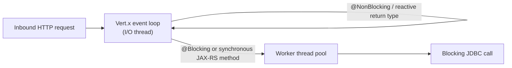

# Quarkus Production Scaling, Thread Model, And Incident Response

Quarkus's fast-startup model is a build-time investment: a large share of the
work a traditional Spring Boot application does at runtime (classpath
scanning, bean-definition resolution) is pushed to build time instead. That
trade produces fast cold starts, but it also means a class of configuration
and failure questions a lead engineer must answer that do not map cleanly
onto a runtime-everything framework.

## 1. Build-Time Versus Runtime Configuration

Every Quarkus configuration property has a **fixed phase**: `BUILD_TIME`
properties are baked into the generated application/native image and cannot
be overridden afterward; `RUNTIME` properties can still be changed per
environment (an environment variable, a mounted `application.properties`, a
Kubernetes `ConfigMap`) without rebuilding the image.

```properties
# BUILD_TIME — fixed once the artifact is built; changing this
# requires a rebuild even though it looks like ordinary configuration.
quarkus.datasource.db-kind=postgresql

# RUNTIME — safely overridable per environment via env var,
# QUARKUS_DATASOURCE_JDBC_URL, without rebuilding the image.
quarkus.datasource.jdbc.url=${DATASOURCE_URL}
```

```java
@ConfigMapping(prefix = "checkout")
public interface CheckoutConfig {
    int reservationTtlSeconds();      // runtime-overridable by default
}
```

The practical failure this causes: a team ships one container image across
`staging` and `production` and expects an environment variable to flip a
build-time property (a datasource kind, certain native-image feature flags,
some extension-level toggles) — it silently has no effect, because the
value was already compiled into the artifact. Treat "is this property
build-time or runtime?" as a question to verify from `quarkus-build-time-run-time-fixed-properties.html`
(linked below) before promising an environment-specific override, not an
assumption.

## 2. Thread Model: Event Loop Versus Worker Threads



Quarkus's HTTP layer runs on a small, fixed-size pool of **event-loop**
(Vert.x I/O) threads. A method is dispatched there by default unless it is
explicitly `@Blocking`, returns a blocking type doing synchronous I/O, or
Quarkus infers blocking behavior from the return type and extension in use.
Running blocking JDBC/file I/O directly on an event-loop thread stalls that
thread for every other request multiplexed onto it — a small number of
slow blocking calls on the event loop can stall far more concurrent
requests than the same calls would on a dedicated worker thread, because
event-loop threads are shared across many in-flight requests, not
one-per-request.

```java
@GET
@Path("/{orderId}")
@Blocking                       // explicit: this method does blocking JDBC work
public OrderResponse find(@PathParam("orderId") String orderId) {
    return orderRepository.findById(orderId);   // synchronous Hibernate call
}
```

```java
@GET
@Path("/{orderId}/status")
public Uni<OrderStatus> status(@PathParam("orderId") String orderId) {
    return reactiveOrderRepository.findStatus(orderId);  // Mutiny, non-blocking
}
```

Mutiny's `Uni`/`Multi` types let a method stay on the event loop for
genuinely non-blocking I/O (a reactive datasource driver, a reactive HTTP
client). Mixing the two models in one call chain without the correct
`@Blocking`/`@RunOnVirtualThread` annotation is the most common
Quarkus-specific concurrency bug: code that looks asynchronous but
silently blocks the event loop underneath a reactive-looking signature.

## 3. Resource And Pool Sizing For Fast Startup

Fast startup changes an operational assumption many teams carry over from
JVM-heavy frameworks: a Quarkus instance can be ready to receive traffic
within a few hundred milliseconds of container start, which means an Auto
Scaling / Kubernetes HPA scale-out event can add real capacity-consuming
instances far faster than the downstream database or dependency can absorb
new connections.

```text
new instance count x configured JDBC pool size per instance
  <= downstream database's safe total connection budget
```

Size `quarkus.datasource.jdbc.max-size` (and any outbound REST-client
connection pool) as a *per-instance share* of a database-wide budget, the
same discipline required for Spring/Hibernate pools elsewhere on this site
— but verify it under Quarkus's actual scale-out speed, not an assumption
carried over from a framework that takes 10-30 seconds to become ready.

## 4. Health Checks Wired To Kubernetes Probes

SmallRye Health exposes `/q/health/live`, `/q/health/ready`, and
`/q/health/started`, each backed by application-registered checks:

```java
@Liveness
@ApplicationScoped
public class DatabaseLivenessCheck implements HealthCheck {
    @Override
    public HealthCheckResponse call() {
        return isProcessIrrecoverable()
            ? HealthCheckResponse.down("database-connection-pool-exhausted")
            : HealthCheckResponse.up("database-connection-pool");
    }
}

@Readiness
@ApplicationScoped
public class DependencyReadinessCheck implements HealthCheck {
    @Override
    public HealthCheckResponse call() {
        return paymentGateway.isReachable()
            ? HealthCheckResponse.up("payment-gateway")
            : HealthCheckResponse.down("payment-gateway");
    }
}
```

```yaml
livenessProbe:
  httpGet: {path: /q/health/live, port: 8080}
readinessProbe:
  httpGet: {path: /q/health/ready, port: 8080}
startupProbe:
  httpGet: {path: /q/health/started, port: 8080}
  failureThreshold: 30
  periodSeconds: 2
```

A liveness check that calls out to a downstream dependency repeats the
mistake flagged in the integration/observability page (readiness depending
on every downstream ping): a liveness check failing because of a transient
downstream outage causes Kubernetes to restart instances that were never
actually broken, worsening the outage instead of isolating it. Liveness
should answer "is this process itself unrecoverable," not "is everything
this process calls currently healthy."

## 5. Scaling-Under-Load Incident Scenarios

**Startup storm during a rapid scale-out.** An HPA event launches 15 new
instances in response to a traffic spike; each becomes ready within
roughly a second (fast startup) and immediately opens its full configured
JDBC pool against the database. The database's connection budget, sized
for the previous steady-state instance count, is exhausted within seconds
— not because any single instance misbehaved, but because fast,
simultaneous readiness removed the natural staggering that slower-starting
frameworks provide for free. Diagnose by correlating database connection
count against pod-ready timestamps, not against request volume alone; fix
by either sizing the database connection budget for peak instance count or
adding a connection-acquisition backoff/ramp on startup.

**Thread pool exhaustion under burst traffic.** A burst of requests hits
an endpoint that performs blocking JDBC work without `@Blocking`, or whose
worker-thread pool is undersized relative to burst concurrency. Symptoms:
request latency climbs sharply while CPU utilization stays moderate
(threads are waiting, not computing) and the event loop itself may show
elevated latency for unrelated non-blocking endpoints sharing the same
process. Diagnose with a thread dump captured during the incident, not
after recovery; fix by correcting the blocking/non-blocking classification
of the offending endpoint and sizing the worker pool from measured
concurrency, not a default.

## 6. Diagnostic Tooling

- `quarkus.log.level`/category-level overrides at runtime (a `RUNTIME`
  property) without rebuilding, for live incident triage.
- JVM mode retains full thread-dump (`jstack`/`jcmd Thread.print`), heap
  dump, and JFR capability; native-image mode trades this away for faster
  startup — confirm which mode is running before promising a JVM-style
  diagnostic capture during an incident.
- `/q/health`, `/q/metrics` (Micrometer/OpenTelemetry), and distributed
  traces remain the first evidence source; a native-image incident without
  JFR/heap-dump access leans more heavily on these signals than a JVM-mode
  incident would.

## Official References

- [Quarkus Configuration Reference: build time vs. runtime](https://quarkus.io/guides/config-reference)
- [Quarkus Reactive Architecture: event loop and worker threads](https://quarkus.io/guides/quarkus-reactive-architecture)
- [SmallRye Health](https://quarkus.io/guides/smallrye-health)
- [Mutiny Reactive Types](https://quarkus.io/guides/mutiny-primer)

## Recommended Next

Continue with [Spring Boot Comparison, Interview Scenarios, And Revision](./QUARKUS-INTERVIEW-REVISION.md).
