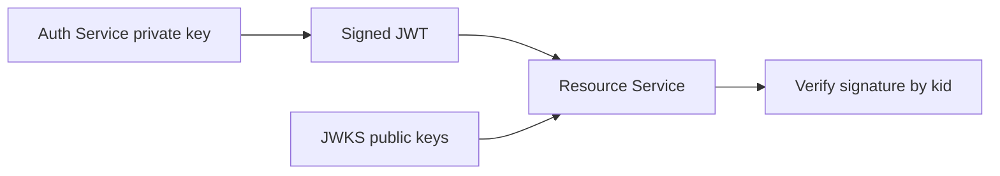

# JWKS And Asymmetric JWT

Asymmetric JWT signing uses a private key to sign tokens and a public key to
verify them.



## Why Asymmetric Signing

| Benefit | Explanation |
|---|---|
| private key stays in auth service | resource services only need public keys |
| safer distribution | public keys can be shared widely |
| rotation support (when implemented) | `kid` selects the active verification key — see Shopverse's current gap below |
| decentralized verification | services validate tokens without calling auth service each request |

## JWKS

JWKS means JSON Web Key Set. It exposes public verification keys:

```json
{
  "keys": [
    {
      "kty": "RSA",
      "kid": "shopverse-key-1",
      "use": "sig",
      "alg": "RS256",
      "n": "...",
      "e": "AQAB"
    }
  ]
}
```

Resource services cache keys and select the right key by `kid`.

## Shopverse Reality: Rotation Support Is Not Actually Wired

The "rotation support" row above describes what the `kid` mechanism makes
*possible* — it is not describing Shopverse's current behavior. Both the
signing side and the publishing side always build exactly **one** key,
with a hard-coded `kid`:

```java
// auth-service JwtConfig — the only key ever built
JWK jwk = new RSAKey.Builder(rsaKeys.publicKey())
        .privateKey(rsaKeys.privateKey())
        .keyID("key-1")
        .build();
```

```java
// AuthController's /.well-known/jwks.json — always publishes that one key
JWKSet jwkSet = new JWKSet(rsaKey.toPublicJWK());
```

Rotating the signing key today means replacing the configured key pair
outright: the moment that happens, the JWKS endpoint stops publishing the
*old* public key, so every token already issued and signed under it
becomes unverifiable mid-lifetime — a hard cutover, not a rotation. A real
rotation needs the JWKS endpoint to publish **multiple** `JWKSet` entries
with distinct `kid` values during the overlap window (old key kept
published until its last issued token expires, new key used for signing
going forward), which the current single-`RSAKey`-bean design doesn't
support without code changes. This is a real, currently open gap — see
[ADR 003's Consequences](../../architecture/adr/003-jwt-jwks-security.md#consequences)
for the full writeup — not a theoretical edge case.

## Related Guides

- [JWT fundamentals](JWT-FUNDAMENTALS.md)
- [JWT best practices](JWT-BEST-PRACTICES.md)
- [ADR 003: RSA-Signed JWT And JWKS Authentication](../../architecture/adr/003-jwt-jwks-security.md)
- [Shopverse JWT implementation](../JWT-OAUTH2-SPRING-SECURITY.md)

